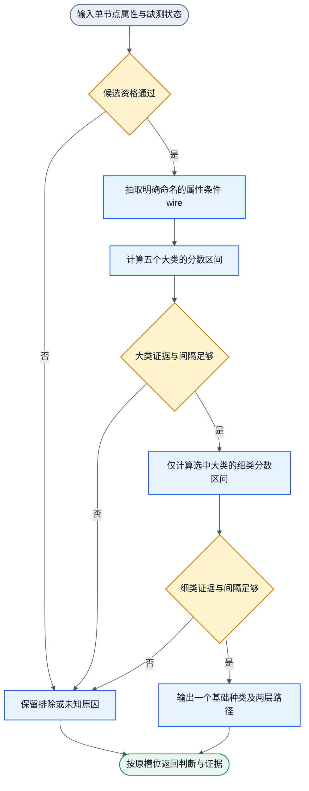

# DOM 基础种类分层连线

状态：候选内容，实施中复核（candidate under verification）。本文描述本轮 wire、profile 与标签合同；旧黄金、来源留出和真实页面回归完成前，不表示新增权重已交付或已采用。

当前实现目标是第一层基础种类。第二层再组合帖子、作者、评论、广告等应用语义。本文件是节点内部 wire 算法的唯一设计 owner；节点事件卡见 [节点清单](../lib/nodes/README.md)。

## 层级与执行顺序

| 属性大类 | 只在大类通过后计算的细类 |
| --- | --- |
| control | button、input、select |
| media | image、video、audio |
| navigation | link |
| text | text |
| structure | container、list、listitem、ignore |



这是真正的先粗后细计算。大类未通过时没有 leafScores。大类通过时，leafScores 只含该大类的细类。数组只是多次单节点计算，保留顺序、长度和重复引用。

进入分类器且观测可用的节点，语义标签始终是 12 个具体类别之一或 `other`。`ignore` 属于 `structure` 大类，是与其他细类同一两阶段电路的叶子目标；它不是 tag 硬过滤、独立类别头或预处理删除。`unknown/conflict` 是判断状态，不是额外语义类别。当前未识别或证据冲突的节点输出残余 `other`，同时保留评分路径；`other` 不等于已判为 other，也不伪造 judged 状态。上游排除、跳过或不可用项不属于已分类输入，标签仍为 null，不能用 other 掩盖采集失败。

## 输入与观测边界

公开节点接收现有 CandidateBatch，可在同一个对象增加 `itemObservations` 数组。既有候选链的输出可直接输入；未提供补充观测时，相关测量保持 null。补充项用 nodeRef 关联，不能覆盖 tag/role 或候选资格。tag/role 来自 batch.observation.nodes，几何与父子关系也只读取这份显式快照。引用不作为数值特征。

补充观测只允许 nodeRef 及 `BasicKindMeasurements` 已声明字段。除输入类型、链接、可编辑、直接文本、CSS 存在性、子计数、重复几何、列表父级与 SVG 图形子元素外，新增十一项可选 nullable 测量：`pointerCursor`、`parentPointerCursor`、`tabIndexFocus`、`borderPresent`、`aspectRatio`、`descendantTextPresent`、`singleChildTag`、`singleChildSameRect`、`withinControlAncestor`、`inSvgAncestor`、`directListChildPresent`。省略或 null 表示未测；false 和 0 表示明确测到不存在。计数只能来自完整的直接子元素观测，不能把截断快照中的条数当作完整数目。旧离线样本缺少新字段时，验证和训练投影统一补为 null。

- inputType 是采集器读取的 input.type 规范值；未读取为 null。浏览器默认 text 应显式提供 text。空字符串保持未知。
- hrefPresent 表示 href 属性存在，空 href 也为 true；不接受原始 URL。
- directTextPresent 只描述直接 Text 子节点是否有非空白文字，不读取或推导 aggregate textContent。
- positiveAreaChildCount 在直接子元素及其几何测量完整时提供。任一缺失就为 null。
- repeatedChildGeometry 描述完整直接子元素几何是否重复。它不证明语义列表。初版由调用者明确测量，本算法不发明布局采集器。
- inVerifiedListParent 描述直接父节点是否有 ul/ol/dl 或 list/feed/menu/tablist 声明。它不是第二轮模型历史判断。
- svgGraphicChildren 只描述 svg 的直接图形子元素是否存在。图形元素集合为 path、use、g、circle、rect、line、polyline、polygon、ellipse、image、text；`svg` 自身不是图形子元素证据。非 svg 节点为明确 false。只检查完整的直接子元素，不推断后代图形。
- pointerCursor、parentPointerCursor、tabIndexFocus、borderPresent、descendantTextPresent、withinControlAncestor、inSvgAncestor 是可选的事实测量；缺测保持 null。`singleChildTag` 来自同一观测的直接唯一子元素 tag。`singleChildSameRect` 只表示同一观测中父与唯一子元素的矩形相同，不能由 class 或 tag 推断。`aspectRatio` 是同一观测的相对宽高比，规范化到 [0,1]。

实时 DOM 测量从直接父节点读取声明列表证据：native ul/ol/dl 或规范化的 list/feed/menu/tablist role。没有父节点或父节点不满足声明条件时，已观测无声明列表父级，为false。重复几何要求至少两个正面积直接子元素，并存在宽、高均相差不超过2px、位于同一行或同一列且位置不同的元素对。完整观察到正面积子元素不足两个时，已观测不重复，为false；矩形不可用时保留null。几何重复只支持结构证据，不能单独证明list。

`directListChildPresent` 表示完整直接子元素中存在原生 ul/ol/dl，或明确 list/listbox/menu 角色。隐藏的选项列表仍属于结构观测。完整观测且无匹配时为 false，子元素观测不完整或未测时为 null；它不表示列表当前可见。

未知字段拒绝。class/id/名字/原始正文/URL/根路径/深度只作为来源或 teacher 证据，不进入学生输入。现有采样学生白名单不变。disabled/hidden 等状态只从已白名单观测读取。所有合格输入统一提取 wire 并评分；SVG、hidden、presentation/none、hidden input 或看起来像 wrapper 的 tag 都不能直接导致提前返回。基础种类不证明可点击、可操作或无遮挡。

## 数值 wire 与缺测

命名 wire 由 native tag、role、可编辑属性和局部组合条件构成。`BasicKindWireValue` 为 `number | null`；布尔及三值组合输出 0、1 或 null，连续几何组合输出 [0,1] 的数值或 null。条件不适用时为 0；适用但未测时为 null。例如 input 类型三支路在 type 缺失时均为 null；非 input 节点均为 0。role=null 表示没有可用角色证据，不推测一个隐藏角色。contentEditable 缺测仅在中性容器的可编辑支路产生不确定性。几何组合只用于中性容器候选，不改变明确原生控件的含义。

`role_presentational`、`input_type_hidden`、`state_disabled`、`state_hidden` 是显式可配评分 wire。默认系数为 0，因为当前没有证据证明这些状态应改变基础种类；例如隐藏按钮仍可能是按钮。它们的值和缺测保留在 wires，完整系数保留在 profile。自定义非零系数会进入相同的区间计算，没有独立否决通道。原子属性的适用范围与具体类别裁决分开；任何单一属性都不硬返回一个类别或排除结果。

原有 wire 名称与 tag 集合的含义保持不变。新增 `nat_svg` 只匹配 svg tag；`svg_graphic_children` 是 svg 范围、正直接子元素计数和 `svgGraphicChildren=true` 的三值 AND。已观测 false 操作数使结果为 0；未知操作数且没有已观测 false 时结果为 null。另增三个中性 div 组合 wire：`div_single_child` 要求一个正面积子元素且无直接文字，`div_leaf` 要求零元素子节点，`div_direct_text` 要求 div 叶状态且存在直接文字。单个 tag、role 或几何属性都不能独立裁决细类。

关系与 ignore 扩展只增加显式组合：`neutral_single_child`、`neutral_multi_child` 与 `neutral_same_rect_wrapper` 要求中性容器；same-rect 组合还要求唯一直接子元素、无自身非格式直接文本、无自身 CSS 外观且 `singleChildSameRect=true`。`composite_descendant_text` 区分自身无文本但后代有文本的中性容器。`own_pointer_boundary`、`svg_internal_part` 只提供支持证据，不证明监听器归属。`empty_pointer_extent` 与 `empty_border_extent` 是布尔条件的连续乘积，`aspectRatio` 作为 [0,1] 因子参与；任一操作数缺测且没有已观测 0 时结果为 null，已观测 0 因子则明确为 0。

每个目标 c 有稀疏权重 w。初始权重手写，范围 [-1,1]。不加隐式 bias。对每个 wire x：

```text
lower(c) = clamp(sum(w*x for observed x) + sum(min(w,0) for missing x), 0, 1)
upper(c) = clamp(sum(w*x for observed x) + sum(max(w,0) for missing x), 0, 1)
```

`neutral_focusable_control` 组合中性容器与明确可聚焦属性，补充非手形光标控件的评分路径。`neutral_list_choice` 组合中性容器、手形光标、直接选项列表与后代文本，区分选择控件和普通动作按钮。两条 wire 均为可训练贡献；新地址迁移补零，不硬定类、不修改阈值。

`neutral_presentation_leaf` 为无意义的呈现叶节点提供评分路径。它组合中性容器、零个正面积直接子元素、无自身非格式文字、无后代文字、不可聚焦、无独立手形光标边界，以及明确不存在 before/after 内容、背景图片和 mask 的观测。隐藏子元素不阻止该条件，格式字符不算有效文字；边框缺测不等于这些 CSS 内容缺测。真实文字、可见子元素、CSS 图像或伪元素图标、明确控件和独立焦点目标都是反例。该 wire 只提供可训练贡献，不直接过滤元素；新权重仍从零迁移，原始槽位与后代保留。

`div_repeated_child_extent` 把已有正面积子元素计数用于 list/container 的细类评分。它仅适用于无明确 role、非可编辑的中性 div，组合重复几何证据与 `min(positiveAreaChildCount,16)/16`。16 是把计数限定到 [0,1] 的归一化尺度，不是列表长度门限。零计数或明确没有重复时为 0，适用但缺测时保留 null；新地址只注册到 list 和 container，按名称迁移为 0。不新增输入字段，也不改变原生 ul/ol 或 role=list 的路径。小列表仍可得到其他 wire 的支持。

该区间描述未知 wire 在 [0,1] 变化时的分数边界。它不是统计置信区间，也不是贝叶斯后验。相关 wire 的独立边界可能较宽，初版允许保守弃判。

每层先按 lower 排序。默认 minScore=0.60、minMargin=0.15。最高 lower 未达门限则 unknown；两类 lower 均达门限但间隔不足则 conflict；有竞争目标 upper 足以破坏胜者间隔则 unknown；否则选胜者。单候选类的竞争分数为 0。缺测仍留在 evidence.wires 与 activeTerms 中，不被改写为观测零。

原始系数由导出的 `LEGACY_BASIC_KIND_PROFILE` 固定，id 为 `dom-basic-kinds-handwritten-v1`。新默认系数由 `DEFAULT_BASIC_KIND_PROFILE` 维护，id 为 `dom-basic-kinds-handwritten-v2`。native 控件/图片/列表支持为 0.85，音视频为 0.90，明确文本/结构为 0.80，role 为 0.75~0.80。链接由 anchor(0.45)+href存在(0.35)组合；span 文本由 span(0.20)+直接无元素子节点(0.20)+直接文字(0.35)组合；div 容器由 div(0.25)+至少两个正面积直接子节点(0.45)组合，并由重复几何(-0.20)和列表父级(-0.45)抑制。重复几何单独最多支持 list 0.45，不能过默认门限。

默认 profile 仍保留 v1 的原有非零系数：media/image 的 `nat_svg` 0.45、`svg_graphic_children` 0.35；structure/container 的 `div_single_child` 0.45；text/text 的 `div_leaf` 0.30、`div_direct_text` 0.45。新增关系、连续几何与 ignore 地址在旧 profile 中按名称补 0，没有已激活的训练新权重。具体系数、适用 wire 和实际贡献从公开 profile 与每次输出读取。

`migrateBasicKindProfile(raw)` 只从 DOM/training 入口导出，不在通用 `lib/index.ts` 导出。它验证并克隆完整 profile，保留 id 和所有已存在权重；按目标与 wire 名称将缺失键补为显式 0，已设置系数保持不变，且不修改输入。迁移补 0 只表示旧 profile 认识新可训练地址，不等于输入已测量或候选已采用。浏览器权重资产解析和训练 profile 加载显式调用该迁移，不改变旧资产阈值，不自动采用候选。

## 判断前的输入预处理

预处理是判断前的独立职责。browser adapter读取原始DOM/CSS后调用纯`shapeAppearanceMeasurements`一次；既有`browser.qualify_live`复用viewport、Focus和黑白名单filter处理候选范围；分类器消费整形后的typed properties和候选状态。离线原始回放复用相同纯函数；训练读取器使用相同`validateBasicKindProperties`规范化派生参数，不再清理原始文本或产生第二套特征。

整形不修改DOM、原始字符串或样本证据。`directTextPresent`保留旧trim语义；新增`nonFormatDirectTextPresent`检查直接文本是否含Unicode格式字符Cf与空白之外的字符。U+200B使前者true、后者false；ZWJ emoji仍有非格式字符，结果true。只测直接文本，不继承后代文字。未提供文本为null，已测空串为false。

新增`beforeContentPresent`、`afterContentPresent`、`backgroundImagePresent`、`maskImagePresent`由computed style声明派生，未读到为null。CSS的none／normal／空声明表示无对应内容；伪元素空引号为false；背景与mask全none图层为false。它们表示声明存在，不证明像素可见、资源加载成功或类别是image。原始CSS、URL、文字及图标字符不进入学生输入。

新增输入只测直接文本是否存在，不读取或聚合 `textContent`。`nonFormatDirectTextPresent` 与 `directTextPresent` 都只描述直接 Text 子节点；后代文字只能由显式 `descendantTextPresent` 事实表示，不能继承为父节点 text 标签。教师纠错中的七项小红书同矩形 span 包装因此可由 same-rect 测量支持 `structure/ignore`，其子节点的直接文本仍保留为 `text/text`；具有多个直接文本、链接或 img 子元素的复合容器仍按 `structure/container`，不自动向子孙传播标签。

新增六条呈现 wire：`direct_non_format_text`、`css_before_content`、`css_after_content`、`css_background_image`、`css_mask_image`、`nat_svg_child`。前五条为对应 nullable 布尔投影；末项按 SVG 内部 tag 集合编码，不直接决定类别。旧 nat_text 集合和原 wire 含义不变。b 文字与 path 的向量不同。

四十二个新增可训练地址按成对family/leaf登记：text/text的直接文本、before、after、SVG子成分；media/image的全部六条；control/button的直接文本及四条CSS；navigation/link的直接文本、before及背景图；structure/container的直接文本、背景图及SVG子成分。未登记交叉项不属于该profile的拟合地址。具体地址由公开profile与按名迁移可审计读取，不另建注册表。

工具注入层排除属于观测范围。默认排除`codex-browser-sidebar-comments-root`；`excludeRoot`、`excludeRoots`、`excludeRootIds`支持调用者声明额外范围。排除子树同步从子计数与关系观测移除。普通fixed、shadow宿主及仅有格式字符的节点仍保留。布局包装是否忽略仍需语义监督，预处理不直接决定。

## 输出与训练接点

每项保留 index、nodeRef、candidateStatus、candidateReasons、familyStatus、family、familyScores、judgmentStatus、basicKind、leafScores、score、margin、reasons、evidence。evidence 含 wire、缺测、实际权重项和两层决策路径。filtered_out/skipped 转为 excluded，上游 unknown 保持不可用，不能因补充属性而复活。输出只保留受限诊断，不透传原始观测。

`confidenceState=uncalibrated`，`calibratedConfidence=null`。数字分数不称为准确概率。离线训练框架已通过 Handwired Circuit 实现参数拟合（保持相同的 I/O、缺测 mask 与 wire 语义，通过 Adam 优化器更新 familyWeights/leafWeights，见 [训练 workflow 设计](training-workflow.md)）。初始手写分数与新拟合的候选 profile 均保持未校准（uncalibrated）；重新拟合使旧校准自动失效；保存的候选 profile 绝不自动采用。

示例：button hidden/disabled→control/button；input 缺 type→control/other 且判断状态 unknown；img role=button→大类 conflict，标签 other；a 缺 href 测量→other；div 只有重复几何→other；span 直接文字与零元素子节点均已测→text/text。v2 中仅有一个正面积子元素的中性 div 可判容器；仅含直接文字的中性 div 叶可判文本；空 div 叶和同时含子元素与直接文字的中性 div 保持 unknown。same-rect wrapper 的 ignore 路径要求对应新系数被显式训练并采用；当前默认系数为 0，不宣称该纠错集已被默认模型闭环识别。v2 中具有图形直接子元素的 svg 可判 image；零图形子元素、计数未知或证据冲突时保持 unknown。旧 v1 profile 仍可按原公式把 svg 判为 other，并按原规则处理中性 div。

`other` 是当前 12 个具体类别之外的残余标签：unknown 和 conflict 均保留为判断状态，不能改写成 judged other。其 score/margin 仍为 null，具体类别的分数区间完整可审计。预测 other 不能直接成为黄金 other 或训练负例。训练标签须由 teacher 或人工确认，监督映射由训练任务负责。

当前标签集合对合格输入全覆盖，不等于已证明主流网站/主流页面的经验覆盖，也不宣称 unknown 已清零。新增种类时更新 BASIC_KIND_FAMILIES、所需的允许 wire 和 profile，保持框架核心不变；复核历史 other 中属于新类的样本，再做旧类与新类的来源隔离回归。新类别不能只改标签名而继续使用缺少该类别行的旧参数。

旧微博快照缺 fragments/clippedRect。沿候选链保留 605 filtered_out、528 skipped、867 unknown，零合格分类。纯函数可另做属性诊断，但不能宣称这些是 workflow 合格结果或准确率。
