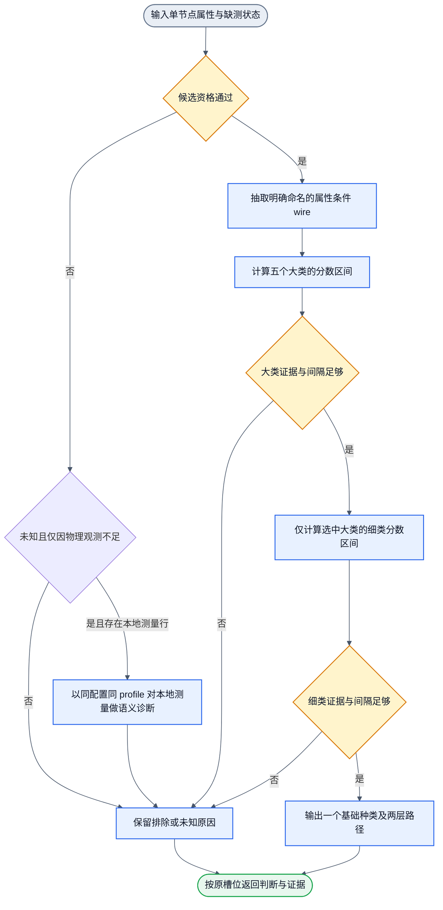

# DOM 基础种类分层连线

## 最小语义单元与验收

四元素定义沿 [总体设计 1.1](design.md#11-结构化语义的目标与状态推理)，设计准入沿项目本地设计 Skill。此处只声明第一层分类单元的领域映射，不增加训练头或环境操作。

| 元素 | 当前单元的显式含义 |
| --- | --- |
| Goal | 对给定候选槽位判断一个基础种类，保留判断状态、缺测与路径；不是点击目标或第二层帖子语义 |
| satisfactionThreshold | 固定为100；单项输出符合确认监督及当前合同才达标。实际satisfaction为100或0，证据不足单列未知；分类分数不等于满足度，页面未知比例也不是准确率 |
| State | 同帧 CandidateBatch、许可测量及缺测、显式配置和本次 profile；nodeRef关联对象，原class/id/正文不进入学生输入 |
| Action | 执行既有 wire 提取和数值分类，产生按原槽位保序的类别、判断状态及证据，增加知识，不修改网页 |

训练期从目标标签与达标条件反推所需辨别事实、wire及确认监督；运行仅使用既定输入关系和本次参数。候选通过不证明标签正确，只有独立复核和监督比较能支持正确性。固定 Goal/satisfactionThreshold 不强造学生输入；若后续任务目标或达标条件改变正确输出，须先修改领域I/O及区分样本，不能隐式复用本单元。

当前外层单节点图为 `dom-basic-kinds.graph.json`；overlay沿 `observe → qualify → classify → present` 单入口单出口复用它。排除、未知、冲突和成功都保留明确结果槽位。wire承担可辨性，缺测区间防止把未测事实当否定，评分及间隔区分竞争结果；移除这些会破坏对应合同。独立升级流程统一引用 [模型演进合同](model-evolution.md) 及其图，不复制采用规则。当前使用时自动采样、统一独立评价、条件自动切换及冲突裁决接线尚未实现；文件化权重只解决本次资源读取，不能算作升级链已闭合。

## 可选优先级拓扑

`profile.topology` 缺省或为 `family_leaf_v1` 时使用下文原两阶段路径；旧 profile 不被自动改写。`priority_staged_v1` 使用四阶段：direct_interaction（input/select/button/link）→ own_content（text/image/video/audio）→ meaningful_structure（list/listitem/container）→ redundant_ignore（ignore）。内部图与实验边界见 [优先级实验](priority-classifier.md)。

`LEAF_SUPPORT_WIRES` 声明各细类的正向适用证据。只有已测且大于零的支撑 wire 打开目标；该判断与参数符号无关，反向证据不能打开目标。family gate 为其细类支撑的并集。关闭目标的整个区间为零；打开目标后仍按缺测区间评分。CSS before/after 既可支持 text，也可支持 image，实际结果由评分决定。

每阶段按适用细类求联合区间 `J=[min(F.min,L.min), min(F.max,L.max)]`，F/L 均先限制在 [0,1]。无适用类为 skip；全部上界低于 minScore 为 weak。二者继续下一阶段。最佳下界达到门限、且对其余上界的间隔达到 minMargin 才输出 judged；明确竞争输出 conflict，其余强歧义输出 unknown。unknown/conflict 立即结束并输出 other，不落入 ignore。共享 structure family 不让 ignore 提前参与有意义结构阶段。

`PRIORITY_BASIC_KIND_INITIAL_PROFILE` 使用全零稀疏参数，不能当作已训练模型。新权重资产使用 contractVersion 2；legacy 使用 1。版本与 topology 交叉组合拒绝加载。默认 profile 与扩展当前资产保持原选择。

状态：候选内容，实施中复核（candidate under verification）。本文描述本轮 wire、profile 与标签合同；旧黄金、来源留出和真实页面回归完成前，不表示新增权重已交付或已采用。

当前实现目标是第一层基础种类。第二层再组合帖子、作者、评论、广告等应用语义。本文件是节点内部 wire 算法的唯一设计 owner；节点事件卡见 [节点清单](../lib/nodes/README.md)。

## 层级与执行顺序

| 属性大类 | 只在大类通过后计算的细类 |
| --- | --- |
| control | button、input、select |
| media | image、video、audio |
| navigation | link |
| text | text |
| structure | container、list、listitem、ignore |



这是真正的先粗后细计算。大类未通过时没有 leafScores。大类通过时，leafScores 只含该大类的细类。数组只是多次单节点计算，保留顺序、长度和重复引用。

进入分类器且观测可用的节点，语义标签始终是 12 个具体类别之一或 `other`。`ignore` 属于 `structure` 大类，是与其他细类同一两阶段电路的叶子目标；它不是 tag 硬过滤、独立类别头或预处理删除。`unknown/conflict` 是判断状态，不是额外语义类别。当前未识别或证据冲突的节点输出残余 `other`，同时保留评分路径；`other` 不等于已判为 other，也不伪造 judged 状态。上游排除、跳过或不可用项不属于已分类输入，标签仍为 null，不能用 other 掩盖采集失败。

## 观测未知的语义诊断（可选字段）

候选资格与语义计算是两个独立事实。资格阶段因物理观测不足而停在 unknown 时，本地可能已经采到可分类的测量行；上图的诊断支路允许对这份已知测量做一次语义计算，但不改变资格结论。该支路不绕过资格、不复活排除项、不修改原始槽位。

`BasicKindSlot` 增加一个可选字段 `semanticDiagnostic?: BasicKindJudgment`。它只在一个很窄的输入状态下出现：

| 输入状态 | 顶层判断 | semanticDiagnostic |
| --- | --- | --- |
| 候选 ok | 既有分类，原样保留 | 不出现，不复制结果 |
| 候选 unknown、原因 `insufficient_observation`、存在原始节点且有显式本地测量行 | 既有 unknown，class/score/margin 仍为 null，reasons 为 `candidate_unknown` | 使用本次请求同一 config 与 profile，对同一属性构造做的既有分类结果 |
| 缺节点引用 | 既有 unknown | 不出现 |
| 因规则观测（`insufficient_rule_observation`）或其他原因未知 | 既有 unknown | 本轮不出现 |
| filtered_out 或 skipped | 既有 excluded | 不出现 |

准入只看资格状态与证据可用性。它不使用 tag 名、期望标签、槽位号、站点名、父节点预测或任何固定数量。候选 `unknown` 的原因字符串由候选链在首次偏离阶段给定；资格一旦离开 ok 就不再被后续阶段改写。只有本地测量行存在才允许诊断，缺行没有诊断；但不要求每个可选测量都出现，缺测仍按既有区间语义处理，不能把缺测补成反例。

诊断与合格分类共用同一属性构造：测量来自已验证的 `itemObservations` 行，tag/role 来自显式观测节点，hidden/disabled 解释不变，null 测量保持 null，不引入新的原始字段。分类器仍是唯一数值 owner；共享的是属性构造，不是第二套算法。

诊断自身的状态可以仍是 judged、unknown 或 conflict，因为它只是同一分类器在当前输入上的结果。它不产生框、Focus、命中目标或交互能力，也不改变资格、顺序、原因或原始观测。诊断不得写成标签、监督或负例，尤其不能把预测的 `ignore` 或 `image` 转成资格、黄金 other 或训练极性。合格候选的数值行为与既有 profile/资产完全不变。

## 输入与观测边界

公开节点接收现有 CandidateBatch，可在同一个对象增加 `itemObservations` 数组。既有候选链的输出可直接输入；未提供补充观测时，相关测量保持 null。补充项用 nodeRef 关联，不能覆盖 tag/role 或候选资格。tag/role 来自 batch.observation.nodes，几何与父子关系也只读取这份显式快照。引用不作为数值特征。

补充观测只允许 nodeRef 及 `BasicKindMeasurements` 已声明字段。除输入类型、链接、可编辑、直接文本、CSS 存在性、子计数、重复几何、列表父级与 SVG 图形子元素外，新增十二项可选 nullable 测量：`pointerCursor`、`parentPointerCursor`、`tabIndexFocus`、`activeElementFocus`、`borderPresent`、`aspectRatio`、`descendantTextPresent`、`singleChildTag`、`singleChildSameRect`、`withinControlAncestor`、`inSvgAncestor`、`directListChildPresent`。省略或 null 表示未测；false 和 0 表示明确测到不存在。计数只能来自完整的直接子元素观测，不能把截断快照中的条数当作完整数目。旧离线样本缺少新字段时，验证和训练投影统一补为 null。

- inputType 是采集器读取的 input.type 规范值；未读取为 null。浏览器默认 text 应显式提供 text。空字符串保持未知。
- hrefPresent 表示 href 属性存在，空 href 也为 true；不接受原始 URL。
- directTextPresent 只描述直接 Text 子节点是否有非空白文字，不读取或推导 aggregate textContent。
- positiveAreaChildCount 在直接子元素及其几何测量完整时提供。任一缺失就为 null。
- repeatedChildGeometry 描述完整直接子元素几何是否重复。它不证明语义列表。初版由调用者明确测量，本算法不发明布局采集器。
- inVerifiedListParent 描述直接父节点是否有 ul/ol/dl 或 list/feed/menu/tablist 声明。它不是第二轮模型历史判断。
- svgGraphicChildren 只描述 svg 的直接图形子元素是否存在。图形元素集合为 path、use、g、circle、rect、line、polyline、polygon、ellipse、image、text；`svg` 自身不是图形子元素证据。非 svg 节点为明确 false。只检查完整的直接子元素，不推断后代图形。
- pointerCursor、parentPointerCursor、tabIndexFocus、activeElementFocus、borderPresent、descendantTextPresent、withinControlAncestor、inSvgAncestor 是可选的事实测量；缺测保持 null。`tabIndexFocus` 只表示显式非负 tabindex 属性，`activeElementFocus` 才表示本帧 `document.activeElement` 命中该节点；负 tabindex 或程序焦点只由后者表达。`singleChildTag` 来自同一观测的直接唯一子元素 tag。`singleChildSameRect` 只表示同一观测中父与唯一子元素的矩形相同，不能由 class 或 tag 推断。`aspectRatio` 是同一观测的相对宽高比，规范化到 [0,1]。

实时 DOM 测量从直接父节点读取声明列表证据：native ul/ol/dl 或规范化的 list/feed/menu/tablist role。没有父节点或父节点不满足声明条件时，已观测无声明列表父级，为false。重复几何要求至少两个正面积直接子元素，并存在宽、高均相差不超过2px、位于同一行或同一列且位置不同的元素对。完整观察到正面积子元素不足两个时，已观测不重复，为false；矩形不可用时保留null。几何重复只支持结构证据，不能单独证明list。

`directListChildPresent` 表示完整直接子元素中存在原生 ul/ol/dl，或明确 list/listbox/menu 角色。隐藏的选项列表仍属于结构观测。完整观测且无匹配时为 false，子元素观测不完整或未测时为 null；它不表示列表当前可见。

未知字段拒绝。class/id/名字/原始正文/URL/根路径/深度只作为来源或 teacher 证据，不进入学生输入。现有采样学生白名单不变。disabled/hidden 等状态只从已白名单观测读取。所有合格输入统一提取 wire 并评分；SVG、hidden、presentation/none、hidden input 或看起来像 wrapper 的 tag 都不能直接导致提前返回。基础种类不证明可点击、可操作或无遮挡。

## 数值 wire 与缺测

命名 wire 由 native tag、role、可编辑属性和局部组合条件构成。`BasicKindWireValue` 为 `number | null`；布尔及三值组合输出 0、1 或 null，连续几何组合输出 [0,1] 的数值或 null。条件不适用时为 0；适用但未测时为 null。例如 input 类型三支路在 type 缺失时均为 null；非 input 节点均为 0。role=null 表示没有可用角色证据，不推测一个隐藏角色。contentEditable 缺测仅在中性容器的可编辑支路产生不确定性。几何组合只用于中性容器候选，不改变明确原生控件的含义。

`role_presentational`、`input_type_hidden`、`state_disabled`、`state_hidden` 是显式可配评分 wire。默认系数为 0，因为当前没有证据证明这些状态应改变基础种类；例如隐藏按钮仍可能是按钮。它们的值和缺测保留在 wires，完整系数保留在 profile。自定义非零系数会进入相同的区间计算，没有独立否决通道。原子属性的适用范围与具体类别裁决分开；任何单一属性都不硬返回一个类别或排除结果。

原有 wire 名称与 tag 集合的含义保持不变，唯一例外是 `nat_container` 加入通用 HTML 内容分组标签 `figure`；它继续只表示原生结构证据，不表示 image、图形后代或第二层业务语义。新增 `nat_svg` 只匹配 svg tag；`svg_graphic_children` 是 svg 范围、正直接子元素计数和 `svgGraphicChildren=true` 的三值 AND。已观测 false 操作数使结果为 0；未知操作数且没有已观测 false 时结果为 null。另增三个中性 div 组合 wire：`div_single_child` 要求一个正面积子元素且无直接文字，`div_leaf` 要求零元素子节点，`div_direct_text` 要求 div 叶状态且存在直接文字。`single_child_div` 另要求已知原始直接子元素计数为 1；已知计数不为 1 时明确为 0，计数缺测或唯一子元素 tag 缺测时保留 null。单个 tag、role 或几何属性都不能独立裁决细类。

关系与 ignore 扩展只增加显式组合：`neutral_single_child`、`neutral_multi_child` 与 `neutral_same_rect_wrapper` 要求中性容器；same-rect 组合还要求唯一直接子元素、无自身非格式直接文本、无自身 CSS 外观且 `singleChildSameRect=true`。`composite_descendant_text` 区分自身无文本但后代有文本的中性容器。`own_pointer_boundary`、`svg_internal_part` 只提供支持证据，不证明监听器归属。`empty_pointer_extent` 与 `empty_border_extent` 是布尔条件的连续乘积，`aspectRatio` 作为 [0,1] 因子参与；任一操作数缺测且没有已观测 0 时结果为 null，已观测 0 因子则明确为 0。

`neutral_multi_child_shape`复用已有中性多子判定`g=neutral_multi_child`和已测量的`a=aspectRatio`：`g==0`或`a==0`时为0；`g==null`或`a==null`时为null；否则为`a`。它只登记`leafWeights.list.neutral_multi_child_shape`一个按名称迁移的0地址，不增加测量、支撑门禁、family、container或ignore地址，也不以阈值定类；几何只作为已有list评分的加权线索。

每个目标 c 有稀疏权重 w。初始权重手写，范围 [-1,1]。不加隐式 bias。对每个 wire x：

```text
lower(c) = clamp(sum(w*x for observed x) + sum(min(w,0) for missing x), 0, 1)
upper(c) = clamp(sum(w*x for observed x) + sum(max(w,0) for missing x), 0, 1)
```

`neutral_focusable_control` 组合中性容器与明确可聚焦属性，补充非手形光标控件的评分路径。`neutral_list_choice` 组合中性容器、手形光标、直接选项列表与后代文本，区分选择控件和普通动作按钮。两条 wire 均为可训练贡献；新地址迁移补零，不硬定类、不修改阈值。

`neutral_actual_focus` 组合中性容器与本帧实际持有焦点的 `activeElementFocus`，为键盘或程序焦点目标提供独立评分路径。它不改变 `tabIndexFocus` 原含义，负 tabindex 单独不构成焦点证明；缺测、不可读或不可映射保持 null，不补 false。它只提供可训练贡献，新地址迁移补零，不硬定类、不降阈值、不替代前景或指针事实。

`neutral_presentation_leaf` 为无意义的呈现叶节点提供评分路径。它组合中性容器、零个正面积直接子元素、无自身非格式文字、无后代文字、不可聚焦、无独立手形光标边界，以及明确不存在 before/after 内容、背景图片和 mask 的观测。该呈现叶准入还接受 `role=null`、`contentEditable=false` 的空 `<i>`；它仍须通过零自身直接文字、零直接子元素及无伪元素或图片外观的门禁，且不会放宽 `neutralContainer`、结构、焦点或多子元素 wire。隐藏子元素不阻止该条件，格式字符不算有效文字；边框缺测不等于这些 CSS 内容缺测。真实文字、可见子元素、CSS 图像或伪元素图标、明确控件和独立焦点目标都是反例。该 wire 只提供可训练贡献，不直接过滤元素；新权重仍从零迁移，原始槽位与后代保留。

三站支持增量增加四条局部组合 wire，不改变已有 wire 的含义，也不增加 DOM 输入。`neutral_inherited_pointer_wrapper` 要求中性容器、无自身非格式文字、无自身 CSS 外观、至少一个直接子元素、手形光标同时来自父级继承且自身不可聚焦。它只表示冗余包装支持，不表示类别已裁决；自身手形边界、父级非手形、自身文字或 CSS 图像均为反例，任一关键操作数缺测时保留 null。该 wire 打开 `structure/ignore` 支撑，并只登记 `structure` family、`ignore` leaf 与 `container` counter-address 的零系数。

`neutral_single_element_wrapper` 要求中性容器恰有一个直接子元素、无自身非格式文字、无自身 CSS 外观、不可聚焦，且 `own_pointer_boundary` 已观测为 0。它不使用正面积子元素计数，因此一个零面积直接子元素下仍有绝对定位后代的包装可被表达；该 wire 不直接忽略原生 region、image 或 control，子节点保留为独立候选。它打开 `structure/ignore` 支撑，并登记 `structure` family、`ignore` leaf 与 `container` counter-address 的零系数。

`noninteractive_hidden_leaf` 要求已知且非 input/button/select/textarea/summary/a 的 tag、无显式交互角色、hidden=true、contentEditable=false、无自身非格式文字、无自身 CSS 外观、零直接子元素、非手形光标且不可聚焦。它只提供隐藏支持宿主的弱评分路径；`state_hidden` 单独不能打开该路径，所有适用事实仍须已测。原生 image 可满足该组合，但媒体路径先参与评分，因此它不是通用 hidden 过滤器，也不提前返回 ignore。该 wire 打开 `structure/ignore` 支撑，并登记对应 family 与 leaf 的零系数。

`search_region_group` 要求 role=search、至少两个正面积直接子元素、存在后代文字且不可编辑。它补充搜索区域的分组支持，不改变现有 `role_container` 的集合或硬返回规则；原生搜索语义仍由显式评分决定。该 wire 打开 `structure/container` 支撑，并登记对应 family 与 leaf 的零系数。

以上新增地址全部通过 `NEW_BASIC_KIND_WIRE_TARGETS` 在迁移时按名称补 0，默认与 legacy profile 的既有系数、阈值及输出不变。输入省略新 wire 的适用操作数时保留 null，不能把缺测补为反例；新系数只有训练并显式采用后才能提高对应目标。

`div_repeated_child_extent` 把已有正面积子元素计数用于 list/container 的细类评分。它仅适用于无明确 role、非可编辑的中性 div，组合重复几何证据与 `min(positiveAreaChildCount,16)/16`。16 是把计数限定到 [0,1] 的归一化尺度，不是列表长度门限。零计数或明确没有重复时为 0，适用但缺测时保留 null；新地址只注册到 list 和 container，按名称迁移为 0。不新增输入字段，也不改变原生 ul/ol 或 role=list 的路径。小列表仍可得到其他 wire 的支持。

中性子元素计数增量（源码合同；拟合与候选采用待验收）：`neutral_child_multiplicity` 把既有 `positiveAreaChildCount` 转成连续计数支持 `max(0,(n-1)/n)`，再与既有 `neutralContainer` 做三值连续组合。`n` 已测且不大于 1 时为 0，已测且至少为 2 时输出 `(n-1)/n`，适用但计数缺测时保留 null；中性条件明确为 0 时整体为 0。零面积直接子元素不计入 `n`，不使用 `childElementCount` 的特定值定类。该 wire 只登记 `leafWeights.list` 与 `leafWeights.container` 两个按名称迁移的 0 地址，不登记 structure family，不加入 `LEAF_SUPPORT_WIRES`，因此子元素较多不能单独打开 list。它不改变 `div_multi_child`、`neutral_multi_child`、peers、heterogeneity 或其他旧 wire 的含义，不新增采集器、属性或 schema。表示见证使用三条开发向量的新值 1/2、5/6、3/4，打破旧 peers 与 heterogeneity 一维向量的 1/3+2/3 凸组合；该见证只证明当前表示可分辨，不是候选权重。类别的实际阈值、旧 profile 兼容和页面回归仍须由公开 consumer 与真实拟合确认。

`div_repeated_children` 另在 `text` family 与 `text` leaf 登记两个零地址。它们只提供可训练的相反证据：中性 div 的直接文本若仅由重复子组之间的分隔符构成，显式学到的负系数可以降低 text 分数；默认系数仍为 0，不直接排除、不改门限，也不改变普通文本叶或原生段落。普通 div 叶的重复几何已测为 false 时该 wire 为 0；非 div 的段落为 0；适用但缺测时保留 null，不能把缺测补成反例。是否最终判为 list 仍由完整评分与其他显式地址决定。

无href交互锚点增量（待实现与拟合验收）：`anchor_pointer_boundary`组合既有事实：tag=a、规范化role为空、hrefPresent=false、contentEditable=false、pointerCursor=true、parentPointerCursor=false。它只提供button支撑及control/button评分，不扩展neutralContainer，不直接决定button，不把DOM的tabIndex默认值当成真实键盘焦点。适用的nullable测量缺失时保留null；role沿既有CandidateBatch的显式字符串／无role合同，不新增学生字段。新增`familyWeights.control`与`leafWeights.button`的该wire地址按名称迁移为0，保留旧系数和门限；旧420行前向与旧黄金须实际回归，不能仅凭补零就宣称任意输入输出恒定。实际按钮监督来自原生点击打开统计面板，而非class、文字或单一pointer样式。

该区间描述未知 wire 在 [0,1] 变化时的分数边界。它不是统计置信区间，也不是贝叶斯后验。相关 wire 的独立边界可能较宽，初版允许保守弃判。

每层先按 lower 排序。默认 minScore=0.60、minMargin=0.15。最高 lower 未达门限则 unknown；两类 lower 均达门限但间隔不足则 conflict；有竞争目标 upper 足以破坏胜者间隔则 unknown；否则选胜者。单候选类的竞争分数为 0。缺测仍留在 evidence.wires 与 activeTerms 中，不被改写为观测零。

原始系数由导出的 `LEGACY_BASIC_KIND_PROFILE` 固定，id 为 `dom-basic-kinds-handwritten-v1`。新默认系数由 `DEFAULT_BASIC_KIND_PROFILE` 维护，id 为 `dom-basic-kinds-handwritten-v2`。native 控件/图片/列表支持为 0.85，音视频为 0.90，明确文本/结构为 0.80，role 为 0.75~0.80。链接由 anchor(0.45)+href存在(0.35)组合；span 文本由 span(0.20)+直接无元素子节点(0.20)+直接文字(0.35)组合；div 容器由 div(0.25)+至少两个正面积直接子节点(0.45)组合，并由重复几何(-0.20)和列表父级(-0.45)抑制。重复几何单独最多支持 list 0.45，不能过默认门限。

默认 profile 仍保留 v1 的原有非零系数：media/image 的 `nat_svg` 0.45、`svg_graphic_children` 0.35；structure/container 的 `div_single_child` 0.45；text/text 的 `div_leaf` 0.30、`div_direct_text` 0.45。新增关系、连续几何与 ignore 地址在旧 profile 中按名称补 0，没有已激活的训练新权重。具体系数、适用 wire 和实际贡献从公开 profile 与每次输出读取。

`migrateBasicKindProfile(raw)` 只从 DOM/training 入口导出，不在通用 `lib/index.ts` 导出。它验证并克隆完整 profile，保留 id 和所有已存在权重；按目标与 wire 名称将缺失键补为显式 0，已设置系数保持不变，且不修改输入。迁移补 0 只表示旧 profile 认识新可训练地址，不等于输入已测量或候选已采用。浏览器权重资产解析和训练 profile 加载显式调用该迁移，不改变旧资产阈值，不自动采用候选。

## 判断前的输入预处理

预处理是判断前的独立职责。browser adapter读取原始DOM/CSS后调用纯`shapeAppearanceMeasurements`一次；既有`browser.qualify_live`复用viewport、Focus和黑白名单filter处理候选范围；分类器消费整形后的typed properties和候选状态。离线原始回放复用相同纯函数；训练读取器使用相同`validateBasicKindProperties`规范化派生参数，不再清理原始文本或产生第二套特征。

整形不修改DOM、原始字符串或样本证据。`directTextPresent`保留旧trim语义；新增`nonFormatDirectTextPresent`检查直接文本是否含Unicode格式字符Cf与空白之外的字符。U+200B使前者true、后者false；ZWJ emoji仍有非格式字符，结果true。只测直接文本，不继承后代文字。未提供文本为null，已测空串为false。

新增`beforeContentPresent`、`afterContentPresent`、`backgroundImagePresent`、`maskImagePresent`由computed style声明派生，未读到为null。CSS的none／normal／空声明表示无对应内容；伪元素空引号为false；背景与mask全none图层为false。它们表示声明存在，不证明像素可见、资源加载成功或类别是image。原始CSS、URL、文字及图标字符不进入学生输入。

新增输入只测直接文本是否存在，不读取或聚合 `textContent`。`nonFormatDirectTextPresent` 与 `directTextPresent` 都只描述直接 Text 子节点；后代文字只能由显式 `descendantTextPresent` 事实表示，不能继承为父节点 text 标签。教师纠错中的七项小红书同矩形 span 包装因此可由 same-rect 测量支持 `structure/ignore`，其子节点的直接文本仍保留为 `text/text`；具有多个直接文本、链接或 img 子元素的复合容器仍按 `structure/container`，不自动向子孙传播标签。

新增六条呈现 wire：`direct_non_format_text`、`css_before_content`、`css_after_content`、`css_background_image`、`css_mask_image`、`nat_svg_child`。前五条为对应 nullable 布尔投影；末项按 SVG 内部 tag 集合编码，不直接决定类别。旧 nat_text 集合和原 wire 含义不变。b 文字与 path 的向量不同。

四十二个新增可训练地址按成对family/leaf登记：text/text的直接文本、before、after、SVG子成分；media/image的全部六条；control/button的直接文本及四条CSS；navigation/link的直接文本、before及背景图；structure/container的直接文本、背景图及SVG子成分。未登记交叉项不属于该profile的拟合地址。具体地址由公开profile与按名迁移可审计读取，不另建注册表。

工具注入层排除属于观测范围。默认排除`codex-browser-sidebar-comments-root`；`excludeRoot`、`excludeRoots`、`excludeRootIds`支持调用者声明额外范围。排除子树同步从子计数与关系观测移除。普通fixed、shadow宿主及仅有格式字符的节点仍保留。布局包装是否忽略仍需语义监督，预处理不直接决定。

## 输出与训练接点

### 内容与用途的双向证据

采集输入保留排版、分隔、装饰、零面积辅助及多层包装节点。候选分类为 `ignore` 只影响默认标注展示，不删除原节点、原始证据或后代。teacher 可记录这些节点的用途，作为 `ignore` 的监督依据和有意义内容的反例；用途说明不能从最终类别复制为学生输入。标签、提示或状态本身有独立读取价值时仍须保留，不能因为称为 badge 或包装就标为 `ignore`。

学生使用直接文字、伪元素内容、图形声明、交互属性与包含关系等可测事实。新增 `shallowStructuralPeerRatio` 比较直接正面积子节点的受限结构和内容存在性，输出最大重复结构组的比例；只有单例组时为 0。它不要求文字链接宽高相同，重复几何由既有 `repeatedChildGeometry` 独立表达。新增 `coincidentChildPairRatio` 描述与父节点和其他子节点重合的图层比例。两者都保留缺测，不输出类别。结构比较仅使用局部 tag、role、内容布尔值和子层 tag 组合，不使用 class、id、原文、URL 或全局深度。

四条评分 wire 分别表达中性重复结构、中性异构结构、无自身内容的单正面积子元素包装，以及无自身文字的重合图层包装。它们分别为 list、container 或 ignore 提供证据；不合并兄弟节点、不删除后代，也不改变既有四阶段决策顺序。新地址迁移补零，未训练不能宣称已采用。

`ownLabelPresent` 只记录当前节点 title 或 aria-label 是否含非格式文字，不传原字符串。`graphicDescendantPresent` 记录实际观测到的近两层 img/picture/svg/canvas、role=img 或背景/mask 图形声明。伪元素内容和 role=figure 单独不足以证明图形；未完整观测且无正证据时保持 null。历史样本未测 title/aria-label 时，`ownLabelPresent` 保持 null，不能从 class 或 teacher 类别补造。

`neutral_named_graphic_owner` 联合中性节点、自身标签、已观测图形后代、无直接非格式文字及单正面积子元素，为 media/image 提供评分路径，并允许 structure/ignore 的反向系数。该路径保留有独立提示或状态的图形包装；它不是 title 存在就直接判 image 的规则。独立按钮、链接与输入仍沿原交互阶段判断。

独立焦点图形表示（源码合同；拟合与候选采用待验收）增加两条 wire。`own_focus_target` 是 `activeElementFocus` 与 `tabIndexFocus` 的 nullable OR：任一已测 true 为 1，全部已测 false 为 0，其余为 null。它表示当前节点自身具有焦点目标价值，不表示 button、input、select、link 或 container。`independent_graphic_content` 是自身图形证据与 `own_focus_target OR ownLabelPresent` 的 nullable AND：已测 false 操作数使其为 0，全部已测 true 才为 1，其余为 null。

自身图形证据只使用有限 tag 集合和既有观测，不新增 class、id、URL、原始文字或 `isSvg` 字段。

| 适用范围 | 自身图形证据 |
| --- | --- |
| HTML 直接图形载体 `img`、`canvas` | 已测为 1 |
| 根 `svg` | 复用 `svg_graphic_children`：已测 true 为 1，已测 false 为 0，缺测为 null |
| `inSvgAncestor=true` 的 `use`、`path`、`image`、`circle`、`rect`、`line`、`polyline`、`polygon`、`ellipse` | 1 |
| `inSvgAncestor=true` 的 `g` | 与 `graphicDescendantPresent` 做 nullable AND；没有图形后代证据时为 0，缺测时为 null |
| 其他 tag，包括资源定义 `defs`、`symbol`、`filter`、`mask`、`clipPath`、gradient、pattern、stop，以及 SVG `text` | 0 |

`inSvgAncestor=false` 时，SVG 专属 tag 不取得自身图形正证据；`inSvgAncestor=null` 时保留 null。SVG `text` 继续沿 text 语义处理。中性 HTML 图形包装继续使用既有 `neutral_named_graphic_owner`，不由新 wire 改写。`independent_graphic_content` 只加入 image 的正向 leaf support，media family support 按现有叶子并集派生；两条新 wire 也加入 ignore 的反向贡献 support 路径，但 support 只打开目标，不裁决类别。它们不加入 button、input、select、link 或 container 的正向 support。既有 `neutral_actual_focus`、`neutral_named_graphic_owner` 与 `svg_internal_part` 的定义保持原样。

四条新地址为 `familyWeights.media.independent_graphic_content`、`leafWeights.image.independent_graphic_content`、`leafWeights.ignore.independent_graphic_content`、`leafWeights.ignore.own_focus_target`。它们通过目标与 wire 名称迁移补 0，不手填已训练系数。新增 image support 会改变 support gate；旧系数不变不代表任意旧输入输出恒定。若零迁移改变旧行为，须报告具体支持路径与输入，不用 missing=0、门限或旧路径 fallback 掩盖。

每项保留 index、nodeRef、candidateStatus、candidateReasons、familyStatus、family、familyScores、judgmentStatus、basicKind、leafScores、score、margin、reasons、evidence。evidence 含 wire、缺测、实际权重项和两层决策路径。filtered_out/skipped 转为 excluded，上游 unknown 保持不可用，不能因补充属性而复活。仅当候选 unknown 的原因是 `insufficient_observation`、原始节点存在且显式本地测量行存在时，另附可选 `semanticDiagnostic`；它保留同一分类器的判断与证据，但顶层 unknown、候选状态、原因、顺序和原始观测全部不变。输出只保留受限诊断，不透传原始观测。

`confidenceState=uncalibrated`，`calibratedConfidence=null`。数字分数不称为准确概率。离线训练框架已通过 Handwired Circuit 实现参数拟合（保持相同的 I/O、缺测 mask 与 wire 语义，通过 Adam 优化器更新 familyWeights/leafWeights，见 [训练 workflow 设计](training-workflow.md)）。初始手写分数与新拟合的候选 profile 均保持未校准（uncalibrated）；重新拟合使旧校准自动失效；保存的候选 profile 绝不自动采用。

示例：button hidden/disabled→control/button；input 缺 type→control/other 且判断状态 unknown；img role=button→大类 conflict，标签 other；a 缺 href 测量→other；div 只有重复几何→other；span 直接文字与零元素子节点均已测→text/text。v2 中仅有一个正面积子元素的中性 div 可判容器；仅含直接文字的中性 div 叶可判文本；空 div 叶和同时含子元素与直接文字的中性 div 保持 unknown。same-rect wrapper 的 ignore 路径要求对应新系数被显式训练并采用；当前默认系数为 0，不宣称该纠错集已被默认模型闭环识别。v2 中具有图形直接子元素的 svg 可判 image；零图形子元素、计数未知或证据冲突时保持 unknown。旧 v1 profile 仍可按原公式把 svg 判为 other，并按原规则处理中性 div。

`other` 是当前 12 个具体类别之外的残余标签：unknown 和 conflict 均保留为判断状态，不能改写成 judged other。其 score/margin 仍为 null，具体类别的分数区间完整可审计。预测 other 不能直接成为黄金 other 或训练负例。训练标签须由 teacher 或人工确认，监督映射由训练任务负责。

当前标签集合对合格输入全覆盖，不等于已证明主流网站/主流页面的经验覆盖，也不宣称 unknown 已清零。新增种类时更新 BASIC_KIND_FAMILIES、所需的允许 wire 和 profile，保持框架核心不变；复核历史 other 中属于新类的样本，再做旧类与新类的来源隔离回归。新类别不能只改标签名而继续使用缺少该类别行的旧参数。

旧微博快照缺 fragments/clippedRect。沿候选链保留 605 filtered_out、528 skipped、867 unknown，零合格分类。纯函数可另做属性诊断，但不能宣称这些是 workflow 合格结果或准确率。

## ignore 增量的测量覆盖前提与证据边界（2026-10-21）

ignore 叶子的 16 条支撑 wire 全部依赖新测量字段（`singleChildSameRect`、`singleChildTag`、`nonFormatDirectTextPresent`、`descendantTextPresent`、`pointerCursor`、`parentPointerCursor`、`tabIndexFocus`、`activeElementFocus`、`borderPresent`、`aspectRatio`、`inSvgAncestor`、`withinControlAncestor`、`inVerifiedListParent`、`coincidentChildPairRatio`、`ownLabelPresent` 等）。缺测保持 null，区间取 `[0,w]`，所以任何非零 ignore 系数都会按权重扩大未知字段上的上界；这是缺测语义的直接结果，不是拟合缺陷。

推论有两条，均已在真实拟合与公开分类器上复核。第一，`same-rect` 单子元素包装只有在 31 项测量字段齐备时才可能被判 ignore：同一节点在完整字段下 `structure` 区间为 `[1,1]`，仅保留旧 12 字段后 `structure` 为 `[0.077,1]`、判断回落 other，`structure` 无法从旧字段单独达到 `minScore=0.6`。第二，旧语料无法承担 ignore 回归：`training-m1` 黄金 357 行每行仅 10–12 项字段，任何能让包装判 ignore 的系数都会把这些行的结构上界抬高，最多使 91 行从 judged 变为 `unresolved_missing_feature` 的 unknown，而不会产生假 ignore。

因此 ignore 增量当前只能证明“测量齐备域内可用”，不能证明旧语料零变化；旧黄金与微博 152 行须按当前 31 字段重新观测后，才能作为该增量的回归与召回证据。在此之前不得把旧语料的判为 other 当作 ignore 无效，也不得把旧语料零变化当作增量验收通过。

真实页面再观测（2026-10-21）复核了上述前提。用只读入口 `playground/browser/reobserve-live.mjs` 在登录态浏览器上跑真实 `observeLiveDom`，采集小红书 explore 1543 个节点、知乎专栏 1104 个、微博 tv/home 1489 个，共 4136 条完整测量。选中候选在其中判出 1126 条 ignore，带自身可见文字、焦点、href 或交互 tag/role 的为 0；代价是有 22 条原本判 container/listitem 的节点变成 unknown/conflict。旧快照页面已改版且视口不同，59 条小红书黄金行只有 6 条能按结构路径配对，因此旧行不能复原为同一批节点，旧黄金的“0 预测变化”不能由旧行承担；真实页面留出是该增量的有效回归证据。

ego 浏览器重采（2026-10-21）追加了微博登录态 live 样本：窗口对齐旧采集 1101×1878 后 1839 个节点、31 项测量齐备。候选判出 479 条 ignore、假 ignore 0；37 条 teacher-ignore 在对齐口径下召回 24/26、唯一配对口径 7/7，5 条无候选、13 条候选不唯一记 unassessed。键盘焦点否决的根因也已定位并复核语义：`own_focus_target` 在拟合点梯度朝减小，但负权重会按区间语义 `[w,0]` 压低缺测焦点行的 ignore 下界、破坏 expected=ignore 召回，损失把权重拉回 0 附近。该区间语义对否决 wire 是正确的（缺测按「焦点可能未测到」保守处理，未把缺测当无焦点；把 null 当实测 false 的 `[0,0]` 才是伪造）。否决学不出来的原因是语料缺测焦点（162 条 verified ignore 中 159 条 `own_focus_target` 为 null），属标签与键盘焦点保留规则的冲突，修复在补测焦点后重拟合，不需要改共享语义。
