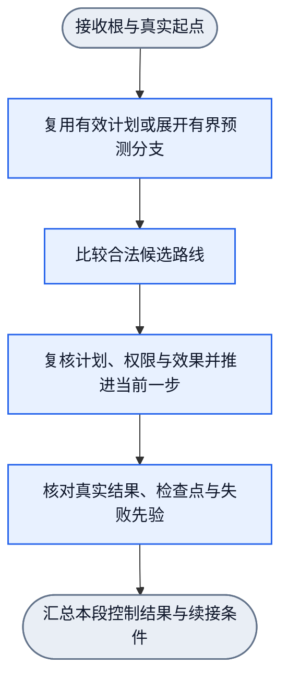

# 有界目标规划：预测推理与执行推理

状态：有界原型已接入`runRecursiveGoal`的`0.2.0` 3N2E运行外壳，已完成有限合成域与真实cwd公开consumer验证；整体Review与main回执见[note.md](../note.md)。公共类型与结构守卫由`lib/workflow/recursive-goal/planning-contracts.ts`导出，纯展开由`planning.ts`负责，控制由`module.ts`负责。设计责任图[bounded-goal-planning.graph.json](../workflows/bounded-goal-planning.graph.json)为`0.2.0-design` 6N5E，没有六个独立运行绑定算子。浏览器策略图、现行模型权重与采用状态不变。

原设计需求与审计在run `/Volumes/Intel/playground/nnanything-runs/human-semantic-evaluation-20261020`；本轮实现、红测与两域证据在`/Volumes/Intel/playground/nnanything-runs/bounded-reasoning-prototype-20261020`。注册结果模型当前为确定性有限规则，不是已训练预测模型，不据两域实验承诺任意语义泛化。

## 1. 目标、边界与术语

目标是在显式根Goal、真实起点、已启用技能、明确结果模型和有限预算内，生成可反驳的候选路径图，再每次只推进一个实际动作。执行后以真实New State决定继续、切换、局部重推演、阶段滚动或结束。

根`AcceptedRoot.rootGoal/rootThreshold/rootBindings`在全部预测段和执行段中保持不变。预测与执行不能修改根、降低阈值、扩大权限、重置总预算或改写学生当前错误head。根实际满足时立即回收必要链并结束，不为性格、路径分数或剩余视野追加动作。

三个不同对象不得混写：

| 对象 | 含义与owner |
| --- | --- |
| 静态治理workflow | 本文配图的6N5E SESE，表达设计资料的责任顺序；无运行绑定，不是每次请求的数据实例 |
| 每请求目标图实例 | `GoalGraphPlan`及其预测节点、结果分支、候选路径、检查点和覆盖声明；由预测入口生成 |
| 实际执行与ledger | 当前动作派发、真实回执、`StateRecord/EvidenceRecord`、effects、错误、重试与预算；由执行入口维护 |

预测推理负责“可能怎样推进及哪些候选有依据”，执行推理负责“现在能否推进一个真实动作”。计划是控制输入，不是事实、权限或完成证明。

## 2. 四元素与训练反推

| 元素 | 本文对应合同 |
| --- | --- |
| Goal | 调用者的结构化Goal及其必要条件不变；本模块只交付有界计划/控制结果，不另造可替换根 |
| satisfactionThreshold | 根阈值原样保存；预测满足度或路径utility不能替代它。只有在真实State上由领域评价器得到的实际满足度可判定根达标 |
| State | 根绑定、最新真实State与证据、未满足义务、计划cursor、checkpoint、预算、ledger、错误和权限；预测State只存在于计划实例 |
| Action | 预测展开、候选比较、当前单步派发、真实后验、checkpoint判定和分段控制；不要求模型一次输出整段动作 |

训练期可由达标State反向推导动作、前置State与结果关系，但运行期以真实New State评价。计划级训练反推关系不同于梯度反传，也不把路径规划器的固定控制训练层序。

动作成功、预测正确、路径满足、checkpoint满足和根Goal达成是五个结果。动作成功但后验unknown仍是unknown；预测正确只增加结果模型证据；checkpoint必须由真实评价器满足；根只由根评价器满足。

## 3. 预测推理I/O

公共合同固定`BoundedPlanningOptions`、`BoundedPlanningRequest<G, B>`和`BoundedPlanningCapability<G, B, S, E, F, C>`。请求只携带可复制引用和领域checkpoint数据；结果模型、适用性、失败先验判断和路径排序只从dependencies注入。

```ts
interface BoundedPlanningOptions {
  kind: "bounded_goal_planning.v1";
  capabilityRef: VersionedRef;
  horizonN: number;
  resultModelRefs: readonly VersionedRef[];
  preference: PathPreferencePolicy;
  checkpointSpecs: readonly unknown[];
  limits: {
    maxPlanNodes: number;
    maxPredictionCalls: number;
    maxReplans: number;
    maxRollbacks: number;
  };
}

interface BoundedPlanningCapability<G, B, S, E, F, C> {
  contract: VersionedRef;
  resultModels: readonly ResultModelBinding<G, B, S, E, F>[];
  guards: PlanningDomainGuards<G, B, S, E, F, C>;
  assessEntry?(input: PlanningEntryAssessmentInput<G, B, S, E, F>): PlanningApplicability;
  matchesActual(input: ActualMatchInput<G, B, S, E, F>): PlanningApplicability;
  assessPrior(input: PriorAssessmentInput<G, B, S, E>): PlanningApplicability;
  decision?: PlanningDecisionBinding;
}
```

`ResultModelBinding.predict`是同步纯有限转移。它只接收显式`G/B/S/E`投影、技能、义务、剩余视野和typed prior；不得读取OS、dispatch、ledger、日志或训练状态。`matchesActual`、`assessPrior`同样不得现场观测或执行。可选异步decision只排序合法候选，省略时用共享默认规则；真实Handwired替换、参数热重载与失败数值对照见[决策单元](bounded-planning-decision.md)。

`PredictionRequest`最少包含：

```text
PredictionRequest {
  acceptedRootRef; startStateRef; startEvidenceRefs;
  horizonN; frontierRef; unmetObligations;
  enabledSkillSchemas; resultModelRefs;
  preferencePolicyRef; remainingPredictionBudget;
  trigger: initial | checkpoint | no_applicable_path | invalidated | uncovered_result
}
```

`acceptedRootRef`必须解析到当前请求的`AcceptedRoot`；`startStateRef`必须指向最新真实State。`enabledSkillSchemas`只列出本次显式启用的技能合同。`resultModelRefs`须与技能、State/action条件及适用域匹配。缺少模型、评价尺或必要证据时保留`unknown/not_ready`，不生成看似可行的成功边。

`PredictionResult`是单一typed结果，统一收束为以下一种：

| 结果 | 最小内容 |
| --- | --- |
| `ready` | `GoalGraphPlan`实例、主路线、有序备选、覆盖声明、checkpoint与比较引用 |
| `deferred` | 只读补证要求、缺口键、已消费预算、保留的frontier |
| `not_ready` | 缺技能、缺结果模型、缺评价尺或不可比原因 |
| `stopped` | 根已满足、明确不可恢复错误、未知effect、权限或预算停止原因；根当前未满足本身不构成停止原因 |

每个结果都携带`rootRef`、`startStateRef`、错误/控制引用和实际预算。节点不能以空路径表示成功、以候选分数表示证据、以`predicted`字段写入实际State或ledger。

预测推理不得派发动作。它可多次调用已声明的技能关系或结果模型，但每次调用只回答已声明转移；调用次数不是N。组合技能展开到规范化语义动作后才计入视野。

## 4. 执行推理I/O

`ExecutionRequest`最少包含：

```text
ExecutionRequest {
  acceptedRootRef; planControlRef; currentStateRef;
  currentStudentHead; currentPermissions; remainingExecutionBudget;
  continuationRef?; retryControlRef?; ledgerRef; pendingVerificationRefs
}
```

`currentStudentHead`是当前学生实际输出，不因计划存在而补造。执行入口先核对计划适用性、根绑定、前提、权限、预算、retryControl与同错计数；合法时最多派发一个当前动作。当前head与技能及参数合同不兼容时保留`policy_error`，计划不能替换成另一个head。

`ExecutionResult`是单一typed结果：

| 结果 | 下一步责任 |
| --- | --- |
| `continue` | 前进当前cursor，保留同一有效计划，不调用预测 |
| `switch` | 用真实State重验次优入口后切到首个适用路径，旧回执保留 |
| `replan` | 仅撤换受影响frontier，生成新计划段 |
| `checkpoint_reached` | 归还该阶段义务，以最新真实State展开下一段 |
| `root_satisfied` | 回收全部必需链与必要收口，停止后续动作 |
| `defer` | 只允许已声明的只读补证；否则停止受影响链 |
| `stop` | 透传原错误、unknown effect、权限、取消或超预算控制 |

结果同时携带实际receipt、`observedStateRef`、effects、错误、预算增量、更新后的计划适用性和continuation。预测字段不得复制进实际证据；actual satisfaction只能来自真实评价。

## 5. 每请求图实例与状态分离

`GoalGraphPlan`至少含`planId`、`rootRef`、`startStateRef`、`horizonN`、节点集、结果边集、候选路径、覆盖frontier、checkpoint和生成范围。`planId`仅标识本次计划实例，不作冻结或身份包装。

| 实例字段 | 语义 |
| --- | --- |
| `PlanNode` | skill/version、typed前置条件、`PredictedState`、预测结果分支、预测effects、成本、unknown与依据引用 |
| `PlanEdge` | 从某结果分支到后继的条件、目标节点/checkpoint及覆盖状态 |
| `PathCandidate` | 有序节点、路径投影、rank引用、假设、失效条件及起始适用State |
| `CoverageFrontier` | 逐结果分支的`covered/truncated/unknown`、剩余视野与原因 |
| `CheckpointSpec` | 对象绑定、Goal、阈值、评价器、证据要求、相关义务和下一段滚动规则 |
| `PlanControl` | 当前`GoalGraphPlan`、当前路径、备选顺序、cursor、已验证checkpoint、恢复阶段、failure prior和累计计数 |

`PredictedState`只含`kind:"predicted"`、领域投影、假设、来源和unknown；它不保存实际`StateRecord`、`EvidenceRecord`、ledger或错误引用。`PlanControl`只保存当前计划、路径/cursor、已验证checkpoint、恢复阶段、typed prior和规划专用累计计数。根、权限、总预算、实际State/evidence、错误、effects和ledger仍由现有runtime owner保存，不在计划内平行复制。预测effect不是授权；真实ledger只在执行前记`in_flight`并在回执后更新。

候选路径是OR选项。只把当前选中路径需要的条件加入必需AND集合；未选备选不得生成“已经失败”的虚假义务。共享预测引用只计一次覆盖，父子证据重叠不能重复贡献根满足度。

## 6. 静态6N5E设计图与唯一出口

新图固定六个中文节点：



六节点分别防止根漂移、无依据预测或重复预测、排序混责、盲派发、预测冒充事实和结果无接收者。每个operator版本均为`0.2.0-design`，无独立workflow配置或绑定；对应责任由既有3N2E controller实现。`dagpipe graph validate/inspect`只证明6N5E拓扑，不证明真实行为。

拒绝、缺口、deferred、unknown、预算停止和正常结果都通过节点输出的typed控制字段沿五条边传到唯一出口。下游节点不得把上游`not_ready`改成空成功，也不得在静态图中增加回边。跨段继续由外层控制再次调用本设计流。

同一静态图用于单步推进，不代表每次经过展开节点都重新预测。接收节点显式给出`reuse`或`expand`控制：已有计划有效、正常续行且未到指定checkpoint时，展开节点只透传已接受计划，比较节点复用当前适用路线；不得调用预测器或重新展开。初次请求、checkpoint达成、无适用备选或明确失效时才消费展开预算。该控制不是新学生动作，也不计入N。

## 7. 有界展开、N与分支覆盖

N是规范化路径上一次有语义动作转移的最大视野。技能包装、控制转移、模型调用和workflow节点不增加N。只读取证在取得当前缺少且合同使用的事实时可计一步；必要后验归原动作合同，不另计；NOOP、虚层、重复同值观测和无下降循环不补N。

展开从真实起点开始，只走显式启用技能和明确结果模型，逐结果分支记录：

| 字段 | 要求 |
| --- | --- |
| 适用条件 | 启动该分支所需typed State/证据/权限 |
| 声明结果 | 模型合同允许的结果范围，不把unknown改成成功 |
| 剩余视野 | 从该结果出发仍可展开的语义动作数 |
| 后继/终止 | 可预测后继、预计根/checkpoint或停止原因 |
| 覆盖状态 | `covered/truncated/unknown`及具体缺口 |

短路径已真实到达根时提前结束。最长路径达到N不证明每个失败分支仍有N步；失败发生在第一步后，原段通常只剩N-1步，必须按实际分支重推演或明确截断。未知结果、缺模型和搜索预算不足都排除在成功保证之外。

N步语义前缀可行即可执行，不要求根在N步内达成。达到视野边界时路径以`horizon`终止，保留truncated frontier；路径前缀可比较，不能因此标为根满足。真实执行到边界后再以最新State展开下一段。no_progress不计N，仍受节点及模型调用预算限制。

预测只能声称“当前已生成且可比较候选中的有限视野较优”，不能声称全局最优或任何未知世界结果必然成功。checkpoint是typed runtime control/continuation，不是SHA、冻结快照或日志恢复控制。

## 8. 路径投影与排序边界

本文只定义传给排序owner的`PathProjection`，不复制候选排序字典序。排序、同分、DEFER和偏好策略的唯一owner是[goal-selection-policy.md](goal-selection-policy.md)，拟议边界为：

```text
rank(candidates, projection, preferencePolicyRef) -> ranking | defer
```

`PathProjection`含同尺终点评价、领域风险等级、动作累计成本和`unknown`。终点评价来自根预期满足度或同一checkpoint评价；不同checkpoint分数不能直接比较，除非领域声明共同根进展尺。

不使用未校准概率相乘。对声明覆盖的叶取最低终点评价，风险取域内可比较的最高等级，成本取各结果路径累计成本的最大值；动作成本单位显式一致，最小可用每动作1单位。比较键缺失时按排序owner返回DEFER或补证。原始NN margin、预测满足度、实际满足度和utility分开保存。

硬条件先于偏好。已观测结果使用实际满足度；待执行路径使用合法预期值。风格只改变合法候选排序，不改变根、阈值、权限、证据、基本类别gold或实际事实。四种默认路径排序及可替换权重接口已实现，不调用F2 margin冒充路径级偏好；实际派发仍检查权限与效果。

## 9. 执行、分叉与局部重推演

执行顺序固定为：核对根实际事实；检查计划绑定、前提、权限、预算、retry与ledger；取得并守卫当前学生head；至多派发一个动作；取得真实回执并更新effects；评价实际New State；核对根、checkpoint和结果分支。

正常结果匹配当前路径且未到checkpoint时推进cursor，不调用预测器重建图。实际分叉先按既定顺序检查已有备选，候选入口必须用当前真实State、权限、effects和预算重验；旧预测不能授权，未选路径也不会自动执行。

`assessEntry`接收完整path/node/入口edge及当前真实State/Evidence，纯判断边conditions、节点/结果preconditions与path.invalidation。首次选路、continue/switch和续接派发前均检查；不适用时继续检查备选，无适用路才重推。非空typed条件缺少该能力时显式合同错误，不能当作空条件。unknown不授权派发，callback异常准确返回。空条件且未提供callback时保留原切片行为。

次优入口都不适用或意外结果未被覆盖时，才局部重推演受影响frontier与排序。重推演不重跑历史derive、不覆盖已接受依赖、不修改根/阈值/固定绑定。原错误、unknown/mixed effects、`in_flight`、同错次数、累计预算和已完成回执跨计划段全部保留。

后续动作抵消先前成果或使引用失效时，撤销相关预测和持续条件适用性，保留历史回执。计划不能降低现有停止条件，unknown/inflight不得因换planId、次优路径或继续而重放。

## 10. Checkpoint、根结束与跨段continuation

checkpoint只在绑定对象和实际条件满足后触发。触发时归还该阶段义务，丢弃旧路径剩余预测承诺，并以最新真实State生成下一段。若根未满足，跨调用滚动通过continuation；若根已满足，立即回收必要链并结束。

`RecursiveGoalContinuation` v1保持无planning语义。规划模式使用严格schema `nnanything.recursive-goal.continuation.v2`，在原有可复制runtime字段上增加`planControl`、`planningContract`和`actionBoundary`。`actionBoundary`必须引用已完成的真实dispatch与atomic result，不得从预测节点构造。

`PlanningEvaluationRef`只是真实评价位置的引用，显式保存`evaluatorId/result/satisfaction/stateRef/evidenceRefs/evaluatedAtTransition`。verified checkpoint必须是`satisfied`且达到其spec阈值；proven-unsatisfied prior必须是`unsatisfied`且有数值评价。预测满足度或历史checkpoint不能填入这两个来源。

v2恢复必须检查：

- `planControl.plan.rootRef`等于accepted root frame，`startStateRef`是continuation中的真实State；
- plan模型引用、checkpoint引用和horizon与`planningContract`一致；
- checkpoint完整规格与已保存计划的接受规格一致，Goal/Bindings由显式comparator比较，阈值、评价器、证据要求、义务及rollingRule逐项一致；同ID不能偷换；
- verified checkpoint可保留历史planRef，但必须引用已记录真实State/Evidence和评价位置；恢复时在当前State重新评价，不复制历史State；
- failure prior来源解析到已有atomic result/error或真实evaluation，且不越过`lastTrustedTransition`；
- `actionBoundary`的frame/dispatch/atomic result/observed state闭包成立；
- `predictionCallsUsed/replansUsed/rollbacksUsed`只增不减，并受planning limits约束；
- v1无planning旧语义不变；v2缺任一扩展字段、引用或capability时显式拒绝。

v1 yielded continuation仍要求accounted retry dispatch。v2规划yield改走独立action-boundary守卫，不能删除旧守卫或把任意空执行状态接受为新分支。

planning与retryPolicy可组合。已成功返回且实际未达标的安全无副作用尝试仍经过原assessRetry、同错计数、策略耗尽及stop gate；v2恢复evaluate_actual时恢复待评价/进度状态，不丢失或重复记账。真实failed/rejected的checkpoint恢复与安全重试分开，不冒用成功无副作用重试。

| 现有边界 | 前瞻设计映射 |
| --- | --- |
| `maxTransitions/maxDepth/maxDerivedGoals` | 继续消费原预算；另加显式计划展开/重推演有限计数，并受总请求上限约束 |
| `capability_missing` | 缺启用技能或无法生成合法后继 |
| `evidence_unavailable` | 缺实际前提/后验证据，或只读补证不可用 |
| `policy_deferred` | 排序键不足、比较未声明或需补证 |
| `effect_outcome_unknown` | 停止自动fallback，只允许声明内只读补证 |
| `budget_exceeded` | 计划展开、动作或重推演预算耗尽 |
| `completed/stalled/cancelled/error` | 由真实根评价及现有控制原样收束，不另造顶层成功 |

这些是映射。错误与控制的最终类型、字段和序列化仍由[recursive-goal-module.md](recursive-goal-module.md)维护；planning类型不得复制另一份错误、effects或ledger真源。

## 11. 训练与演进边界

未来技能转移预测和路径偏好学习各有独立I/O、样本、权重和评价。转移模型学习“State+Action条件→结果范围/后继”；偏好模型只学习候选/路线排序。排序成绩不能证明转移正确，转移损失也不能证明根达成。

预测样本须有可复核结果、来源模型和适用边界；偏好样本须有候选投影及独立排序依据。来源家族先分train/dev/verification，unknown、actual失败和预测落空保留，不把预测自回放当gold。旧技能回归与新场景评价分别报告。

N、层序、是否继续、checkpoint、预算、重推演与fallback控制不训练。本轮未拟合新模型；测试用手工profile只证明数值替换，不是训练成果。未来采用沿[model-evolution.md](model-evolution.md)。

## 12. 十六个设计案例

| 案例 | 预期映射 |
| --- | --- |
| C1 正常主路径未到checkpoint | `continue`并推进cursor；计划有效时不调用预测器 |
| C2 意外结果匹配已有次优入口 | 用真实State重验后`switch`；旧预测不授权，原回执保留 |
| C3 次优入口不匹配且结果未覆盖 | 先完成备选检查，再局部`replan`；不得盲派或自由成功 |
| C4 checkpoint实际满足、根未满足 | `checkpoint_reached`，归还阶段义务并展开下一段 |
| C5 根实际满足且仍有高分备选 | `root_satisfied`；零额外优化动作，回收必要链后结束 |
| C6 N=3但第二步真实达到根 | 第二步结束，不机械补第三步 |
| C7 NOOP/包装/重复同值观测凑三层 | 不计有效N；暴露`truncated/unknown`覆盖缺口 |
| C8 一条分支三步、另一失败分支断路 | 逐分支声明覆盖；不得从最长路推导全分支可行 |
| C9 unknown effect且原派发in_flight | `stop/defer`并允许声明内只读补证；换图或续接不得重放mutation |
| C10 切换/重推演后预算或同错计数耗尽 | `budget_exceeded`或原停止控制；累计值不因planId清零 |
| C11 保守/激进面对同尺收益和风险 | 排序owner可选不同合法路线；根、权限和实际事实不变 |
| C12 候选完全同分且无顺序／有typed顺序 | 无顺序为`defer`；有顺序由排序owner按显式顺序选择 |
| C13 路线抵消旧成果或共享结果重叠 | 撤销失效适用性，覆盖去重；历史回执与错误不删除 |
| C14 关键结果模型或评价尺缺失 | `not_ready`并指出具体路线；不得编造可行边或未来成功 |
| C15 推理失败后最近checkpoint已失效 | 先取当前真实State重验；不把历史verified或旧环境当可恢复点 |
| C16 相同失败先验范围改变 | 同义务、技能版本、对象和前提才约束具体转移；前提改变后重新判断，不永久禁用技能 |

## 13. 原型支持、实现缺口与验收

| 已支持 | 当前缺口 |
| --- | --- |
| 3N2E `runRecursiveGoal`的根绑定、真实State评价、单current-head派发、有界derive、反向满足、错误、effects及v1/v2 continuation | 组合Goal仍由既有derive逐层展开；不承诺全局任意高层语义规划 |
| 计划展开、结果模型调用、cursor、备选、checkpoint、失败先验与两域consumer已接入 | 结果模型仍为显式有限规则，未训练；cwd跨进程reattach未实现 |
| 准确缺能力/证据/DEFER/unknown effects/预算错误；默认规则与Handwired决策替换及候选热重载 | 自动采集、后训练、自动诊断及采用未实现 |
| 浏览器F2当前候选、同错重试及CLI/cwd/finite-search消费入口 | F2不是预生成多步路径；不能冒充路径级偏好或前瞻 |

原型验收：有限合成域逐例验证正常复用、切换/重推、checkpoint现场重验与失败范围、预算/取消/未知效果、根结束及新进程续接；真实cwd覆盖same/different/绑定拒绝/提交后观测失败四场景。手工矩阵独立验证权重效用与排序反转，热重载用公开入口验证版本隔离。具名分母和原始日志由note.md引用，不将合成结果计入真实OS分母。

后续领域接入仍先补结果模型、真实consumer及独立评价；现有控制owner复用，不另建执行引擎、并发mutation框架、冻结快照或平行台账。
