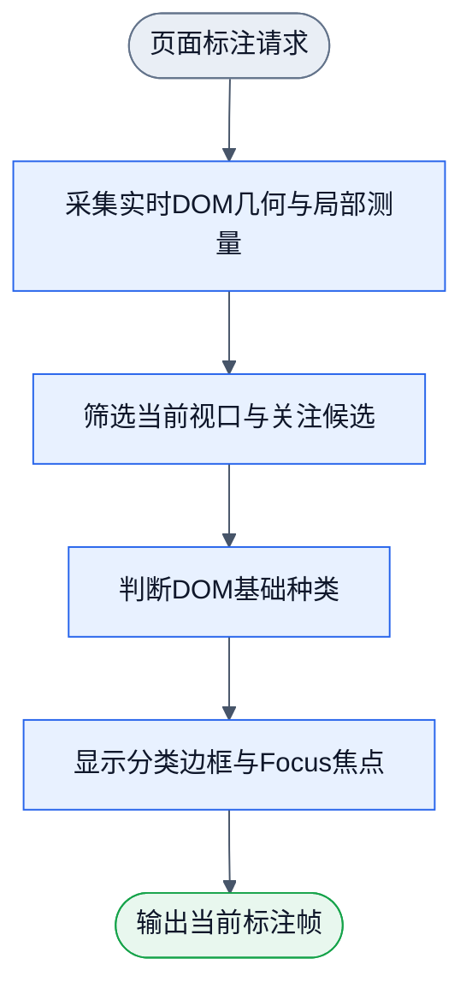

# 页面分类标注与采集扩展 M1

2026-10-17，Chrome/Chromium本地扩展的设计与实现合同。用户选择扩展，并新增点选采集、人工纠错和一键收集未知项。独立Gemini4计划与同角色增补位于外置browser-overlay运行目录。先完成最小可用闭环，不扩展训练台或第二层业务语义。

## 工作流与边界

现有候选图和基础类别图不改。新增4N3E标注图与1N0E采集图。每次刷新、Focus或权重改变是新事件；调度复用现有compileWorkflow/runWorkflow和Flowed的浏览器构建，不另写调度器。磁盘loadWorkflow不进入浏览器包，图作为构建时JSON资源明确传入。

内部采集、复核投影、去重和下载是该单节点的实现，不为普通函数拆出更多节点。图只保存拓扑，实际NodeDefinition与公开consumer必须证明可运行。滚动与DOM变更合并刷新，扩展宿主子树不进入观测或变更触发；关闭断开监听并移除宿主。

## 输入、输出和唯一owner

- `lib/adapters/browser/live-dom.ts`：顶层Document/Window与稳定节点引用表→PageObservation、局部属性与元素映射。全页遍历无2000条截断，候选仍按viewportOnly/subtree/focus/黑白名单筛选。完整children与getClientRects、实际祖先overflow裁剪；computed `matrix(1,0,0,1,tx,ty)`（含identity）是纯2D平移，视口矩形已含偏移，保留单位比例的client尺寸完成裁剪，不因此排除整棵子树。旋转/缩放/倾斜、matrix3d、非none的独立translate/rotate/scale/perspective属性、clip-path及其他未测定裁剪仍保留null。未知重复几何与未验证列表父级不得补假值。iframe和shadow内部只报告未覆盖，不推断closed shadow数量。
- `lib/adapters/browser/weight-asset.ts`：显式训练权重资产→已校验profile、compatibility门限、未校准标志。加载失败保留原生效配置；结果报告不能当权重加载。私人权重不提交。
- `lib/adapters/browser/capture-bundle.ts`：当前分类帧、选中引用和用户复核决定→本地采集会话与单文件bundle。仅收集合格候选，未知批量保持未复核。按snapshot/frame/node去重，保序重排inputRef.index。采集会话不产生训练梯度。
- `lib/browser-classify.ts`：纯浏览器入口，复用已有观察/Focus/候选/类别及复核schema。浏览器workflow适配单独导出已有compiler/runner，不能导入Node磁盘loader或重复分类算法。
- `lib/nodes/browser-overlay.ts`：可复用NodeDefinition与显式Document、引用表、present/download资源，使用上述两张图。数据、Focus/profile和采集会话不从日志或隐式站点全局重建。
- `extension/`：MV3壳和Shadow DOM视图，只有activeTab+scripting权限，无host_permissions。图标显式开关；浏览器包复用Flowed官方browser入口。单个esbuild开发依赖，不引入UI框架或自造打包器。
- `playground/overlay/`：同一视图与测量器的真实网页consumer、可重复fixture和本地HTTP入口，用于浏览器黑盒验收。

采集包含kind=`nnanything.browser-capture-bundle.v1`、会话/Focus/profile引用、trainingRequest和按证据引用索引的evidenceSidecar。trainingRequest仅由readBasicKindTrainingRequest校验；不能错误套用接收CandidateBatch的validateBasicKindRequest。提供显式extractTrainingRequestFromBundle，拒绝错类型。学生properties只用现有允许字段；class/id/文本/链接路径等仅在证据区。证据不读取input.value、密码、Cookie、浏览器存储或网络请求；不伪造原始整页HTML覆盖。

## 主任务路径与UX

页面是操作工具，目标是查分类、限定Focus并采集纠错，采用紧凑常规控件。类别颜色配文字图例，平时显示边框，选中或开启“显示全部标签”后显示类别文字，减少父子标签堆叠。Focus用独立边框与名称。面板显示扫描总数、视口候选、已判断/未知/冲突和未覆盖说明。分数显示为未校准分数，不显示概率百分比。

“检查元素”和“选择Focus”均为显式点选模式，拦截一次点击，不触发原网页按钮；Esc取消，选中后退出模式。正常浏览不拦点击。Focus根被移除时显示失效，用户可清除，不静默扩大范围。

选中后可选择“确认分类正确”“分类错误并指定正确类别”“尚不确定”。只标错未选正确类写rejected、黄金字段全null；确认other需理由。只有用户明确确认的标签可verified。未知一键收集只纳入candidateStatus=ok且judgmentStatus=unknown的当前Focus/viewport项；不把filtered_out、skipped或观测不足混为类别未知，不自动黄金other/负例。收集到当前会话后显示计数；“导出JSON样本包”通过用户手势Blob下载持久保存，导航前需导出，首版不建数据库或自动后台保存。

## 最小验收

图先DAGpipe validate/inspect。基础模块红测覆盖教师字段泄漏、标错未定类被训练、缺other理由、未知批量误纳入排除项、重复样本、>2500项保序、错误权重导致现有配置丢失。真实浏览器fixture验证视口/overflow/隐藏、>2500节点完整遍历、同一节点引用稳定、Focus选择/取消/移除、滚动更新、动态变化不自触发、关闭后原网页点击恢复、单项纠错和未知批量及本地导出。Node白盒不替代浏览器行为。

用户安装前先完成可审查构建物与同源harness实测。能操作Chrome安装时按实际权限完成；若需用户加载本地扩展，则明确该步未验证并提供具体文件夹，不能以harness冒称MV3已安装。完整milestone作者验收后一次独立审查，main合并/推送并清理任务资源。

## 作者验证结果与剩余边界

2026-10-17：扩展代码与可加载目录已构建，95项测试、库/UI类型检查通过。Chrome真实网页consumer遍历2714元素；色框与类别筛选、点选复核、未知批量去重、Focus子树/取消/移除/恢复、动态变更与关闭清理通过。32行真实下载包经公开提取器与training.prepare检查，仅1条verified入集，1条rejected与30条unreviewed均排除。2501行导出、裁剪矩形、稳定引用恢复、权重解析与标签数据边界由公开接口测试覆盖。过程证据、原始下载引用与截图在外置`browser-overlay`运行目录，项目汇总以note.md为准。

MV3尚未安装到Chrome，真实网站的工具栏/注入入口未验证。同源网页consumer不替代这项证明。自动化文件选择被ChatGPT扩展的file URL权限拒绝，未改权限或换通道；权重文件选择后的界面应用仍需手工验收。首版只处理顶层DOM，iframe/shadow内部未覆盖，不宣称完成像素遮挡判断。采集会话驻留内存，刷新或导航前需导出；不自动上传或训练。
