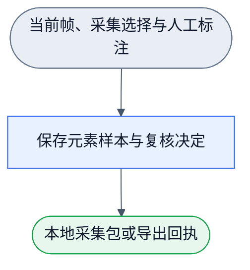

# 页面分类标注与采集扩展 M1

状态：候选内容，实施中复核（candidate under verification）。本文记录已落地的捕获、标注与输入合同，以及尚待场景回归的 ignore 与训练采用边界；不表示本增量已整体交付或候选权重已采用。

2026-10-17，Chrome/Chromium本地扩展的设计与实现合同。用户选择扩展，并新增点选采集、人工纠错和一键收集未知项。独立Gemini4计划与同角色增补位于外置browser-overlay运行目录。先完成最小可用闭环，不扩展训练台或第二层业务语义。

## 工作流与边界

现有候选图和基础类别图不改。新增4N3E标注图与1N0E采集图。每次刷新、Focus或权重改变是新事件；调度复用现有compileWorkflow/runWorkflow和Flowed的浏览器构建，不另写调度器。磁盘loadWorkflow不进入浏览器包，图作为构建时JSON资源明确传入。




内部采集、复核投影、去重和下载是该单节点的实现，不为普通函数拆出更多节点。图只保存拓扑，实际NodeDefinition与公开consumer必须证明可运行。滚动与DOM变更合并刷新，扩展宿主子树不进入观测或变更触发；关闭断开监听并移除宿主。

## 输入、输出和唯一owner

- `lib/adapters/browser/live-dom.ts`：顶层Document/Window与稳定节点引用表→PageObservation、局部属性与元素映射。全页遍历无2000条截断，候选仍按viewportOnly/subtree/focus/黑白名单筛选。完整children与getClientRects、实际祖先overflow裁剪；computed `matrix(1,0,0,1,tx,ty)`（含identity）是纯2D平移，视口矩形已含偏移，保留单位比例的client尺寸完成裁剪，不因此排除整棵子树。旋转/缩放/倾斜、matrix3d、非none的独立translate/rotate/scale/perspective属性、clip-path及其他未测定裁剪仍保留null。未知重复几何与未验证列表父级不得补假值。iframe和shadow内部只报告未覆盖，不推断closed shadow数量。
- `lib/adapters/browser/weight-asset.ts`：显式训练权重资产→已校验profile、compatibility门限、未校准标志。加载失败保留原生效配置；结果报告不能当权重加载。私人权重不提交。
- `lib/adapters/browser/capture-bundle.ts`：当前分类帧、选中引用和用户复核决定→本地采集会话与单文件bundle。批量收集只纳入合格候选且保持未复核；`collect_unresolved` 同时纳入 qualified `unknown` 与 `conflict`，并分别给出 `eligibleUnknown`、`eligibleConflict`；既有 `collect_unknown` 仍只纳入 qualified `unknown`。按 snapshot/frame/node 去重，保序重排 `inputRef.index`。采集会话不产生训练梯度。
- `lib/browser-classify.ts`：纯浏览器入口，复用已有观察/Focus/候选/类别及复核schema。浏览器workflow适配单独导出已有compiler/runner，不能导入Node磁盘loader或重复分类算法。
- `lib/nodes/browser-overlay.ts`：可复用NodeDefinition与显式Document、引用表、present/download资源，使用上述两张图。数据、Focus/profile和采集会话不从日志或隐式站点全局重建。
- `extension/`：MV3壳和Shadow DOM视图，只有activeTab+scripting权限，无host_permissions。图标显式开关；浏览器包复用Flowed官方browser入口。单个esbuild开发依赖，不引入UI框架或自造打包器。
- `playground/overlay/`：同一视图与测量器的真实网页consumer、可重复fixture和本地HTTP入口，用于浏览器黑盒验收。

构建时可显式选择一个已校验的本地权重资产：

```sh
npm run build:extension -- --weight-file training/weights/layout-ignore-svg-pair-v1.weight.json
```

无参数构建继续使用手写基线。带参数时，构建先读取并通过`parseBrowserWeightAsset`校验文件，再把typed profile/config仅嵌入content bundle；面板来源显示“构建加载”、文件basename和profile ID。缺文件、非法JSON或合同不符必须非零退出，不能回退基线或覆盖已有构建产物。绝对输入路径只进入本地构建回执，不进入页面UI。

面板文件上传仍只覆盖当前会话，不写入Chrome storage，也不发网络请求。页面重载后恢复构建时选择的资产；该本地构建选择不自动采用候选profile为项目默认。

采集包含 kind=`nnanything.browser-capture-bundle.v1`、会话/Focus/profile 引用、trainingRequest 和按证据引用索引的 evidenceSidecar。trainingRequest 仅由 readBasicKindTrainingRequest 校验，不能错误套用接收 CandidateBatch 的 validateBasicKindRequest；显式 extractTrainingRequestFromBundle 拒绝错类型。学生 `properties` 只用 `BasicKindMeasurements` 与 tag/role 等许可字段；raw class/id 只在证据区，作为来源线索，不进入学生输入。证据不读取 input.value、密码、Cookie、浏览器存储或网络请求；不伪造原始整页 HTML 覆盖。采集保留原始槽位、兄弟/直接父子关系、子元素观测和 Focus 范围，不能为去重或 ignore 展示删除这些关系证据。

## 主任务路径与UX

普通页面变更触发重算时，保留上一帧的视觉标注与统计，面板更新状态占固定空间。可采集帧立即失效；旧显示只能用于查看，不获得新的采集资格。成功结果整体替换显示，真正的空结果、错误、Focus切换或失效、关闭仍清除旧显示。刷新以单个运行和一个合并的后续请求推进；更新期间到来的变更使旧运行结果不能重新启用采集，关闭重开也不能接收旧代结果。公开回归入口为`artifacts/overlay-harness/refresh.html`，通过实际controller验证稳定呈现、旧采集回调拒绝、突发合并及错误／Focus／关闭恢复；不读取私有controller状态。

页面是操作工具，目标是查分类、限定 Focus 并采集纠错，采用紧凑常规控件。类别颜色配文字图例，平时显示边框；`ignore` 默认不画标注框，图例仍显示该类别，用户可开启查看。选中或开启“显示全部标签”后显示类别文字，减少父子标签堆叠。Focus 用独立边框与名称。面板显示扫描总数、视口候选、已判断、未知、冲突、ignore 与未覆盖说明；`ignored` 是 `judged` 的子集，`unresolved=unknown+conflict`，排除项不计入两者。分数显示为未校准分数，不显示概率百分比。

“检查元素”和“选择Focus”均为显式点选模式，拦截一次点击，不触发原网页按钮；Esc取消，选中后退出模式。正常浏览不拦点击。Focus根被移除时显示失效，用户可清除，不静默扩大范围。

选中后可选择“确认分类正确”“分类错误并指定正确类别”“尚不确定”。只标错未选正确类写 rejected、黄金字段全 null；确认 other 需理由。只有用户明确确认的标签可 verified。未解决项一键收集使用 `collect_unresolved`，只纳入 candidateStatus=ok 且 judgmentStatus 为 unknown 或 conflict 的当前 Focus/viewport 项；legacy `collect_unknown` 的 unknown-only 含义保持不变。filtered_out、skipped、观测不足和候选未知不混为类别未知，不自动黄金 other/负例。收集到当前会话后显示计数；“导出 JSON 样本包”通过用户手势 Blob 下载持久保存，导航前需导出，首版不建数据库或自动后台保存。

## 当前用户可观测范围

语义判断前，实时DOM观测生成可选`foreground`（visible／occluded／unassessed）和`exposedRects`。候选预处理排除已确认完全遮挡的节点，原因`occluded`；未测定绘制保持候选unknown。原始rect、DOM顺序和排除槽位保留。旧观测没有新字段时保持原行为，不伪称已检查遮挡。分类器、权重和训练标签不变。

只对已测定的轴对齐纯色矩形做覆盖差集。接收指针且有背景色的表面包含半透明遮罩；鼠标穿透表面仅在背景完全不透明时提供视觉遮挡证据。原生命中栈按目标与遮挡面自身提供前后关系，不用其小块后代代替整个表面。鼠标穿透目标或表面使用显式层叠路径比较，不把后代z-index直接与另一个根比较。祖先圆角裁剪、图片透明度和复杂变换不能冒充矩形全覆盖；不确定区域不画框。有限采样点全被挡住不构成完全遮挡证明。本轮不承诺逐像素可见性、完整CSS绘制引擎或iframe/shadow内部覆盖。

标注只画已保留的露出矩形。同一节点的多个露出框共享 nodeRef，计数仍按节点槽位。被排除节点不计入分类未知/冲突，不进入未解决批量采集或手动样本保存，不转 ignore/other/负例。`ignore` 只改变默认标注呈现，不剪除节点、子节点、关系或采集失败证据。工具自身宿主与已声明工具根不参与遮挡。重新观测后，关闭遮罩的背景可恢复候选。

公开consumer为`artifacts/overlay-harness/foreground.html`（`npm run build:extension`生成），通过原四节点workflow验收详情遮罩、两侧露出、透明层、不透明鼠标穿透层、圆角不确定性、采集拒绝和关闭恢复。十五轮二十七项浏览器断言已通过，含审查新增的前景穿透、后景负z-index、小块悬浮后代、祖先圆角、visibility子级恢复、静态grid层叠和现代颜色透明度反例。无法解析的颜色保持不确定，不默认不透明。旧357黄金×两profile共714次输出未变。

输入只按直接 Text 子节点判定 text 证据，不把 `textContent` 聚合成父节点文字。教师纠错中的 7 个同帧同矩形 span 包装是 `structure/ignore` 候选：自身无文本、唯一子元素同矩形，子元素的可见文字仍有自己的 `text/text` 标签；父 ignore 不删除子框和数据。行 17、29、43、50 这类多文本、链接或 img 子元素属于复合容器，按 `structure/container`，其子节点保留 text/image/link 等类别，不做自动后代标签继承。五项初步 91 行台账中的 ambiguous 项保持 ambiguous；ignore 不能由 class 名或跨观测关系强制返回。

用户后续明确：设计可训练的“人类可观测／可交互”过滤 filter。viewport 位置、最上层与露出区域、交互承载作为事实输入，保留/过滤由任务监督训练；阅读和显示内容也属于人类可用目标。本轮只交付最小契约与候选回归范围，不能把确定性遮挡预处理或已有 ignore 评分冒充完成该训练。

## 最小验收

图先 DAGpipe validate/inspect。基础模块红测覆盖教师字段泄漏、标错未定类被训练、缺 other 理由、legacy unknown-only 与 unresolved unknown+conflict 的范围差异、排除项误纳入、重复样本、>2500 项保序、错误权重导致现有配置丢失。真实浏览器 fixture 验证视口/overflow/隐藏、>2500 节点完整遍历、同一节点引用稳定、Focus 选择/取消/移除、滚动更新、动态变化不自触发、关闭后原网页点击恢复、单项纠错、未解决批量、ignore 默认不画但可查看及本地导出。Node 白盒不替代浏览器行为。

用户安装前先完成可审查构建物与同源harness实测。能操作Chrome安装时按实际权限完成；若需用户加载本地扩展，则明确该步未验证并提供具体文件夹，不能以harness冒称MV3已安装。完整milestone作者验收后一次独立审查，main合并/推送并清理任务资源。

## 作者验证结果与剩余边界

2026-10-17：扩展代码与可加载目录已构建，95项测试、库/UI类型检查通过。Chrome真实网页consumer遍历2714元素；色框与类别筛选、点选复核、未知批量去重、Focus子树/取消/移除/恢复、动态变更与关闭清理通过。32行真实下载包经公开提取器与training.prepare检查，仅1条verified入集，1条rejected与30条unreviewed均排除。2501行导出、裁剪矩形、稳定引用恢复、权重解析与标签数据边界由公开接口测试覆盖。过程证据、原始下载引用与截图在外置`browser-overlay`运行目录，项目汇总以note.md为准。

以上为初始交付时的安装边界；后续实际安装和现场证据以note.md为准。自动化文件选择被ChatGPT扩展的file URL权限拒绝，未改权限或换通道；权重文件选择后的界面应用仍需手工验收。首版只处理顶层DOM，iframe/shadow内部未覆盖，不宣称完成像素遮挡判断。采集会话驻留内存，刷新或导航前需导出；不自动上传或训练。

2026-10-17 候选呈现与关系输入升级：实时 adapter 读 DOM/CSS 后调用共享纯整形函数；候选节点继续负责 viewport/Focus/黑白名单。非格式直接文本、before/after 内容、背景图及 mask 存在性、关系几何与十项 nullable 测量随采集包保存，旧包缺项保留 null。工具注释根默认排除；额外排除根由资源显式提供，不排除普通 fixed 或 shadow 宿主。规则和连线唯一合同为 `docs/basic-kinds-wiring.md`。当前训练候选未采用，扩展重建也不表示用户页已加载新版；真实页面场景回归与现场重载核验仍待完成。
