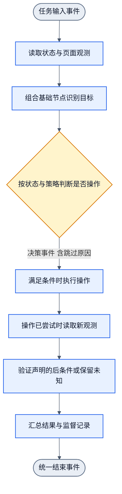

# 画布、事件与基础节点

状态：设计修订5草案，2026-10-17。承接用户决定：节点通过事件输入输出，读取明确状态后判断、处理或操作，单次执行为标准DAG。只提供基础节点，由使用者组合；不将DOM处理顺序固定进核心。尚未实现，修订2的Gemini 4评估不覆盖本文。

## 1. 最小框架

画布编辑和展示同一份WorkflowDefinition。保存、校验与执行都消费这份定义，不另建画布专用执行引擎。画布上的节点代表可复用处理能力，不代表每一个DOM元素，也不代表Handwired内部数值单元。

核心只负责节点合同、事件连线、依赖执行和结束结果。首期单进程即可，不引入消息中间件、全局事件总线、事件溯源系统或独立复杂状态机。画布界面暂不实现。

| 基础节点能力 | 输入事件 | 输出事件 | 可选训练 |
| --- | --- | --- | --- |
| 观测 | 页面或其他资源引用、观测要求 | 观测数据或证据引用 | 通常无需训练 |
| 选择 | 输入项、显式黑名单/白名单等条件 | 保留项、排除项及原因 | 手写规则无需训练 |
| 拆分/转换 | 范围、集合或观测数据 | 有序独立项或派生参数 | 按具体节点声明 |
| 判断 | 参数、明确业务状态、可选profile | 单标签/分数或条件结果 | 仅声明训练适配的节点 |
| Operation | 具体目标、操作参数及前置条件 | 执行回执与结果状态 | 首期不训练操作策略 |
| 验证 | 预期后条件、操作回执和新观测 | 成功、失败或证据不足 | 按具体节点声明 |

这些是能力说明，不要求先建立六套类层次。黑名单和白名单可作为独立节点，也可由同一规则节点的不同实例承担。DOM拆分、viewport、站点取参属于应用基础节点。训练准备、拟合、校准与比较也使用相同节点/事件合同。

## 2. 节点之间用事件传递输入输出

每个输入/输出端口声明事件类型及数据合同。节点完成处理后，将结果作为输出事件沿已声明边发送；下游只在所需输入齐备时执行。事件携带业务数据或明确引用，不依赖自然语言解释。

最小事件信封包含eventId、runId、生产节点/端口、事件类型、输入项关联键及数据或数据引用。输入事件通过入口端口进入；多输入节点按同一次执行和同一输入项关联，禁止将不同页面观测或不同样本的结果拼接。具体字段及批事件编码在接口冻结时确定，不提前实现消息协议。

各边声明下游必需的数据及状态引用。例如操作决策事件须关联具体目标与动作要求，验证输入须关联预期后条件、回执和新观测。不能只发一个标签后再要求下游从隐藏上下文取齐数据；数值节点仍只消费其白名单参数。

节点配置、profile选择和操作策略仍由明确的类型化调用/配置合同提供。事件引用实际使用的配置；不将控制决策藏进任意metadata。事件记录用于回溯，不从日志反推运行控制状态。

业务状态是明确输入，节点输出判断结果及必要的新状态；不读写隐藏的全局可变对象。首期按run传递状态及其观测引用即可。浏览器页面本身可变化，旧观测不等于操作时的当前页面状态。

节点执行状态与业务状态分开：等待/运行/结束描述执行进度；目标存在、页面已变化、后条件满足描述业务事实。无需操作、被过滤、未知和失败都要有明确结果。条件未满足时发出跳过结果，使下游能收束到统一结束出口，不无限等待一条不会产生的事件。

同一输入项在一次run内只触发对应节点调用一次；重复投递不得再次触发操作。此约束不证明外部副作用恰好执行一次。操作结果未知时保留unknown，不自动重试。持久恢复与跨进程投递不是首期目标。

## 3. 由使用者搭建，不固定业务流程

使用者可以组合“观测→黑名单→白名单→DOM拆分→逐项判断”，也可以增加viewport、focus或取参节点。微博示例的viewport与deny优先等规则是该应用的合同，不是核心对所有应用强加的固定顺序。画布连线必须符合节点端口合同；连通不等于业务正确。

DOM拆分按可观测层级产生独立输入，包括合格中间容器及后代；不先知道“这是作者/正文”再拆分。父子可以分别作为样本且子树重叠。保留snapshot/nodeRef、父子兄弟关联及确定顺序用于映射，绝对路径与全局深度不进入模型。

范围过滤与当前节点过滤不同。跳过父容器自身仍可继续拆分后代；显式排除子树才停止该范围。拆分节点不负责继承未声明的白黑名单含义。示例在拆分后用相同候选规则检查展开项，防止离屏或已排除目标重新进入模型。规则及其传递方式由workflow显式绑定。

一个拆分节点输出数组，后续节点以map/batch处理。不要为每个DOM元素生成一个画布节点。显式数组入口保持输入长度和顺序；页面拆分入口建立自己的确定项序号，并保留排除映射。

## 4. 判断与操作闭环示例

下图只是可搭建的应用示例，不是框架强制流程。所有箭头均表示有类型的输入/输出事件。每个步骤把成功、跳过或错误作为明确结果向后传递；依赖失败时后续操作跳过，最后统一汇总。识别子流程可复用[DOM识别图](dagpipe/graphs/dom-recognition.graph.json)。

判断节点只产生类别或决策，不自行点击。Operation需要具体有效目标、显式动作参数与前置条件。歧义、低于已声明阈值或引用失效时不选择任意目标执行。动作前校验当前可操作性，不能用viewport相交替代它。

回执成功只说明执行器返回成功。验证节点用新的观测检查预期后条件；缺少证据返回unknown。操作结果不明时可以做只读观测，不据此自动重放动作。离线训练/回归只用保存的事件和观测重新计算判断，不执行真实operation。

业务闭环是“观测→判断→操作→新观测→验证→结束”。单次DAG中没有回边。下一次外部事件可启动新的run；是否继续由显式调用条件决定，不自动把所有结束事件接回入口。训练epoch留在拟合节点内部有界运行。

该示例的[项目图](dagpipe/graphs/operation-episode.graph.json)有7节点6边。Object端口与operator仍为设计占位。静态拓扑通过不证明事件调度、端口类型、动作隔离或业务后条件已实现。

## 5. 后续最小验收

接口实现后验证：事件按边传递；输入未齐不执行；跨run/跨项不混接；跳过/失败能结束；重复事件不重复调用operation；数组逐项保序；离线训练不执行副作用。DOM示例另验证父容器跳过不丢后代，以及拆分不复活被排除目标。

本轮只交设计，不运行这些验收。基础节点集合先覆盖一个最小示例，再按真实用途增加，不提前做全部浏览器能力。
