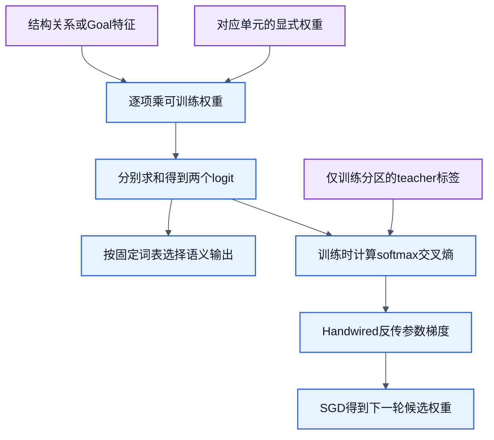

# 训练设计1：CWD概念与pwd获取

状态：历史独立基线与当前共享阶段并存。历史6参数独立PWD profile（`REJECT/PWD`，`x=[1, goalObserveCwd, goalSetCwd]`）及其12/12、6/6、独立12/12均为历史基线，只保留兼容，不被共享入口调用。当前正式命令阶段是共享模型的PWD阶段（4参数：heads `unsupported, pwd` × wires `bias, goalObserveCwd`）。CWD关系是`MATCH/NO_MATCH`概念测量，`x=[1, sameSession, hasObservation]`，共6个参数；历史16/8只是样本计数，不产生命令selector。当前共享train/dev与独立验证结果见[共享模型实测](cli-filesystem-training-results.md)。统一共享命令模型唯一权威合同见[文件系统训练合同](cli-filesystem-training.md)。

调用边界统一沿[参数简化合同](cli-call-contract.md)：模型输出调用序列 `["pwd"]`。profile、sandbox与session在策略工厂绑定：`createCliCommandPolicy({ profile, sandbox, session: S })`；每次调用传`step({ goal, state })`，请求没有`resources`字段。harness固定映射到 `cwd.get(session:S)`。NN不解析命令输出内容。

## 固定Goal、阈值与评价

共享命令入口的PWD Goal固定`satisfactionThreshold=100`，实际`satisfaction`只取100、0或null。成功要求本请求产生属于S的新PWD观测，且S.cwd/revision不变：完全成立为`achieved/100`；native OS或grant失败为`unmet/0`；没有定义评价真值时为`unverified/null`。过期观测、关系`MATCH`和其他session的PWD都不提前完成Goal。固定配置和公开结果类型唯一维护于[文件系统训练合同](cli-filesystem-training.md)。

CWD关系概念仍只输出`MATCH/NO_MATCH`分类。训练评价以监督真值固定100/0；没有评价真值时满足度未知，不把分类输出本身冒充目标满足度。保留现有分类输出，不增加环境操作、命令头或推理期teacher。

单元接入只引用公共图：[project-design](../workflows/project-design.graph.json)、[model-evolution](../workflows/model-evolution.graph.json)与[model-conflict-design](../workflows/model-conflict-design.graph.json)。共享命令模型和CWD关系模型的使用采集、当前版本、自动比较采用及LLM冲突处理均未实现；候选保持`uncalibrated/not_applied`，本地旧入口是兼容切片，不迁移为新的零散Goal。

## 目标与函数

CWD关系概念测量与共享命令模型分工明确：

| 单元 | 学生输入与监督 | 输出/职责 | 交付形式 |
| --- | --- | --- | --- |
| CWD关系 | 查询session引用、候选观测槽位的结构关系；teacher给出是否是该session已有的CWD知识 | `MATCH / NO_MATCH`；在多个候选中确认知识归属，不生成路径字符串 | 独立概念测量，不生成正式命令候选 |
| 获取动作 | 结构化Goal与State；teacher给出`pwd / unsupported` | 统一共享命令模型阶段1（4参数：`unsupported, pwd` × `bias, goalObserveCwd`） | 统一共享profile候选（`cli.command-policy.v1`） |

概念请求为`{kind:"cwd.belongs_to", session:S, candidate:C}`。C为`{session, observation:null|{physicalCwd, evidence, sourceRun}}`槽位；引用合法性手写校验。候选有观测且属于S时MATCH，否则NO_MATCH。模型不接收teacher真值；名称相等计算和字段是否存在是手写特征，不冒称NN学习了字符串相等算法。匹配旧知识只说明归属，不证明本次Goal已完成。

获取请求统一由共享命令模型处理：绑定工厂携带S，调用为`{goal:{kind:"observe_cwd",session:S.sessionId},state:{session:S.sessionId,cwdObservation:null,directoryListing:null}}`。模型输出调用序列 `["pwd"]`，harness绑定S执行`/bin/pwd -P`。原有6参数独立PWD模型保留为历史兼容基线，新共享入口不调用旧profile。

## NN内部图与手写边界

CWD关系输入固定为`x=[1, sameSession, hasObservation]`。两个logit分别为MATCH/NO_MATCH，`z[a]=Σ W[a,j]x[j]`，共6个参数。两个二值特征的4种组合全部覆盖；只在`sameSession=1 && hasObservation=1`时监督MATCH。标签组合规则是teacher，不在推理时覆写argmax。

CWD关系单元保持上述6参数概念profile，同分NO_MATCH；它只回答知识归属，不选择命令。当前共享命令模型的PWD阶段使用heads `[unsupported, pwd]`、wires `[bias, goalObserveCwd]`，共4个参数，同分`unsupported`优先。历史6参数独立PWD动作profile（`REJECT/PWD`）仅作兼容基线，共享入口不调用。若关系模型选错，记录错误，不用teacher修正输出后计为正确；动作仍按真实Goal执行，与关系题准确率分开统计。

每轮后端求值/反传，下一epoch由拟合器开始，不给workflow加回边。初始预算沿已验证配置：零初始化、全批SGD、200epochs、lr0.1；只是初始预算，不预先承诺收敛。零/冻结对照只做预测，不执行命令；冻结使用扩展后的初始矩阵且不做参数更新（等价初始状态`epochs:0`），数值拟合器的`epochs:0`路径由作者单独测试。实际计时、回载和逐例比较均保留。内部图不包含路径字符串、原始名字或绝对沙盒根。

手写部分是字段校验、引用关系特征、session绑定、真实执行、知识更新和Goal检查。NN只学习关系判别与动作评分。权限或目录失败由执行器返回；NN不预测有权限就越过授权。

## 状态转换与后条件

成功：`executionCwd_after=executionCwd_before`；`knowledge_after`绑定本次实际physicalCwd、native evidence及run。两个session互不影响。失败或拒绝：保留旧知识，Goal未达成；过期知识、关系MATCH或模型预测都不能替代本次成功观测。

沙盒先创建两个实际不同目录与两个显式session，再随机打乱候选槽位。预期路径由独立`fs.realpath`取得，执行结果来自pwd；不把同一函数的输出直接复制为真值。快照保存OS执行和来源，场景配方可重建，不依赖已清理临时路径。

## 样本计划

每个场景生成4条关系题和3条动作题；动作题分别为observe_cwd、set_cwd拒绝、其他Goal拒绝。下表预算已执行。每项都报告唯一特征向量数，换名不算新概念。

| 分区 | 独立场景家族 | 关系题 | 动作题 | 计划真实pwd |
| --- | ---: | ---: | ---: | ---: |
| train | 4 | 16 | 12 | 4 |
| development | 2 | 8 | 6 | 2 |
| verification | 4 | 16 | 12 | 4 |

train家族：普通双session、含空格目录、同目录不同session、已有陈旧知识；development使用独立嵌套布局和中文路径家族；verification由独立作者构造尾随空格、祖先链接的物理cwd、重复观测、含其他session旧知识的4种正常场景。验证集另加缺失cwd和缺少授权2个失败探针，不算入上表正常pwd预算。目录布局、关系槽位顺序和旧知识组合分别记录，名称变化只是环境覆盖。

训练资料与验证资料使用不同配方，先分来源家族再生成；原pwd黄金及路径黄金作为只读回归。不同session名称不自动构成独立来源。所有关系特征组合可在各分区出现，诚实说明这是完整有限真值表和独立环境验证，不是未见概念泛化。

配方独立性落实到结构：train分别用双兄弟目录、父子双目录、共享物理目录的双session、双目录陈旧知识；development改用三层树/三session及不同缺观测槽位；verification独立构造四层分支树、多个session与祖先链接链、连续观测轨迹及跨session混合旧知识。名称特殊性叠加在各自结构上，不能将训练树只改名放入验证。保留原始配方、构造来源和结构差异，不能仅靠不同随机种子声称独立。

## 外层DAG、验收与实施owner

旧`cli-cwd-learning.graph.json`及同名workflow配置从未发布，已随“一份共享profile”的要求删除；不得引用为当前图。当前推理图是`workflows/cli-command-step.graph.json`（3节点/2边，0.1.0）及同名workflow配置。多阶段训练图是`workflows/cli-filesystem-training.graph.json`（8节点/8边，0.1.0）及同名workflow配置，接收调用者准备并分区的dataset，不生成fixture或自行启动新进程回载；这些由公开consumer完成。`workflows/cli-filesystem-curriculum.graph.json`（5节点/4边，0.1.0-design）只是公开consumer 5N4E顺序流程的设计描述，不是运行配置或新引擎。独立验证由单独consumer载入已保存候选，不进入fitter。未提供workflow可选verification资源时，receipt的fullyVerified为false；train/dev accepted不冒充独立验收。

历史独立基线验收为：关系16/16和动作12/12验证题均正确；4个正常真实pwd均满足后条件；所有失败探针都未错误达成Goal；已有pwd/路径回归零退化；新进程回载分数/动作一致；所有必需指标完整，否则不采用。这里是历史有限样本精确门槛，不是概率校准声明。当前共享模型的验收结果与计数见[共享模型实测](cli-filesystem-training-results.md)，本文不重复。动作guard与错误策略分别计数。

owner：`lib/adapters/cli/`负责场景与真实观测；`lib/filters/`负责关系特征/评分；`lib/nodes/trainable/`负责电路结构；`lib/training/`负责分区、拟合与比较。历史独立PWD与CWD关系结果作为基线；当前正式交付统一收敛为共享模型（PWD→CD→LS），单项命令不维持独立active profile。唯一训练合同见[文件系统训练合同](cli-filesystem-training.md)。
