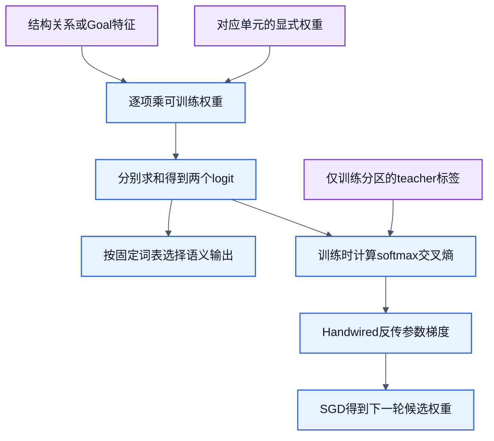

# 训练设计1：CWD概念与pwd获取

状态：可实施设计，2026-10-19；未运行本设计的新样本训练。已有有限pwd动作选择器及实测保持原样，见[cli-goal-training.md](cli-goal-training.md)。沙盒/分区沿[公共合同](cli-filesystem-training.md)，采用规则沿[模型演进合同](model-evolution.md)。本页是本项概念题、样本与训练连线的唯一owner。

调用边界统一沿[参数简化合同](cli-call-contract.md)：PWD映射`cwd.get(session)`，NN不解析命令输出内容；既有pwd适配器的回执解码属于harness，不算学生能力。

## 目标与函数

先建立“CWD属于指定会话”的关系，再学习为了获得本次CWD而调用PWD。训练两个独立最小函数，不把两个标签混进同一损失：

| 单元 | 学生输入与监督 | 输出/职责 |
| --- | --- | --- |
| CWD关系 | 查询session引用、候选观测槽位的结构关系；teacher给出是否是该session已有的CWD知识 | `MATCH / NO_MATCH`；在多个候选中确认知识归属，不生成路径字符串 |
| 获取动作 | 结构化Goal；teacher给出`PWD / REJECT` | 沿现有三特征六参数策略，学习本次获取动作；不因已有知识就省略执行 |

概念请求为`{kind:"cwd.belongs_to", session:S, candidate:C}`。C为`{session, observation:null|{physicalCwd, evidence, sourceRun}}`槽位；引用合法性手写校验。候选有观测且属于S时MATCH，否则NO_MATCH。模型不接收teacher真值；名称相等计算和字段是否存在是手写特征，不冒称NN学习了字符串相等算法。匹配旧知识只说明归属，不证明本次Goal已完成。

获取请求沿现有`{goal:{kind:"observe_cwd",session:S},state:{session:S,cwdObservation:...}}`。固定动作`{kind:"PWD",session:S}`由harness绑定S，执行`/bin/pwd -P`。模型不接收执行器隐藏的真实cwd，输出路径由本次OS观测提供。相对路径以所属S的cwd解析的能力，引用已有路径模型独立测试；它不计入本次新参数的学习成绩。

## NN内部图与手写边界

CWD关系输入固定为`x=[1, sameSession, hasObservation]`。两个logit分别为MATCH/NO_MATCH，`z[a]=Σ W[a,j]x[j]`，共6个参数。两个二值特征的4种组合全部覆盖；只在`sameSession=1 && hasObservation=1`时监督MATCH。标签组合规则是teacher，不在推理时覆写argmax。

获取动作复用现有`x=[1, goalObserveCwd, goalSetCwd]`、`REJECT/PWD`、6个参数。同分REJECT。关系单元同分NO_MATCH。两者分别保存profile；若关系模型选错，记录错误，不用teacher修正输出后计为正确。动作仍按真实Goal执行，与关系题准确率分开统计。

每轮后端求值/反传，下一epoch由拟合器开始，不给workflow加回边。初始预算沿已验证配置：零初始化、全批SGD、200epochs、lr0.1；只是初始预算，不预先承诺收敛。零/冻结对照、实际计时、回载和逐例比较均保留。内部图不包含路径字符串、原始名字或绝对沙盒根。

手写部分是字段校验、引用关系特征、session绑定、真实执行、知识更新和Goal检查。NN只学习关系判别与动作评分。权限或目录失败由执行器返回；NN不预测有权限就越过授权。

## 状态转换与后条件

成功：`executionCwd_after=executionCwd_before`；`knowledge_after`绑定本次实际physicalCwd、native evidence及run。两个session互不影响。失败或拒绝：保留旧知识，Goal未达成；过期知识、关系MATCH或模型预测都不能替代本次成功观测。

沙盒先创建两个实际不同目录与两个显式session，再随机打乱候选槽位。预期路径由独立`fs.realpath`取得，执行结果来自pwd；不把同一函数的输出直接复制为真值。快照保存OS执行和来源，场景配方可重建，不依赖已清理临时路径。

## 样本计划

以下是待生成预算，不是已完成样本数。每个场景生成4条关系题和3条动作题；动作题分别为observe_cwd、set_cwd拒绝、其他Goal拒绝。每项都报告唯一特征向量数，换名不算新概念。

| 分区 | 独立场景家族 | 关系题 | 动作题 | 计划真实pwd |
| --- | ---: | ---: | ---: | ---: |
| train | 4 | 16 | 12 | 4 |
| development | 2 | 8 | 6 | 2 |
| verification | 4 | 16 | 12 | 4 |

train家族：普通双session、含空格目录、同目录不同session、已有陈旧知识；development使用独立嵌套布局和中文路径家族；verification由独立作者构造尾随空格、祖先链接的物理cwd、重复观测、含其他session旧知识的4种正常场景。验证集另加缺失cwd和缺少授权2个失败探针，不算入上表正常pwd预算。目录布局、关系槽位顺序和旧知识组合分别记录，名称变化只是环境覆盖。

训练资料与验证资料使用不同配方，先分来源家族再生成；原pwd黄金及路径黄金作为只读回归。不同session名称不自动构成独立来源。所有关系特征组合可在各分区出现，诚实说明这是完整有限真值表和独立环境验证，不是未见概念泛化。

配方独立性落实到结构：train分别用双兄弟目录、父子双目录、共享物理目录的双session、双目录陈旧知识；development改用三层树/三session及不同缺观测槽位；verification独立构造四层分支树、多个session与祖先链接链、连续观测轨迹及跨session混合旧知识。名称特殊性叠加在各自结构上，不能将训练树只改名放入验证。保留原始配方、构造来源和结构差异，不能仅靠不同随机种子声称独立。

## 外层DAG、验收与实施owner

本项训练图：[cli-cwd-learning.graph.json](../workflows/cli-cwd-learning.graph.json)。它细化公共训练流程中的两种监督/拟合及独立评价，算子均design，不是运行配置。关系训练与动作训练分别得到候选，合并成只读评估包；后续评价复用真实公开执行入口。

设计验收为：关系16/16和动作12/12验证题均正确；4个正常真实pwd均满足后条件；所有失败探针都未错误达成Goal；已有pwd/路径回归零退化；新进程回载分数/动作一致；所有必需指标完整，否则不采用。这里是预定有限样本精确门槛，不是已测准确率，也不是概率校准声明。动作guard与错误策略分别计数。

先做沙盒session与真实观测consumer，再加CWD关系电路和数据准备；复用现有pwd策略/执行器，不重写它。owner：`lib/adapters/cli/`负责场景与真实观测；`lib/filters/`负责关系特征/评分；`lib/nodes/trainable/`负责6参数电路；`lib/training/`负责分区、拟合与比较；`lib/nodes/`和CLI公开consumer负责workflow封装。实现前红测至少抓住跨session误认、已有知识冒充新观测和零策略拒绝observe。只交第一项，不提前实现cd。
