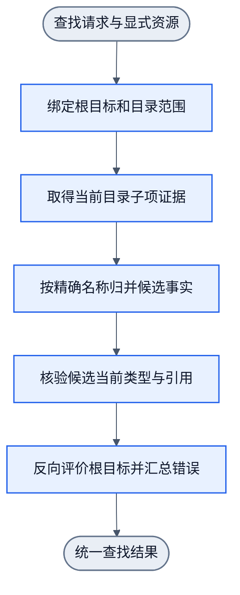

# 指定目录内精确名称查找：最小组合设计

版本：0.1.0-design，2026-10-21。状态：设计交付，尚未实现、训练或行为验收。用户要求在已交付CLI基础上设计下一步，由worker实施。范围为一个已绑定目录的直接子项，按精确名称寻找一个普通文件或目录。完成本批不代表任意搜索或第一层全部完成。

## 1. 现状、目标与非目标

当前基础能力及证据见[CLI基础](cli-foundation.md)。已读`cli-foundation` 1N0E、`cli-file-property` 6N5E、`recursive-goal` 3N2E，现有流均闭合。本批的缺口是：没有将列举、名称条件、真实候选核验接成一个保留根Goal的查找入口。目录列举仅返回path/name/type，不能据此伪造带OS身份的ObjectRef。

复用关系如下：

| 已有owner | 本批用途 | 不得替代的事实 |
| --- | --- | --- |
| `lib/adapters/cli/directory-listing.ts` | 结构化列举直接子项，保留coverage/errors | 不解析人类ls文本，不把partial当complete |
| `lib/adapters/cli/entry-inspection.ts`、`filesystem-sandbox.ts` | 授权、session/范围绑定、lstat和受信对象引用 | 不从路径或列举type生成身份，不绕过sandbox |
| `lib/filters/cli-file-property.ts`、`cli-command-policy.ts` | 现有observed子Goal及共享命令策略 | 不把根matches请求伪装成已支持原子请求 |
| `lib/workflow/recursive-goal/` | 根保留、子条件、真实评价、错误/预算/continuation | 不复制控制器，不训练层序，不隐藏失败 |

不做：递归目录扫描、模糊/大小写折叠匹配、glob/正则、内容搜索、自然语言、role、help学习、符号解析、创建/移动/删除、内容写入、自动训练或采用。查找本身不读取文件正文，不跟随候选symlink；fixture创建不算学生能力。

首版支持可由现有字符串协议无损表示的POSIX名称。任意非UTF-8原始文件名字节不在首版支持域；不得把不能无损观测的名称算作完整覆盖。worker在探索阶段确认当前观测能否识别该限制，不能声称任意POSIX字节名已覆盖。

## 2. 四元素与最小语义

| 元素 | 本批定义 |
| --- | --- |
| Goal | 在显式目录D的直接子项中，取得名称严格等于N、实际类型等于T的当前对象引用；T只支持regular或directory |
| satisfactionThreshold | 首版固定100；二元事实成立为100，已证不成立为0，证据不足为null。其他阈值拒绝，不能用模型分数代满足度 |
| State | 根Goal、绑定session及revision、目标目录、当前列举及coverage/errors、精确匹配项、实际inspect与对象身份、成员结果、根事实；控制预算/effects沿现有typed资源 |
| Action | 当前只选一个已启用技能：观测目录直接子项，或核验匹配条目。不变更文件和session cwd |

知识获得和找到对象是不同目标。本批根Goal要求找到：完整无匹配表示取得了负向知识，但根Goal仍未满足。不是把所有子Goal achieved相加就得到父Goal achieved；最后必须按根的名称、类型、归属和当前证据重新评价。

去掉NN后，固定名称比较、coverage判断和根评价仍是确定性基础设施。NN仍负责现有原子子Goal的head选择；本批不声称学会新的搜索策略。只有后续出现需要学习的多个策略，才另补组合学习合同，不预先造权重。

## 3. 请求、资源与公开入口

拟新增公开入口`nnanything/cli-search`的`runCliEntrySearchGoal`。这是实施目标，不是当前API。请求使用以下最小形状；类型别名复用现有引用，不复制其字段定义：

```ts
type EntrySearchRequest = {
  goal: {
    kind: "file.property";
    property: "file.property.directory.entries";
    target: DirectoryObjectRef; // 已绑定的一个目录，不接受DirectoryQuery
    requirement: {
      kind: "matches";
      predicate: {
        kind: "entrySelector";
        name: string;
        type: "regular" | "directory";
        cardinality: "one";
      };
    };
  };
  satisfactionThreshold: 100;
};
```

`name`必须为单个非空名称段，拒绝NUL、`/`、`.`、`..`；不trim、不展开变量或glob。空格、换行、中文、前导横线和反斜杠保留。比较的是实际枚举名称的严格字符串相等，不做Unicode规范化和大小写折叠。因此即使宿主大小写不敏感，输入`A`也不匹配实际目录项`a`。type是Goal要求，不是已观测真值。

资源信封与业务请求分开：显式sandbox、session、共享policy/profile、recursive limits及授权由binding传入；不把控制状态镜像进业务metadata。沿已有profile文件显式加载入口，加载失败原样暴露；不采用默认权重补偿。worker确定最薄的绑定函数签名并在实施前记录，不能扩大业务请求或新增执行引擎。

首次请求不接收调用者伪造的“已找到”或gold。真实State由当前运行的观测产生；若复用既有typed continuation，只能沿其资源/版本/证据校验，不能凭上一轮列表满足this_run。相对目录引用按进入请求时的显式session绑定解析；session发生变化时显式报绑定失效，不悄悄改查另一个目录。

这是组合入口支持的新matches谓词。现有`createCliCommandPolicy().step`继续只处理已注册的原子合同：直接把该根matches传给原子policy，仍应unsupported、零执行。本批不改共享head/wire/矩阵，不实现未来P3的学习型`select.entry`；后者仍由[属性训练设计](cli-property-training-design.md)维护。本页实现的是固定精确匹配组合，不能把它登记成P3训练完成。

## 4. 图、技能与执行反馈

内部责任图：[cli-entry-search.graph.json](../workflows/cli-entry-search.graph.json)，5N4E，`0.1.0-design`。这是组合责任图，无独立五算子绑定或运行配置。实际调度复用现有recursive-goal 3N2E，实际动作复用cli-file-property 6N5E；worker不得手抄五阶段再实现另一个循环。



所有失败携带typed结果沿后续节点传递到同一report出口；无执行资格的阶段只传递事实，不继续OS调用。多轮发生在既有controller内部，不在DAG造回边。

五阶段的最小必要性：去掉绑定会丢session/范围约束；去掉列举会将猜测路径冒充目录证据；去掉精确比较会偷换用户名称；去掉核验会信任陈旧类型和伪造引用；去掉根评价会把子Goal完成误当找到。各阶段只承担这一项责任，不新增排名、规划或重试节点。

已确认一个重要既有边界：`cli-state.ts`的directoryListing知识及authority只接受complete；`cli-command.ts`对partial列举返回unknown，不把它存为已满足知识。首版沿用此合同：partial无论是否出现同名项，都返回unknown，不继续inspect；原始列表、候选线索和逐项错误仍保留在实际回执中，不塞入complete State。后续若要在partial中利用已知正例，须独立设计局部证据资格，不能在本批放宽原子observed含义。

根派生的逻辑条件为：

| 条件/技能 | 当前输入与操作 | 实际New State与继续条件 |
| --- | --- | --- |
| C1 取得目录观测 | 生成`directory.entries observed this_run`子Goal；共享policy应选ls，固定helper列举 | 保留真实列表和错误。拒权/执行错终止；partial按现有合同unknown，不继续派发或反复列举 |
| C2 确定精确候选 | 纯函数比较当前条目名，不训练，不派OS动作 | 无匹配按coverage决定未满足或未知；出现一个同名项时继续C3。伪造重复同名属于观测合同错误，不引入性格排序 |
| C3 核验当前匹配对象 | 从受信列表中的条目路径机械绑定PathRef；生成`entry.identity observed`的`entry.inspect`子Goal，followSymlinks=false | 必须取得当前类型、dev/ino和合法对象引用，再比较Goal类型。失败保留原错误；仅有列表type不能完成根 |
| 根评价 | 对C1–C3真实结果执行根谓词 | 名称、直接归属、类型、有效引用均满足才100；真实错误/未知不可被子Goal成功覆盖 |

候选类型即使在列表中与Goal不同，也允许只做一次C3观测确认当前类型；不按扩展名或列表旧类型直接满足。symlink核验为symlink，不跟随它去搜索目标。目录绑定与权限沿sandbox，词法前缀不是物理范围授权；必要绑定缺失时报错，不用M0的cwd“安全根”替代。

首版不自动重试查找失败，不搜索其他目录。列举后候选消失时返回证据失效unknown并保留ENOENT；不能把它改成完整not_found。候选在核验前被同名同类型对象替换时，根只要求当前存在符合条件的对象，可以返回实际核验的新对象及身份，不声称它与列表时是同一对象；若调用链持有旧identity且检测到失效，则保留stale_reference，不能静默重绑。

不承诺原子目录快照或调用返回后对象永不变化。无匹配的负向结论只针对本次完整列举时点；命中的引用只针对实际核验时点。下游使用仍须沿既有引用有效性合同。普通读对OS atime的影响不算本批主动写入保证；保证的是不派写操作、不改变内容/目录项及session cwd。

limits、能力缺失、取消、stalled/exceeded沿[递归模块](recursive-goal-module.md)返回，不另造第二套状态机。本批新增普通成功路径最多需要两个原子调度（ls、inspect），不能把report/evaluator偷偷做额外IO；纯评价调用必须零IO。

## 5. 结果与准确错误

保留原始RecursiveGoalResult（根事实、control、errors、ledger、effects分开）。领域投影增加`status`、`resolution`、`satisfaction`、`match`、`coverage`和证据引用，不覆写原始结果。`match`仅在合法真实核验后返回；所有非achieved结果为null。

| 真实结果 | status / resolution | satisfaction与根事实 |
| --- | --- | --- |
| complete列表名称精确命中，实际类型符合，有当前受信引用 | achieved / matched | 100 / satisfied；列举与核验均为本次真实证据 |
| 当前完整列举无精确名称 | unmet / not_found | 0 / unsatisfied；证据范围为该次列举 |
| 同名项经真实核验为其他类型（含symlink） | unmet / type_mismatch | 0 / unsatisfied；返回要求类型和实际类型证据 |
| partial，不论是否出现同名项 | unknown / insufficient_evidence | null / unknown，保留列表线索与逐项错误；不伪造complete知识 |
| 命中后消失、无法核验或缺身份 | unknown / stale_or_unverified | null / unknown，保留原始errno/引用错误；非ENOENT执行故障也在errors保留 |
| 缺授权、未执行的绑定/能力拒绝 | rejected / rejected | null，根事实保持未验证；effect_denied/capability_missing等沿既有错误码 |
| helper/协议/策略错误或必需执行失败 | failed / failed | null，根事实保持未验证；保留policy_error、执行与观察错误，不伪装not_found |
| budget提前停止 | unknown / budget_exhausted | null，保留 typed budget control、`rootEvaluation` 与部分事实，不由根已评价豁免 |
| cancel/stalled提前停止 | unknown / interrupted | null；control保留cancelled/stalled及原因 |

非法schema、额外答案字段、非法name/type/threshold沿现有入口约定抛TypeError，零执行；合法但缺技能/授权等有准确typed报告。部分IO失败不抛掉整条ledger。错误码映射复用既有recursive错误链，errno置原始执行错误证据，不编新的通用errno。

观测内容可信性属于adapter边界。相同目录出现重复名称、条目path/name/parent不一致、混入另一session/scope或伪造当前性，均不得返回match；沿现有schema/authority守卫拒绝。只加本批真实可达缺口的校验，不复制一个通用安全框架。

## 6. 测试标准：逐失败模式验收

测试以公开`nnanything/cli-search`入口与真实consumer为主，纯函数单测仅辅助定位。先让核心行为在当前缺入口/缺组合上红，再实现；不能仅测试导出存在。测试不能从模型输出生成gold。

| ID | 场景与oracle前提 | 必须断言 / 抓住的错误 |
| --- | --- | --- |
| E01 | 直接目录中存在目标普通文件；再用目录目标独立运行 | achieved/100、实际引用身份/类型/父目录正确；ls与inspect当前真实执行；抓只返回名称不核验 |
| E02 | 完整空目录或只有不匹配直接项 | unmet/not_found/0；非异常；不inspect不存在的猜测对象；抓把知识获得当找到 |
| E03 | 名称相同但真实类型不同，含指向文件的symlink | unmet/type_mismatch；不跟随symlink，不读其目标内容；抓requiredType偷换observedType |
| E04 | 目标只在孙目录或相邻目录；另有`/a`与`/ab` | not_found仅限正确直接目录；零递归/越界调用；抓隐式扩大scope |
| E05 | 空格/换行/中文/前导横线/反斜杠/shell元字符 | 名称及参数无损，绝不执行插值；与真实枚举值核对；抓trim、分词和命令拼接 |
| E06 | 仅大小写或Unicode规范化形式不同 | 严格字符串非匹配；OS无法同时创建两者时用不同单场景及纯关系对照，记录宿主限制；抓宿主open等价替代名称gold |
| E07 | 受控列举某非目标项lstat失败，得到partial；分别有/无同名目标线索 | 两者均unknown并保留partial/error，零后续inspect，不得not_found或achieved；抓partial伪造complete知识及错误重试 |
| E08 | 缺filesystem.read或process.exec；以及真实helper启动/协议失败 | 拒权零业务执行；其他故障failed；原错误存在且根不成功；抓吞错或无条件fallback |
| E09 | 列举后、核验前，受控移除匹配项 | unknown/stale_or_unverified，ENOENT保留，match=null；抓陈旧列表直接满足 |
| E10 | 核验前同名条目换成另一类型/同类型对象 | 用当前核验事实判断；同类型命中引用为真实新身份，不虚报身份未变；抓旧引用复用 |
| E11 | 旧run/session/revision或scope混入；重复名称/路径不一致的受控观测 | 显式合同/证据拒绝，零错误对象成功；抓暗中重绑/从payload伪造authority |
| E12 | 有意错误head、缺ls/inspect技能，及小预算/取消 | policy_error或capability_missing/原control准确回根；错误head零执行，不由harness换成正确head；抓隐藏纠错和预算重置 |
| E13 | 根未达标，但已执行的observed子Goal均成功 | 根仍unmet/unknown，绝不因子项全绿直接achieved；抓反向满足错误 |
| E14 | 重复纯评价；两session及不同查询交错执行 | evaluator零IO，session互不污染；父cwd、session cwd和目标内容/目录项不变；抓隐藏观测/共享状态 |

故障注入使用当前adapter依赖seam，保留真实生产函数和必要OS动作；不得用stub直接返回想要的领域结论代替OS证据。权限注入必须标注为受控拒绝，不能自称真实EACCES；真实权限无法稳定制造时保留未验证事实。涉及可能阻塞的子进程用父进程明确超时、等待退出后清理；复用已修的FIFO原则，不为每条普通查询另建超时框架。

最小敏感性证据按本批机制选取：忽略coverage会使E07无目标反例红；跳过真实核验会使E09/E10红；把所有子Goal完成当根完成会使E13红。可用最小公开反例或隔离构建退化证明，不要求逐行mutation，也不得改测试gold使其绿。

### 来源、隔离与具名分母

- 家族A为开发实现者编写的真实临时目录consumer；家族B由独立执行者按本合同重新构造场景，不能复制A脚本后改名。B先固定输入、OS预期和失败注入前提，再运行候选；预期不能按结果调整。
- 首版无新拟合，因此A/B为开发/独立验证分区，不伪称train/test泛化。若未来加拟合，来源family先分train/dev/verification再生成，不能把B转训练后仍计独立留出。
- 逐例保存输入、OS前提、预期、实际、原始错误、根/子Goal轨迹、实际调用次数和清理结果。分报有效命中、完整负向、证据不足、执行/控制失败、范围/副作用、旧能力回归的通过数/总数；unknown不能删出分母。
- 至少执行E01–E14的每个适用分支。每行可能多例，不硬编一个总数；交付按实际用例清单可复算。任何必需分支未验证则不宣称完整验收。
- 独立Reviewer审逐例依据及oracle合理性，不以全绿或作者摘要替代。新鲜受控OS场景是实际运行，但不是用户生产目录或跨Linux证明。

## 7. 探索路径与实施任务

以下为worker执行顺序；本轮只定义，不执行。

| 工作包 | 行动与产物 | 继续条件 / 失败处理 |
| --- | --- | --- |
| Q0 入口审计 | fetch最新main；读适用AGENTS/需求/图/note；记录policy、sandbox、引用、recursive evaluator/skill I/O以及最薄binding签名 | 不重审已关闭finding；新差异影响合同才更新Plan。不得复用浏览器树开发 |
| Q1 最小探索 | 独立Plan后，在自有沙盒跑ls→匹配→inspect两个真实样例（命中/完整无命中），确认trusted evidence能跨子Goal使用、当前性和effect授权 | 尤其确认policy工厂证据authority与recursive adapter兼容；缺口必须定位owner，不从私有日志重建可信状态 |
| Q2 核心红测 | 公开入口的E01/E02/E09/E13先红；固定错误/coverage与root评估映射 | 红测绑定实质行为，不是只缺函数；保留原始失败 |
| Q3 最小实现 | 按owner补类型/纯比较/CLI递归adapter和薄导出，复用controller及原子workflow | 若需改通用核心、原子head/wire或默认权重才能跑通，先报告证据并补Plan，本批不擅自扩大 |
| Q4 边界与隔离 | 覆盖E03–E14，保存逐例结果；运行相关旧CLI/recursive合同测试及build | 只补受影响测试，未变全量证据可复用；真实consumer包含无写入后验和finally清理 |
| Q5 独立家族 | 交独立GCM执行者构造并运行B，记录合成注入与真实OS来源 | 发现差异按观测/合同/策略/引用/评价owner归因；不改gold或偷偷重训 |
| Q6 交付候选 | 自检通过，提交候选，更新note与本页实施状态；给父编排者完整milestone Review材料 | worker停在可审查候选；不合main、不push、不采用权重、不删除待审树。父独立Review后集成 |

探索不能从所有命令或整个文件系统开扫。起点是一个目录中的两个小场景，只有成功与负向闭合后才补边界。找不到所需技能应返回capability_missing；发现无法得到受信对象引用或不能保留partial原因则停该受影响实现，明确owner与最小修复。

## 8. 文件owner与实现边界

| 位置 | 预计责任 |
| --- | --- |
| `lib/adapters/cli/entry-search-contract.ts` | 组合typed请求/报告及输入校验，复用引用与错误类型 |
| `lib/filters/cli-entry-search.ts` | 名称关系、coverage和根事实的纯判断；不执行IO、不读profile |
| `lib/adapters/cli/entry-search-recursive.ts` | skills/evaluator/adapter桥接，受信状态、原子policy调用和错误传播；不复制算法 |
| `lib/cli-search.ts`、`package.json` | 薄公开子入口；无独立业务实现 |
| `tests/cli-entry-search*.test.mjs`、`playground/cli/entry-search/` | 合同和实际consumer；原始结果在外置run |
| 本页、领域合同、调用合同、节点README、workflows README、note | 只更新实际受影响声明，图为责任设计与实际绑定状态分别记录 |

上述是职责建议；若既有唯一owner可直接复用，则少建文件，不强凑目录。不得修改browser相关代码/资产、共享模型权重、gold或用户文件，不造第二个命令selector。通用核心原则上不改。

## 9. 训练与升级边界

本批没有新增学习函数，推理环复用现有原子policy，训练环复用既有8N8E及现有样本/profile。精确名称关系、循环、错误和根评价都是D，不新建假训练集/权重或组合loss。新运行可沿现有可选onSample记录使用样本，保留Goal/State/选择/执行/New State/根判定；使用记录不是gold，也不代表全域自动采样已完成。采集出错沿现有可选失败边界保留，不覆盖业务结果。

若Q1暴露相同许可输入要求互斥正确head，先报告表示缺口；若只是在已支持原子分布上的策略误选，记录原始失败，另立最小拟合计划，不通过固定harness替学生纠错。新拟合、回载、旧能力回归和无回归采用规则只沿[模型演进](model-evolution.md)，本批不授权修改在用权重或自动升级机制。

## 10. 作者验收与父Review标准

作者验收必须同时满足：

1. Q0–Q6有实际状态与证据；四元素、D/O/L、根/子结果及错误闭合，所有适用E分支逐例可复算。
2. 从新进程经包公开入口运行A与独立B，正常命中、负向、partial、执行失败、陈旧证据、控制中断均符合第5节；无私有函数绕过结果。
3. 相关旧CLI与recursive回归、build、实际consumer通过；profile加载明确，head/wire/权重无变化。任何未通过/未验证保留，不自称100%泛化。
4. 纯判断与controller/IO解耦；失败根可回收全部已派子链，ledger中没有已派未结算项；自有fixture/进程在成功及失败终点清理。
5. 图与实现职责一致，修改过的图validate/inspect；有真实配置/绑定才移除design标识，不为责任图伪造运行配置。
6. S06及五项UNVERIFIED、Linux限制与本批结果分开；不把只读搜索通过写成完整Shell或模型学习完成。

父编排者在作者完整验收后独立Review一次，核对根目标反向满足、scope/引用、错误、partial、逐例oracle、来源独立性及有限泛化结论；不逐节点审批。通过后由父集成main并清理。交接提示词见[worker提示词](cli-entry-search-worker-prompt.md)。
