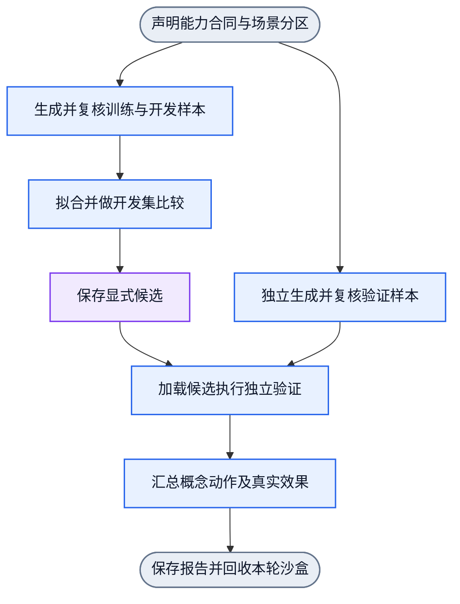

# 文件系统沙盒与前三项语义训练

状态：设计态，2026-10-19。用户已选择真实文件系统中的专用沙盒目录，不声称硬件、虚拟机或操作系统权限隔离。本轮只定义训练顺序、样本分离和训练过程DAG；不将图校验称为沙盒执行器已实现。总体Goal/State合同见[design.md 1.1](design.md#11-结构化语义的目标与状态推理)。精确操作类型沿[语义目录](cli-semantic-operations.md)，不另造操作词表。

## 1. 当前顺序

基础路径函数已有独立训练结果，是本轮可复用前置；不重新训练或扩大范围。前三项按下面顺序交付。每项都走同一个独立训练流程，但目标、样本、损失与候选分别保存，不混成一个模型。

| 顺序 | 理解与训练目标 | 结构化Goal与动作 | State及真实验收 | 当前状态 |
| --- | --- | --- | --- | --- |
| 1 | CWD是某一会话当前目录；获取CWD | `observe_cwd(S) → pwd(S)` | 新增本次真实CWD观测；执行基准不变；已有观测不能替代本次观测 | 首个有限选择器已训练，见[已有结果](cli-goal-training.md)；专用沙盒样本管线待接入 |
| 2 | 改变指定会话的CWD | `set_cwd(S,D) → cd(S,D)` | 在同一S中再次执行pwd，核对目标物理目录；其他会话和父进程不变；失败保留原CWD | 设计态，尚未实现会话变更或训练 |
| 3 | 获取目录内的文件与子目录 | `directory.list(D) → ls(D)`的结构化执行能力 | 得到直接子条目及文件/目录类型；与独立OS观测比较；不递归、不读取正文；列举不改变CWD | 设计态，尚未实现或训练 |

第1项先训练基础概念关系：`cwd属于哪个session`、`cwd观测与执行基准的区别`、`相对路径以该session的cwd解析`。再训练获取动作。已有path.resolve模型及pwd模型提供部分证据，不表示完整概念层已验收。结构化概念题和动作题分别统计，不以命令选择正确替代概念理解。

第2项只训练目标目录已明确的精确单操作。第3项先显式给出目录D，不以组合规划作为前置。后续才组合“获取CWD→进入目录→列举”。`ls`的命令参数与机器可读观测入口须在实现时固定；不把空格分词或解析面向人的多列输出作为文件名真值。隐藏条目、空目录及特殊文件名必须保留。普通文件、目录、链接分别观测，不能从扩展名猜类型；未读取的类型保持未知。符号链接策略沿现有精确操作合同。

训练顺序图：[cli-filesystem-curriculum.graph.json](../workflows/cli-filesystem-curriculum.graph.json)。节点表示独立能力训练的依赖与验收次序，不是已有运行算子。共享训练过程：[cli-filesystem-training.graph.json](../workflows/cli-filesystem-training.graph.json)。

## 2. 真实文件系统沙盒

沙盒执行器的职责是创建本轮专用根目录、按场景构造实际文件树、提供显式session、执行单项动作、独立观测前后状态及回收自有目录。它不负责生成NN预测，不参与目标成功的自我证明。后续唯一实现owner为`lib/adapters/cli/`；样本和拟合仍归`lib/training/`，不增加第二套调度器。

每个分区、每条有副作用的样本各用独立目录与session，避免cd或其他状态污染下一条样本。每次重试创建新的场景目录，保留失败证据；不在DAG中加回边。真实路径仅属于执行资源与teacher证据，学生使用结构化类型、关系和显式引用，不记忆沙盒绝对根、文件名或session名来答题。

目录是训练fixture边界，不提供OS隔离。首轮执行入口只接受声明的语义动作和显式参数，不接受任意shell字符串。相对路径在指定session中解析；目标引用不得逃出本轮场景。涉及符号链接的目标按真实解析结果检查。该限制必须在执行边界实现并给出越界拒绝反例，不能以字符串前缀判断宣称安全，也不能把“专用目录”本身当成已实现限制。首轮不开放任意命令或未声明的写入操作。

训练数据放在既有忽略目录，不新建根级资产目录：

```text
training/samples/filesystem/<capability>/<run>/train/
training/samples/filesystem/<capability>/<run>/development/
training/samples/filesystem/<capability>/<run>/verification/
training/results/filesystem/<capability>/<run>/
training/weights/filesystem/<capability>/<run>/
```

实际fixture在运行时临时目录中创建；保存结构化场景配方、输入输出及原始执行证据，不让历史临时路径成为唯一复现入口。清理只针对本轮owner创建的场景；所有成功/失败路径都先保存结果，再回收资源，清理失败显式记录。

## 3. 样本生成与复核验证分开

先声明能力合同和场景家族，再按家族分配用途，之后才创建文件树和生成样本。同一树模板的换名、同一session的轨迹及其派生样本不得跨分区。分目录保存只是物理分离，不能代替来源分离。

| 分区 | 生成与复核 | 可以做什么 | 禁止用途 |
| --- | --- | --- | --- |
| train | 训练场景配方→实际执行与观测→检查标签和状态转换→合格样本 | 拟合参数；保留失败样本及明确预期 | 未复核预测不能直接变黄金监督 |
| development | 独立的开发场景家族→同一公开执行入口 | 选训练预算、查错、比较零/冻结/候选 | 不报告为最终独立验证 |
| verification | 独立作者或独立配方，在拟合前定义预期，单独创建实际场景 | 保存候选后只读加载，真实执行并复核 | 不进fit、不选epoch、不改标签迎合模型、不作为修复后新的未见集 |

训练样本自身也需要复核。训练数据复核与最终独立验证是两种职责：前者确保监督正确，后者检验候选在未用于调参的样本上能否完成目标。验证作者可以复用相同动作合同与公开执行入口，但不复用训练fixture生成器来宣称独立场景。

样本保留`goal, state_before, action, execution_result, observed_state_after, goal_result`。概念层另保存结构化问题、关系输入与期望关系输出。目标评估器依据独立OS观测判定；NN预测的新状态永远不作为实际观测。失败、unknown、权限拒绝与部分结果均显式保留。

发现验证失败时保留原始报告。修复后原验证集只能作回归集；若要再次报告未见验证，另建新场景家族。候选保持`uncalibrated/not_applied`，每轮训练不自动替换已采用权重。

## 4. 每项能力的最小训练过程

共享过程是单源单汇DAG。分区声明之后分成两条资料链：训练/开发准备与独立验证准备。拟合节点只收到训练资料；独立验证资料在候选形成后才与候选合流。验证不回流修改本轮参数。



图中“拟合并做开发集比较”复用对应能力的细粒度训练workflow。训练/开发标签只在其资料链中可见；最终目标检查器所需验证预期不进入学生输入。错误结果沿原有workflow失败合同结束，资源由场景owner收口；图中的单出口表示报告与资源终态，不把失败转为成功。

分别报告概念关系正确率、动作选择正确率、参数绑定正确率、真实操作效果、错误是否保持状态、未声明副作用及跨场景影响。同时给出独立场景家族数和学生可见的不同输入结构数；换目录名不能冒称语义泛化。

## 5. 前三项的最小独立验证

| 能力 | 正常样本 | 抓错反例 |
| --- | --- | --- |
| CWD / pwd | 多session、不同实际目录、空格/中文目录、过期知识后重新观测 | 将其他session的cwd当答案；把pwd误标为改变cwd；用旧知识冒充新观测；授权/目录失败却报成功 |
| cd | 已知绝对目录、相对当前cwd的目标、连续两次变更 | 子进程退出后cwd未持久；其他session被改；不是目录/不存在/越界时仍变更；目标验证来自不同session |
| 目录列举 | 空目录、文件与子目录混合、点开头名称、空格/中文/换行名称 | 漏条目或拆错文件名；把后代当直接子项；按扩展名猜类型；读取未完成却报完整；列举意外改变cwd |

这些是计划验收，尚未生成新的沙盒训练/验证样本，尚未训练cd或目录列举。下一实施切片先接入CWD/pwd的场景沙盒和严格分区样本，再依序推进cd与目录列举；不重开浏览器或computer use范围。
