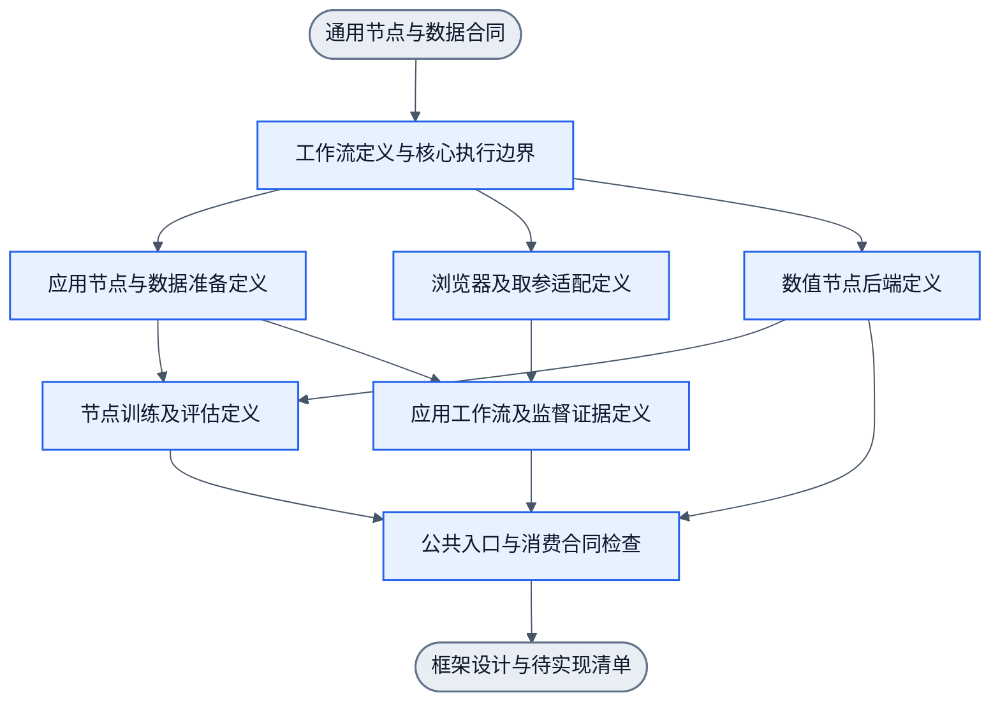
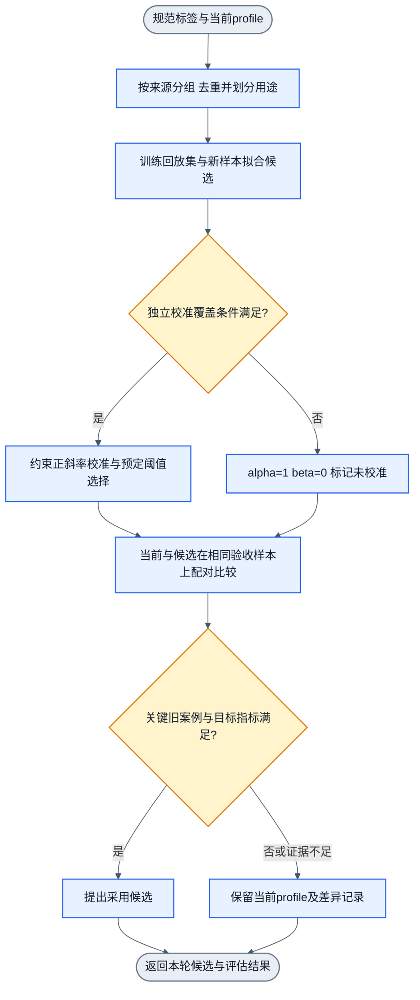

# NNAnything 总体设计

版本：修订6架构基线。L1 能动切片已交付并验收，当前用户授权基础工作流资产设计与目录分类（nnanything-design-workflow-assets），2026-10-17。先定义通用框架，再确定最小基础节点，组合网页与训练workflow；以后扩展其他场景。以filter节点、事件I/O和统一workflow为主轴，画布是可选呈现。黑白名单、DOM拆分、判断及operation供使用者组合，不固定业务流程，详见[事件与呈现](canvas-events.md)及[节点与Workflow](node-workflows.md)。保留单标签、按序批处理和[Focus入口](focus-and-labeling.md)。

本文件是总体方案入口。具体目录、配置、节点与四层优先级以[实施计划](implementation-plan.md)、[节点合同](node-contract.md)和[项目治理](project-governance.md)为准；最新工作流真源见 [workflows/README.md](../workflows/README.md)，三类基础采样节点合同卡唯一真源见 [lib/nodes/README.md](../lib/nodes/README.md)。下方D1-D5为未来长期责任地图，不是当前执行授权。research保留详细依据，设计review不等于电路训练或产品可用。

2026-10-17 第一层基础种类算法与六节点离线训练已实现（详见[训练合同](training-workflow.md)）。6N6E SESE 工作流接入真实Handwired求值、反传与Adam。已有158项试验、六页201项评估及随后明确授权的MAP式增量实验已运行，范围和局限见[实验结果](training-m1-results.md)。阈值固定，置信度未校准，候选不自动采用。历史卡片sigmoid、alpha/beta或完整贝叶斯分布不作为本轮多分类实现。第二层业务语义、WebUI、Rust保持后续范围。

2026-10-19 新增结构化语义状态推理方向，以下1.1节为其目标合同。首个固定函数 `cwd+input→词法绝对路径` 已实现真实训练与回载，见[路径训练](cli-path-training.md)。历史独立 `observe_cwd→pwd` 实测见[Goal动作训练](cli-goal-training.md)，只留历史证据，旧API与旧Goal已退役。当前CLI收敛为一份 `cli.command-policy.v1` 的 typed `file.property` 模型与权重profile；唯一训练合同见[文件系统训练合同](cli-filesystem-training.md)。

## 1. 目标与边界

建立以有类型输入输出的filter为节点、以workflow组合执行的通用框架。节点定义处理能力，workflow定义应用流程；正式执行、数据准备、训练与监督均按workflow组织。基础核心不内置DOM、微博或业务类别。第一个playground是微博DOM语义，跨站验证在后。

节点通过类型化事件接收输入、读取明确状态、完成处理后发出输出。核心提供端口、连线和有限DAG执行，首期不引入消息中间件或独立复杂状态机。Workflow本质是节点接续，配置文件、代码或可选画布共用定义与执行合同。观测、选择、拆分/转换、判断、operation及验证作为基础能力按需组合；业务闭环可以是观测→判断→操作→新观测→验证→结束，下一次触发开启新的run，不给单次DAG加回边。

手写filter、特征转换、神经网络、拟合与评估均可封装为节点，保留各自输入输出含义。不是每个节点都可训练。节点级训练只消费输入与期望输出以及该节点的参数/损失/后端合同，不直接消费应用整页或执行动作。Workflow连线表达步骤依赖，Handwired内部连线表达数值与梯度，不能混为同一张训练图。

页面可作为浏览器识别层共享上下文。示例用viewport、focus、白名单/黑名单限制范围，再由拆分节点生成不同层级的DOM独立输入，并检查展开项的候选资格。父节点跳过自身不自动裁掉后代。每项复用同一处理节点，不为每个DOM元素新建画布节点。首期一个任务对每个节点输出一个标签，也支持节点数组按序返回；暂不做同节点多个标签同时输出。二分类是该任务合同的特例，isTarget可作为相应二分类视图。过滤掉的候选不是模型负例。

目标覆盖：帖子、作者、正文、互动、媒体、来源标记、搜索及个人入口。语义用固定类别和结构查询表达，正常推理不依赖LLM。广告/推广/推荐显式输出，不只作为普通帖负例丢弃。

两个浏览器模式：使用模式定位具体目标供程序读值/操作；监督模式记录每次操作、由LLM回溯失败、选择样本修复并比较版本。两模式共享原始样本、目标定义及profile。

本节D0浏览器基线的非目标：自动把任意JS编译为神经网络、一次性训练所有站点、把整个页面输入filter、运行时用LLM解释查询、替用户学习或更改已明确的业务策略（例如哪些内容应隐藏）。D0原轮次只交设计，不授权当时的实现；后续已明确授权的训练与能力以各自当前合同为准。

### 1.1 结构化语义的目标与状态推理

2026-10-19 冻结四元素基础合同：每个语义及其训练设计均围绕 `Goal / satisfactionThreshold / State / Action`，形成语义闭合、单入口单出口（SESE）且满足最小必要性的 DAG。该合同适用于浏览器、CLI 及后续 computer use；不表示所有场景已实现。治理过程唯一入口为[本地设计流程](../.agents/skills/nnanything-design/SKILL.md)，拓扑唯一真源为 `workflows/project-design.graph.json`，由 DAGpipe 校验管理。冻结指当前标准生效；后续按明确需求修订同一正文，不建立冻结快照或身份包装。

| 元素 | 必须明确的语义 |
| --- | --- |
| Goal | 目标及其满足度评价规则，包含必要条件与证据要求 |
| satisfactionThreshold（满足度阈值） | 0–100 的最低满足度；结果达到要求即可结束，更高不是必要目标 |
| State | 当前条件、对象及必要关系、知识与观测来源；实际结果以 New State 表达，未知不伪装为已知 |
| Action | 必要操作、对象和参数引用、适用条件及预期状态变化；计算或识别也可作为增加知识的操作 |

`satisfactionThreshold` 表示要求；`satisfaction` 表示实际满足度，是 Goal 对实际 State 的评价结果，不增加为第五个基础元素。满足度不等同于模型分数或动作执行成功。获取 cwd 等二元目标只用 0/100；search 等确有部分成果的目标才定义中间满足度。覆盖度只有在 Goal 明确定义时才代表满足度；搜索进度不能自动证明已找到目标。必要证据不足时保留未知，不编造数值。满足度达到阈值且 Goal 必要条件成立才算达标；满足度阈值不放宽权限、数据正确性或 Goal 的必要条件。

反向推理属于训练过程：由 Goal 与 satisfactionThreshold 要求反推达标 State、所需 Action 和前置 State，形成可学习关系及监督；它与数值梯度反向传播分别说明。推理使用学到的关系选择操作与参数，执行后用实际 New State 评价；预测不能替代实际结果。对象关系、动作条件及评价均归入四元素，不另立平行基础要素。纯分类及固定函数显式声明固定 Goal/satisfactionThreshold、输入 State、计算 Action 和知识输出，不强造环境操作或可训练头。

四元素不机械对应四个节点。仅当 State 或 satisfactionThreshold 会改变正确输出时，才需要相应的学生输入与区分样本；固定项可为显式配置。每个节点、输入、wire、边和验证步骤均须回答：删除后会破坏哪项语义闭合、必要可辨性或验收依据？无独立必要性则删除或复用。每次运行单入口单出口，达标、未达标、失败及证据不足均收束为明确结果；跨步迭代以实际 New State 开启新 run，不在单次 DAG 加回边。当前共享CLI切片要求每次请求显式给0..100的satisfactionThreshold，实际satisfaction只输出100/0/null；该接入不表示自动采集或自动采用链已实现。

用户当前目标为结构化 `Goal → State → Action → New State`。手写基础概念、动作输入输出和执行结构；NN学习概念关系、动作与状态变化的关系，以及给定Goal/State的动作调用选择。全程使用结构化语义，不训练自然语言请求识别。概念层、动作层、推理层是此方向的三类训练职责，与下文浏览器基础语义/组合识别的两层分类对象不同。

所有注册CLI命令收敛为单一共享模型和权重profile（`cli.command-policy.v1`）。输入为typed `file.property` Goal与State；公开入口以`createCliCommandPolicy({profile,sandbox,session:S,onSample?})`绑定显式资源，再调用`.step({goal,satisfactionThreshold,state})`。模型输出标准调用序列。序列首项是实际Shell命令名，后续项是有类型的简化位置参数。当前拟合命令/控制head，参数引用机械绑定，实际New State由harness观测与验证；未训练状态预测头。

| Goal | 显式资源与证据条件 | 模型输出 | harness固定执行与实际New State验证 |
| --- | --- | --- | --- |
| `file.property.relation.sessionCwd` observed(this_run) | 显式session S；阈值0..100 | `["pwd"]` | 读取S当前cwd并产生本请求受信观测；S.cwd/revision不变 |
| `file.property.relation.sessionCwd` equals D | 显式S与typed目标D；阈值0..100 | `["cd", D]`或`NOOP` | 适用真观测证明已等于D时NOOP且零执行；否则提交S，并以同一回执的后验PWD评价 |
| `file.property.directory.entries` observed(this_run) | 显式目录目标D；阈值0..100 | `["ls", D]` | 通过固定结构化helper列举直接子条目；不解析人类文本；S状态及FS内容不变 |
| 合法但未绑定DirectoryQuery | 显式typed query且本轮B查找未实现 | `DEFER` | `invocation:null`、零executor；返回typed`binding_unresolved` |
| 结构合法但未注册的property/predicate | 任意已通过schema的file.property请求 | `unsupported` | `invocation:null`、零executor；实际satisfaction未知 |

在此共享模型中，模型只负责内部命令头路由与参数角色输出。`["cd", D]`是一次调用的参数序列，不是多步规划。CD后的PWD是harness固定后条件验证步骤，不冒称模型学会了多步规划。

读取与修改分开：pwd改变的是已知信息，不能误标为修改执行目录；cd改变指定会话的执行基准，不能通过一次性子进程中的cd冒充父会话已改变。执行器使用明确session资源，不隐式修改Agent父进程cwd。

训练/反馈样本统一保存显式Goal、State、策略选择、实际invocation、执行结果、New State、证据、满足度和采集回执。NN预测调用序列，真正的New State由harness执行与OS观测提供；预测不能充当事实。目标检查器按typed Goal验证，失败/未知均保留，不由模型自报成功。

实施状态：当前共享命令策略（`createCliCommandPolicy`）与单候选训练（`runCliCommandTraining`）已在`nnanything/cli-goal`实现。推理图`cli-file-property`为6N5E `0.3.0.0000`，训练图为8N8E `0.3.0.0000`，图、算子和`NodeDefinition`版本一致。当前`cli.command-policy.v1`为10个head×30条wire，共300参数：7个语义执行操作（head）为`pwd`、`cd`、`ls`、`path.resolve`、`path.relative`、`path.parts`、`entry.inspect`，3个控制head为`unsupported`、`DEFER`、`NOOP`。旧六参数PWD API、旧三个Goal kind、旧4×4运行对象及旧命令图已退役；旧4×4仅可经显式离线迁移。当前候选完成真实训练、保存后新进程回载及训练图262条真实执行，候选`35bd5ad9-15dc-409e-9001-bcab24f75398`保持`uncalibrated`与`not_applied`；训练报告保持`fullyVerified=false`，外部独立套件有限通过56/56并保留5项`UNVERIFIED`。

### 1.1.1 可训练基本单元与组合

#### CLI搜索能力与内容理解分工

全项目（包括CLI、浏览器与通用推理）只接收结构化Goal、State、条件及参数，不支持自然语言理解，也不将自然语言识别或表达列为当前训练、实现或验收目标。LLM作为设计或样本teacher不改变此输入边界。

当前CLI训练优先夯实文件搜索和字面字符搜索：在明确授权范围内，学习目标条件、候选、查询、搜索证据及后续选择之间的关系，并在不同真实项目语境中验证无命中、换候选、纠错和终止。当前不做模糊匹配，后续另行考虑；缺少完整路径而按精确结构化条件发现对象，不等于模糊匹配。现有有限实验不证明任意语境均可通过；新场景按独立来源和未见组合报告。

递归搜索是当前必需目标，且训练与运行中的搜索执行与日常真实CLI用法一致：目录子树递归由原生CLI搜索命令（`find -P`、`grep -R -I -n -F --`、`rg --json --no-config -F --`，公开入口`nnanything/cli-search`）一次性完成，模型只学习选择命令、绑定搜索根路径与匹配参数槽位、判读命令回执，以及在必要时对已命中的目标文件执行受控跟进读取（`followUpRead`）；严禁模型逐步发`ls -> entry.inspect -> cd -> 分块file.read`自展开目录树或滑动窗口扫描大文件，也不将控制器安全步数/深度上限作为搜索语义标签或完成门槛。外层`recursive-goal`仅负责“原生搜索命令定位命中文件 $\to$ 受控`followUpRead`或后续目标操作”的目标级闭环，不拆解目录遍历步序。结果判定严格区分三层事实：（1）单槽位命令执行覆盖（`slotReceipt.coverage: "complete" | "partial"`，仅由该槽位子进程回执推导）；（2）全请求候选域覆盖（`domain.coverage: "complete" | "partial" | null`，结合已执行槽位覆盖与多槽位状态，如`cardinality: "one"`在主域`s0`完整命中并早停跳过备选域`s1`时`domain.coverage = "partial"`且`reasons`含`"unsearched_fallback_scope_early_stop"`）；（3）根Goal满足度（`cardinality: "one"`在`s0`完整命中且必要跟进读取满足时返回`status = "achieved"`, `resolution = "matched"`, `satisfaction = 100`；`cardinality: "all"`未完备或`one`在0命中下遇`EACCES`/截断/超时时返回`status = "unknown"`, `satisfaction = null`；全域完整搜索0命中返回`status = "not_satisfied"`, `resolution = "not_found"`, `satisfaction = 0`）。递归文件搜索和递归字符搜索分别验收，不能以单目录或预绑定双文件的通过代替；具体已实现入口与缺口沿领域合同及实验报告记录。

当前MLP训练方向不承担文件正文或代码含义理解。基于上下文决定哪些内容值得阅读、解释代码/文本、判断如何修改及生成编辑内容，由大模型承担；搜索结果中的文件引用、命中位置、查询归属和真实回执作为显式交接材料。大模型的解释或修改建议仍是提案，不能替代实际执行和结果验证，也不自动变为训练gold。此处规定分工，不声明大模型接入或编辑闭环已经实现。

按给定范围读取字节/行、返回原始内容及读取成功/失败特征仍是机械执行能力，可由既有adapter承担；这不等于理解读出的内容。字符命中也不证明符号定义、用途或业务语义。当前下一阶段止于搜索能力及真实语境表现，命中文件上下文读取与编辑留待后续大模型协作阶段；不沿此前上下文方案继续扩训练头、窗口读取原语或编辑样本。

#### 决策单元的三段结构与推理前置边界

R（对象关系）、D（目标条件分解）、E（状态评价）、A（当前选择）统一支持：**确定性因素前置处理 → MLP处理 → 确定性结果后置处理**。这是每个头内部的模型结构，不是仅在整个CLI模型包外加一层规则。无必要固定逻辑的前层或后层直接透传，不为结构形式添加规则。

| 位置 | 唯一职责 | 输出与约束 |
| --- | --- | --- |
| 头内确定性因素前置处理 | 根据显式输入处理确定性因素、激活条件和候选约束 | 向MLP传递处理后的输入，并显式保留后层所需的旁路因素；缺测不补false，不猜测学习结果 |
| 头内MLP处理 | 学习关系、分解、评价或选择映射 | 仅声明的学习参数参与优化；原始预测与最终输出分开 |
| 头内确定性结果后置处理 | 根据声明的固定逻辑组合前置因素、旁路信息与MLP结果 | 执行确定性选择、约束或结果组合；不得临时补规则掩盖失败，数值或合同错误不能伪装为语义成功 |
| 模型外推理前置与控制 | 通用推理引擎绑定显式Goal/State、可用能力与授权，按当前状态调用各头并管理循环、预算和终止 | 不内置CLI/站点规则，不固定为只执行一次R→D→E→A；模型预测不能替代真实后验 |
| 模型外命令预处理与观测 | CLI adapter/harness把选定语义操作及参数引用转换为命令/argv，处理默认值、执行及真实回执解码 | 属于领域执行框架，不是头内手写层或学习权重；真实exit/stdout/stderr进入State后再交模型评价 |

每个头的固定层声明、固定参数、MLP结构与学习参数共同保存、加载和版本管理；固定参数不参与梯度更新。CLI模型包汇集本领域R/D/E/A单元及其I/O定义，不将命令执行程序打包成模型权重。领域可持有独立参数，通用引擎复用相同调用合同。外部workflow依赖与头内数值连线分开；不因统一打包就自动跨头反传。

确定性约束须在设计和评价前声明，并有可核对的输入前提。例如明确尚无读取回执时，E可限制其不能判读取目标已满足；命令exit=0仅证明相应命令合同下的执行结果，不能直接证明根Goal满足。固定层、原始MLP和组合输出分别验收，不将固定层纠正计为MLP已学会。当前E头有限混合实验不证明R/D/A已完成相同实现，也不代表任意CLI或浏览器泛化；实现状态沿领域证据与note.md维护。本段规定设计方向，不改变既有候选采用状态。

2026-10-20 用户明确：项目每个可训练基本单元统一包含推理环、训练环、训练样本和权重。最小神经元是不可再拆且仍具独立语义的可训练能力；神经元组由多个此类单元组合，对外仍使用同一套单元合同。这里的“神经元”是语义能力单元，不等于一个标量参数或激活函数。

| 单元组成 | 最小神经元与神经元组共同要求 |
| --- | --- |
| 推理环 | 显式接收 Goal、阈值、State 与启用权重，输出当前 Action/知识结果、实际 New State、满足度与准确错误；通过实际证据闭合 |
| 训练环 | 按同一语义 I/O 读取隔离样本，真实拟合候选，保存、回载、独立评价及旧能力回归；使用与候选权重分离 |
| 训练样本 | 明确语义、来源分区、输入、监督及真实效果证据；组合单元既检验成员能力，也检验成员关系与整体结果 |
| 权重 | 显式声明参数及其所属能力；组可显式引用成员 profile，并持有必要的组合关系权重，不强制新增一份重复权重 |

统一接口指共同的输入、结果、训练及权重生命周期合同，不要求所有领域使用相同维度、标签或执行器。组在外部像一个单元，在内部按既有 workflow 组合；成员错误及副作用知识必须返回，不能只返回整体布尔值。推理环与训练环各自保持 SESE；多轮通过控制器调用独立 run，不在 DAG 加回边。跨节点连线不自动反传，端到端训练必须另有显式数值合同。

确定性观测、执行、可精确计算的事实谓词及调度节点仍是基础设施，不为满足四项清单虚设训练样本或权重。需要抽象判断的目标条件关系、后果预测和语义评价属于可训练能力，消费真实观测并接受有来源的监督，不能统一限定为手写。组合若只有固定连线，可复用成员权重；需要学习时声明对应监督和权重，不强制每项拆成独立模型。只实现预测函数或离线拟合器的能力，应明确缺失环节，不能宣称完整单元。各既有单元的实际实现状态沿其领域合同，不因本节生效而冒称已补齐。

2026-10-22 分层混合原则：第一层基础语义仍须训练；“刚性”指固定且可复核的定义、手工构造样本、监督、缺测规则、显式I/O和验收尺度，不指永久手写。基础单元职责独立，上层目标或偏好不能改变其gold。现场观测可补证据，但模型预测不自动成为监督。失败先检查观测、可辨输入、样本、wire和拟合；只有按[模型演进2.1](model-evolution.md#21-预训练后训练与结构修订边界)证明必要表示缺口，才修订基础结构。

| 语义职责层 | 固定边界 | 混合实现范围 |
| --- | --- | --- |
| 第一层：独立基础语义 | 单一含义、手工正反例、未知规则、独立验收；上层Goal不改基础事实 | 按固定监督训练权重；精确计算、真实执行和来源校验继续手写 |
| 第二层：小组合语义 | 成员I/O、必要依赖、前后条件及完成标准 | 组合适用性、角色关联及当前候选选择可用规则或权重 |
| 第三层：高层目标推理 | 根Goal/阈值/绑定、证据、权限及真实验收不变 | 语义拆解、有限结果预测、合法路径排序和反馈解释可用规则或权重 |

三层表示语义复杂度，不替换浏览器基础类别/应用组合的分类对象划分，不要求共用特征、权重或损失。语义拆解回答“哪些条件满足目标”；确定性控制回答“哪项就绪、是否继续、尝试次数”。不训练层序、预算、重试计数或授权。不同实现沿同一职责显式I/O替换，不用规则偷偷改正模型错误，不在权重失败时无条件fallback。

通用每步评价当前真实条件，取得一个合法技能及必要预测，至多执行一个原子动作，再取得后验，分开评价节点/根事实与执行结果，按证据继续、换路、重推、补观察或准确停止。无planning模式不虚构预测；模式反应沿[递归模块4.0](recursive-goal-module.md#40-逐步反馈与模式反应)。失败归因沿[有界规划9.1](bounded-goal-planning.md#91-失败事实归因与路线限制)，经验的时间/来源边界沿[模型演进2.2](model-evolution.md#22-逐步经验与纠正的时间边界)。

本轮浏览器 `SetExpanded` 作为首个落实切片：对象控制关系与 CLICK/NOOP/DEFER 选择是两个可训练成员，共同组成单步语义组；两套参数显式放在一个 profile。组的真实执行、采集、训练及回载沿 [browser-single-action-training.md](browser-single-action-training.md) 验收。

拟合已按用户明确顺序推进限定切片：先最简单单次操作，再学习单次执行失败与点击无效的反馈，最后在有合法替代候选时学习重试后的次选。失败处理同样是可训练反馈单元，须具备四项组成，不能把已记录日志或手写停止条件称为已学。真实失败反馈进入下一步 State，根 Goal 不丢失。默认策略是在可重试且同类错误重复时累计到显式可配置 n 次才放弃首选，再由当前策略能力选择次选；同类错误判断的依据、计数与预算显式持有，不从日志重建。重试控制与次数不训练，反馈语义和当前策略选择分别监督。没有替代能力时返回准确错误，不发明技能；对象关系不明与多个已确认等效策略分开处理。原子50参数、F1反馈36参数与F2策略20参数均已真实拟合并回载，候选均未采用。F2原独立oracle保留22/24失败及两项前提不成立的裁决，诊断负控制不计作训练候选24/24。范围仍限`SetExpanded`与已测投影；任意错误重试、任意页面和复杂组合未完成。各阶段当前状态分别由[browser-feedback-strategy.md](browser-feedback-strategy.md)和[browser-progressive-strategy.md](browser-progressive-strategy.md)维护。

### 1.1.2 人的评价、基础独立与组合干扰

人的可观察、可感知语义是评价依据。元素身份、候选资格、当前能力、实际感知和目标效果必须分别回答：disabled按钮不因此失去button身份，readonly输入不因此失去input身份，poster或音频控件存在也不证明正在播放。证据按问题选择，DOM/ARIA、截图、AX、声音、原生回执和OS产物各有适用范围。标签来源如实声明，不要求每个样本真人签字；精确矩阵、分母和独立Review职责由[人的语义评价](semantic-evaluation.md)维护。

基础独立要求语义职责、显式I/O、权重和副作用owner清楚，无隐藏状态依赖，不要求统计独立或禁止共享特征。组合仍可能共享证据、覆盖相同目标、相互抵消或使后继前提失效。共享证据不重复算覆盖，子目标分数不直接求和成为根满足度，替代路径不都成为必需条件。组合层须以真实根评价验收，不能用成员全通过代替。

目标阈值、原始NN分数、预测满足度、实际满足度与排序效用分开。多个候选可满足同一阈值，组合层再用显式分数、尝试顺序或保守/激进偏好排序。性格只改变合法候选的偏好，不改变Goal、阈值、权限、基本类别gold或证据真值。已观测结果与待执行动作分别比较；预测过线不意味着实际达成。完整合同由[目标选择策略](goal-selection-policy.md)维护，当前F2的有限同效果/正且唯一margin/同分DEFER规则不因此改变。

实际编码到既有完整milestone独立Review边界时，Reviewer还须核验人的评价尺、gold来源、oracle前提、来源分区、具名分母、缺测/弃权和逐例结果的合理性，不能只看测试全绿或总分。方法沿本地设计Skill，不新增逐节点审查。

### 1.1.3 预测推理与执行推理（有界原型已接入）

用户进一步明确推理分成两部分。预测推理从真实起点，在有限视野内生成有依据的多路径目标图，按显式性格倾向选择主路线和备选，声明前提、预测结果、分支覆盖与checkpoint；执行推理每次沿当前适用路径推进一个动作，用实际New State验收。预测不派发，执行不把预测写成真实证据。

正常结果仍匹配且未到指定checkpoint时继续；遇分叉或意外，先用当前真实State检查已有次优路径，不能覆盖时重推演受影响部分；指定checkpoint真实满足后归还阶段义务，返回预测入口展开下一段。根Goal、阈值、固定绑定始终保留。根实际满足后收回必需链并结束，不为性格追更高分或为N层补动作。

N表示规范化的有语义动作转移视野，不是嵌套包装、模型调用或workflow节点数。最长分支够N层不证明所有失败分支都可行；须逐分支说明覆盖和未知。预测State、实际State、预期effects和实际ledger分开，换图不重置预算、同错次数或未明派发。图生成只用已启用技能和明确结果模型；缺能力或关键证据时返回具体未就绪，不能虚构成功路径。

学生仍只输出当前一步；预测转移、关系及当前偏好可独立训练，N、层序、继续、checkpoint与预算控制不训练。[有界目标规划](bounded-goal-planning.md)维护对象图、双模块I/O、checkpoint与控制映射。现有recursive-goal已接有限结果模型，完成合成域及真实cwd验证；组合Goal仍沿显式derive逐层展开，不承诺任意高层语义。默认规则、真实Handwired替换与候选热重载由[决策单元](bounded-planning-decision.md)维护，真实训练及自动采用未实施。不新增第五基础元素或第二执行引擎。

### 1.1.4 所有行为的观测反馈义务（设计合同）

每个产生语义结果或行为决策的推理步均须观察并接收反馈，不能整段动作执行完才统一看结果。单步责任链为：读取当前适用观测→选择当前Action及其观察要求→执行当前Action→按该动作的方式观察（含执行结果检查）→将反馈带入下一步。执行结果检查属于观察：同时核对执行回执/错误、实际New State/effects，以及这些结果是否满足本步和根Goal的必要条件。不同动作可有不同观察方式；输入读回宿主值，提交检查响应归属，滚动观察新露出范围，文件操作核对OS属性。页面变化是补充触发源，不能取代逐步后验。

每次改变环境或获取知识的Action均须声明：要确认哪个Goal条件、观察方式及其启用能力、读取哪个对象/范围及哪些事实、证据的当前性与关联要求，以及缺失/冲突/超时/执行错误如何返回。这些是Action的后条件和State的证据要求，不增加第五个基础元素，也不强制每次重采整页。纯计算须读回并核对明确计算结果，不虚设浏览器操作；只读Action以实际读取结果作为本步后验，不为“观察一次观察”无限衍生子Goal。已满足且证据仍适用的条件可NOOP，但仍评价当前证据并返回本步反馈，不伪造一次新执行。

反馈分三项持有：原始执行回执及effects、实际观测结果及观测错误、当前Goal的评价与模型解释。这是观察反馈内部的责任划分，不把执行结果检查排除在观察之外；仍由采集器取得事实、评价器核对Goal，不能把两者合成模型自报成功。执行失败仍保留能安全取得的后验，取不到则显式unknown；没有后验不能推断无效果、无副作用或可安全重试。观察也可失败：旧缓存、无效绑定、未采到、冲突或读取失败不能标成对象不存在或操作无效。一次读取成功只说明取得事实，不说明原业务Goal已满足。

必需观察条件由已启用技能合同与Goal约束给出。模型可学习从候选中选择观察对象、范围和适用关系，不能删去必需检查、自定真值或越过授权。采集器负责取得真实值，领域评价器按明确判据使用显式传入证据；将结果检查归入观察反馈不授予evaluate/measureProgress自行采集或执行的能力，缺新观测仍须走正常技能派发。若依赖学习的语义识别，保留其模型来源与unknown/conflict，不将预测当独立事实。下一步控制、预算、继续/结束和安全重试资格仍由现有控制器持有，不训练层序或是否继续。缺证据时可以先衍生只读观察子Goal；缺启用观察技能则准确返回，不执行依赖该事实的动作。

环境相关变化使受影响事实失效；动作后的必要观察不以收到DOM mutation为前提，未变化也须读回。允许沿明确等待预算等待新证据，不能以等待时间结束、spinner消失或模型预测代替达标。新反馈进入下一run的显式State；已达成的持久条件在依赖它的后续动作改变范围/绑定/状态后须重验，历史子Goal成功不能替代当前根评价。跨步沿现有递归与有界推理合同，单次DAG不加回边。

学习“观察什么”和“反馈意味着什么”分别定义监督，复用[基本单元](#111-可训练基本单元与组合)接口；真实采集、证据适用性、精确比较和控制不虚设权重。使用样本须保留观察选择、所需事实、实际读取、错误、前后变化及根结果；使用记录不是自动gold，训练及采用沿[模型演进](model-evolution.md)。本节仅统一设计要求，不宣称各领域已接入。搜索逐步实例及实现缺口由[搜索页面抽象](search-page-abstraction.md)维护；不得将现有SetExpanded/F1/F2扩大为通用搜索反馈能力。

### 1.1.5 二层语义：决策结果期待、观察与反馈学习

2026-10-24用户明确：抽象二层语义通过语义设计与样本学习目标和条件之间的联系；行为后果、结果评价也要支持样本学习及在线学习。每次决策以结果为导向，输出当前行动、要取得或改变的目标条件、结果期待和观察要求，再用实际后验形成反馈。期待是Action的预期New State及其与Goal的关系，不增加第五个基础元素。

结果期待分清结果要求与后果预测：前者给出什么证据足以支持本步/根Goal，不能随预测改变；后者估计当前行动可能取得的结果，用来选路，可以通过实际反馈修正。执行前明确做对/命中、做错/无效的可观测表现，同时保留未知与预期外结果。不能观察结果后倒写期待，不能把有用的负向知识都当成坏决策。

二层单元至少设计：Goal到必要/替代条件的联系、当前决策及期待结果、观察对象/方式/证据资格、实际结果的语义评价、反馈后的下一合法选择，以及对应监督/权重和使用采样。关系、预测与评价可共享或分开训练，但监督职责、输入时点和错误归因须可区分；控制器只按已声明结果调度，不把层序/预算/授权作为学习对象。

首个CLI读取实验明确分为基础反馈学习与推理学习：前者识别实际取得的数据特征/错误，后者将正向、负向与未知结果关联当前Goal，输出下一语义需求并绑定已注册子Goal。read不理解正文。二层语义以真实义务收束为结束，成功/明确错误/未知分别返回；不能把停止衍生或分数不变等同根成功。具体实验与peer交接由[读取反馈实验](cli-read-feedback-experiment.md)维护。

语义评价可由已验证学习型evaluator完成；原始字节/DOM/回执、证据当前性和权限仍由对应owner提供。预测与评价器的自评分不能成为自己的独立成功标签。精确字面匹配等可计算事实可保持手写oracle；开放语义的结果解释须有明确样本与独立判据，不能用“已有固定评价器”排除训练责任。

每个样本保留决策前State/期待、实际动作、真实观察、后果评价、下一选择和最终根结果；执行成功但无命中、执行失败、观察不足、对象变化分别训练。先证明反馈能帮助恢复，再以新类似任务的路径成本评价效率提升。在线采样、隔离训练、回载与更新时机沿[模型演进2.3](model-evolution.md#23-期待反馈单元的在线学习)，当前接入状态按领域报告，不冒称已运行。

2026-10-24用户明确新实验方向：有限参数化目标词表上训练四个语义输出头，复用通用推理引擎，再以CLI/浏览器实例做开放组合与持续后训练。四头分别为对象关系H_R、目标条件分解H_D、状态/后验评价H_E、当前子目标/技能选择H_A；它们不是四个attention heads，也不是四基础元素分别一模型。State是观测事实，Condition是Goal对State的要求，不再另设同义“条件评价头”和“结果评价头”。LLM生成目标关系/分解及样本提案作为teacher，需证据确认；BERT/小Encoder是可选学生，运行输出结构化语义，不训练自然语言表达。

新实验唯一合同为[L2四头有限实验](l2-four-head-experiment.md)，含输出维度、有限词表、单头/组合/证伪/旧能力量化与规模化准入；内部单步责任图为[l2-four-head-step](../workflows/l2-four-head-step.graph.json)，0.1.0-design 8N7E，不是已绑定运行workflow。外层recursive-goal 3N2E与现有使用API不变；领域未来通过显式infer资源接select/derive/evaluate。运行时守卫不持有完整teacher答案替模型选路，根事实、授权与实际回执仍独立。先做有限两域验证，再做两批继承已有权重的后训练，未通过不扩大数据量或冒称泛化。当前仅设计落盘，旧线性模型不折算为四头实现。

### 1.2 固定语义调用与全模型自进化

用户进一步明确：推理选择获取目标所需的语义命令头与位置参数；调用序列固定，由harness转换为实际固定CLI调用与语义操作。当前运行head为`pwd`、`cd`、`ls`、`path.resolve`、`path.relative`、`path.parts`、`entry.inspect`，控制head为`unsupported`、`DEFER`、`NOOP`。语义目标、调用选择、参数绑定、真实执行与效果验证分工明确。

所有接入CLI命令统一按[CLI调用参数简化](cli-call-contract.md)约定：输出`["command", ...params]`，S置于信封，不训练原生flags、shell脚本编写或输出正文解析。命令/argv/默认行为和机器回执由harness负责。

所有模型的目标架构均包含使用时采集、训练/使用版本隔离、独立配对比较及条件自动升级。有明确提升、所有必需旧能力无回归且证据完整时自动采用；冲突或回归保留当前版本，留证据交大模型判断。大模型可以修订设计连线，但先更新对应外层DAG、内部数值图和合同，再走实现、训练与验证，不能直接改在用版本。唯一完整合同见[语义调用与模型演进](model-evolution.md)。这是当前新设计要求，不冒称已有离线训练已实现自动升级。

### 1.3 本地基础设计入口

Shell 的领域目标进一步统一为 `file.property.xxx`，涵盖路径、目录及普通/特殊文件的属性观测与变化；不零散新增场景Goal。内容、用途及操作适用性归入同一属性体系。领域合同唯一源为 [cli-filesystem-semantics.md](cli-filesystem-semantics.md)，共享属性状态转换图为 `workflows/cli-file-property.graph.json`。当前已接入PWD/CD/LS、`path.resolve`、`path.relative`、`path.parts`、`entry.inspect`及`NOOP`/`DEFER`/`unsupported`控制结果；其余属性单元仍是设计，不将设计目录标为运行能力。

新增能力或修改I/O、状态、harness、数值连线、workflow及采用规则，统一使用[本地设计Skill](../.agents/skills/nnanything-design/SKILL.md)。基础流程是现状/缺口→语义目标与效果→固定调用与执行责任→内部数值图及外层DAG→样本隔离与进化验收→图纸合同校验→可实施设计或具体缺口。持久过程图见[project-design.graph.json](../workflows/project-design.graph.json)。这是本项目设计方法，不代替独立Plan和已有开发交付流程，也不把设计图当已实现算子。

### 1.4 通用递归目标框架

2026-10-20 用户要求高层目标递归衍生子目标，并以真实证据逐层返回达成。合同沿[通用递归目标设计](recursive-goal-design.md)，拓扑沿[recursive-goal.graph.json](../workflows/recursive-goal.graph.json)，本次反馈归因候选为`0.2.0.0001`、3N2E，历史运行证据另列。四元素不增加新项；帧、依赖、进度、预算和栈均为显式State。领域提供typed语义、衍生能力、原子操作及评价，核心管理生命周期，不内置CLI/DOM规则；当前衍生手写，未来混合边界沿1.1.1。

独立模块合同见[recursive-goal-module.md](recursive-goal-module.md)：源码owner为`lib/workflow/recursive-goal/`，公开门面`lib/recursive-goal.ts`通过`nnanything/recursive-goal`导出，通过领域适配器注入现有workflow，不内置领域执行器。模块分别返回入参拒绝、已接收目标的运行结果、可捕获模块fault；根事实、控制停止原因、原子失败与副作用知识分开。预期错误沿3N2E收束，底层引擎异常由入口保留可用cause和已知effects，不假设report节点必执行。公开递归回归、真实cwd与非CLI consumer已经验收；具体运行边界与证据见模块合同第13节。

根Goal、阈值及目标绑定在全程保持不变；衍生节点携带rootRef、parentRef及它满足的上层条件。每层只从显式允许、符合训练/启用合同的技能中选择当前节点Goal/State对应的一个head；技能可为原子或组合，无可用技能直接报capability_missing并沿父链返回，不发明选项。固定比较不强造训练head。确定性控制器负责展开、分支、依赖、继续和递归返回，不训练层序或是否继续，不让模型一次输出整段计划。

需求自上而下衍生，真实达成证据自下而上反向满足。叶调用返回真实New State后先验节点，再检查父目标的必要依赖、当前实际条件和不变量；每条衍生链都收束为达成、错误、未知或明确未选/取消，根汇总全部回执。子目标历史成功不等于父目标当前达成。未选分支不进入必需集合，已满足的根可直接结束。“反向满足”是证据合流，训练期目标反推仍按1.1节分别定义。

每个原子workflow保持原有SESE与运行合同；CLI复用已实现的6N5E `0.3.0.0000`，浏览器/桌面operation仍按各自当前边界。递归runner在节点内部有界调度独立子run，图内不加回边，不建立第二套执行引擎。外层图及cwd/纯计算领域规则已实现，组合规则固定且不训练控制层序；静态校验本身不证明运行。共享预算控制全树终止，未支持语义、证据不足、无进展、超预算及副作用未知均显式返回，不承诺仅凭“客观上可行”就能推导未声明的语义。Shell叶目标继续为`file.property.xxx`，不新增`file.property.plan`或把通用进度伪装为文件属性。

### 1.5 操作目标与元素必要性关系（设计态，未就绪）

2026-10-20 后续实施状态：`SetExpanded` 的最小控制关系/单次能力切片已通过独立入口实现与真实训练，见 [单次行为训练](browser-single-action-training.md)。下文记录原始设计准入结论；通用必要性网络、`ObserveExpanded` 及完整业务语义仍未实现。

2026-10-20 用户要求整理「用户要做什么操作 → 为什么需要当前这个元素 → 语义分类」的推理链，并给出完整推理与训练逻辑。唯一合同为[操作目标与元素必要性关系](operation-goal-necessity.md)，当前为未就绪设计，无运行入口、未训练、未改L1词表与wire。该合同把三件事分开：元素的基础种类（L1，不随操作改变）、它对该操作当前条件承担的语义角色（随Goal改变）、操作后真实New State（只能由观测决定）。因此“本次不需要该按钮”不是L1的`ignore`，`ignore`的监督目标仍是第2节两层边界所述「是否需要作为agent独立交互／读取目标」。

最小单元是判断`(Goal, 条件C, 元素E)`的关系，首轮只取`SetExpanded`与`ObserveExpanded`两个typed目标，用于区分改变状态与读取状态。这两项typed目标、其条件合同、结果schema、控制关联观测及L3操作能力均未成为正式合同，故不进入训练。展开状态`aria-expanded`已在浏览器适配器采集，但尚无学生输入与wire消费；`aria-controls`未采集，控制关联当前不可辨。缺口清单及恢复条件由该合同第7节维护，不在此复制。

### 1.6 浏览器行为与分类后元素结构 v0.1

浏览器先定义读取、输入、选择、点击、滚动、搜索、下载和导航的局部意图，再推导基础识别、角色/归属/控制关系及当前技能与对象选择。唯一合同为[browser-behavior-framework.md](browser-behavior-framework.md)，版本`0.1.0-design`；分类后的元素结构保留版本化引用、候选与L1判断、几何/露出、交互状态、按需内容、关系和证据，不把保留字段自动当作L1学生输入。操作只使用人类键鼠，DOM可只读；网页相关变化触发新观测。单步复用现有7N6E设计图，递归复用已有通用模块。外部原生搜索案例已做，项目L1/L2/operation尚未接入，新结构不是导出API，未训练新权重。

## 2. 手写入口、四层职责与两层训练

| 层次 | 处理对象 | 输出 | Owner |
| --- | --- | --- | --- |
| 手写预过滤 | 页面候选及viewport/focus/白黑名单规则 | 放行候选与排除原因；不产生语义负标签 | 浏览器候选程序 |
| 观测 | 节点及必要局部DOM/布局/属性/滚动 | 可测数值、局部结构与原始证据 | 站点/浏览器适配器 |
| 基础语义 | 单节点观测参数 | 作者、正文、互动、来源标记等目标分数 | 已声明目标filter |
| 组合识别 | 单节点参数、成分分数与关系摘要 | 完整对象、成分归属、广告/推广等组合目标分数 | 组合filter与外部上下文编排 |
| 策略操作 | 分类、具体节点引用、用户规则 | 查询、读取、展开、隐藏等动作 | 浏览器程序/调用者 |

基础语义和组合识别是两层可训练结构。浏览器已直接提供的img/button等事实直接读取；需要学习的是头像/配图、点赞/普通按钮等角色。仅为复述输入role而训练的分类器没有独立价值。

手写预过滤位于神经网络入口之前：读取规则所需的基础几何/属性，示例顺序执行viewport、focus和白黑名单规则，拆分后对保留项做完整取参与神经网络求值。ManualFilter返回pass/reason；NeuralNode返回单标签/分数。规则链和模型职责分离，均可各自回放，但规则不冒称可训练分类器。每个步骤可独立节点化；此顺序约束本应用，不成为核心固定管线。

两层结构与两阶段开发不同：第一阶段只用自身和可测关系建立基线，先实现少数目标；第二阶段引入其他节点实际预测，训练组合/协同支路。第二阶段内部可使用有限推理轮次，但不等于只有第二次推理。完整卡片可保留直接识别基线，验证组合层是否有增益。

广告、推广和普通帖同样可以有作者、内容与互动。结构post.card不等于post.card.organic。用户指定排除某类内容属于明确策略，不与结构完整性混为一份标签。

卡片族采用共同的结构判定合同：post.card提供完整卡片结构支路，来源目标复用该支路而非独立重学边界。来源结果受结构结果约束，非卡片不输出为卡片子类；已确认广告/推广/推荐与organic互斥。训练保持连续logit和原始样本，不先硬删结构负例；推理的一致性组合由外部解析器完成，不改变当前被判断节点。组合分数属于新分数合同，不能沿用子支路的概率校准宣称。

organic是本实验的复合目标，不承诺只有一种实现。若结构/来源证据不足，不能用“所有来源filter低分”证明普通帖；解析器须保留未定情况。每个可训练目标有filter，但分类目录中的确定性原语或组合目标无需各自复制一套网络。

## 3. 分类、关系与查询

固定target沿用 [完整目录](../research/semantic-query-contract.md)。三组代表目标：

- 结构与内容：post.card、post.author.name、post.author.avatar、post.body及text/image/video/link成分。
- 交互：search.input、account.self.entry、post.comment.entry、post.repost.entry、post.like.entry、post.body.expand、navigation.entry；post.comment.item是实际评论容器，与评论入口分开。
- 内容来源：post.card.advertisement、post.card.promotion、post.card.recommendation、post.card.organic。它们是语义目录，实际单标签任务只选择明确互斥的子集；重叠含义不强塞进一次分类，未知不自动变负例。

查询字段为target、within、scopeMode=owned/subtree、cardinality=one/all、where.visible/enabled。within存在时缺省owned：枚举局部DOM后按该target声明的规范归属筛选，内嵌帖子和单条评论形成各自边界，不能把其作者认作外层作者。subtree显式表示纯DOM自身及后代，不承诺语义归属。最近候选祖先只是证据，不等于归属真值；归属未定且会影响one选择时返回ambiguous，不能默默跨边界或丢弃。

候选前置合同新增FocusSpec：viewportOnly固定true，within/region限制当前关注对象，deny优先allow，未配置allow不额外限制、显式空allow不产生候选。该合同与where.visible/enabled区分：前者限制是否进入分类，后者是查询/操作条件。部分可见即保留，过滤当前容器不默认裁掉其全部后代。排除与上下文规则沿增量合同。

one有多个合格结果返回ambiguous，零个返回not_found；不自动选最高分。目标未知/未支持返回unsupported_target，范围引用失效返回stale_scope，必要观测缺失而无法判断返回insufficient_observation。查询返回具体nodeRef与目标分数，读取和动作另行调用。

DOM节点、AX节点和可点击祖先可能不同。每个目标必须有规范边界；标注和推理使用同一种边界。姓名与完整URL可以在定位后读取，不作为身份捷径训练。

查询引用不会自动提升到可点击祖先。操作请求若需要另一个节点，显式要求相应操作目标（如navigation.entry），并带原节点的局部范围/关联依据，由适配器返回唯一可操作引用。无法确认时拒绝该动作并记录原因，不选择任意最近可点击祖先。

在已定位正文范围内，text/image/video/link优先使用DOM/AX事实筛选；涉及头像/徽标排除、播放器边界或链接行为歧义时才增加目标filter。读取目标与操作目标分开，不将href存在视为已证明导航成功。

关系直接进入参数：父子包含、相对尺寸/位置、兄弟对齐/间距、成分计数及局部共现。第二阶段再加入父级、子成分、兄弟上一轮的预测摘要。nodeRef/ownerRef只关联证据，不作为数值特征。DOM包含不自动证明语义part_of，须覆盖内嵌转发和评论区。

上下文编排在filter外完成，汇总成当前节点的固定维度参数。协同轮次同步读取上一轮结果，避免遍历顺序改变语义。初始分数来自基础观测；不无限迭代或把相关分数当独立似然反复相乘。准确轮数、摘要和每目标电路在后续审图时确定，本设计不伪称这些参数已验证。

## 4. 模块与目录规划

最新单源目录架构唯一维护于 [实施计划](implementation-plan.md) 第 2 节。以下为模块责任概览：

| 路径 | 职责与禁止事项 |
| --- | --- |
| AGENTS.md | 项目边界、唯一owner、数据/标签/推理隔离；引用全局流程，不复制治理 |
| lib/core | 通用Node/Workflow事件端口、输入输出、参数/Profile与后端合同；不内置DOM类别 |
| lib/workflow | 通用事件关联、依赖执行、静态校验、分支/过滤结果与记录适配；不放站点规则 |
| lib/training | 节点训练算子与适配合同；只依赖通用节点样本合同 |
| lib/nodes/trainable | 可训练节点结构与Handwired电路定义；不存真实权重 |
| lib/nodes | 可复用节点定义（通用与DOM语义），三类采样节点卡见 [lib/nodes/README.md](../lib/nodes/README.md) |
| lib/filters | 纯内存确定性过滤规则与候选求值内核 |
| lib/adapters/browser | 页面观测输入与引用适配，供应用节点调用 |
| workflows | 项目DAG图与持久配置唯一真源，清单见 [workflows/README.md](../workflows/README.md) |
| training | 本地样本(samples/)、评估报告(results/)与真实权重(weights/)资产根目录 |
| tests | 公共consumer、基础反例、后续真实入口回归；不测试假训练/假点击成功 |
| docs / research | 当前方案与流程 / 原始调研依据；旧草案需明确适用范围 |
| data/raw、labels、datasets | 本地原始资料、规范标签、派生向量；默认不入Git |
| artifacts | 本地profile、评估报告、回放记录；按需另定哪些可共享 |
| playground | 小规模实验入口说明；代码开发仍用外置独占worktree |

画布只规划编辑/查看workflow这一责任，当前不新建UI目录或实现编辑器。先用可读定义表达节点与连线；后续UI不能维护第二份执行真源。

模块依赖草图：状态为设计候选，仅描述依赖，不证明已执行。

## 5. 核心数据合同

| 合同 | 必需含义 |
| --- | --- |
| NodeDefinition | 通用处理器的输入/输出、配置和参数合同；可选训练适配，不依赖应用 |
| WorkflowDefinition | 节点实例、数据依赖、配置/profile绑定、执行结果及错误出口；不把日志当控制真源 |
| FilterDefinition | 具体filter节点能力；神经网络节点另声明taskId/标签、按序特征/变换、手写数值图及可训练参数 |
| NumericInput | inputContract、当前节点的数值向量；不含页面、DOM对象、class/id或账号文本 |
| NodeResult / FilterResult | 按节点合同区分规则pass/reason、转换数据、语义label/分数、训练产物等；神经网络首期单标签，二分类可提供isTarget视图。应用批处理保序，不伪造分类 |
| Profile | 普通版本标识、target、兼容的输入/电路合同、权重、阈值、校准状态/参数与训练来源引用 |
| Snapshot | 采集批次、页面/帖子来源组、原始DOM/截图/布局等引用及各自时间；保留不同步限制 |
| LabelRecord | snapshot/node/target、truth=true/false/unknown、规则/LLM/用户来源、证据、复核状态 |
| Dataset | 规范标签引用、派生向量、group、用途分区；标签与原始字段不拼进特征向量 |
| OperationSample | episode/step、结构查询/动作/预期、当时profile和候选分数、FocusSpec及规则版本/排除记录、前后现场、实际结果 |
| FailureReview | 失败owner、errorType、首次偏离证据、标签提议与train/regression/investigate/duplicate处置 |
| Comparison | 同组样本当前/候选预测、真值、fixed/regressed/unresolved/retained/unassessed及分项指标 |

原始与学生数据使用两份不同合同：RawDomNodeEvidence可含class/id/text/url及原始DOM，只供teacher/标定与受控证据存储使用；StudentNodeObservation由取参器按显式白名单生成，只含已声明类型/属性编码和数值测量，不暴露原始对象或全部attributes。训练接口不接受RawDomNodeEvidence；NumericInput只由StudentNodeObservation及FeatureSchema生成。类型隔离不能证明取参值的真实来源，后续还需对原始名称/账号变化而允许观测不变的反例检验，防止编码旁路。

FeatureSchema逐项声明required、单位/变换和缺失处理。required缺失则返回取参失败，不调用filter；optional使用固定中性值和明确的availability位，并将该位纳入已审连线。已观察到不存在的成分计数0与没有观察到分开；不得传NaN/Infinity，或以0伪装未知。第一阶段不声明语义预测字段，第二阶段才按同一规则添加。

新增ScopeAnnotationCompleteness：snapshotId、scopeRef、target、boundaryContract、已穷尽的规范正例、eligibleCandidateRefs、excludedUnknownRefs（含未定等价包装）、ruleVersion、复核状态和证据。明确负例可以单独标注；自动补负例只允许在已核实完整的目标/范围内，对eligible集合减去正例与excludedUnknown集合，不能将未命中规则的所有节点直接置false。

Snapshot与规范LabelRecord及其更正记录是数据来源；Dataset向量是按inputContract生成的派生物，保留回到原始现场和标签的引用。证据或必要测量不足时不可声称能重新提取。

缺少数据和负面真值不同；expectedNodeRefs空数组表示无目标，缺省表示未确定。页面或节点引用失效时重新解析；不能把失效自动标成filter错误。

profile兼容检查只针对输入含义、顺序、变换和电路契约，防止错接线；不建立SHA/冻结快照或候选身份治理。

## 6. Handwired连接与训练路径

Handwired提供手工数值电路与参考反向传播，不是任意JS可训练编译器。已核查其reusable-layout示例；权重和输入分别连source cells，a*x经multiply，明确求和及折线经roundAffine/ReGLU。布尔阈值在损失梯度外，避免先硬截断导致误判无法纠正。

第一阶段优先可解释稀疏支路：自身类型/布局、局部结构/成分、相对关系、来源证据。每个目标声明使用的输入与权重，不能把同一个10输入卡片图用于所有语义目标。[旧卡片图](../research/filter-wiring-audit.md)是审计候选，不是已批准公共架构。

二分类首选连续logit z，宿主计算sigmoid/BCE并将梯度传回电路；Handwired不被宣称自带指数。未经独立校准的confidence保持目标分数语义。重复反馈不是新独立样本。

FilterDefinition声明每个参数的符号/区间约束。旧卡片草案中明确表示惩罚的am、ab、ap要求非负，拟合后投影到允许区间；其他参数的符号也需与支路语义一致或明确为有符号证据。不能一面称固定负向证据，一面允许权重无说明地反转。只投影权重，不对可训练分数先硬截断相乘。

权重拟合始终使用未校准logit z；每次生成新候选后，旧校准状态先失效。独立校准需满足目标合同的正负类、分组覆盖条件，并约束alpha>0。条件不足则alpha=1、beta=0、calibrated=false，分数保持未校准解释；阈值保留预先声明值，不在黄金集上补调。若有独立校准数据才重新拟合alpha/beta与预定阈值。单快照阶段只能报告开发拟合，不提供独立校准/泛化成绩。

训练workflow首先组织旧训练样本+新样本重拟合，各节点负责自身I/O及拟合/校准/评估能力。当前权重可热启动，这不等于贝叶斯更新。顺序近似贝叶斯作为后续独立训练策略：后验近似作先验，只加入未吸收的新标签；更正已吸收标签时按规范真值重建，不叠加矛盾证据。若全量回放则从基础先验计入全量规范标签，不再重复施加吸收同批旧数据的后验罚项。

训练路径设计候选：每轮单入口单出口，跨轮采用的profile成为下一轮输入。

当前离线训练仍不自动覆盖使用版本。后续统一采用策略由[模型演进合同](model-evolution.md)维护：有明确提升、必需旧能力零回归、独立证据完整且无冲突时自动升级；否则保留当前版本与差异。上图为已有训练产生候选的过程，不代表自动采用链已接通。不在设计中编造业务准确率数值目标。

## 7. 批量采集与teacher标注

数据准备workflow中的teacher与学生训练节点分开。微博teacher可用class token、结构、可见标记和内容定位规范节点，批量输出类别及真值；转换成学生白名单I/O样本后才交训练workflow。teacher只在采集标注侧运行，非LLM查询执行不调用teacher。

规则命中保留ruleId、源页面、节点边界和依据。抽查不同帖子形态及广告/推荐反例后提高规则标签可信度；未命中只能标unknown，只有证明某范围完整标注的target才可生成其余节点负例。标签冲突和等价包装边界待核实，不默认为负例。

规则能批量定位不代表准确率天然100%。teacher是否把嵌套转发作者认成外层作者、是否被站点class变更破坏、是否把正文提及广告误当来源标记，都要单独验证。人工确认的黄金集与规则派生开发样本分开，不能以teacher为唯一裁判证明学生泛化。

为同一页面保存多目标标签，未确认的其他类别保持unknown。已确认的广告/推广/推荐卡片保留各自正标签，也可对organic给负标签；不能从organic=false反推出任何具体来源类别为true。

采集前先用少量已有样本检验合同，不先构建大而空的数据设施。后续扩批时按独立帖子/广告素材/源页面状态分组，滚动和同帖不同节点不视为独立来源。

groupId取已知来源关联的传递闭包：同snapshot的节点必须同组；跨snapshot相同post或adAsset继续合组。不是将(snapshotId,postId,adAssetId)直接拼成互不相同的复合键。身份不清时保守合组或补证据，不声称已证明独立。小样本无需强行造四个非空分区；独立组不足时保留开发数据状态，推迟独立校准和泛化验收。

来源类别只在存在可区分的学生观测时启用。固定UI词仅限已声明局部槽位；图片广告标记需另审局部视觉/图像证据分支，几何或文件名不能替代识别。商业推广需明确可用的导流组件/结构或另经审计的商业语义证据；仅有“荐读”时只能确认recommendation，不能默认推导promotion。真实商业标签仍保留在标定层，缺乏可辨输入的目标保持未支持或待审，不伪造已识别结果。现有证据尚不能证明所有类别在当前特征下可分。

## 8. 监督回放与版本劣化

本节维护领域回放和归因边界；跨CLI、浏览器及所有可训练节点的采集、版本隔离、条件自动升级与大模型改图统一沿[模型演进合同](model-evolution.md)，不另设第二套采用规则。

每次查询/操作进入样本池，包含成功、失败、歧义、未知。保存当时证据，不能事后从变化页面伪造操作前状态。CDP成功回执不等于业务成功；expected后条件由动作/任务合同声明，无法判断保留unknown。

LLM按episode回溯首次偏离，区分filter、枚举器、范围解析器、执行器、页面环境与未知。只有证据足够的识别标签进入参数修复；其他问题转对应owner，不伪造成训练负例。成功样本经核实后也保留代表性回归，避免只观察失败分布。

旧训练回放集与新训练集共同拟合；校准集选分数解释/阈值；独立黄金集与新留出批次验收。用于调参或选择特征的样本降为开发证据，长期反复使用的黄金集也需新独立批次补充。

逐例报告修复、退化、仍错、保持正确、无法判断。每个target分别报精确率/召回率及源批次数；广告/推广报具体漏识别，普通帖报误收/误删；归属错误另计。不能以背景负例数量、loss下降或修复数抵消关键退化。

参数修复以外的归因也进入问题回归队列：枚举/范围错误交其owner，特征不足返回输入/连线审计；修订后用同一原始现场比较完整查询。Comparison分filter级与query级，分别关联输入/取参/枚举/解析合同版本。输入合同变化时，两版本各自从同一Snapshot重提适用特征；不能用新向量直接喂旧模型。缺测、目标边界不可比或缺少正确候选证据则标unassessed并计数，不能从分母静默消失或据此采用候选。

第二阶段的训练上下文由按来源group留出得到的实际预测生成，不使用黄金父子/成分标签代替。第一阶段与关系版本的对比保留相同目标边界和原始来源组，单独检查错误传播。

离线回放只复算节点/查询判断，不重复网站点击；真实动作回归另在受控场景验证。缺少布局/状态不能假装从HTML完整还原页面。现有样本可支持合同研究，不能提供独立泛化成绩。

## 9. 开发与测试框架规划

节点及数值后端开发起点拟用TypeScript ES modules、Bun test、tsc。Workflow通用执行后端仍需评估与既有DAGpipe能力的适配，不因两类workflow就建立两套引擎，也不提前写跨语言桥。D1先定义节点/workflow合同，不导入上游私有类型。D2数值节点采用显式HANDWIRED_ROOT本地源码根，经独立适配层加载src/runtime/numeric-ui-core.ts；路径由本地配置指定，缺失时显式报错，不自动搜索或复制/vendor上游。将来分发或上游接口变更需另审，不自行发包。

检查只覆盖本轮行为：

- 契约consumer：仅通过公开入口构造定义、样本、查询与训练任务；非法目标、非法字段、未知真值被正确区分。
- 数据隔离反例：class/rootPath等未声明字段不进入向量；teacher提议不自动晋升黄金；来源组不能横跨训练与验收。
- 数值基础：实际后端接入后检验前向与可纠错梯度、profile加载等公开行为；不在未接入时mock训练成功。
- 版本比较：真值与预测配对正确识别fixed/regressed，unknown不当负例；参数与输入合同变化分开。
- 真实consumer：实现后分别验证单节点推理、离线训练产物加载和适用浏览器解析/动作，不以单测替代。

开发顺序：有效需求/图→独立计划→基础反例→唯一owner实现→公开consumer验收→一次完整milestone审查→集成。当前用户另要求整体设计先由AGY Gemini 4评估，本轮到该评估和设计修订为止。

## 10. Git、目录规则与阶段计划

Git事实：本地main已初始化，远端origin由用户指定为https://github.com/Jasonzhangf/NNAnything.git。原始DOM/截图/JSON与训练产物默认忽略，不发布登录态页面。本轮review后仅提交设计/规则/图与计划，合入main并正常推送，不做额外SHA核对。

项目实现均在 /Volumes/Intel/playground/nnanything 下的唯一独占worktree进行，主树用于集成。过程日志在仓库外的独占run目录；不能以散落复制代替Git合流。规则不新增无关AppSDK治理、机器manifest或SHA绑定。

| 阶段 | 交付 | 推进条件 |
| --- | --- | --- |
| D0 当前交付 | 架构、配置、节点/经验合同、目录、四层计划与独立设计复核；main合流并推送指定远端 | 不实现，文档/新图针对性检查与review完成 |
| D1 能动（L1） | 通用最小执行、7个手写候选节点、非DOM与浏览器候选公开consumer；不依赖画布、模型或训练环境 | 有序候选/排除输出、基础边界有真实公开入口证据；完整milestone Review后交付 |
| D2 核心功能（L2） | 在D1上增加取参、真实Handwired节点与训练；完整10节点识别和7节点训练workflow、兼容profile回载 | 数值连线先审；节点独立I/O、网页识别与训练产物加载均有黑盒证据 |
| D3 微博采标实验 | teacher规则、独立样本、可复核标签、第一阶段目标训练报告 | 标签边界与teacher质量已检查 |
| D4 关系与监督 | 预测上下文支路、回溯选择性入集、版本配对回归 | 基础版本有效，关系收益有独立证据 |
| D5 跨站验证 | 新站profile及同类目标评估 | 单站结论明确，不预设迁移成功 |

D1不要求先实现全部20个目标；D2/D3的目标子集与样本预算按验收需要选择。运行与训练骨架先建立，teacher采标规模后扩展。当前不执行D1及后续阶段。

当前优先级与验收以[四层实施计划](implementation-plan.md)为准。网页节点、通用节点和训练节点共用合同但各有职责。新场景新增相应节点、编码和适配器，不在核心硬编码场景分支；profile仅在合同兼容时复用。D3/D4属于L3按需完善，D5属于L4兼容性；不按编号一次展开全部能力。

第4节是完整责任地图，不是D1要创建的全部空模块。D2才接后端与最小离线运行；D3再接teacher与批标，D4再接完整browser动作及supervision。远期模块先写边界说明，不为它们提前造空服务、注册表或假执行接口。

## 11. 需整体评估的问题

1. 两层训练与两阶段开发是否清楚，是否存在语义循环或不必要的目标分类器。
2. 通用filter接口、上下文外置、Handwired与站点teacher边界是否一致。
3. 规则标签、独立黄金、校准和新留出划分能否防止泄漏及虚假高分。
4. 单标签任务的互斥类别、规范节点、层级拆分与focus候选范围是否足以支持后续操作；重叠语义是否保留为独立任务目录而未错误互斥。
5. 监督回溯、参数修复和版本退化比较是否遗漏关键失败路径。
6. 目录、开发/测试/训练框架和阶段计划是否有过度设计或实现前必须解决的未知。
7. 事件I/O、状态传递、跳过/失败收束和操作后验证是否闭合；是否保持最小基础节点，而没有把示例业务或画布编辑器固化为核心执行机制。

目前未知：各目标最小特征、精确数值图与Handwired依赖接入、图片广告标记的识别方式、最少样本量、阈值/指标界限、跨站迁移效果。不得将这些未知写成已完成事实。
