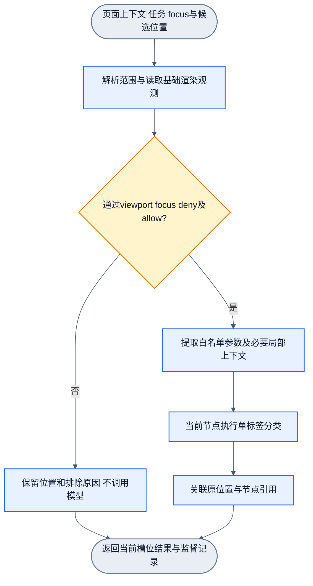

# Focus、候选过滤与单标签批处理

状态：修订5中的DOM应用设计草案，2026-10-17。页面可作为共享上下文；首期单任务单标签并支持按序数组；分类前有focus、白名单、黑名单，目标至少限制在viewport。上述步骤及DOM层级拆分均为可组合基础节点，不固定进通用核心。未实现，尚未纳入上一轮Gemini 4设计复核。

上层框架已调整为 [Filter节点与统一Workflow](node-workflows.md)。本文是DOM应用workflow的候选节点合同，不是通用框架的内置业务。

## 1. 输入层次

入口明确分成手写filter链与神经网络节点两段。ManualFilter依次执行viewport、当前focus与白黑名单等确定规则，返回pass/reason；其中deny优先allow。NeuralNode只对放行节点做当前任务的单标签判断并返回label/confidence。前者是候选过滤，后者是可训练语义识别，不把两种结果混用。

浏览器入口持有页面DOM与布局上下文。页面无需所有节点都分类：先限制关注范围并做基础过滤，再为保留候选提参。数值模型使用已审特征及必要局部上下文，不直接把原始class、账号或整段HTML作为数值输入。

手写filter会读取执行规则必需的少量基础观测，例如rect/tag/role；完整特征提取和神经网络求值放在放行之后。手写链不更新神经网络权重；调整候选规则时仍需用完整查询回归检查目标是否被误排除。

一次任务指定taskId及一个互斥的标签集合。可判断一个节点，也可按顺序判断节点数组；每个节点只返回一个标签。同一节点多标签、多头同时输出和跨任务结果聚合暂不在首期实现。分类目录保留未来目标名称，不表示所有类别必须放入同一个互斥任务。

## 2. FocusSpec

| 字段 | 含义 | 首期规则 |
| --- | --- | --- |
| viewportOnly | 目标必须有可视几何与viewport相交 | 固定true，白名单不能覆盖 |
| within | 当前关注的具体容器引用，可省略 | 缺省当前页面；可指当前帖子、列表或面板 |
| scopeMode | owned / subtree | 按已定义的语义归属或纯DOM范围筛选 |
| region | 可选关注矩形 | 与viewport取交集，只缩小范围，坐标使用同一CSS坐标系 |
| allow | 可选白名单条件集合 | 任一条件命中即允许；未配置不额外限制，显式空集合不允许候选 |
| deny | 可选黑名单条件集合 | 任一条件命中即排除，优先于allow |

“当前关注谁”由within或region定位当前对象及局部范围，不输入某个账号名称来替代识别。taskId选择判断哪种语义；它不能替代范围约束。FocusSpec是调用程序的控制参数，不是模型权重或训练真值。

allow/deny首期使用类型、role、明确属性和已定位节点引用等可直接读取的条件，不先运行语义分类器再决定是否调用自身。条件对象内字段同时满足，条件集合之间按任一命中处理。精确字段集合待接口冻结时定义，不建立任意自然语言或脚本规则执行器。

站点class选择器若用于显式定位focus或teacher规则，应记录为站点依赖规则，不能流入学生向量或冒称模型泛化。候选规则自身也需要测量是否漏掉目标；不因参数未包含class就认为整条链路没有名称捷径。

## 3. 基础过滤顺序

1. 解析当前文档、within和region，引用失效返回明确范围错误。
2. 按渲染几何与裁剪计算当前节点可视区域；只保留与viewport及关注矩形有正面积交集的目标候选。
3. 应用deny，再应用allow。allow命中不能复活被deny排除的节点，也不能允许viewport外目标。
4. 页面模式通过独立拆分节点，按DOM层级建立候选项；保留中间容器及后代，不只保留叶子。初筛保留可遍历范围与排除记录，不能只用“父节点通过”的布尔值决定是否遍历后代。展开项按相同候选规则检查后再提参。显式单节点/数组入口可不接拆分节点，不自动增添分类目标。
5. 对保留候选提取当前任务需要的特征，进入单标签分类。第二阶段才附加已声明的预测上下文。各步骤通过事件传递，具体组合由workflow声明。

黑名单和白名单不是“其他类”的定义。script/style/template等非渲染元数据通常不作为视觉目标；html/body等页面级容器是否作为目标由当前任务明确设置。排除当前节点不等于剪掉整个子树：例如跳过body仍须检查其可见后代。只有显式排除某个子树，才连其后代一同不作为目标；必要父级结构仍可读取。

部分进入viewport即保留，不要求整张帖子完全可见、中心点在视口内或达到某个全局占比。考虑滚动容器的实际裁剪，不以overflow声明代替测量。getClientRects存在多个片段时，以实际有效片段判断，不只依赖可能跨空白区域的总外接框。viewport与节点矩形应处于同一坐标系。

viewport相交不证明节点没有被浮层遮挡，也不证明可点击。精确遮挡/操作可用性在动作边界验证；当前设计不假设所有相交节点都能操作。零几何或display:contents节点可跳过自身并继续检查后代，不将它的后代一并删除。

尺寸/角色限制必须按任务声明，不设置统一“很小就不要”的门槛：头像、广告标记和操作图标都可能很小。广告、推广、推荐不默认加入deny；它们是需要识别的目标。需要过滤某类内容的用户策略在识别结果之后执行，或由用户明确缩小任务范围。

## 4. 页面与单节点模型的连接

图为单个候选槽位的设计路径，批处理重复使用同一合同。仍为待审候选图；单入口单出口。

目标候选受viewport限制，上下文观测不要求所有关联元素都在viewport内。可以读取所属容器边界或兄弟数量，不能因此把它们都加入输出列表。对视口外元素不额外运行分类；第二阶段如需要其语义判断，缺省为未知/不可用，不偷偷扩大整页分类。

## 5. 顺序与结果

页面模式先限制范围，再拆分为确定顺序的层级项，检查展开项后产生candidateRefs；按项序号关联分类与排除记录。父子可分别作为输入且子树重叠，不是对页面做互斥分割。snapshot/nodeRef及父子兄弟关联只用于映射与局部测量，绝对路径和全局深度不输入模型。显式输入nodeRefs数组时，输出数量和顺序与输入完全一致；被过滤的槽位保留index、nodeRef、status=filtered_out、reason，不给它伪造类别或分数。

通过过滤后的分类结果带index、nodeRef、label、confidence。必要特征缺失或分类无法确定时保留未判定状态，不静默删除或挤压数组。label属于taskId声明的互斥集合；未标注、未判定和已确认“其他”是不同概念。

排除原因至少区分outside_viewport、outside_focus、nonrendered、deny_match、allow_miss。保存FocusSpec及规则版本、viewport/region测量与候选/排除引用，供监督回溯。结果状态与排除原因是程序记录，不作为模型类别。

## 6. 训练与回归

focus过滤是候选枚举器职责，产生的排除记录不自动成为负标签。teacher可保存更完整原始现场用于定位漏检，但训练、校准和评估必须记录各自候选规则，不能将不同focus下的成绩直接比较。

分别评估：用户期望focus和viewport内的真目标有多少被候选规则保留，以及已保留候选的分类表现。目标被allow/deny误排除归candidate_enumerator/focus规则问题，不能只计算模型看到的节点来抬高准确率。用户明确范围之外的目标不算本次漏识别。

比较版本时，保留同一页面观测、同一意图范围和规范标签；规则变化既比较共同候选的分类，也比较完整查询的漏选/误选。滚动、页面重绘或focus改变后重新产生候选，不用旧的可视判断冒充当前状态。按既有分组独立性规则安排回放。

本轮仅修改设计。该增量影响入口、输出和候选回归口径，之前修订2的通过结论不自动覆盖本文件；接口冻结与实现前需纳入下一轮设计审查。
