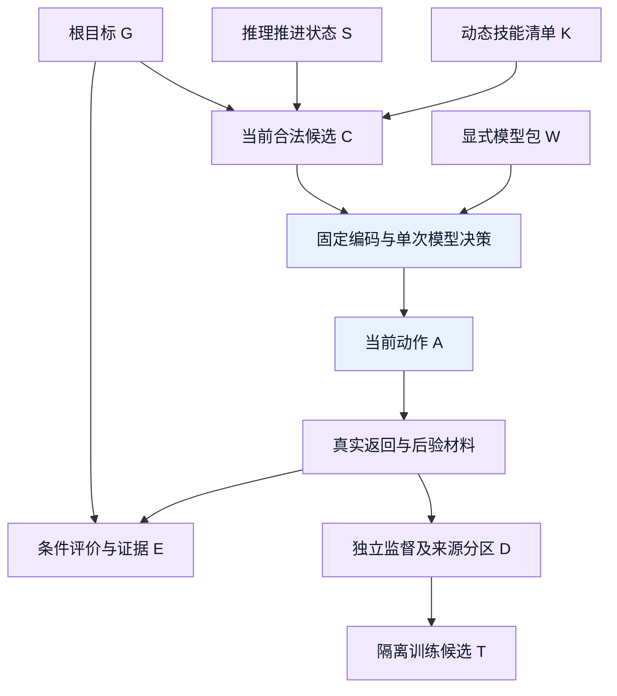
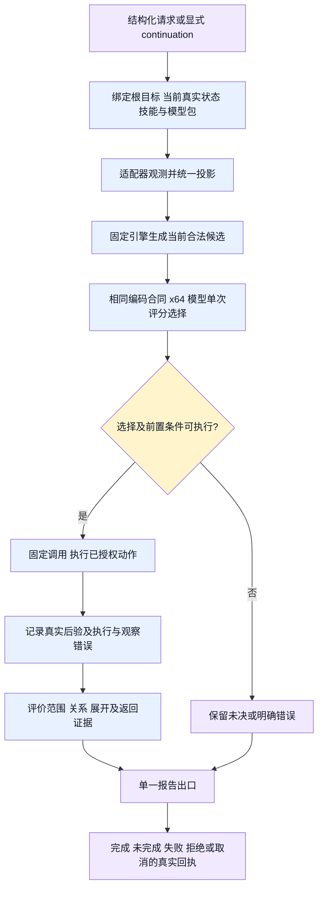
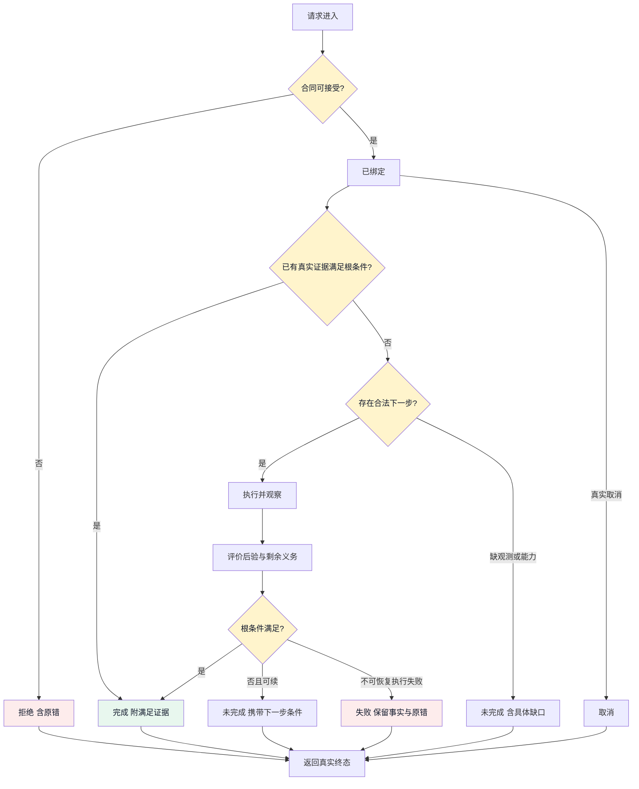
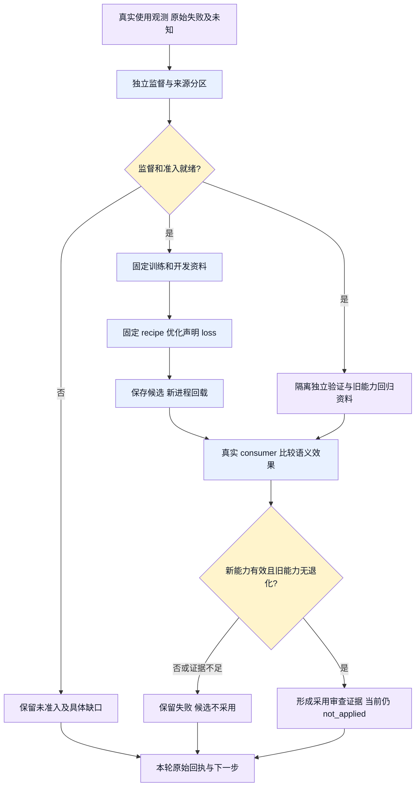

# 推理与训练 ontology 审计

状态：语义细分、治理准入实现与审计合同；不是推理能力交付、新模型或采用许可。Alice，2026-11-11（America/Los_Angeles）。

本文件细化 `design.md` §1.1、`nn-code-redesign-symbols-tsjs-design.md`、`model-evolution.md`，不另建四元素定义。既有用户约束继续有效。新增实现方案必须沿研究员设计、Alice 审计、执行者实现流程。

2026-11-12 按逐条确认同步 S/A/E 定义。批准原文在 `/Volumes/Intel/playground/nnanything-runs/nncode-training-full-audit-20261109/semantic-confirmation.md`。本次更新不继承旧 Review 对新正文的接受，也不改变 `behavior_verified=false`。动作绑定的具体工程门禁为公开测试 `tests/recursive-goal-selected-action.test.mjs`：在 bind → run → report 的 run 内，从 selected 到 atomic dispatch 必须传递同一对象及参数；合法带 decision 的原子动作和旧无载荷动作均应执行；执行时丢对象或换对象被断言拦截。适用对象为当前 frame 的一次原子选择，owner 为 recursive-goal；正反回执落在本次 foundation-execution run，最终接受以独立 Review 为准。

## 1. 对象、身份与事实来源

| ID / 对象 | 定义与身份 | 必需属性 / 禁止混入 | owner / 观测入口 |
| --- | --- | --- | --- |
| G / 根目标 | 一次结构化请求中保持不变的目标；请求引用、目标对象及条件共同确定身份 | 范围、关系条件、展开深度、返回条件、阈值；不得随当前候选改写目标 | 调用者；请求与 continuation |
| S / 推理状态 | 当前路径与 Goal 的推进状态；按请求、frame 和当前义务区分实例 | 可推进路径、可拆 Goal、待评价和待返回结果；观测、判断及预测作为不同来源材料，不得用材料集合代替推进状态 | engine；frame、condition、cursor 与真实 step 回执 |
| K / 技能 | 固定格式的能力声明，技能引用及参数合同标识其含义 | typed 参数、前置条件、effects、结果合同；技能可动态增减，但不得注入任意执行代码 | 注册能力提供者；技能清单 |
| C / 候选 | 当前 Goal/State/技能下的一次可选决策 | 独立目标/动作引用、合法性依据、参数引用；不得含 gold 或预选答案 | 固定引擎；StepContext candidateGroup |
| W / 模型包 | 当前请求显式捕获的权重与编码合同 | 64 维输入、两层隐藏层、格式一致；不得静默换 profile 或手填答案 | 模型 loader；加载回执 |
| A / 动作 | 当前目标或子目标到所需操作的映射；不能等同目标完成 | Goal 关联、技能引用、对象和参数、授权 effects；不得执行时换成另一个选择 | engine 调用 adapter；执行回执 |
| E / 评价与证据 | 对当前 step 可评价结果的评价；其余保留待评价 | 对象、条件、来源、unknown 与覆盖；模型分数不是满足度，子完成不代表根完成 | evaluator；逐条件证据和最终报告 |
| D / 样本 | 关联来源家族中的观测与独立监督 | 来源分区、监督来源、训练/开发/验证用途；未知不得补 false，有效错误不得丢弃 | 研究员及数据 owner；样本、admission 回执 |
| T / 训练候选 | 某次固定 recipe 从声明起点拟合并回载的模型包 | loss 目标、起始权重、耗时、停止原因、旧能力回归；不得自动采用 | trainer/evaluator；原始训练与回载回执 |

对象关系不是执行顺序。以下为有向依赖关系图，不表示模型自动掌握了所有关系。



| 关系 ID | 方向 / 基数 | 可检查事实 | 必须 / 不得 |
| --- | --- | --- | --- |
| R1 constrains | G → C，一对多 | 请求与候选参数、effects | 保留根条件；不得按候选修改根 |
| R2 supports | S 的当前可评价材料 → E，多对多 | receipt 对象、范围、时刻与条件对应 | 可评价子集先评价；同名或共享任意 receipt 不等于同一声明 |
| R3 selects | W + C → A，每步至多一个执行选择 | 实际 StepContext、模型输出、执行日志 | 真实模型决策；不得 adapter 预先交最终答案冒充模型 |
| R4 observes | A → 真实返回材料 → 推进状态更新，一对多或观测失败 | 原子执行后验、原错、frame 变化 | 区分执行与观察失败；不得 exit0 推出目标满足 |
| R5 decomposes | G → 子条件，一对多 | 引擎义务与父子证据 | 引擎推进，子目标证据反向满足父；不得模型自改控制预算 |
| R6 derives | D → T，多对一 | 分区、配方与拟合输入 | 训练/开发/独立验证按来源隔离；不得验证反例仍称未见 |
| R7 compares | T → E，一对多 | 独立评价、旧能力回归与实际 consumer | 原始失败保留；不得总分遮蔽旧能力退化 |

### 1.1 治理准入机器绑定

以下 `ontology-governance` 块只保存 ID、正文定位、授权来源定位、能力 scope、
真实 `project-design` edge 与证据引用，不复制第一部分的完整语义正文。语义
定义仍以本文件第一部分为唯一入口。机器只检查结构和可读材料；语义正确性、
授权适用性和证据可信度仍由现有独立 Reviewer 核对，不将结构通过写成行为
验证。实际 design/delivery 结果由公开入口
`npm run gate:ontology -- --stage <design|delivery> --contract <markdown>`
产生。

```json ontology-governance
{
  "ontology_version": 1,
  "definitions": {
    "objects": [
      {
        "id": "G",
        "identity": "请求引用、目标对象及条件共同确定身份",
        "owner": "调用者；请求与 continuation",
        "attributes": ["范围", "关系条件", "展开深度", "返回条件", "阈值"],
        "perception": "请求与 continuation",
        "mustHave": ["范围", "关系条件", "展开深度", "返回条件", "阈值"],
        "mustNotHave": ["不得随当前候选改写目标"],
        "source": { "path": "docs/inference-training-ontology.md", "quote": "| G / 根目标 |" }
      },
      {
        "id": "S",
        "identity": "请求、frame 和当前义务区分推进状态",
        "owner": "engine",
        "attributes": ["可推进路径", "可拆 Goal", "待评价和待返回结果"],
        "perception": "frame、condition、cursor 与真实 step 回执",
        "mustHave": ["推理推进状态", "材料来源区分"],
        "mustNotHave": ["不得含未来结果", "不得把预测当事实"],
        "source": { "path": "docs/inference-training-ontology.md", "quote": "| S / 推理状态 |" }
      },
      {
        "id": "K",
        "identity": "技能引用及参数合同标识其含义",
        "owner": "注册能力提供者",
        "attributes": ["typed 参数", "前置条件", "effects", "结果合同"],
        "perception": "技能清单",
        "mustHave": ["typed 参数", "前置条件", "effects", "结果合同"],
        "mustNotHave": ["不得注入任意执行代码"],
        "source": { "path": "docs/inference-training-ontology.md", "quote": "| K / 技能 |" }
      },
      {
        "id": "C",
        "identity": "当前 Goal/State/技能下的一次可选决策",
        "owner": "固定引擎",
        "attributes": ["独立目标/动作引用", "合法性依据", "参数引用"],
        "perception": "StepContext candidateGroup",
        "mustHave": ["独立目标/动作引用", "合法性依据", "参数引用"],
        "mustNotHave": ["不得含 gold", "不得含预选答案"],
        "source": { "path": "docs/inference-training-ontology.md", "quote": "| C / 候选 |" }
      },
      {
        "id": "W",
        "identity": "当前请求显式捕获的权重与编码合同",
        "owner": "模型 loader",
        "attributes": ["64 维输入", "两层隐藏层", "格式一致"],
        "perception": "加载回执",
        "mustHave": ["显式捕获的权重与编码合同"],
        "mustNotHave": ["不得静默换 profile", "不得手填答案"],
        "source": { "path": "docs/inference-training-ontology.md", "quote": "| W / 模型包 |" }
      },
      {
        "id": "A",
        "identity": "当前目标或子目标到所需操作的映射",
        "owner": "engine 调用 adapter",
        "attributes": ["Goal 关联", "技能引用", "对象和参数", "授权 effects"],
        "perception": "执行回执",
        "mustHave": ["技能引用", "参数", "授权 effects"],
        "mustNotHave": ["不得生成任意 shell", "不得把 parser 结果当训练结果"],
        "source": { "path": "docs/inference-training-ontology.md", "quote": "| A / 动作 |" }
      },
      {
        "id": "E",
        "identity": "对当前 step 可评价结果的评价",
        "owner": "evaluator",
        "attributes": ["对象", "条件", "来源", "unknown", "覆盖"],
        "perception": "逐条件证据和最终报告",
        "mustHave": ["对象", "条件", "来源", "unknown", "覆盖"],
        "mustNotHave": ["模型分数不是满足度"],
        "source": { "path": "docs/inference-training-ontology.md", "quote": "| E / 评价与证据 |" }
      },
      {
        "id": "D",
        "identity": "关联来源家族中的观测与独立监督",
        "owner": "研究员及数据 owner",
        "attributes": ["来源分区", "监督来源", "训练/开发/验证用途"],
        "perception": "样本、admission 回执",
        "mustHave": ["来源分区", "监督来源", "训练/开发/验证用途"],
        "mustNotHave": ["未知不得补 false", "有效错误不得丢弃"],
        "source": { "path": "docs/inference-training-ontology.md", "quote": "| D / 样本 |" }
      },
      {
        "id": "T",
        "identity": "某次固定 recipe 从声明起点拟合并回载的模型包",
        "owner": "trainer/evaluator",
        "attributes": ["loss 目标", "起始权重", "耗时", "停止原因", "旧能力回归"],
        "perception": "原始训练与回载回执",
        "mustHave": ["声明的起点", "旧能力回归"],
        "mustNotHave": ["不得自动采用"],
        "source": { "path": "docs/inference-training-ontology.md", "quote": "| T / 训练候选 |" }
      }
    ],
    "relations": [
      {
        "id": "R1",
        "from": ["G"],
        "to": ["C"],
        "kind": "constrains",
        "direction": "directed",
        "cardinality": "one-to-many",
        "owner": "source row R1",
        "perception": "source row R1",
        "mustHave": ["请求与候选参数", "effects"],
        "mustNotHave": ["不得按候选修改根"],
        "source": { "path": "docs/inference-training-ontology.md", "quote": "| R1 constrains |" }
      },
      {
        "id": "R2",
        "from": ["S"],
        "to": ["E"],
        "kind": "supports",
        "direction": "directed",
        "cardinality": "many-to-many",
        "owner": "source row R2",
        "perception": "source row R2",
        "mustHave": ["receipt 对象", "范围", "时刻与条件对应"],
        "mustNotHave": ["同名或共享任意 receipt 不等于同一声明"],
        "source": { "path": "docs/inference-training-ontology.md", "quote": "| R2 supports |" }
      },
      {
        "id": "R3",
        "from": ["W", "C"],
        "to": ["A"],
        "kind": "selects",
        "direction": "joint-to-single",
        "cardinality": "at-most-one-action-per-step",
        "owner": "source row R3",
        "perception": "source row R3",
        "mustHave": ["实际 StepContext", "模型输出", "执行日志"],
        "mustNotHave": ["不得由 adapter 预先交最终答案"],
        "source": { "path": "docs/inference-training-ontology.md", "quote": "| R3 selects |" }
      },
      {
        "id": "R4",
        "from": ["A"],
        "to": ["S"],
        "kind": "observes",
        "direction": "directed",
        "cardinality": "one-to-many-or-observation-failure",
        "owner": "source row R4",
        "perception": "source row R4",
        "mustHave": ["原子执行后验", "原错"],
        "mustNotHave": ["不得由 exit0 推出目标满足"],
        "source": { "path": "docs/inference-training-ontology.md", "quote": "| R4 observes |" }
      },
      {
        "id": "R5",
        "from": ["G"],
        "to": ["Condition"],
        "kind": "decomposes",
        "direction": "directed",
        "cardinality": "one-to-many",
        "owner": "source row R5",
        "perception": "source row R5",
        "mustHave": ["引擎义务", "父子证据"],
        "mustNotHave": ["不得由模型自改控制预算"],
        "source": { "path": "docs/inference-training-ontology.md", "quote": "| R5 decomposes |" },
        "auxiliaryEndpoints": [
          {
            "id": "Condition",
            "source": { "path": "docs/inference-training-ontology.md", "quote": "| R5 decomposes |" }
          }
        ]
      },
      {
        "id": "R6",
        "from": ["D"],
        "to": ["T"],
        "kind": "derives",
        "direction": "directed",
        "cardinality": "many-to-one",
        "owner": "source row R6",
        "perception": "source row R6",
        "mustHave": ["分区", "recipe 与拟合输入"],
        "mustNotHave": ["不得让验证反例仍称未见"],
        "source": { "path": "docs/inference-training-ontology.md", "quote": "| R6 derives |" }
      },
      {
        "id": "R7",
        "from": ["T"],
        "to": ["E"],
        "kind": "compares",
        "direction": "directed",
        "cardinality": "one-to-many",
        "owner": "source row R7",
        "perception": "source row R7",
        "mustHave": ["独立评价", "旧能力回归", "实际 consumer"],
        "mustNotHave": ["不得总分遮蔽旧能力退化"],
        "source": { "path": "docs/inference-training-ontology.md", "quote": "| R7 compares |" }
      }
    ],
    "behaviors": [
      {
        "id": "B1",
        "owner": "engine",
        "precondition": ["结构化 G、S、K、W 合同兼容"],
        "input": ["结构化 G、S、K、W 合同"],
        "output": ["已绑定上下文"],
        "transition": { "from": "未绑定", "to": "已绑定上下文" },
        "effects": [],
        "perception": "绑定回执",
        "mustHave": [],
        "mustNotHave": ["缺合同不得静默降级"],
        "source": { "path": "docs/inference-training-ontology.md", "quote": "| B1 绑定 / engine |" }
      },
      {
        "id": "B2",
        "owner": "adapter + shared converter",
        "precondition": ["当前范围的真实源"],
        "input": ["当前范围的真实源"],
        "output": ["统一观测材料"],
        "transition": { "from": "原始观测", "to": "统一观测材料" },
        "effects": [],
        "perception": "源到观测的公开投影回执",
        "mustHave": [],
        "mustNotHave": ["不得做请求驱动的事实伪造"],
        "source": { "path": "docs/inference-training-ontology.md", "quote": "| B2 观测投影 / adapter + shared converter |" }
      },
      {
        "id": "B3",
        "owner": "student",
        "precondition": ["实际当前 C 与 x64"],
        "input": ["实际当前 C 与 x64"],
        "output": ["一个决策或未决"],
        "transition": { "from": "待选择", "to": "一个决策或未决" },
        "effects": [],
        "perception": "实际 StepContext 与模型输出回执",
        "mustHave": [],
        "mustNotHave": ["不得推进深度", "不得闭合根目标"],
        "source": { "path": "docs/inference-training-ontology.md", "quote": "| B3 单次选择 / student |" }
      },
      {
        "id": "B4",
        "owner": "engine + adapter",
        "precondition": ["决策合法且前置/权限满足"],
        "input": ["合法决策"],
        "output": ["执行回执及后验"],
        "transition": { "from": "已选择", "to": "执行回执及后验" },
        "effects": [],
        "perception": "执行回执与后验",
        "mustHave": [],
        "mustNotHave": ["候选非法或缺技能必须显式返回", "仅声明的 effects"],
        "source": { "path": "docs/inference-training-ontology.md", "quote": "| B4 分解与执行 / engine + adapter |" }
      },
      {
        "id": "B5",
        "owner": "evaluator + engine",
        "precondition": ["当前 step 有可评价结果"],
        "input": ["当前可评价结果及对应 Goal 条件"],
        "output": ["证据、剩余义务、continuation 或终点"],
        "transition": { "from": "后验", "to": "证据、剩余义务、continuation 或终点" },
        "effects": [],
        "perception": "逐条件证据和最终报告",
        "mustHave": [],
        "mustNotHave": ["不得修改 gold/阈值", "unknown 不等于 false"],
        "source": { "path": "docs/inference-training-ontology.md", "quote": "| B5 评价 / evaluator + engine |" }
      },
      {
        "id": "B6",
        "owner": "researcher",
        "precondition": ["原始来源与独立监督"],
        "input": ["原始来源与独立监督"],
        "output": ["已准入分区"],
        "transition": { "from": "原始资料", "to": "已准入分区" },
        "effects": [],
        "perception": "样本与 admission 回执",
        "mustHave": [],
        "mustNotHave": ["缺监督不能以 pending 模板冒充就绪"],
        "source": { "path": "docs/inference-training-ontology.md", "quote": "| B6 准备 / researcher |" }
      },
      {
        "id": "B7",
        "owner": "固定 trainer",
        "precondition": ["已审 recipe、准入资料及起始权重"],
        "input": ["已审 recipe、准入资料及起始权重"],
        "output": ["未采用候选"],
        "transition": { "from": "已准入", "to": "未采用候选" },
        "effects": [],
        "perception": "训练与回载回执",
        "mustHave": [],
        "mustNotHave": ["后训练不得从零冒充"],
        "source": { "path": "docs/inference-training-ontology.md", "quote": "| B7 拟合 / 固定 trainer |" }
      },
      {
        "id": "B8",
        "owner": "evaluator",
        "precondition": ["新进程回载候选及独立资料"],
        "input": ["新进程回载候选及独立资料"],
        "output": ["采用判据证据或拒绝/未完成"],
        "transition": { "from": "候选", "to": "采用判据证据或拒绝/未完成" },
        "effects": [],
        "perception": "真实 consumer 比较回执",
        "mustHave": [],
        "mustNotHave": ["当前只交候选证据", "不产品接线", "不安装"],
        "source": { "path": "docs/inference-training-ontology.md", "quote": "| B8 比较 / evaluator |" }
      }
    ]
  },
  "graph": {
    "path": "workflows/project-design.graph.json",
    "nodeIds": [
      "读取现有架构与能力缺口",
      "定义四元素与训练反推关系",
      "确定固定调用与执行责任",
      "设计数值连线与外层流程图纸",
      "设计独立样本及版本进化验收",
      "校验四元素闭合与最小必要性",
      "交付可实施设计或具体缺口"
    ]
  },
  "authority": {
    "userApproval": {
      "path": "/Volumes/Intel/playground/nnanything-runs/nncode-training-full-audit-20261109/governance-authorization.md",
      "quote": "第一部分你已经落盘了吗?需要改成治理门禁"
    },
    "priorConstraints": [
      {
        "path": "/Volumes/Intel/playground/nnanything-runs/nncode-training-full-audit-20261109/governance-authorization.md",
        "quote": "先前用户直接约束仍保留：64 输入、两层隐藏层；统一格式、统一推理、动态技能与权重；权重单次决策，推理引擎推动 Goal 拆解；真实证据与模型评分分离；训练资料来源隔离，后训练继承已有知识。"
      }
    ]
  },
  "capability": {
    "id": "inference-training-ontology-contract",
    "scope": "NNAnything 推理与训练设计及交付的第一部分 ontology 准入；允许后续能力按现有合同声明明确 scope 子集。",
    "contractSource": {
      "path": "docs/inference-training-ontology.md",
      "quote": "# 推理与训练 ontology 审计"
    },
    "objects": [
      { "id": "G", "applicable": true, "owner": "调用者", "observation": "请求与 continuation", "clauseIds": ["G08"] },
      { "id": "S", "applicable": true, "owner": "adapter", "observation": "真实进程/DOM/source receipt", "clauseIds": ["G02"] },
      { "id": "K", "applicable": true, "owner": "注册能力提供者", "observation": "技能清单", "clauseIds": ["G03"] },
      { "id": "C", "applicable": true, "owner": "固定引擎", "observation": "StepContext candidateGroup", "clauseIds": ["G03"] },
      { "id": "W", "applicable": true, "owner": "模型 loader", "observation": "加载回执", "clauseIds": ["G03"] },
      { "id": "A", "applicable": true, "owner": "engine", "observation": "执行回执", "clauseIds": ["G09"] },
      { "id": "E", "applicable": true, "owner": "evaluator", "observation": "逐条件证据和最终报告", "clauseIds": ["G04"] },
      { "id": "D", "applicable": true, "owner": "研究员与数据 owner", "observation": "样本与 admission 回执", "clauseIds": ["G05"] },
      { "id": "T", "applicable": true, "owner": "trainer/evaluator", "observation": "训练、回载与候选回执", "clauseIds": ["G06", "G07"] }
    ],
    "relations": [
      { "id": "R1", "applicable": true, "owner": "engine", "observation": "请求与候选参数/effects", "clauseIds": ["G08"] },
      { "id": "R2", "applicable": true, "owner": "evaluator", "observation": "receipt、范围、时刻与条件对应", "clauseIds": ["G04"] },
      { "id": "R3", "applicable": true, "owner": "engine", "observation": "StepContext、模型输出与执行日志", "clauseIds": ["G03"] },
      { "id": "R4", "applicable": true, "owner": "adapter", "observation": "原子执行后验与原错", "clauseIds": ["G09"] },
      { "id": "R5", "applicable": true, "owner": "engine", "observation": "引擎义务与父子证据", "clauseIds": ["G04"] },
      { "id": "R6", "applicable": true, "owner": "trainer", "observation": "分区、recipe 与拟合输入", "clauseIds": ["G06"] },
      { "id": "R7", "applicable": true, "owner": "evaluator", "observation": "独立评价、旧能力回归与 consumer", "clauseIds": ["G07"] }
    ],
    "behaviors": [
      {
        "id": "B1",
        "applicable": true,
        "owner": "engine",
        "effects": [],
        "observation": "请求与 continuation 绑定回执",
        "clauseIds": ["G08"],
        "allowCase": { "id": "B1-allow", "description": "兼容合同完成绑定" },
        "denyCase": { "id": "B1-deny", "description": "缺合同不得静默降级" }
      },
      {
        "id": "B2",
        "applicable": true,
        "owner": "adapter + shared converter",
        "effects": [],
        "observation": "原始源到统一语义状态",
        "clauseIds": ["G01", "G02"],
        "allowCase": { "id": "B2-allow", "description": "允许有依据的局部绑定观测" },
        "denyCase": { "id": "B2-deny", "description": "禁止局部遮蔽伪造 import 或事实" }
      },
      {
        "id": "B3",
        "applicable": true,
        "owner": "student",
        "effects": [],
        "observation": "单次模型决策输出",
        "clauseIds": ["G03"],
        "allowCase": { "id": "B3-allow", "description": "实际 x64 与动态候选进入单次选择" },
        "denyCase": { "id": "B3-deny", "description": "不得把 parser/teacher 最终答案或 gold 入模" }
      },
      {
        "id": "B4",
        "applicable": true,
        "owner": "engine + adapter",
        "effects": [],
        "observation": "执行回执与真实后验",
        "clauseIds": ["G09"],
        "allowCase": { "id": "B4-allow", "description": "合法决策在权限内执行" },
        "denyCase": { "id": "B4-deny", "description": "非法候选或缺技能须显式返回" }
      },
      {
        "id": "B5",
        "applicable": true,
        "owner": "evaluator + engine",
        "effects": [],
        "observation": "证据、剩余义务、continuation 或终点",
        "clauseIds": ["G04"],
        "allowCase": { "id": "B5-allow", "description": "真实条件满足形成完成证据" },
        "denyCase": { "id": "B5-deny", "description": "exit0 或模型分数不能替代完成" }
      },
      {
        "id": "B6",
        "applicable": true,
        "owner": "researcher",
        "effects": [],
        "observation": "原始资料到准入分区",
        "clauseIds": ["G05"],
        "allowCase": { "id": "B6-allow", "description": "独立来源监督完成准入" },
        "denyCase": { "id": "B6-deny", "description": "pending/null gold 不得冒充就绪" }
      },
      {
        "id": "B7",
        "applicable": true,
        "owner": "固定 trainer",
        "effects": [],
        "observation": "训练、回载与 loss 回执",
        "clauseIds": ["G06"],
        "allowCase": { "id": "B7-allow", "description": "合格起点和旧资料重放完成后训练" },
        "denyCase": { "id": "B7-deny", "description": "不得从零重拟合冒充后训练" }
      },
      {
        "id": "B8",
        "applicable": true,
        "owner": "evaluator",
        "effects": [],
        "observation": "采用判据证据或拒绝/未完成",
        "clauseIds": ["G07"],
        "allowCase": { "id": "B8-allow", "description": "新能力有效且旧能力无退化" },
        "denyCase": { "id": "B8-deny", "description": "回归或未授权采用必须保留失败" }
      }
    ]
  },
  "clauses": [
    {
      "id": "G01",
      "axis": "behavior",
      "axisId": "B2",
      "source": { "path": "docs/inference-training-ontology.md", "quote": "| G01 / behavior B2 |" },
      "scope": "解析局部绑定并投影真实观测。",
      "scenario": "TSJS 观测投影。",
      "trigger": "解析 import/local/unknown 关系。",
      "allowedActions": ["保留有依据的观测事实。"],
      "forbiddenActions": ["忽略局部遮蔽并伪造 import。"],
      "stateBefore": "source",
      "stateAfter": "S",
      "effects": [],
      "owner": "producer owner",
      "approval": {
        "state": "approved",
        "source": {
          "path": "/Volumes/Intel/playground/nnanything-runs/nncode-training-full-audit-20261109/governance-authorization.md",
          "quote": "第一部分你已经落盘了吗?需要改成治理门禁"
        },
        "scope": "第一部分治理门禁化。"
      },
      "governance": {
        "edge": { "from": "确定固定调用与执行责任", "to": "设计数值连线与外层流程图纸", "arcId": "capability_boundary_design" },
        "gateKind": "behavior",
        "check": "检查局部绑定不得伪造 import/source evidence。",
        "allowCase": "B2-allow",
        "denyCase": "B2-deny",
        "observation": "公开 producer 检查普通 import 与 for-of 遮蔽。"
      }
    },
    {
      "id": "G02",
      "axis": "behavior",
      "axisId": "B2",
      "source": { "path": "docs/inference-training-ontology.md", "quote": "| G02 / behavior B2 |" },
      "scope": "投影声明观测并保持精确来源对应。",
      "scenario": "共享 converter 观测投影。",
      "trigger": "observation/request 投影到统一状态。",
      "allowedActions": ["保留精确对象与来源对应。"],
      "forbiddenActions": ["把同名或共享 receipt 当同一声明。"],
      "stateBefore": "observation",
      "stateAfter": "S",
      "effects": [],
      "owner": "shared converter owner",
      "approval": {
        "state": "approved",
        "source": {
          "path": "/Volumes/Intel/playground/nnanything-runs/nncode-training-full-audit-20261109/governance-authorization.md",
          "quote": "第一部分你已经落盘了吗?需要改成治理门禁"
        },
        "scope": "第一部分治理门禁化。"
      },
      "governance": {
        "edge": { "from": "确定固定调用与执行责任", "to": "设计数值连线与外层流程图纸", "arcId": "capability_boundary_design" },
        "gateKind": "behavior",
        "check": "检查请求不变时真实声明变化必须改变观测投影。",
        "allowCase": "B2-allow",
        "denyCase": "B2-deny",
        "observation": "observeTsJsStepwiseRequest→loadStepwiseEpisodeFamily→relationStepContext。"
      }
    },
    {
      "id": "G03",
      "axis": "behavior",
      "axisId": "B3",
      "source": { "path": "docs/inference-training-ontology.md", "quote": "| G03 / behavior B3 |" },
      "scope": "模型只消费实际 x64 与动态候选。",
      "scenario": "单次选择。",
      "trigger": "上下文进入模型评分。",
      "allowedActions": ["使用相同 observation 形成相同实际输入。"],
      "forbiddenActions": ["把 parser/teacher 最终答案或 gold 入模。"],
      "stateBefore": "C",
      "stateAfter": "decision",
      "effects": [],
      "owner": "encoder/runtime owner",
      "approval": {
        "state": "approved",
        "source": {
          "path": "/Volumes/Intel/playground/nnanything-runs/nncode-training-full-audit-20261109/governance-authorization.md",
          "quote": "第一部分你已经落盘了吗?需要改成治理门禁"
        },
        "scope": "第一部分治理门禁化。"
      },
      "governance": {
        "edge": { "from": "定义四元素与训练反推关系", "to": "确定固定调用与执行责任", "arcId": "capability_semantic_contract" },
        "gateKind": "behavior",
        "check": "检查同一 observation 经训练/推理得到相同实际输入。",
        "allowCase": "B3-allow",
        "denyCase": "B3-deny",
        "observation": "删 gold 不改输入；源码正则不是 gate。"
      }
    },
    {
      "id": "G04",
      "axis": "behavior",
      "axisId": "B5",
      "source": { "path": "docs/inference-training-ontology.md", "quote": "| G04 / behavior B5 |" },
      "scope": "完成判断只依据真实后验与剩余义务。",
      "scenario": "评价与返回。",
      "trigger": "报告完成或 continuation。",
      "allowedActions": ["按真实条件满足声明完成。"],
      "forbiddenActions": ["用 exit0、模型分数或预算耗尽代替完成。"],
      "stateBefore": "posterior",
      "stateAfter": "real report",
      "effects": [],
      "owner": "recursive-goal owner",
      "approval": {
        "state": "approved",
        "source": {
          "path": "/Volumes/Intel/playground/nnanything-runs/nncode-training-full-audit-20261109/governance-authorization.md",
          "quote": "第一部分你已经落盘了吗?需要改成治理门禁"
        },
        "scope": "第一部分治理门禁化。"
      },
      "governance": {
        "edge": { "from": "设计独立样本及版本进化验收", "to": "校验四元素闭合与最小必要性", "arcId": "capability_acceptance_design" },
        "gateKind": "terminal",
        "check": "区分真实闭合成功与遗留必要义务。",
        "allowCase": "B5-allow",
        "denyCase": "B5-deny",
        "observation": "复用现有完成测试；覆盖审计另行补。"
      }
    },
    {
      "id": "G05",
      "axis": "behavior",
      "axisId": "B6",
      "source": { "path": "docs/inference-training-ontology.md", "quote": "| G05 / behavior B6 |" },
      "scope": "样本准入必须包含独立来源监督。",
      "scenario": "训练资料准备。",
      "trigger": "原始资料转准入分区。",
      "allowedActions": ["保留来源分区和有效监督。"],
      "forbiddenActions": ["把 pending/null gold 当已准入。"],
      "stateBefore": "raw",
      "stateAfter": "admitted or held",
      "effects": [],
      "owner": "researcher/data owner",
      "approval": {
        "state": "approved",
        "source": {
          "path": "/Volumes/Intel/playground/nnanything-runs/nncode-training-full-audit-20261109/governance-authorization.md",
          "quote": "第一部分你已经落盘了吗?需要改成治理门禁"
        },
        "scope": "第一部分治理门禁化。"
      },
      "governance": {
        "edge": { "from": "设计独立样本及版本进化验收", "to": "校验四元素闭合与最小必要性", "arcId": "capability_acceptance_design" },
        "gateKind": "precondition",
        "check": "检查有效监督和来源隔离。",
        "allowCase": "B6-allow",
        "denyCase": "B6-deny",
        "observation": "现有 admission 入口逐域核对。"
      }
    },
    {
      "id": "G06",
      "axis": "behavior",
      "axisId": "B7",
      "source": { "path": "docs/inference-training-ontology.md", "quote": "| G06 / behavior B7 |" },
      "scope": "后训练必须继承合格起点和旧资料。",
      "scenario": "离线后训练。",
      "trigger": "recipe 从声明起点拟合。",
      "allowedActions": ["继承旧知识并保存未采用候选。"],
      "forbiddenActions": ["从零重拟合冒充后训练。"],
      "stateBefore": "D",
      "stateAfter": "T candidate",
      "effects": [],
      "owner": "trainer owner",
      "approval": {
        "state": "approved",
        "source": {
          "path": "/Volumes/Intel/playground/nnanything-runs/nncode-training-full-audit-20261109/governance-authorization.md",
          "quote": "第一部分你已经落盘了吗?需要改成治理门禁"
        },
        "scope": "第一部分治理门禁化。"
      },
      "governance": {
        "edge": { "from": "设计数值连线与外层流程图纸", "to": "设计独立样本及版本进化验收", "arcId": "capability_wiring_design" },
        "gateKind": "transition",
        "check": "检查合格起点、旧资料重放和回载回执。",
        "allowCase": "B7-allow",
        "denyCase": "B7-deny",
        "observation": "实际训练任务绑定仍须核对。"
      }
    },
    {
      "id": "G07",
      "axis": "behavior",
      "axisId": "B8",
      "source": { "path": "docs/inference-training-ontology.md", "quote": "| G07 / behavior B8 |" },
      "scope": "候选评估保留回归和未采用边界。",
      "scenario": "候选比较和采用判断。",
      "trigger": "新进程回载候选并运行独立资料。",
      "allowedActions": ["保留评价报告和 not_applied 候选。"],
      "forbiddenActions": ["用总分冲抵旧能力退化或未授权采用。"],
      "stateBefore": "T",
      "stateAfter": "evidence or rejected/incomplete",
      "effects": [],
      "owner": "evaluator",
      "approval": {
        "state": "approved",
        "source": {
          "path": "/Volumes/Intel/playground/nnanything-runs/nncode-training-full-audit-20261109/governance-authorization.md",
          "quote": "第一部分你已经落盘了吗?需要改成治理门禁"
        },
        "scope": "第一部分治理门禁化。"
      },
      "governance": {
        "edge": { "from": "校验四元素闭合与最小必要性", "to": "交付可实施设计或具体缺口", "arcId": "capability_design_assessment" },
        "gateKind": "effect",
        "check": "检查旧能力回归、候选未采用和真实 consumer。",
        "allowCase": "B8-allow",
        "denyCase": "B8-deny",
        "observation": "尚未声称自动采用 gate 已实现。"
      }
    },
    {
      "id": "G08", "axis": "behavior", "axisId": "B1",
      "source": { "path": "docs/inference-training-ontology.md", "quote": "| B1 绑定 / engine |" },
      "scope": "根目标与当前推理合同绑定。",
      "scenario": "新请求或显式 continuation 进入推理。",
      "trigger": "建立当前 Goal/State/技能/模型上下文。",
      "allowedActions": ["保留根目标并绑定兼容的显式合同。"],
      "forbiddenActions": ["改写根条件或在缺合同情况下静默降级。"],
      "stateBefore": "未绑定", "stateAfter": "已绑定上下文或明确拒绝",
      "effects": [], "owner": "engine",
      "approval": {
        "state": "approved",
        "source": { "path": "/Volumes/Intel/playground/nnanything-runs/nncode-training-full-audit-20261109/governance-authorization.md", "quote": "第一部分你已经落盘了吗?需要改成治理门禁" },
        "scope": "现有 B1 与 G/R1 约束的治理绑定，不新增语义。"
      },
      "governance": {
        "edge": { "from": "定义四元素与训练反推关系", "to": "确定固定调用与执行责任", "arcId": "capability_semantic_contract" },
        "gateKind": "precondition", "check": "检查根条件保留与输入合同兼容。",
        "allowCase": "B1-allow", "denyCase": "B1-deny",
        "observation": "公开绑定入口的请求与 continuation 回执。"
      }
    },
    {
      "id": "G09", "axis": "behavior", "axisId": "B4",
      "source": { "path": "docs/inference-training-ontology.md", "quote": "| B4 分解与执行 / engine + adapter |" },
      "scope": "固定引擎调用合法技能并记录真实后验。",
      "scenario": "单次决策进入动作执行。", "trigger": "准备调用候选技能。",
      "allowedActions": ["在前置条件和 effects 授权内执行并读取真实后验。"],
      "forbiddenActions": ["执行非法候选、越权 effects 或把执行成功当根目标完成。"],
      "stateBefore": "已选择", "stateAfter": "执行回执及真实后验或明确错误",
      "effects": [], "owner": "engine + adapter",
      "approval": {
        "state": "approved",
        "source": { "path": "/Volumes/Intel/playground/nnanything-runs/nncode-training-full-audit-20261109/governance-authorization.md", "quote": "第一部分你已经落盘了吗?需要改成治理门禁" },
        "scope": "现有 B4 与 A/R4 约束的治理绑定，不新增权限。"
      },
      "governance": {
        "edge": { "from": "确定固定调用与执行责任", "to": "设计数值连线与外层流程图纸", "arcId": "capability_boundary_design" },
        "gateKind": "effect", "check": "检查合法技能、前置条件、授权 effects 和真实后验。",
        "allowCase": "B4-allow", "denyCase": "B4-deny",
        "observation": "公开执行入口及原子执行后验和原错。"
      }
    }
  ],
  "reviews": {
    "design": {
      "decision": "ACCEPT",
      "scope": "inference-training-ontology-contract",
      "source": {
        "path": "/Volumes/Intel/playground/nnanything-runs/nncode-training-full-audit-20261109/foundation-execution-20261112/action-review/acceptance.md",
        "quote": "Decision: ACCEPT\nScope: inference-training-ontology-contract"
      }
    }
  },
  "deliveryEvidence": []
}
```

## 2. 行为及责任边界

每个行为都是 `(当前状态, 输入) → (输出, 新状态, effects)`。预测状态单列，永不覆盖真实状态。

| 行为 ID / owner | 前提与输入 | 输出及状态迁移 | effects / 禁止 |
| --- | --- | --- | --- |
| B1 绑定 / engine | 结构化 G、S、K、W 合同兼容 | 未绑定 → 已绑定上下文 | 无外部 effect；拒绝缺合同，不静默降级 |
| B2 观测投影 / adapter + shared converter | 当前范围的真实源 | 原始观测 → 统一观测材料 | 允许已授权读取；不做请求驱动的事实伪造 |
| B3 单次选择 / student | 实际当前 C 与 x64 | 待选择 → 一个决策或未决 | 无执行 effect；不推进深度、不闭合根目标 |
| B4 分解与执行 / engine + adapter | 决策合法且前置/权限满足 | 已选择 → 执行回执及后验 | 仅声明的 effects；候选非法或缺技能显式返回 |
| B5 评价 / evaluator + engine | 当前 step 的可评价结果及对应 Goal 条件 | 可评价子集 → 评价证据及推进状态；其余保留待评价 | 不修改 gold/阈值；unknown 不等于 false；不把一步完成当根完成 |
| B6 准备 / researcher | 原始来源与独立监督 | 原始资料 → 已准入分区 | 无拟合；缺监督不能以 pending 模板冒充就绪 |
| B7 拟合 / 固定 trainer | 已审 recipe、准入资料及起始权重 | 已准入 → 未采用候选 | 仅离线权重；后训练继承旧知识，不从零冒充 |
| B8 比较 / evaluator | 新进程回载候选及独立资料 | 候选 → 采用判据证据或拒绝/未完成 | 当前只交候选证据，不产品接线、不安装 |

## 3. 推理单步事件 DAG

复用 `recursive-goal.graph.json` 的 bind/run/report。下面细化 run 内一个步骤的语义，不增加第二套执行引擎。run 内控制器可以在同次请求继续多步；显式 continuation 用于需要跨调用续接的情形，不要求每步返回调用者。单步 DAG 不加回边。文件系统原生命令的递归仍由原生命令执行。



四类覆盖是目标条件的分类，不新增训练头。`all` 需要全部必要义务闭合；`one` 按既定请求条件在找到有证据的目标后可满足，不强迫全仓遍历。达到深度边界只能完成请求声明的深度，不冒称全图覆盖。

| 覆盖义务 | CLI 引用查询 | 浏览器搜索/内容获取 | 闭合失败时 |
| --- | --- | --- | --- |
| 范围 | 请求路径、文件范围及实际读取覆盖 | 请求页面/列表及实际可见、已采范围 | 保留未读取、未观测范围 |
| 关系 | 精确 callSite 与声明、模块、局部绑定的关系 | 主贴、作者、评论、链接的实际关联 | 同名不等于同一对象，未知仍未知 |
| 展开 | 请求深度下的引用义务、当前候选游标 | 声明范围内滚动、分页、展开义务 | 上限或失败不得标全覆盖 |
| 返回 | 路径、跨度、关系边、逐步证据和未决项 | 来源页面、节点及内容证据和未决项 | 不能只有最终结论而无依据 |

## 4. 状态迁移路径

下列为单步审计语义名称，不声称代码已使用这些 enum。执行 disposition、知识 known/unknown、目标 satisfaction 是分别保留的结果属性，不能替代路径与 Goal 的推进状态。可续的步骤交回 run 调度，不因此结束整个请求。unknown 关系可以是合法任务输出，但不自动表示根目标已满足；最终完成投影依照基础构建合同，区分 complete、partial 与 incomplete。



预算耗尽属于明确的未完成/停止原因，不是完成。是否可恢复由现有错误归因合同判断，不由图新增重试次数。新观测的再次推进是下一次 DAG 实例，不在图内画循环边。

## 5. 训练到候选评价 DAG

复用 `model-evolution.graph.json`。该图当前是 design；其自动采用节点不因此获得当前执行授权。



每次训练报告必须说明：优化的 loss、起始候选及预训练/后训练阶段、各语义头实际耗时、loss 轨迹、停止原因、实际执行训练与回归次数、失败原回执、回载和真实 consumer 的语义效果。轮次不是目标；不能为过关改预算、gold 或阈值。本次不新定 loss 或训练预算。

## 6. Gate 条款与落盘边界

以下只将已有用户约束映射为 gate。审批来源是本线程明确要求及项目现行合同，不把本次审计当新规则批准。每项均区分约束已批准与检查是否已接入。无可执行证据的项仍是待绑定，不能称运行强制 gate。

治理准入命令为 `npm run gate:ontology -- --stage design|delivery --contract <markdown>`。命令只读一个名为 `json ontology-governance` 的 Markdown 代码块，不执行合同中的命令。合同只保存 ID、正文定位、授权定位、真实 `project-design` edge、Review 和 raw 证据引用。设计阶段要求定义完整、能力 scope 明确、排除了有审查依据、owner/effects/入口存在、clause 已批准、edge 存在且设计 Review 为 `ACCEPT`；允许尚无运行结果。交付阶段额外要求审批和交付 Review 为 `ACCEPT`，每个适用行为的合法/非法 case 都有逐例 raw 和匹配 Review。

Raw 文件接受纯文本记录 `case: <case-id>` 与 `result: PASS|FAIL|UNVERIFIED`。逐例 Review 除 `Decision: ACCEPT|REWORK` 和 `Scope: <scope>` 外，还须写 `Reviewed case: <case-id>` 与 `Raw evidence: <合同解析后的同一 raw 绝对路径>`。汇总 Review 也必须包含 `Decision` 与合同声明的 `Scope`。每个记录字段只能在文件顶层出现一次；重复字段使该记录无效，后续值不能覆盖先前值。脚本只核对文件存在、定位文本、case、结果、路径、重复字段和声明一致性，不证明文件未伪造，也不证明语义结论正确。退出码 `0` 表示当前阶段材料和审查证据可准入，`1` 表示具体治理缺口，`2` 表示参数、读取或语法错误。`behavior_verified` 始终为 `false`；实际行为状态另列 `reviewed_behavior_evidence`，该列表只表示逐例材料通过结构审查。

| 条款 / 轴 | 场景、触发及允许→禁止 | before→after / effects | owner、依据 | edge / 检查及正反例 / 状态 |
| --- | --- | --- | --- | --- |
| G01 / behavior B2 | 解析局部绑定时，允许有依据的 import/local/unknown；禁止忽略局部遮蔽伪造 import | 源→观测；只读 | producer owner；用户“解析器做解析，统一抽象”，TSJS 设计 §3 | 原始源→B2→S；公开 producer 检查普通 import 与 for-of 遮蔽；只审观测，不判断最终关系真值；本目录测试可执行，未接 CI |
| G02 / behavior B2 | 投影声明观测时，允许精确对象与来源对应；禁止同名/任意共同 receipt 当同一声明 | 观测→统一状态投影；无 effect | shared converter owner；已接受 retention semantic projection r6 | 原始观测→B2→S；observeTsJsStepwiseRequest→loadStepwiseEpisodeFamily→relationStepContext；请求不变、改真实声明应改变观测投影，不能据此宣布根条件满足；待真实入口反例，不宣称失败已证实 |
| G03 / behavior B3 | 模型选择时，允许实际 x64 与动态候选；禁止 parser/teacher 最终答案或 gold 入模 | 上下文→单次决策；无 effect | encoder/runtime owner；用户统一格式、64 输入两层、单次决策要求 | C→M；同一 observation 经训练/推理得到相同实际输入，删 gold 不改输入；需行为证据，源码正则不是 gate |
| G04 / behavior B5 | 返回完成时，允许声明条件满足；禁止 exit0/模型分数/预算耗尽代替完成 | 后验→真实报告；无 effect | recursive-goal owner；design §1.1 | E→R；真实闭合成功 vs 遗留必要义务；绑定现有完成测试，覆盖审计尚未完成 |
| G05 / behavior B6 | 样本准入时，允许独立来源监督；禁止 pending/null gold 当已准入 | 原始→准入或保留；无拟合 | researcher/data owner；训练 Skill 与用户来源隔离要求 | S→D/V；有效监督对照未监督；现有 admission 入口需逐域核对 |
| G06 / behavior B7 | 后训练时，允许合格起点和旧资料重放；禁止从零重拟合冒充后训练 | 准入→候选；离线权重 | trainer owner；model-evolution §2.1 | D→F；合法 warmstart 对照缺起点；已有 checker 证据见下文，当前实际训练任务绑定仍须核对，不重跑既有有效验收 |
| G07 / behavior B8 | 候选评估后，允许保留报告；禁止回归被总分冲抵及未授权采用 | 候选→not_applied；不安装 | evaluator/Jenny；当前授权及 model-evolution | E→C/H；新提升旧退化必须保留失败；目前仅审计合同，未声称自动采用 gate 已实现 |

G01 的命令：`node --test tests/audit/inference-ontology-lexical-observation.test.mjs`，须显式设置 `NNANYTHING_AUDIT_SUBJECT` 为被审候选的绝对 worktree 路径，且由 owner 先提供其 dist。测试不构建、不训练、不评分、不写被审树。该审计套件不进入默认 `tests/*.test.mjs`，避免要求普通测试依赖他人候选树。

G06 已有实现为 `lib/training/unified-warmstart-acceptance.ts`，由 `lib/training/l2-standard-runner.ts` 的 `warmstart-acceptance` 入口调用。已有审查回执为 `/Volumes/Intel/playground/nnanything-runs/tsjs-warmstart-acceptance-dev-consumer-engineering-r1-20261110/alice-review.md` 的 Subject 2 ACCEPT；该回执接受固定入口工程，明确不接受实际数据或训练效果。checker 检查起点与 epoch-zero 回执、实际梯度更新、回载、耗时和语义结果。它的存在不等于本次 producer 候选已满足后训练条件；本审计不执行该评分入口。

## 7. 当前审计决定与接手动作

已有三节点递归执行图、四头责任图和模型演进图不能代替上述边界的真实行为证据。四头图是 design，当前 TSJS 切片不能据此宣称 D/E 已训练。训练/推理输入相同不能用源码字符串匹配证明。

2026-11-11（America/Los_Angeles）治理门禁实现：第一部分已有 `ontology-governance` 机器绑定；公开命令和正反用例已实现。独立 finding 复核通过后，真实 design Review 已按原始回执绑定，实际 `design` 返回 admitted。完整框架尚缺 delivery Review 和逐例行为证据，实际 `delivery` 仍非零拒绝。两阶段都保留 `behavior_verified: false`，不授权训练、评分或采用。当前回执在既有任务 run 的 `governance-gate-execution-receipts/accepted-design.json` 与 `rejected-framework-delivery.json`。

G01 已执行：普通 import 控制通过，for-of 局部遮蔽反例失败。实际公开入口输出 `bindingKind: import`、`sourceModuleFile: factory.ts`，把局部绑定误记成导入事实。此为观测层缺陷，不是训练成绩。红测交 Henry 修 producer 的唯一 owner；不改候选权重或训练数据追过关。G02/G03 由共享 converter owner 在同一 milestone 补实际 loader→StepContext→encoder 对照；研究员确认 unknown 与有效监督的准入边界。Alice 复核受影响结果，再将通过的候选交 Jenny 集成。其余浏览器准备不依赖该 producer，不串行等待。

既有 recursive-goal、l2-four-head-step、model-evolution 图均通过 `dagpipe graph validate`。这是拓扑证据，不证明 design 算子已实现；细化图目前为本文件 Mermaid 审计视图，不新增虚构 operator 注册。

本文件未改产品行为或宣布完成采用。每个 gate 后续以公开入口回执更新状态，不以文档存在冒称已受 gate 保护。新增政策若出现须逐条另审；本次不新增政策。
