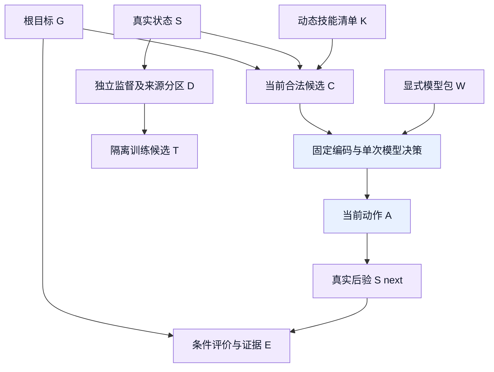
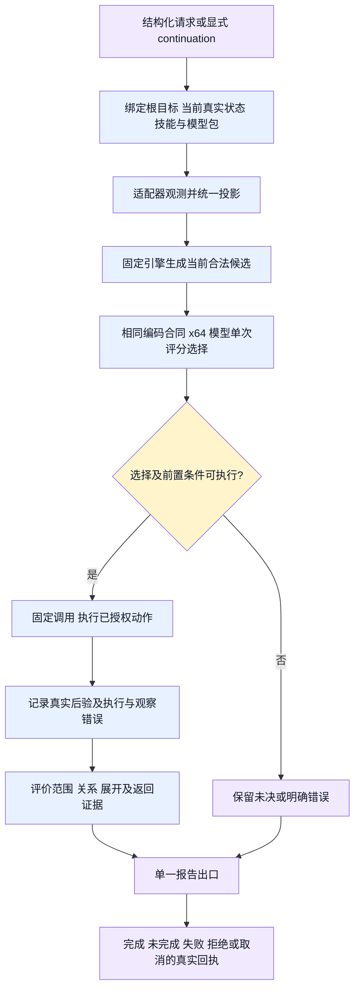
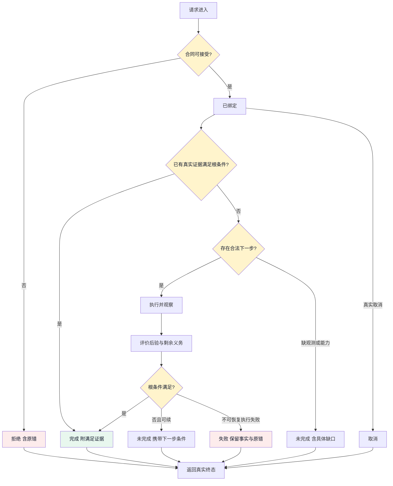
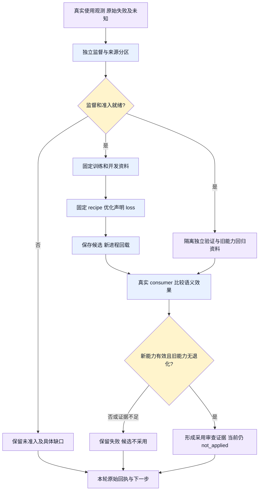

# 推理与训练 ontology 审计

状态：语义细分与审计合同；不是新模型、运行实现或采用许可。Alice，2026-11-12 UTC。

本文件细化 `design.md` §1.1、`nn-code-redesign-symbols-tsjs-design.md`、`model-evolution.md`，不另建四元素定义。既有用户约束继续有效。新增实现方案必须沿研究员设计、Alice 审计、执行者实现流程。

## 1. 对象、身份与事实来源

| ID / 对象 | 定义与身份 | 必需属性 / 禁止混入 | owner / 观测入口 |
| --- | --- | --- | --- |
| G / 根目标 | 一次结构化请求中保持不变的目标；请求引用、目标对象及条件共同确定身份 | 范围、关系条件、展开深度、返回条件、阈值；不得随当前候选改写目标 | 调用者；请求与 continuation |
| S / 真实状态 | 当前已发生且有来源的观测集合；对象引用、观测来源与观测时刻区分实例 | known/unknown、覆盖范围、来源；不得含未来结果或把预测当事实 | adapter；真实进程/DOM/source receipt |
| K / 技能 | 固定格式的能力声明，技能引用及参数合同标识其含义 | typed 参数、前置条件、effects、结果合同；技能可动态增减，但不得注入任意执行代码 | 注册能力提供者；技能清单 |
| C / 候选 | 当前 Goal/State/技能下的一次可选决策 | 独立目标/动作引用、合法性依据、参数引用；不得含 gold 或预选答案 | 固定引擎；StepContext candidateGroup |
| W / 模型包 | 当前请求显式捕获的权重与编码合同 | 64 维输入、两层隐藏层、格式一致；不得静默换 profile 或手填答案 | 模型 loader；加载回执 |
| A / 动作 | 对一个候选的单次执行请求；不能等同目标完成 | 技能引用、参数、授权 effects；不得生成任意 shell 或把 parser 结果当训练结果 | engine 调用 adapter；执行回执 |
| E / 评价与证据 | 对 G 的条件在真实 S 上的满足判断；不是独立的新基础元素 | 对象、条件、来源、unknown 与覆盖；模型分数不是满足度 | evaluator；逐条件证据和最终报告 |
| D / 样本 | 关联来源家族中的观测与独立监督 | 来源分区、监督来源、训练/开发/验证用途；未知不得补 false，有效错误不得丢弃 | 研究员及数据 owner；样本、admission 回执 |
| T / 训练候选 | 某次固定 recipe 从声明起点拟合并回载的模型包 | loss 目标、起始权重、耗时、停止原因、旧能力回归；不得自动采用 | trainer/evaluator；原始训练与回载回执 |

对象关系不是执行顺序。以下为有向依赖关系图，不表示模型自动掌握了所有关系。

| 关系 ID | 方向 / 基数 | 可检查事实 | 必须 / 不得 |
| --- | --- | --- | --- |
| R1 constrains | G → C，一对多 | 请求与候选参数、effects | 保留根条件；不得按候选修改根 |
| R2 supports | S → E，多对多 | receipt 对象、范围、时刻与条件对应 | 精确关联；同名或共享任意 receipt 不等于同一声明 |
| R3 selects | W + C → A，每步至多一个执行选择 | 实际 StepContext、模型输出、执行日志 | 真实模型决策；不得 adapter 预先交最终答案冒充模型 |
| R4 observes | A → S next，一对多或观测失败 | 原子执行后验、原错 | 区分执行与观察失败；不得 exit0 推出目标满足 |
| R5 decomposes | G → 子条件，一对多 | 引擎义务与父子证据 | 引擎推进，子目标证据反向满足父；不得模型自改控制预算 |
| R6 derives | D → T，多对一 | 分区、配方与拟合输入 | 训练/开发/独立验证按来源隔离；不得验证反例仍称未见 |
| R7 compares | T → E，一对多 | 独立评价、旧能力回归与实际 consumer | 原始失败保留；不得总分遮蔽旧能力退化 |

## 2. 行为及责任边界

每个行为都是 `(当前状态, 输入) → (输出, 新状态, effects)`。预测状态单列，永不覆盖真实状态。

| 行为 ID / owner | 前提与输入 | 输出及状态迁移 | effects / 禁止 |
| --- | --- | --- | --- |
| B1 绑定 / engine | 结构化 G、S、K、W 合同兼容 | 未绑定 → 已绑定上下文 | 无外部 effect；拒绝缺合同，不静默降级 |
| B2 观测投影 / adapter + shared converter | 当前范围的真实源 | 原始观测 → 统一语义状态 | 允许已授权读取；不做请求驱动的事实伪造 |
| B3 单次选择 / student | 实际当前 C 与 x64 | 待选择 → 一个决策或未决 | 无执行 effect；不推进深度、不闭合根目标 |
| B4 分解与执行 / engine + adapter | 决策合法且前置/权限满足 | 已选择 → 执行回执及后验 | 仅声明的 effects；候选非法或缺技能显式返回 |
| B5 评价 / evaluator + engine | 真实后验及根条件 | 后验 → 证据、剩余义务、continuation 或终点 | 不修改 gold/阈值；unknown 不等于 false |
| B6 准备 / researcher | 原始来源与独立监督 | 原始资料 → 已准入分区 | 无拟合；缺监督不能以 pending 模板冒充就绪 |
| B7 拟合 / 固定 trainer | 已审 recipe、准入资料及起始权重 | 已准入 → 未采用候选 | 仅离线权重；后训练继承旧知识，不从零冒充 |
| B8 比较 / evaluator | 新进程回载候选及独立资料 | 候选 → 采用判据证据或拒绝/未完成 | 当前只交候选证据，不产品接线、不安装 |

## 3. 推理单步事件 DAG

复用 `recursive-goal.graph.json` 的 bind/run/report。下面细化 run 的语义，不增加第二套执行引擎。完整循环位于 DAG 外：报告返回 continuation，下一次执行产生新的一步。文件系统原生命令的递归仍由原生命令执行。

四类覆盖是目标条件的分类，不新增训练头。`all` 需要全部必要义务闭合；`one` 按既定请求条件在找到有证据的目标后可满足，不强迫全仓遍历。达到深度边界只能完成请求声明的深度，不冒称全图覆盖。

| 覆盖义务 | CLI 引用查询 | 浏览器搜索/内容获取 | 闭合失败时 |
| --- | --- | --- | --- |
| 范围 | 请求路径、文件范围及实际读取覆盖 | 请求页面/列表及实际可见、已采范围 | 保留未读取、未观测范围 |
| 关系 | 精确 callSite 与声明、模块、局部绑定的关系 | 主贴、作者、评论、链接的实际关联 | 同名不等于同一对象，未知仍未知 |
| 展开 | 请求深度下的引用义务、当前候选游标 | 声明范围内滚动、分页、展开义务 | 上限或失败不得标全覆盖 |
| 返回 | 路径、跨度、关系边、逐步证据和未决项 | 来源页面、节点及内容证据和未决项 | 不能只有最终结论而无依据 |

## 4. 状态迁移路径

下列为审计语义名称，不声称代码已使用这些 enum。状态含三个正交字段：执行 disposition、知识 known/unknown、目标 satisfaction。unknown 关系可以是合法任务输出，但不自动表示根目标已满足。

预算耗尽属于明确的未完成/停止原因，不是完成。是否可恢复由现有错误归因合同判断，不由图新增重试次数。新观测的再次推进是下一次 DAG 实例，不在图内画循环边。

## 5. 训练到候选评价 DAG

复用 `model-evolution.graph.json`。该图当前是 design；其自动采用节点不因此获得当前执行授权。

每次训练报告必须说明：优化的 loss、起始候选及预训练/后训练阶段、各语义头实际耗时、loss 轨迹、停止原因、实际执行训练与回归次数、失败原回执、回载和真实 consumer 的语义效果。轮次不是目标；不能为过关改预算、gold 或阈值。本次不新定 loss 或训练预算。

## 6. Gate 条款与落盘边界

以下只将已有用户约束映射为 gate。审批来源是本线程明确要求及项目现行合同，不把本次审计当新规则批准。每项均区分约束已批准与检查是否已接入。无可执行证据的项仍是待绑定，不能称运行强制 gate。

| 条款 / 轴 | 场景、触发及允许→禁止 | before→after / effects | owner、依据 | edge / 检查及正反例 / 状态 |
| --- | --- | --- | --- | --- |
| G01 / behavior B2 | 解析局部绑定时，允许有依据的 import/local/unknown；禁止忽略局部遮蔽伪造 import | 源→观测；只读 | producer owner；用户“解析器做解析，统一抽象”，TSJS 设计 §3 | 原始源→B2→S；公开 producer 检查普通 import 与 for-of 遮蔽；只审观测，不判断最终关系真值；本目录测试可执行，未接 CI |
| G02 / behavior B2 | 投影声明观测时，允许精确对象与来源对应；禁止同名/任意共同 receipt 当同一声明 | 观测→统一状态投影；无 effect | shared converter owner；已接受 retention semantic projection r6 | 原始观测→B2→S；observeTsJsStepwiseRequest→loadStepwiseEpisodeFamily→relationStepContext；请求不变、改真实声明应改变观测投影，不能据此宣布根条件满足；待真实入口反例，不宣称失败已证实 |
| G03 / behavior B3 | 模型选择时，允许实际 x64 与动态候选；禁止 parser/teacher 最终答案或 gold 入模 | 上下文→单次决策；无 effect | encoder/runtime owner；用户统一格式、64 输入两层、单次决策要求 | C→M；同一 observation 经训练/推理得到相同实际输入，删 gold 不改输入；需行为证据，源码正则不是 gate |
| G04 / behavior B5 | 返回完成时，允许声明条件满足；禁止 exit0/模型分数/预算耗尽代替完成 | 后验→真实报告；无 effect | recursive-goal owner；design §1.1 | E→R；真实闭合成功 vs 遗留必要义务；绑定现有完成测试，覆盖审计尚未完成 |
| G05 / behavior B6 | 样本准入时，允许独立来源监督；禁止 pending/null gold 当已准入 | 原始→准入或保留；无拟合 | researcher/data owner；训练 Skill 与用户来源隔离要求 | S→D/V；有效监督对照未监督；现有 admission 入口需逐域核对 |
| G06 / behavior B7 | 后训练时，允许合格起点和旧资料重放；禁止从零重拟合冒充后训练 | 准入→候选；离线权重 | trainer owner；model-evolution §2.1 | D→F；合法 warmstart 对照缺起点；已有 checker 证据见下文，当前实际训练任务绑定仍须核对，不重跑既有有效验收 |
| G07 / behavior B8 | 候选评估后，允许保留报告；禁止回归被总分冲抵及未授权采用 | 候选→not_applied；不安装 | evaluator/Jenny；当前授权及 model-evolution | E→C/H；新提升旧退化必须保留失败；目前仅审计合同，未声称自动采用 gate 已实现 |

G01 的命令：`node --test tests/audit/inference-ontology-lexical-observation.test.mjs`，须显式设置 `NNANYTHING_AUDIT_SUBJECT` 为被审候选的绝对 worktree 路径，且由 owner 先提供其 dist。测试不构建、不训练、不评分、不写被审树。该审计套件不进入默认 `tests/*.test.mjs`，避免要求普通测试依赖他人候选树。

G06 已有实现为 `lib/training/unified-warmstart-acceptance.ts`，由 `lib/training/l2-standard-runner.ts` 的 `warmstart-acceptance` 入口调用。已有审查回执为 `/Volumes/Intel/playground/nnanything-runs/tsjs-warmstart-acceptance-dev-consumer-engineering-r1-20261110/alice-review.md` 的 Subject 2 ACCEPT；该回执接受固定入口工程，明确不接受实际数据或训练效果。checker 检查起点与 epoch-zero 回执、实际梯度更新、回载、耗时和语义结果。它的存在不等于本次 producer 候选已满足后训练条件；本审计不执行该评分入口。

## 7. 当前审计决定与接手动作

已有三节点递归执行图、四头责任图和模型演进图不能代替上述边界的真实行为证据。四头图是 design，当前 TSJS 切片不能据此宣称 D/E 已训练。训练/推理输入相同不能用源码字符串匹配证明。

G01 已执行：普通 import 控制通过，for-of 局部遮蔽反例失败。实际公开入口输出 `bindingKind: import`、`sourceModuleFile: factory.ts`，把局部绑定误记成导入事实。此为观测层缺陷，不是训练成绩。红测交 Henry 修 producer 的唯一 owner；不改候选权重或训练数据追过关。G02/G03 由共享 converter owner 在同一 milestone 补实际 loader→StepContext→encoder 对照；研究员确认 unknown 与有效监督的准入边界。Alice 复核受影响结果，再将通过的候选交 Jenny 集成。其余浏览器准备不依赖该 producer，不串行等待。

既有 recursive-goal、l2-four-head-step、model-evolution 图均通过 `dagpipe graph validate`。这是拓扑证据，不证明 design 算子已实现；细化图目前为本文件 Mermaid 审计视图，不新增虚构 operator 注册。

本文件未改产品行为或宣布完成采用。每个 gate 后续以公开入口回执更新状态，不以文档存在冒称已受 gate 保护。新增政策若出现须逐条另审；本次不新增政策。
