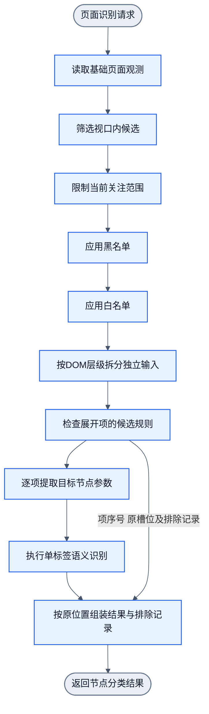

# Filter节点与统一Workflow

状态：总体设计修订6增量草案，2026-10-17。以filter为基础节点，通过事件输入输出；使用者通过节点接续组合workflow，画布为可选呈现，正式执行与训练共用合同。先定义框架，再确定基础节点，组合网页与训练workflow，后续扩展其他场景。详见[事件与呈现](canvas-events.md)。未实现，修订2的Gemini 4评估不自动覆盖本稿。

最新阶段：当前只交D0架构与计划。以下两条完整workflow属于后续L2核心功能层；先实现的L1能动层只输出候选，见[实施计划](implementation-plan.md)。节点复用/经验合同以[node-contract.md](node-contract.md)为唯一详细定义，配置以[workflow-config.md](workflow-config.md)为准。

本轮设计和D0增量已由独立Gemini4复核，报告见[最新结果](reviews/gemini4-d0-incremental-review.json)；修订2评估仅保留为历史，不作为新增架构的通过依据。

## 1. 统一抽象

Filter是有明确输入输出的处理单元，不限于布尔筛选。Node是Filter在workflow中的实例，绑定输入、配置与可选profile；Workflow定义节点、事件端口连线、先后依赖和结果出口。画布是可选的编辑与查看方式，配置文件或代码可消费同一合同。框架负责按合同执行与记录，不内置微博、DOM或业务分类。

| 对象 | 最小职责 | 不负责 |
| --- | --- | --- |
| NodeDefinition | 有类型的输入/输出事件端口、处理能力、参数/约束、可选训练适配合同 | 调度其他节点、改写workflow |
| NodeInstance | 引用节点定义、绑定输入与配置及profile | 将站点名称隐式编码成模型特征 |
| WorkflowDefinition | 节点依赖、数据流、调用参数、出口与错误边界 | 冒充神经网络计算图 |
| WorkflowRunner | 按事件关联与依赖执行、合同检查、显式结果与记录 | 自带站点规则、自动生成训练标签、擅自重试副作用 |
| Profile | 某节点的兼容参数、阈值/校准状态与来源 | 定义应用流程或替代workflow |

手写判断、数据转换、神经网络、训练和评估可统一封装为节点，但保留各自输入输出语义。viewport节点输出放行/排除结果；特征节点输出数值；语义节点输出当前任务单标签/分数；拟合节点输出候选profile。不是所有节点都可训练，也不能把所有输出压成一个布尔值。

业务配置与profile绑定由明确的控制合同承载，不从日志重建，不暗藏在业务metadata中。初期采用本地明确的节点定义与连线，不建立插件市场、全局注册服务或分布式调度系统。

## 2. 正式执行Workflow

正式应用通过workflow执行：单节点/单数组接口是包装成最小workflow的便捷入口，不另造一条绕过workflow的业务执行链。节点仍可以独立测试；单元测试不需要完整浏览器workflow。

DOM识别只是第一种应用。页面采样/引用和focus是应用输入，通用框架不感知这些字段的站点含义。下图是可自行搭建的微博示例，不是核心固定链路；黑白名单、拆分、取参和判断分别是基础节点。箭头均为类型化事件。

各过滤节点保留槽位标识和排除记录；被排除的项不再计算特征或调用模型。范围记录保留可继续遍历的根与显式排除子树；父节点跳过自身不阻止拆分后代。拆分后逐项使用同一处理节点，不按DOM数量扩建画布。最后按项序号组装，不因过滤压缩显式输入数组。显式单节点/数组入口不自动扩展后代；拆分是调用者选择的节点。操作workflow可以引用识别结果，再显式调用动作节点；识别workflow本身不自动点击或导航。

手写规则调整属于应用workflow/节点配置变化，不自动改神经网络参数。多个应用可复用相同节点定义和profile。节点定义不等于每个任务复制一套网络，复用仍须满足输入/输出与标签合同。

## 3. 训练Workflow

训练使用同一workflow事件合同和执行记录。它编排训练步骤，并指定targetNode及其节点/输入/输出/参数合同；节点训练器只消费节点样本，不读取页面、不枚举DOM、不调用站点teacher或执行动作。事件信封和执行状态属于调度关联，训练只提取目标节点声明的业务输入/期望输出，不将runId等作为学习特征。

校准节点在独立覆盖不足时明确返回未校准状态；不会伪造已校准成功。训练、校准和回归样本用途沿既有独立性规则分离。训练结果是候选profile与报告，采用是workflow中的显式决定，不由训练节点自行覆盖当前参数。

“训练只关注输入输出”是应用隔离边界，不表示任意函数有I/O就能反向传播。可训练节点还必须声明输入编码、期望输出编码、可训练参数、损失/梯度后端、约束及校准规则；这些定义属于节点训练适配合同。Handwired根据已审数值连线求值与反传，不自动把手写业务代码变成可训练电路。

批量teacher标注是单独的数据准备workflow：原始证据→站点规则/LLM标定→复核→规范标签。其结果转换成节点训练样本后，才进入训练workflow。class/content保持在标注侧，不作为训练向量输入。

第一阶段训练一个目标节点；同一节点的样本可以逐条标记后按数组拟合。暂不做整条业务workflow端到端求梯度。第二阶段成分/父子兄弟上下文由应用workflow汇总为目标节点输入，节点训练器仍只处理自身合同；上下文必须来自实际留出预测。

## 4. Workflow连线与数值连线

| 连线 | 含义 | 梯度范围 |
| --- | --- | --- |
| Workflow DAG | 事件输入输出、处理步骤、状态依赖、配置/profile绑定与结果边界 | 不因相连就自动传播梯度 |
| 节点内部Handwired电路 | 明确数值算子、特征及可训练权重 | 只在所声明可训练节点内传播 |

首次workflow采用单进程、显式依赖、有限执行的DAG模型。训练epoch在拟合节点内部有界运行；协同识别如需多轮则显式展开或在受控节点内有界执行，不在DAG中加循环依赖。无需为第一期引入分布式worker或自动调度服务。

节点输入齐备后执行，结果事件触发下游；业务状态通过明确I/O传递，不引入隐藏全局状态。条件不满足的路径返回跳过结果，执行失败保留错误，统一收束结束。判断→operation→重新观测→验证可以组合为一个有限DAG；下一次外部触发开启新run，不在原图回连。具体最小合同见[事件设计](canvas-events.md)。

错误、过滤、未知和成功不同：规则拒绝是正常业务结果；输入缺测或模型未判定显式返回；节点执行错误到workflow错误边界，不伪装为语义负类。动作结果未知不得自动重放，离线训练回放不执行动作节点。

记录节点调用的定义、输入/输出引用、实际配置/profile、排除或错误原因；应用需要的原始页面证据由应用节点保存并引用。训练侧关联这些证据用于回溯，但不把全部原始数据灌入学生输入。

### 4.1 递归目标与原子workflow的接续（0.1.0）

[通用递归目标合同](recursive-goal-design.md)在既有workflow执行合同上增加有界目标组合。外层[recursive-goal](../workflows/recursive-goal.graph.json)为3N2E：绑定根目标与执行条件→有界衍生及真实结果核验→统一报告。request/result是端口，不计作额外节点。目标栈、依赖与预算显式传递；领域模型仅选择当前叶动作，控制器不学习层序或是否继续。

根目标不因衍生而替换。每层在已启用技能选项中满足当前节点所需条件；组合技能衍生下层条件，原子技能通过既有编译/运行入口调用领域图，不绕开端口、effect与结果合同。无技能即错误，错误也须逐层返回。每次叶调用有独立run关联及真实New State，返回后先验叶，再重验父，反向满足直至根；所有已生成链有明确回收结果。调用树与依赖图是不同关系，不能把双向调用/返回记录画成同一DAG的回边。单次静态图仍无环，实例展开有全局预算，节点内部调度未作为新引擎实现。重复触发不自动重放未知副作用，continuation只续明确未完成工作。

通用组合层通过`nnanything/recursive-goal`的`runRecursiveGoal`公开；三个`goal.recursive.bind/run/report@0.1.0`算子由请求级运行时创建，唯一owner为`lib/workflow/recursive-goal/module.ts`。当前CLI原子6N5E仍按现合同执行。typed端口与领域能力要求在递归模块合同中维护，不将Object端口或静态validate当作schema/effect验收。预期领域Outcome（含失败/缺口/预算/取消）经图中report收束，保留原始执行错误、回执及已发生副作用。公开递归回归及两个consumer的实际证据见模块合同第13节。

独立模块的公开边界及错误类型由[递归模块合同](recursive-goal-module.md)维护。现有runner遇基础设施failure会跳过后续节点，模块入口须单独返回结构化fault，不能伪造report已执行。根事实评价、调度停止、原子status及effect知识相互独立，原始执行错误不因上层传播而改写，也不能只存日志而不返回根调用者。现有`WorkflowRunFailure`只保留category/message/nodeId，不承诺尚未采集的errno或cause可恢复；后续适配层必须在真实异常边界显式保留，不能解析message或日志补全。

## 5. 目录与稳定边界

| 规划目录 | 责任 |
| --- | --- |
| lib/core | 通用Node/Workflow定义、输入输出与参数/profile合同；不内置DOM语义 |
| lib/workflow | 通用执行/校验/记录适配层；不写站点或分类规则 |
| lib/training | 节点训练算子与适配合同；只依赖通用节点样本合同 |
| lib/nodes/trainable | 可训练节点结构与Handwired电路定义；不存权重资产 |
| lib/nodes | 可复用节点定义（通用与DOM语义），三类采样节点卡见 [lib/nodes/README.md](../lib/nodes/README.md) |
| workflows | 项目DAG图与持久配置唯一真源，清单见 [workflows/README.md](../workflows/README.md) |
| training | 本地样本(samples/)、评估报告(results/)与真实权重(weights/)资产根目录 |

框架不变指增加应用时无需改通用核心，不能理解为合同永远不可演进。新增应用可以组合已有节点，也可以新增符合合同的节点处理器，不把差异硬塞进神经网络或通用框架。

已有DAGpipe CLI可静态校验项目图；下列项目自有图仅为设计候选，operator尚未实现/注册，不能执行。物理执行后端与TypeScript/Handwired适配边界仍待实现前设计审查，不能因静态图通过就宣称Rust SDK已集成。本轮不造第二套调度器，也不为未选执行后端提前写跨语言桥。

当前图文件的Object端口仅表示尚待细化的外层合同，不证明字段隔离或参数绑定已经实现。原始证据/槽位映射保留在应用数据与执行记录中，数值节点只接收白名单向量；后续须在具体端口合同和后端compile阶段验证，不能依赖一条宽泛Object声明保证安全或正确性。

- [DOM识别workflow设计图](../workflows/dom-recognition.graph.json)
- [节点训练workflow设计图](../workflows/node-training.graph.json)
- [判断与操作闭环示例图](../workflows/operation-episode.graph.json)
- [L1能动候选流设计图](../workflows/dom-candidates.graph.json)
- [基础规则采样流设计图](../workflows/dom-rule-sampling.graph.json)

设计图规模：L1候选7节点6边；DOM识别10节点10边；节点训练7节点8边；操作闭环7节点6边。图中将原槽位/排除记录单独送往结果组装，将用途分区显式送往校准与比较；不要求神经节点携带原始页面。静态validate/inspect仅验证拓扑与operator引用语法，未执行事件、节点或训练，未完成registry/schema/effect编译验收。

## 6. 首期顺序与验收

下表是L2完整核心层内部的三个依赖增量。当前D0不实现；后续先做L1能动候选流，不将下表全部节点提前列为首轮必做。四层推进、目录和停止点统一维护于[实施计划](implementation-plan.md)。

| 顺序 | 交付 | 验收边界 |
| --- | --- | --- |
| 1. 通用框架 | NodeDefinition/Instance、类型化事件端口、WorkflowDefinition、显式状态与配置/profile绑定、有限DAG执行及结束合同 | 用不含DOM字段的最小consumer定义并接续节点；端口不兼容或有环时明确拒绝；执行可返回成功、跳过或错误 |
| 2. 最小基础节点 | 通用规则/数组转换/结果汇总节点；网页观测、候选过滤、DOM拆分、取参与分类节点；样本准备、分区、拟合、校准与比较节点 | 节点逐个通过公开I/O独立验证；手写节点无需训练后端；可训练节点使用已审内部数值图与真实后端，不返回假训练结果 |
| 3. 两条最小workflow | 网页识别workflow与目标节点训练workflow，复用同一个执行合同 | 网页流程保留输入项与排除映射；训练流程产出可由同一判断节点加载的兼容候选profile与报告；离线训练不产生浏览器操作 |

网页workflow先覆盖一个明确语义任务，训练workflow先训练该任务的一个节点。Operation及其后条件验证合同保留，真实网页操作按既有D4阶段接入，不扩大首次识别/训练验收。数据准备先用可复核的小样本，批量采标在基础可用后扩展。

“基础节点”分通用节点、场景节点与训练节点。三者共用Node合同，但不要求DOM拆分适用于所有场景，也不将浏览器依赖装进核心。拟合/校准等节点按相应后端需要加载能力，不让普通手写节点依赖训练环境。只建立两条最小workflow实际需要的节点，不先实现完整目录。

两条workflow通过目标节点定义、输入/输出编码和profile兼容合同对齐：网页流程调用该节点推理，训练流程从规范样本构造相同输入与期望输出，并返回候选参数。训练节点不依赖网页workflow内部的步骤名称或DOM标签规则。

后续其他场景用自己的观测/操作适配器、输入编码、目标节点和workflow接入。兼容时复用节点及profile；特征或目标不同就定义相应节点/训练合同，不承诺只换权重即可迁移。新增场景无需在核心增加站点或领域分支。

需验证：节点可独立消费事件I/O；workflow拒绝不兼容端口和环；事件不跨run/输入项混接；跳过/失败可以结束；重复事件不重复调用操作；手写filter拒绝不调用神经网络；显式数组保序；同一节点可在正式与训练/评估workflow复用；节点级修复与应用级退化分别比较；训练回放不执行真实动作。本稿是设计，没有执行这些验收。
