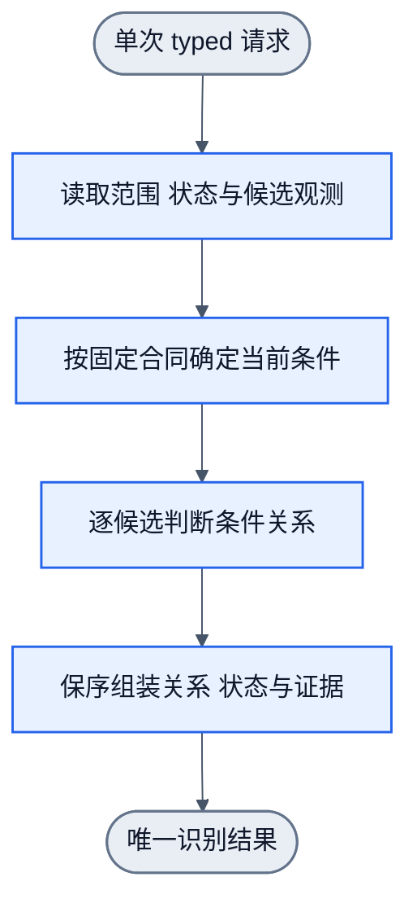

# 操作目标与元素必要性关系：四元素推理链与训练链

状态：2026-10-20 `0.1.0-design`。本文只定义「用户要做什么操作 → 当前还缺什么条件 → 哪个元素能提供该条件 → 它承担什么语义角色 → 依据是什么」的关系单元、推理链、训练反推链与最小实施切片。`ObserveExpanded` 的最小状态读取合同已 READY，可进入后续实现；它是确定性读取，不训练也不引入网络。`InputTextValue` 的显式宿主绑定只免除对象查找，不免除 Goal/State 到 INPUT、NOOP、DEFER 的单步学习责任。InputTextValue 因当前值、有效输入类型、只读/可编辑事实、原生文字执行器及训练域绑定尚未闭合而 BLOCKED；当前没有 input profile、typed 运行入口、样本或权重。数值合同由 [browser-single-action-training.md](browser-single-action-training.md) 唯一维护，本文不复制 wire 或拟合预算。

四元素唯一正文为 [design.md 1.1](design.md#11-结构化语义的目标与状态推理)；设计准入流程为[本地设计 Skill](../.agents/skills/nnanything-design/SKILL.md)；外部拓扑沿用 [dom-recognition.graph.json](../workflows/dom-recognition.graph.json) 与 [operation-episode.graph.json](../workflows/operation-episode.graph.json)，本文不新增图或边。测试/拟合方法沿[训练 Skill](../.agents/skills/nnanything-training/SKILL.md)与 [training-workflow.md](training-workflow.md)，采用规则沿[model-evolution.md](model-evolution.md)，三者均不在此复制。第一层基础种类仍由 [basic-kinds-wiring.md](basic-kinds-wiring.md) 唯一维护，本文不改其 Goal、词表、wire 或权重。


本文按 `workflows/project-design.graph.json` 的七个节点组织，逐节对应其资料流。

“必要性”在本文中指：当前目标还有哪项条件未满足，当前元素是否能提供该条件，以及依据是什么。它不直接表示“这个元素在所有可行方案中都不可替代”。

## 1. 读取现有架构与能力缺口

### 1.1 现状与 owner

| 对象 | 当前职责与状态 | 唯一 owner |
|---|---|---|
| L1 基础分类 | 对候选槽位判断基础种类，保留判断状态、缺测和证据；已交付的能力按当前合同复用 | `docs/basic-kinds-wiring.md`；`lib/filters/basic-kinds.ts`；`lib/nodes/basic-kinds.ts` |
| 候选资格 | 处理 viewport、Focus、黑白名单及已证明的前景观测；资格不等于语义类别或操作能力 | `docs/focus-and-labeling.md`；`docs/browser-overlay-m1.md` |
| L2 组合识别 | 组合基础成分与关系，形成应用语义；`dom-recognition.graph.json` 为 10N10E 设计图 | `docs/design.md` 的分类、关系与查询合同；对应图纸 |
| L3 操作 episode | 观测、识别、决策、执行、重观测、验证、报告；7N6E，设计态 | `workflows/operation-episode.graph.json` |
| 离线训练 | 六节点流程和真实 Handwired 拟合已有实现；当前 adapter 面向基础种类 | `docs/training-workflow.md`；`lib/training/` |
| 模型演进 | 规定采集、隔离、比较、采用及冲突处理；完整自动链尚未实现 | `docs/model-evolution.md` |
| 通用递归目标 | 规定根目标、条件衍生、技能选择与反向满足；通用模块仍为设计态 | `docs/recursive-goal-design.md` |

L1 的 Goal 是“判断这个元素是什么基础种类”。用户此次要求补上的是：

> 给定一个操作目标，当前还需要什么条件；哪个元素能提供该条件；它因此承担什么语义角色；依据是否充分。

这里缺少一个显式函数：

```text
当前操作 Goal + 未满足条件 + 元素及局部关系观测
→ 元素与该条件的语义关系 + 判断状态 + 证据
```

它属于目标相关的关系判断。它不能通过给 L1 增加用户意图字段来隐式完成。

### 1.2 三个必须分开的结论

| 结论 | 示例 | 随操作 Goal 改变吗 |
|---|---|---|
| 基础种类 | 此元素是 button | 不因 Goal 改变 |
| 当前条件中的语义角色 | 此元素是该区域的展开操作承载者 | 可能改变 |
| 实际目标结果 | 操作后，该区域实际处于 expanded 状态 | 由真实 New State 决定 |

“本次不需要该按钮”不能改成 L1 `ignore`。

`ignore` 判断的是元素是否具有独立交互、读取或状态观察价值。它不是“对当前目标无关”。同一个按钮可以保留其 L1 类别，同时在本次关系任务中被判为 `not_provider`。

依据：[AGENTS.md](../AGENTS.md) 第 115–127 行；[基础种类合同](basic-kinds-wiring.md) 第 3–16 行。

### 1.3 事实、设计选择与未知

- 事实：L1 有独立 Goal。基础种类不证明可点击、无遮挡或实际操作成功。
- 事实：L2、L3 图均有单入口和单出口，所读拓扑无回边。图中的算子仍标为 `design`。
- 设计选择：首轮只处理一个显式范围、一个 typed 操作目标和一个当前条件。不做自然语言理解和自由规划。
- 未知：现有许可观测能否区分真实页面中的操作用途。现有资料不能证明已具备这种能力。
- 未知：哪些历史记录具有足够的真实操作及前后状态证据。旧 L1 标签不能直接充当此次监督。

## 2. 定义四元素与训练反推关系

### 2.1 最小语义单元

最小单元是：

> 判断元素 E 是否为操作目标 G 的当前条件 C 提供必要能力或证据。

每次调用只判断一个 `(G, C, E)`。数组调用重复同一合同，并保长保序。

下列类型是设计记法，不是已有 API。

```text
OperationGoal =
  SetExpanded {
    regionRef,
    desired: true
  }
  | ObserveExpanded {
    regionRef,
    freshness: this_run
  }
  | InputTextValue {
    hostRef,
    desiredValue: string
  }

NecessityRequest {
  operationGoal,
  condition,
  candidateRef,
  satisfactionThreshold: 100,
  state
}
```

`ObserveExpanded` 用于区分“改变状态”和“读取状态”。`InputTextValue` 只接受一个显式绑定的普通单行文字编辑宿主及精确目标字符串，不负责寻找编辑宿主、推断用途或扩展到搜索、选择、密码及富文本编辑。不扩展到任意网页操作目录。

`regionRef` 必须是显式绑定。它用于关联对象，不作为学生数值特征。目标不能由原始正文、按钮文案或完整 URL 代替。

### 2.2 四元素领域映射

| 元素 | 本单元的含义 |
|---|---|
| Goal | 确定 E 与 G 的当前条件 C 的语义关系，给出可追踪依据。G 是结构化操作目标；C 来自已声明的条件合同 |
| satisfactionThreshold | 固定 100。关系、判断状态和证据均符合独立确认监督及合同才达标。模型分数不作为满足度 |
| State | 当前范围和对象绑定、目标条件的实际状态、同次有效观测、元素属性与局部关系、L1 输出及其状态、缺测和覆盖边界、显式 profile |
| Action | 执行关系识别与证据关联，增加知识。不点击、不输入、不修改网页 |

其知识输出建议为：

```text
ConditionRelationResult {
  candidateRef,
  conditionRef,
  relation: condition_provider | not_provider | null,
  judgmentStatus: judged | unknown | conflict | excluded,
  evidenceRefs,
  missingFacts,
  reasons
}
```

`condition_provider` 表示“该元素可为该条件提供所需作用”。它不表示已执行成功，也不表示它是唯一提供者。

语义角色由条件合同解释。例如：

- 对“使 R 展开”的操作条件，provider 的角色是 `expansion_control`。
- 对“取得 R 的当前展开状态”的观测条件，provider 的角色是 `expansion_state_source`。

这不是给同一任务增加第二个分类头。每次只判断一个条件关系；角色是该关系在当前 typed 条件中的含义。

### 2.3 达标与未知

运行期可以确认：

- 请求与引用是否合法。
- 证据是否适用于当前对象和状态。
- 关系判断是否明确。
- 必要观测是否缺失。

运行期不能仅凭模型输出确认“语义判断正确率为 100%”。

本单元的语义正确性由独立监督与行为验收确认。没有这种依据时，不能把 `judged` 自动写成 `satisfaction=100`。实际满足度保持未知。

操作根目标另行评价：

- `SetExpanded(R,true)`：须以操作后的有效观测证明 R 实际展开。
- `ObserveExpanded(R,this_run)`：须取得本次请求适用的状态证据。读到 `false` 也可以完成“观察状态”目标。
- `InputTextValue(H,S)`：须以输入后的新观测证明同一逻辑宿主 H 的当前值精确等于 S；已有值等于 S 时以零输入 NOOP 完成。
- 执行器返回成功、点击已发出、模型预测展开，都不能替代上述证据。

依据：[四元素唯一正文](design.md) 第 27–44 行。

### 2.4 运行期推理链

以 `SetExpanded(R,true)` 为例：

| 链路 | 本次问题 | 输出及限制 |
|---|---|---|
| 用户操作目标 | 用户要求哪个对象达到什么状态？ | 显式绑定 R，目标为 expanded=true |
| 必要条件 | 当前目标是否已满足？尚缺什么？ | 已有有效 true 证据则无需展开；已知 false 才进入展开条件；状态未知则先补证 |
| 条件提供者 | 哪个元素能承载对 R 的展开操作？ | 按候选及关系观测逐项识别，保留所有合格 provider |
| 语义角色 | E 对该条件承担什么作用？ | `condition_provider` 对应 `expansion_control`，L1 基础类别保持原结果 |
| 为什么需要 | E 与 R 的关系、当前缺口及能力依据是什么？ | 返回具体证据引用、模型贡献和缺测；不生成无依据的理由 |
| 实际验证 | 经授权执行后，R 是否真的展开？ | L3 重观测并评价实际 New State |

条件分解是确定性的。运行期调用已声明的条件规则，再应用已学关系识别。它不在现场反向创造训练监督。

“为什么需要”的解释须包含：

1. G 需要的条件 C。
2. 当前 State 中 C 尚未满足或尚无证据。
3. E 支持 C 的已观测事实。
4. 该判断仍依赖哪些未确认事项。

例如：

> R 当前已观测为折叠。E 与 R 存在本次有效的控制关联。模型据此将 E 判为展开条件提供者。该判断尚未证明点击会成功；实际结果须由操作后观测确认。

若证据只证明 DOM 包含，解释只能说“包含”。不能把它改述成已证明的控制关系。

### 2.5 训练期反推链

训练反推从真实目标结果出发：

```text
目标与达标规则
→ 经确认的达标 New State
→ 实际产生该结果的操作及对象
→ 操作所需的前置条件
→ 操作前真实 State
→ 元素与条件的监督关系
→ 检查学生输入是否足以区分
→ 拟合、回载、独立评价
```

监督至少需要：

- 当时的 typed Goal 和范围绑定。
- 操作前的实际 State。
- 实际操作对象、参数、执行回执。
- 操作后的真实观测。
- 对条件关系的独立复核。
- 证据覆盖及不确定性。

模型输出、LLM 猜测、L1 类别、点击已发出均不能直接成为关系真值。LLM 可以复核已有真实证据，但不能补造缺失结果。

一次真实操作成功，也不自动证明因果唯一性。页面可能异步自行变化，或存在多个等效入口。存在混淆时须做受控重复或对照；不能排除混淆则保留未确认。

## 3. 确定固定调用与执行责任

| 责任方 | 手写或学习内容 | 不可计为学生成果的部分 |
|---|---|---|
| 领域合同 | typed Goal、条件、证据有效性、达标规则及固定操作能力 | 条件词表和规则由人定义 |
| harness／adapter | DOM、状态、局部关系、前后观测、实际命中与执行回执 | 观测、引用绑定和浏览器执行 |
| 关系模型 | 从 Goal／条件与可辨观测判断候选的条件关系 | 不负责发明条件、补事实或自报成功 |
| 决策及 guard | 检查范围、权限、引用时效、前置条件和歧义 | 不替模型换成另一个正确元素 |
| 目标评价器 | 用真实 State 评价目标 | 不用模型分数替代目标结果 |
| 训练模块 | 监督投影、分区、拟合、保存、回载和比较 | 不把拟合器自报成功当验收 |

固定调用只给出责任形状：

```text
识别调用：
assessConditionRelation(goal, condition, candidate, observedState, profile)

后续环境调用：
applyDeclaredOperation(operationKind, targetRef, typedArguments)

结果评价：
evaluateGoal(goal, actualNewState, evidence)
```

这些名称均为设计记法，不是已导出 API。

环境操作只允许映射到已实现、已启用的固定能力。不得产生任意 JS、自由工具文本或隐式点击最近祖先。

当前浏览器 operation 只实现了 `SetExpanded` 窄切片；`ObserveExpanded` 与 `InputTextValue` 尚未运行接入。因此，即使关系或绑定明确，也不能宣称已能执行这两个目标。必要能力不存在时，沿既有概念返回 `capability_missing`；证据取得不了则保留证据缺口。二者不能混用。

读取状态同样需要单独接入。现有采集包明确不读取 `input.value` 等内容，不能把本设计解释为已扩大读取范围。

依据：[模型演进合同](model-evolution.md) 第 5–30 行；[递归目标合同](recursive-goal-design.md) 第 34–48 行；[浏览器采集边界](browser-overlay-m1.md)。

## 4. 设计数值连线与外层流程图纸

### 4.1 内部可辨输入与 wire

L1 profile 和现有 wire 不承载此次目标关系。新增关系模型须有独立合同与参数资源。

建议先保留以下最小输入。新增测量均须先定义 adapter 合同，不能从 teacher 标签反推。

| 学生输入／wire | 来源与含义 | 删除后失去什么 |
|---|---|---|
| `goal_kind` | typed 操作目标的有限编码 | 无法区分改变状态与观察状态 |
| `condition_kind` | 当前待判断条件的有限编码 | 无法确定 provider 所需承担的作用 |
| `state_requirement` | 当前条件已满足、未满足或未知的显式事实投影 | 已展开、折叠与未测可能得到同一输出 |
| L1 类别及判断状态 | 运行时真实 L1 输出，或训练时隔离生成的预测 | 无法复用基础种类；若消融无增益则可删除 |
| 元素自身许可测量 | 已测交互、状态承载等事实，不含原文 | 无法区分自身承载者和普通包装 |
| 候选与目标的局部关系 | 已观测的包含关系、同区域归属及完整性；控制关联当前不可观测（见 7.1），不得写成已测事实 | 无法区分同类元素作用于不同区域 |
| 缺测表示 | 每项已测值及 missing mask／等价三值表示 | 会把“不知道”误当“没有” |
| `goal × evidence` 条件组合 wire | 把目标条件与对应证据接到评分路径 | 仅拼接输入可能不能表达目标改变后的标签翻转 |

`goal_kind` 与 `condition_kind` 若在首轮存在一一对应、没有独立可辨价值，应只保留一个编码。不能为了形式完整重复输入。

`nodeRef`、`regionRef`、来源 ID、profile ID 用于绑定和追踪，不进入数值向量。原始 class/id、正文、账号、完整 URL、绝对路径、全局深度均禁止输入。

特别禁止以下“答案字段”：

```text
isExpansionButton
isRequiredForGoal
teacherPurpose
operationSucceeded
expectedRole
```

若这些字段由 teacher 或后验结果生成，再作为操作前输入，就构成泄漏。

### 4.2 数值路径建议

最小候选是一个条件关系分类器。它只输出 `condition_provider / not_provider` 的竞争评分及判断状态。

建议复用项目已有的有界、可解释 wire 评分方法：

1. 从许可观测产生具名 wire。
2. 缺测保持区间或等价显式表示。
3. 参数接为真实可训练 source。
4. 正式前向与训练 adapter 共用特征和评分实现。
5. 损失只消费经确认的关系标签。
6. `unknown/conflict` 作为判断状态保留，不设为负类。
7. 不向 L1 跨节点自动反传。

具体稀疏地址、门限和损失参数仍须由可辨反例确定。本文不复用 L1 的数值门限并宣称已适用。

若移除 NN 后，所有监督都已由固定控制关联规则唯一决定，则应直接使用确定性关系计算。没有剩余学习函数时，不建这个模型。

### 4.3 外层推理图

复用 `dom-recognition.graph.json` 的 10N10E 拓扑作为 L2 设计载体：

- 前八节点继续负责观测、范围、候选和提参。
- “执行单标签语义识别”在此关系任务中消费显式 Goal、条件和关系特征。
- L1 作为独立能力调用，保留自己的合同和输出。
- “按原位置组装结果与排除记录”继续保长保序。
- Goal 和条件由入口显式携带。不能丢到末端再从日志重建。

首轮建议不新增顶层节点或边。需要补的是节点 I/O、任务绑定、关系 adapter 和证据合同。若实现阶段发现条件产生和关系判断必须独立复用，再拆节点；不能先为四元素各造一个节点。

运行设计示意如下。它概括职责，不替代持久图。



`operation-episode.graph.json` 继续承担环境闭环。其第二节点消费上述识别结果，后续节点检查、执行、重观测和验证。暂不增加节点或边。

每次 episode 只做当前声明的一步。需要补观测或继续操作时，以实际返回 State 开启新 run。不能给图加回边。

### 4.4 节点与边的必要性

| 图中职责 | 删除后的具体损失 |
|---|---|
| 观测与范围处理 | 无法确认元素、状态和证据适用范围 |
| 候选限制与展开复检 | 会混入范围外目标，或丢失后代及排除记录 |
| 特征提取 | 无法执行白名单投影及缺测表达 |
| 条件关系识别 | 缺少本次要学习的关系函数 |
| 保序组装 | 排除项、未知项和原槽位可能丢失 |
| L3 决策 | 无法隔离识别提议与允许执行的调用 |
| L3 执行 | 没有环境变化；只能交付识别 |
| L3 重观测 | 会用执行回执冒充真实结果 |
| L3 后条件验证 | 无法证明用户目标达成 |
| L3 报告 | 失败、未知及副作用不能统一回收 |

现有 L2 的主链九条边逐步承载上述依赖。候选节点直达组装节点的第十条边保留原槽位及排除映射，不能删除。

L3 六条边依次传递观测、识别、决策、执行回执、新观测和验证结果。删除任意一条，都会切断对应证据链。

所有预期结果均收束到唯一结果。非 ok 输入必须显式传递原原因。基础设施异常按既有 runner 错误合同处理，不伪造 report 已执行。

### 4.5 外层训练图

复用六节点训练职责和 6N6E 拓扑：

| 节点 | 本任务补充职责 | 删除后的损失 |
|---|---|---|
| prepare | 校验真实 episode、监督复核及操作前输入投影 | 后验答案或未确认记录可能进入训练 |
| partition | 核对来源家族用途及关联闭包 | 同页、同模板或同 episode 泄漏 |
| fit | 拟合关系模型，保存真实训练记录 | 没有学生学习 |
| compare | 正式入口比较基线与候选 | 只知道 loss，不知道行为变化 |
| assess | 分开判断改善、退化与证据不足 | 总体指标可能掩盖关键错误 |
| report | 交付候选、回载资源及证据回执 | 无法复现和消费结果 |

六条边分别传递：准备样本、训练分区、候选、独立评价分区、逐例比较、最终评估。候选与评价分区的两路输入不能合并成 fitter 自评。

现有 adapter 只支持 L1 基础种类。复用拓扑不表示此次关系训练已经可用。

## 5. 设计独立样本及版本进化验收

### 5.1 先分来源家族，再采集或生成

先将页面模板、站点结构、资产、组件实现及操作 episode 的关联家族分为：

- train：拟合参数。
- dev：诊断、选配置和修改 wire。
- verification：独立验收，不交给 fitter。

同一页面上的 Goal 对照、同一操作的前后状态、同模板变体及缺测增强必须留在同一用途分区。

prepare 不能改变预先声明的家族用途。partition 负责检查关联闭包和泄漏，不通过重新随机分行制造“独立验证”。

旧 L1 黄金只做原合同回归。它们没有新关系标签时，不进入此次关系拟合。

### 5.2 监督映射

每条拟合记录至少绑定：

```text
操作前学生输入
+ typed Goal 与条件
+ 候选与目标引用
+ 实际操作及前后观测的证据引用
+ 独立复核的条件关系
+ 来源家族与用途
```

操作后的信息只进入监督证据侧。不能进入操作前学生向量。

`not_provider` 必须有确认依据。未点击、未被策略选择、未成功、观测不足，都不能直接映射为该标签。

例如，一个已确认的等效展开入口即使本次未选中，也仍是 provider。不能将所有未选候选训练成负例。

### 5.3 必需的区分样本与反例

| 配对或反例 | 应有结果 | 能抓住的错误 |
|---|---|---|
| 同帧同元素：`SetExpanded` 与 `ObserveExpanded` | 控制承载与状态证据职责分别判断；L1 不变 | 去掉 Goal 仍输出固定用途 |
| 同 Goal：R 折叠／已展开 | 前者需要状态转换；后者无展开义务 | 无条件选择动作入口 |
| 同 Goal：R 状态未知／已知 false | 未知先补证，不能当作 false | 缺测补否定 |
| R 已展开，但目标要求 `this_run` 状态观测且尚无本次证据 | 仍需观测条件 | 将世界状态与已取得知识混同 |
| 两个同类按钮分别控制 R、Q | 仅与 R 条件相关的关系成立 | 只按 button 类别或距离选择 |
| 同矩形父包装与子控件 | 分别识别；不自动把子用途赋给父 | 用包含或同矩形证明控制归属 |
| 两个经真实操作确认的等效入口 | 都可为 provider，单选策略另处理 | 将“本次选中”等同“唯一必要” |
| 点击回执成功，但 R 仍折叠 | 根目标未达成；分类错误须另归因 | 执行成功冒充目标达成 |
| 点击失败由过期引用或权限造成 | 保留执行失败，不自动改关系标签 | 将 harness 错误训练为语义负例 |
| 同许可输入却有展开／删除两种真实行为 | 当前表示不可辨，保留未知并报缺口 | 用更多拟合掩盖信息不足 |
| 状态观测缺失、冲突或来自旧页面 | unknown／conflict／失效原因保留 | 用旧证据、other 或负例清零 |
| 一个按钮与一个独立状态文本 | 依据条件分别判断操作与观测角色 | 只保留可点击元素 |

首轮 `satisfactionThreshold` 固定 100，不加入学生输入，也不造阈值配对。

未来若阈值会改变正确操作或标签，须先定义实际满足度规则，再加入阈值输入和区分样本。不能把模型置信门限当作该阈值。

### 5.4 训练与公开入口验收

后续实施需交付一个公开 consumer，显式接收 typed 请求、观测及候选 profile。建议沿 `playground/` 和既有 browser/training 入口接入，具体导出名在实现前闭合。当前没有可引用的新关系 API。

验收分三层：

1. 关系验收：公开关系入口在独立样本上输出正确关系、状态、顺序与证据。
2. 真实 episode 验收：浏览器真实 DOM 经同一 adapter 和 L2 入口识别，再由固定 L3 能力执行，重观测并评价实际 Goal。
3. 训练交付验收：真实 Handwired 拟合、候选保存、新进程回载，再运行相同公开入口。

浏览器 fixture 应由真实页面事件处理和状态变化构成。fixture 的内部预设答案不能进入学生输入。真实站点资料只留本地，且只在后续明确执行范围内采证。

必须分别报告：

- 候选漏选与观测不足。
- 关系类别及 unknown/conflict。
- 调用对象、参数和 guard 拒绝。
- 执行结果与实际后条件。
- L1 旧能力回归。
- `fixed / regressed / retained / unresolved / unassessed`。

### 5.5 候选采用

采用完全沿 `docs/model-evolution.md`，不建立另一套门槛。

新关系模型的首个候选是新能力准入，不替换 L1。关系模型后续版本才与其当前使用版本配对比较。

真实拟合、回载、独立改善、必需旧能力无回归、运行兼容及无待决冲突均须有证据。自动采集和采用链没有实现时，候选继续 `not_applied`。

### 5.6 最小 read/input 操作切片

本节把 read 和 input 收敛为两个 `0.1.0-design` 目标。详细浏览器行为目录及元素快照仍由 [browser-behavior-framework.md](browser-behavior-framework.md) 维护；数值 wire、heads、样本分区与拟合预算由 [browser-single-action-training.md](browser-single-action-training.md) 唯一维护。本节只维护这两个目标的四元素、typed 交接、执行责任、失效、真实后验和验收用例。两者复用 `operation-episode.graph.json` 的 7N6E 与 `project-design.graph.json`，不增加节点、边或第二张同义图。

| 切片 | Goal | satisfactionThreshold | State | Action | 当前状态 |
| --- | --- | --- | --- | --- | --- |
| `ObserveExpanded` | 取得显式绑定区域本次运行适用的展开状态 | 100；读到 `true` 或 `false` 都达到 | 当前 document/scope 绑定、同次元素观测、展开状态证据、覆盖及缺测 | 只读当前浏览器观测；不执行网页修改 | READY，待 typed runtime 实现 |
| `InputTextValue` | 使显式绑定的普通单行文字宿主精确等于目标字符串 | 100；新观测精确相等才达到，已有值相等以 NOOP 达到 | 同一宿主的当前值、有效输入类型、可见性、enabled、editable、readOnly、引用版本及权限 | 学生选择 INPUT、NOOP 或 DEFER；INPUT 的对象和值引用由 harness 机械绑定，并执行固定原生文字替换 | BLOCKED，缺字段、训练域绑定及原生文字执行器 |

#### 5.6.1 typed 请求与结果

以下类型是 `0.1.0-design` 设计记法，不是已导出 API。操作状态是浏览器行为合同 `ElementSnapshotV01` 的最小逐行投影，不要求先实现完整快照。`scopeRef`、`observationId`、`documentRef` 与 `revision` 显式携带，避免从页面、文案或元素序号重建范围。

```ts
type BrowserOperationGoalV01 =
  | {
      kind: "ObserveExpanded";
      region: ElementRef;
      freshness: "this_run";
    }
  | {
      kind: "InputTextValue";
      host: ElementRef;
      desiredValue: string;
    };

interface BrowserOperationRequestV01 {
  contract: "nnanything.browser-operation.request.v0.1-design";
  requestId: string;
  goal: BrowserOperationGoalV01;
  satisfactionThreshold: 100;
  state: BrowserOperationStateV01;
}

interface BrowserOperationStateV01 {
  observationId: ObservationId;
  documentRef: DocumentRef;
  scopeRef: string;
  revision: number;
  elements: readonly {
    ref: ElementRef;
    controls: Observed<readonly ElementRef[]>;
    expanded: Observed<boolean>;
    tag: Observed<string>;
    effectiveInputType: Observed<string | null>;
    value: Observed<string | null>;
    enabled: Observed<boolean>;
    editable: Observed<boolean>;
    readOnly: Observed<boolean>;
    view: {
      visibility: Observed<"visible" | "partial" | "offscreen" |
        "hidden" | "occluded">;
      exposedRects: Observed<readonly Rect[]>;
      pointerTarget: Observed<{ x: number; y: number }>;
    };
    evidenceRefs: readonly EvidenceRef[];
  }[];
  evidence: readonly {
    id: EvidenceRef;
    observationId: ObservationId;
    source: string;
    fact: unknown;
  }[];
}

type BrowserOperationInvocationV01 =
  | {
      kind: "observe_expanded";
      requestRef: string;
      documentRef: DocumentRef;
      observationId: ObservationId;
      revision: number;
      region: ElementRef;
    }
  | {
      kind: "native_input_text";
      requestRef: string;
      documentRef: DocumentRef;
      observationId: ObservationId;
      revision: number;
      host: ElementRef;
      desiredValue: string;
    };

type BrowserEffectFactV01 =
  | { kind: "focus_acquired"; target: ElementRef }
  | { kind: "host_value_changed"; target: ElementRef };

interface BrowserOperationResultV01 {
  contract: "nnanything.browser-operation.result.v0.1-design";
  requestId: string;
  achieved: boolean;
  satisfaction: 0 | 100 | null;
  invocation: BrowserOperationInvocationV01 | null;
  receipt: unknown | null;
  dispatchState: "not_dispatched" | "dispatched" | "unknown";
  effects: {
    knowledge: "none" | "known" | "unknown" | "mixed";
    confirmed: readonly BrowserEffectFactV01[];
    receiptRef: string | null;
  };
  newState: BrowserOperationStateV01 | null;
  evidenceRefs: readonly EvidenceRef[];
  error: {
    diagnosticId: string;
    code: RecursiveGoalErrorCode;
    stage: RecursiveGoalErrorStage;
    message: string;
    sourceCategory: string | null;
    nativeCode: string | null;
    refs: readonly string[];
  } | null;
  collectionError: string | null;
}
```

`BrowserOperationStateV01` 只保留当前目标需要的投影；与目标无关的字段可明确为 `not_applicable`，但不得补零或猜测。`ObserveExpanded` 只要求 region/control 行、展开状态及证据可用；input 还要求宿主值、输入类型和可编辑事实。`receipt` 是 adapter 原始回执的不可信载荷，进入结果前须由领域 guard 校验。`dispatchState` 是本领域结果的唯一派发事实，不另设 `executorInvoked` 重复字段。`error.code`、`error.stage` 和错误原因只采用[递归目标错误合同](recursive-goal-module.md)已声明的稳定词表。域结果中的 `sourceCategory`、`nativeCode` 与 `refs` 按现有 `AdapterDiagnostic` 映射；投影到 `RecursiveGoalErrorDiagnostic` 时，`sourceCategory` 只映射到 `error.source.category`，`refs` 只映射到 `error.source.refs`。不得在结果中同时维护不一致的 `source.category` 副本，也不得另造顶层错误词表。该领域结果后续投影到 `AtomicReceipt` 或既有 episode result，不替代 `RecursiveGoalResponse`。

实现前还须把以下字段加到 input 专用类型或既有元素快照结构。它们只是可观测事实，不是 L1 数值白名单：

```text
hostRef: ElementRef
effectiveInputType: Observed<"text" | "search" | "password" | "number" | ...>
value: Observed<string | null>
tag: Observed<"input" | "textarea" | ...>
editable: Observed<boolean>
readOnly: Observed<boolean>
enabled: Observed<boolean>
view: visibility, exposedRects, pointerTarget
```

首轮只允许 `tag=input` 且 `effectiveInputType=text`。`input` 缺少 type 时是否按 `text` 解释，必须由 adapter 给出明确的 effective-type 证据。`textarea`、`contenteditable`、rich text、`password`、`search`、`select` 及文件输入均不在本切片。

#### 5.6.2 对象引用、时效与失效

| 事实 | 合同 |
| --- | --- |
| Goal 绑定 | `ElementRef` 由 `documentRef + frameRef + nodeRef` 组成；同时要求元素位于请求声明的 `scopeRef` |
| 快照时效 | `observationId` 与 `revision` 属于当前观测；派发前必须由 adapter 的 current-control 复核文档、观测和版本 |
| 逻辑对象 | 跨快照只能使用 adapter 显式给出的同一宿主绑定证据。AX 序号、DOM 顺序、文案或值相同都不证明同一对象 |
| 导航或替换 | `documentRef` 变化使旧 Goal 引用失效。旧引用不得自动迁移到新文档，current-control 不匹配时零派发 |
| read 后验 | `ObserveExpanded` 必须读取本次新观测；不能把请求内旧证据直接改写成本次证据 |
| input 后验 | 已派发输入后必须取得新的 `observationId`、更大的 `revision`、相同 document/scope，并显式重绑同一逻辑宿主 |
| 迟到结果 | 新观测无法重绑或不是 current-control 时，保留已发生 dispatch/effects，目标满足度置 `null`，不得报成功 |
| 敏感内容 | 普通 input 值只在当前授权目标和专用观测中读取；密码值不进入普通元素快照、日志或样本 |

失效引用统一投影为 `invalid_binding`，域结果 `sourceCategory` 可保留 `stale_reference`，后续按上一节映射到递归错误 `source.category`。如果已派发输入后才失效，effect knowledge 依真实回执保留，不能因后验失败改成未执行。

#### 5.6.3 ObserveExpanded 执行与结果

`ObserveExpanded` 只读取绑定的展开状态。它复用现有窄 adapter 的 `aria-controls` 解析及 `aria-expanded` 观测，可在不新增网络、事件注入或点击能力的情况下实现。

执行规则如下：

1. 校验 `region` 是当前 document/scope 中的显式元素。
2. 取得新观测，解析指向该区域且证据有效的 `aria-expanded`。
3. `expanded=observed(true|false)` 时返回 `achieved=true`、`satisfaction=100` 和新观测引用。读到 `false` 也是成功读取状态。
4. 没有展开证据、值非法或多个来源冲突时返回 `satisfaction=null`、`achieved=false`，并保留 `unknown` 或 conflict 原因。
5. 引用过期或 current-control 不符时返回 `invalid_binding`，零网页修改，不继承旧结果。
6. `dispatchState=not_dispatched`、`effects.knowledge="none"`；读取观测不是网页输入或网页副作用。

该切片不读取正文、名称、媒体或属性值，不增加 L1 类别，不新增控制关系网络。它是 read 的最小可选切片，不是完整 read 能力。

#### 5.6.4 InputTextValue 执行与结果

`InputTextValue` 只处理一个显式绑定的普通单行文字 input。输入宿主已经由调用者绑定，因此该切片不训练对象查找或用途推断；但这不免除学生按 Goal/State 选择 INPUT、NOOP 或 DEFER 的责任。INPUT 使用机械绑定的对象与值引用，不训练字符串生成和键盘层序。

执行前必须确认：

- 宿主仍在 current-control 对应的 document/scope 中。
- effective input type 为 `text`，且不是 `textarea`、`contenteditable`、password、search 或 select。
- 当前值、enabled、editable、readOnly、可见区域和命中点均有有效观测或明确缺测。
- 目标值来自请求的精确字符串，不从当前页面、模型提议或日志推断。

动作规则如下：

1. 当前值已知且精确等于目标值时，学生目标 head 为 NOOP。`invocation=null`、零输入、`effects.knowledge="none"`、`satisfaction=100`。
2. 当前值不等，且 effective type、enabled、editable、readOnly、露出与命中事实均为可执行正事实时，学生目标 head 为 INPUT。
3. 当前值不等，但任一必要事实未知，或宿主明确 disabled、只读、非普通文字 input、没有可执行露出区域时，学生目标 head 为 DEFER，零输入。不得把缺测当空串、可编辑、可执行或焦点已经存在。
4. INPUT 仅在 guard 复核 current-control、类型、权限和可执行前提后调用固定 typed 能力 `native_input_text`。guard 拒绝非法 INPUT 时必须保留模型 raw head 与 guard 错误，不能替学生改选 NOOP 或 DEFER。
5. `native_input_text` 允许在内部执行所需的原生焦点、全选和键盘文字替换，但不向模型暴露子步骤。禁止 `.value=`、`execCommand`、脚本事件、站点函数/API、网络请求或直接修改 DOM。select-all 仅是文字替换的键盘基础，不启用 select 行为。
6. 执行后必须用新观测重绑同一逻辑宿主。只有当前值精确等于目标值才返回 `satisfaction=100`。值不同返回 0；值未知或无法重绑返回 `null`。
7. 相邻输入、页面其他字段和未绑定对象不得被改写。邻字段变化是副作用失败，不因目标值正确而忽略。
8. 页面异步更新时，重观测等待使用 adapter 声明的有界窗口。超时返回 unknown，不把等待超时当作值错误或成功。

错误与 effects 分开保留：

- 派发前拒绝：`dispatchState=not_dispatched`、`effects.knowledge=none`。
- 已正常返回但后验值错误：保留 native receipt 和可确认 effects，Goal 仍为 0。
- 已跨过输入副作用边界后抛错或回执不完整：`dispatchState=unknown`、`effects.knowledge=unknown`，错误为 `effect_outcome_unknown`；不得自动重试或报成功。
- 已取得新观测但值不符合：`effects.knowledge` 可因真实 focus/值变化为 `known`，`satisfaction` 仍为 0。
- collection 失败只写入 `collectionError`，不改实际 Goal 结果或已发生 effects。

`BrowserEffectFactV01` 只记录可由当前观测或 typed receipt 证明的事实。执行成功、焦点成功或值变化都不能替代“同一宿主当前值精确等于目标值”这一 Goal 判定。

#### 5.6.5 NN 责任与拟合预算

`ObserveExpanded` 是确定性读值，拟合预算为 `0` 个参数、`0` 个 epoch、`0` 次训练。当前值、证据有效性和结果状态足以决定行为；它不训练 read 头，不引入网络，也没有需要新进程加载的权重。

`InputTextValue` 的显式宿主绑定只消除对象查找，不消除 Goal/State 到当前动作的学习。该切片需要一个独立 input-policy 成员，由学生选择 INPUT、NOOP 或 DEFER；对象和值参数仍由 harness 机械绑定。其 wire、heads、反例、来源分区、固定预算、回载和原生验收合同唯一维护在 [browser-single-action-training.md](browser-single-action-training.md)，本文不复制数值。

当前 input-policy 只是设计，不是已拟合成员。尚无 input profile、typed 运行入口、样本或权重；不能把既有 SetExpanded 训练绑定说成已支持 input。训练域绑定仍需独立设计并校验，待观测字段和原生文字执行器闭合后才可进入拟合。

adapter 负责观测、引用校验、原生执行和回执；领域评价器负责 Goal；模型 raw head 与 guard 结果分别保留。guard 可以拒绝非法调用，不能替模型选择正确 head，也不能用规则 fallback 掩盖错选。

若后续要学习“哪个未绑定元素是目标输入宿主”，那仍是独立的关系和对象选择能力。它必须先补充分区样本、可辨 wire、失败反例和新 profile 合同；不能把未绑定查找塞入当前 `InputTextValue`。

#### 5.6.6 正反例、来源分区与新进程验收

当前没有拟合。`ObserveExpanded` 不产生训练集；`InputTextValue` 尚无样本或权重。下表 I1-I10 是本轮设计中的原生验收用例，不是已执行证据。输入训练被阻塞时不得先造样本、权重或拟合结果；解除阻塞后的来源分区和固定预算沿数值合同 owner。

| 用例 | 输入或动作 | 预期 |
| --- | --- | --- |
| R1 | 区域明确折叠，`aria-expanded=false` | read 达到 100，零网页修改 |
| R2 | 区域明确展开，`aria-expanded=true` | read 达到 100，零网页修改 |
| R3 | 无展开属性或控制关联缺失 | unknown，`satisfaction=null` |
| R4 | 多来源展开值冲突 | conflict，保留证据，不任取一方 |
| R5 | 请求 revision 已被新观测替换 | `invalid_binding`，不使用旧证据 |
| R6 | 读取期间同 document 发生新变更 | 以新观测和 current-control 判定；旧结果不报成功 |
| I1 | 当前值已精确等于目标值 | NOOP，零输入，达到 100 |
| I2 | 空的普通 text input 写入目标字符串 | 原生键盘后同宿主值精确相等，邻输入不变 |
| I3 | 非空普通 text input 替换为目标字符串；目标可为空串 | 全选和键盘替换后精确相等，清空目标也可验收，不直接写 value |
| I4 | readonly、disabled、search、password、select 或 contenteditable | 零输入，`precondition_unsatisfied` |
| I5 | 当前值、effective type 或可编辑状态未知 | 零输入，`evidence_unavailable` 或 DEFER |
| I6 | 派发前 document/revision/scope 失效 | 零输入，`invalid_binding` |
| I7 | 原生执行器在焦点后、文字输入前失败 | 保留已知或未知 effects，Goal 不报成功 |
| I8 | 输入完成但后验值不同 | `satisfaction=0`，保留 receipt 与实际 effects |
| I9 | 输入期间导航或宿主无法重绑 | 保留 dispatch/effects，`satisfaction=null` |
| I10 | 异步页面在 adapter 有界窗口内仍不暴露新值 | 超时为 unknown，`satisfaction=null`，不冒充 0 或成功 |

来源与独立验收要求：

1. 开发 fixture 使用本地普通 text input、相邻输入、禁用/只读对照、缺测及失效引用，不联网。
2. 独立 verification 由不同 owner 编写或选择独立页面家族，不进入开发实现方的同一 fixture 家族。读 false/true 与 input 成功/失败/部分副作用分别验收；两个独立 input family 必须产生真实原生键盘效果。
3. 纯合成 receipt 只能检查 contract 映射，不能替代真实原生按键产生的 New State。真实站点只留本地证据，不作为公共提交资产。
4. `ObserveExpanded` 实现后的确定性消费者必须在新进程中启动，显式提交 typed 请求并输出 invocation、原始 receipt、New State、effects、错误、satisfaction 与 exit code。该进程不加载 profile，不继承开发进程内存；验收者只读结果和证据。
5. `InputTextValue` 字段、执行器和训练域绑定闭合后，候选保存必须经新进程显式回载和公开 consumer 重跑；坏 profile、缺源码根须显式失败。当前没有 input profile 或权重，不得命名为“已训练”或“已回载”。

#### 5.6.7 就绪结论

| 切片 | 结论 | 缺口与下一动作 |
| --- | --- | --- |
| `ObserveExpanded` | READY（设计可实施，未实现） | 后续在现有单动作/operation 边界增加 typed Goal 和 read-only 结果消费，复用 `aria-controls`、`aria-expanded` 与 current-control；补 R1-R6 和新进程消费者。无需新网络或 NN |
| `InputTextValue` | BLOCKED | 学习责任已恢复为 INPUT/NOOP/DEFER 独立成员设计，但 `single-action-contract.ts`/专用观测尚缺 current value、effective input type、editable/readOnly 与 input 宿主事实；resources 只有 `nativeClick`，没有 `native_input_text` receipt；训练域绑定也未设计或校验。先补字段、动作合同和训练绑定，再做 I1-I10；不能直接扩大 search/select/password/contenteditable |

因此本轮 C3 的最小可交付实现切片仍是 `ObserveExpanded`。`InputTextValue` 保留完整 typed 设计、独立 input-policy 设计及具体阻塞，但在上述条件闭合前不进入实现或训练。

## 6. 校验四元素闭合与最小必要性

### 6.1 可删除项与保留理由

| 项目 | 处理 | 理由 |
|---|---|---|
| 给 L1 加用户操作 Goal | 删除 | L1 固定目标未变 |
| 当前任务无关 → L1 ignore | 删除 | 会破坏已有独立目标价值语义 |
| 独立“保留／忽略”训练头 | 删除 | 此次学习的是条件关系，不是重做 L1 ignore |
| 自由文本“为什么需要”生成器 | 删除 | 条件、证据及实际 wire 贡献足以形成可审查解释 |
| 单独的必要性总分 | 删除 | 没有额外评价意义，且易混成目标满足度 |
| Goal 与条件重复编码 | 条件删除 | 一一对应时只保留一个 |
| 固定阈值的学生输入 | 删除 | 首轮不改变正确输出 |
| 状态预测头 | 删除 | 实际 New State 必须来自观测 |
| 独立 read 分类头 | 删除 | `ObserveExpanded` 的值、证据有效性和结果规则已由确定性 adapter/evaluator 决定 |
| input 对象查找、字符串生成和键盘层序网络 | 删除 | 显式绑定和固定 typed 参数引用已承担这些机械职责 |
| DOM 写值或站点 API 输入 | 删除 | 违反唯一允许的人类键鼠执行边界 |
| 全局不可替代性判断 | 删除 | 需要穷尽替代方案和额外因果证据，超出最小单元 |
| typed Goal／条件 | 保留 | 存在同元素、不同目标的标签对照 |
| 实际 State 与缺测 | 保留 | 决定当前是否还有操作或补证义务 |
| 对象局部关系 | 保留 | 区分相同基础种类作用于不同目标 |
| 独立真实监督 | 保留 | 防止模型自证和后验泄漏 |
| 执行后重观测 | 保留于 L3 | 防止回执成功冒充目标成功 |
| InputTextValue 的 INPUT／NOOP／DEFER 单步选择 | 保留 | 显式宿主绑定只消除对象查找；Goal/State 与当前动作仍需可训练映射 |
| 单出口与逐项记录 | 保留 | 回收失败、未知、排除及副作用 |
| 新执行引擎、注册服务、治理台账 | 删除 | 现有 workflow 与 owner 已覆盖职责 |

### 6.2 可辨性检查先于训练

每个预期标签翻转，都必须找到学生输入中的对应变化。

若正确标签改变，但许可输入完全相同，只有三种处理：

1. 找到缺失且可真实观测的领域事实，补到唯一 adapter 和 wire owner。
2. 发现标签冲突，按真实证据复核。
3. 无法取得必要事实，保持未就绪或运行时未知。

不能加站点名称、teacher 用途、原始文案或答案标志来取得可拟合结果。

### 6.3 合同冲突检查

用户此次需求与现有四元素合同没有必然冲突。

以下做法会产生具体冲突，因此本文未采用：

- 将“当前 Goal 不需要”写为 `ignore`，冲突于 AGENTS 第 117–123 行。
- 用静态 DOM 证明实际可操作，冲突于 AGENTS 第 119 行及基础种类合同第 109 行。
- 将 L2/L3 设计图写为运行能力，冲突于现有图的 `design` 版本及递归合同的浏览器能力边界。
- 将训练 Skill 的现有 L1 adapter 直接称为 L2 训练实现，超出现有训练职责和合同。

本次没有修改图纸，也未运行 DAGpipe。上述 SESE 结论来自读取现有拓扑。新增 I/O、绑定及实现图的正式校验仍属于后续准入工作。

## 7. 交付可实施设计或具体缺口

### 7.1 就绪判定与恢复条件

最小 read 和 input 的合同结论如下。它们均有现有职责 owner，不需要建立新治理入口。

| 缺口 | owner | 恢复条件 |
|---|---|---|
| `ObserveExpanded` design contract READY，但 typed runtime 未实现 | browser adapter、operation 节点及公开 consumer | 复用现有 `aria-controls`/`aria-expanded` 窄观测，增加 `ObserveExpanded` typed Goal 与 read-only 结果消费；R1-R6 在新进程通过，且图仍为 7N6E |
| `InputTextValue` design contract BLOCKED：快照缺 current value、effective input type、editable/readOnly | `lib/adapters/browser/single-action-contract.ts`、`single-action-observation.ts` 及其领域 guard | 增加显式 `Observed` 字段和缺测语义；只支持普通 text input，不扩 password/search/select/contenteditable |
| `InputTextValue` 无原生文字执行器和 receipt | browser adapter 与 operation node | 提供固定 `native_input_text` 人类键鼠能力，返回 dispatched/ok/effects/error；DOM 写值不算实现 |
| input 跨观测的同一宿主身份没有显式证据 | browser adapter/current-control | 新观测必须重绑 document/scope/host；序号、顺序、值相等或文案相同不能继承引用 |
| input-policy 学生头尚无实现、profile 或权重 | `browser-single-action-training.md`；既有 browser 训练 consumer | 独立 INPUT／NOOP／DEFER 数值合同已设计但未拟合；字段、执行器和训练域绑定闭合后才可实现 |
| 新 input 训练域绑定未设计或校验 | `lib/training/`、既有 workflow binding owner | 先设计并校验 input 专用 6N6E 绑定；既有 SetExpanded 训练绑定不支持 input |
| input 真实监督集及来源分区未准备 | adapter/consumer 采集；`lib/training/` 管理投影 | 先分页面/fixture/episode 家族，再取得独立前后状态和复核关系；不能把后验答案放进操作前输入 |
| L3 浏览器操作仅实现 SetExpanded | browser adapter 与 operation 节点 | read/input 实现前不把 design 图或独立 fixture 写成产品能力 |
| input adapter、consumer、回载与演进接线未覆盖 | `lib/training/`；既有模型演进 owner | 当前没有 profile、样本或权重；解除字段和执行器阻塞后，按独立数值合同接入训练、回载与评价 |

下一轮直接实现 `ObserveExpanded` 的最小 read 切片，并保持零网页修改、`false` 成功读取、`unknown`/stale 不伪造结果。`InputTextValue` 先补字段、adapter、receipt 和训练域绑定，再进入实现与拟合；恢复学习责任不等于已经可训练。若不同正确 head 仍映射为同一许可输入，先修观测/wire，不增加 epoch。L1 的使用不受这些缺口影响。

### 7.2 三问回答

1. 去掉 NN 后剩下什么？

   剩下 typed Goal、固定条件分解、观测、引用绑定、证据校验、执行、目标评价和报告。`ObserveExpanded` 没有 NN。`InputTextValue` 的 NN 只负责当前 INPUT／NOOP／DEFER 的 head 选择；对象查找、参数复制、文字生成和键盘层序仍由确定性边界承担。若许可输入无法区分正确 head，先修观测与 wire。

2. 什么证据能抓错？

   同元素换 Goal、同 Goal 换 State、同类元素换控制对象的配对样本可以抓语义错误。真实执行后的 New State 可以抓目标结果错误。过期引用、缺测、包装误归属、等效入口和执行失败归因反例可以抓边界错误。三类证据分别验收，不能互相替代。

3. 候选凭什么替换当前版本？

   新关系候选不能替换 L1。它只能按既有模型演进合同获得新能力准入，或替换自己的当前版本。依据必须包括真实拟合及回载、独立明确提升、必需旧能力无回归、合同兼容和无待决冲突。减少 unknown、loss 下降或一次操作成功都不充分。

### 7.3 实际读取的关键依据

以下行号均来自本轮仓库读取。旧实验数字未作为此次新能力的验收证据。

| 文件 | 已读关键行 | 用途 |
|---|---:|---|
| [AGENTS.md](../AGENTS.md) | 56–62、105–129 | 设计流程、两层边界、ignore、输入禁令与训练边界 |
| [design.md](design.md) | 27–70、112–134 | 四元素、训练反推、固定调用、对象归属和证据 |
| [设计 Skill](../.agents/skills/nnanything-design/SKILL.md) | 14–24、39–54 | 七节点、最小必要性及三问 |
| [训练 Skill](../.agents/skills/nnanything-training/SKILL.md) | 36–66 | 学生白名单、来源分区、正式前向与候选边界 |
| [basic-kinds-wiring.md](basic-kinds-wiring.md) | 3–16、90–115、180–218 | L1 固定 Goal、缺测、wire、用途证据和输出状态 |
| [browser-overlay-m1.md](browser-overlay-m1.md) | 62–84、88–100、142–160 | 真实观测、采集、前景、公开入口及未实现范围 |
| [focus-and-labeling.md](focus-and-labeling.md) | 15–46、70–94 | 单标签、Focus、候选保序和监督隔离 |
| [priority-classifier.md](priority-classifier.md) | 48–54、73–83 | 内部拓扑、候选未采用及覆盖不足的限制 |
| [training-workflow.md](training-workflow.md) | 60–66、108–119、131–171、254–289、318–334 | 六节点、训练 adapter、监督、来源、数值连线及关系输入边界 |
| [model-evolution.md](model-evolution.md) | 22–56、68–83 | 使用采集、候选隔离、采用与未实现接线 |
| [recursive-goal-design.md](recursive-goal-design.md) | 21–48、78–107、121–131 | 条件衍生、真实反向满足、能力缺失与局部学习 |
| [project-design.graph.json](../workflows/project-design.graph.json) | 5–20 | 七节点 7N6E 资料流 |
| [dom-recognition.graph.json](../workflows/dom-recognition.graph.json) | 6–29 | L2 10N10E 及候选直达组装的证据边 |
| [operation-episode.graph.json](../workflows/operation-episode.graph.json) | 6–22 | L3 7N6E 操作与真实验证链 |
| [lib/nodes/README.md](../lib/nodes/README.md) | 119–129、208–257 | 已实现节点、公开入口、基础分类和关系训练边界 |


