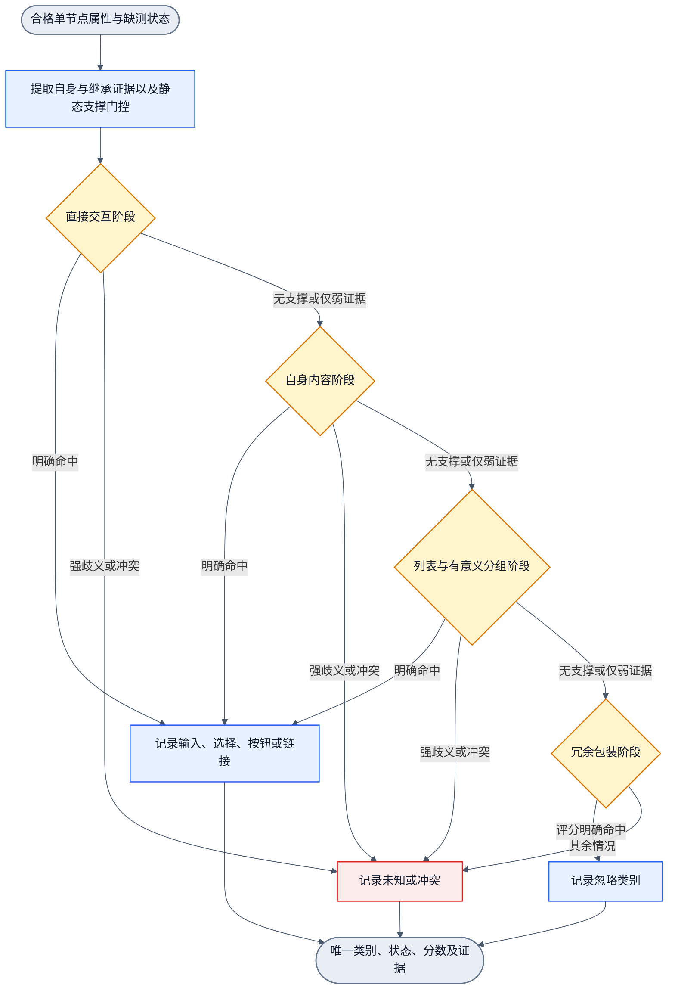

# DOM 基础分类器的优先级实验

状态：实现与真实训练对照已完成，独立 Gemini 4 medium 整体 Review 通过，候选未采用。算法和训练合同分别由 basic-kinds-wiring.md 与 training-workflow.md 维护。旧设计及默认权重保持原入口。

外层观测、筛选、分类、展示和六节点训练图保持原有 SESE 拓扑。内部按以下顺序求值，所有出口汇入同一个结果。各阶段仍计算显式评分，原生标签不硬返回类别。

支撑门控只看已观测的适用证据，不读取权重符号。无支撑的目标不参加该阶段；进入目标后仍保留缺测区间。弱证据是联合上界低于门限；强歧义和冲突立即停止，不进入忽略。结构阶段按有意义细类的联合区间评估，不能因忽略证据抬高共享 structure 分数而阻断最后的忽略分支。

旧 profile 省略 topology 时保持旧两阶段算法。新 profile 明确使用 priority_staged_v1，初始稀疏系数全零。新权重资产使用 contractVersion 2，旧资产保持 1，交叉装载报错。扩展当前采用的 SVG-pair 资产不变。

实验比较三个对象：当前旧权重、旧结构从零重新拟合、新结构从零拟合。后两者使用同一训练数据和预算；旧 357 样本只评估。合成基础元素与缺测增强分别标记，不声称新增独立页面。失败候选保留 not_applied。

计时脚本使用单调时钟。分别记录数据准备、后端加载、电路构建、基线评估、训练梯度及更新、每轮评估、最终评估、对照和端到端耗时。每轮实际两次全量行评估；同时报告唯一源样本、增强与重复负载、完成轮数、参数量和真实行处理量。失败也保存已经完成的工作，不伪造取消或成功。

## 2026-10-18 实测

使用 Apple M3 Ultra、darwin arm64、Node 22.22.2、Handwired reference f32 后端。正式训练112行：96个非合成源样本、15个合成样本、1个缺测增强；111个唯一源标识不等于111个独立页面，合并来源关联为18组。357条旧黄金只评估，25条诊断不计准确率，其中10条另有训练teacher监督。

| 实验 | 行数 | 轮数 | 参数 | 拟合总时长 |
| --- | ---: | ---: | ---: | ---: |
| 旧结构全零重训 | 112 | 500 | 184 | 3.948 s |
| 新结构全零重训 | 112 | 500 | 258 | 5.288 s |
| 新结构规模32 | 32 | 100 | 258 | 0.324 s |
| 新结构规模64 | 64 | 100 | 258 | 0.624 s |
| 新结构全量唯一源 | 111 | 100 | 258 | 1.127 s |
| 新结构两倍重复负载 | 222 | 100 | 258 | 2.073 s |

两倍重复负载只有111个源标识，只测吞吐。正式500轮各有56,000梯度行、112,224总行遍历。整个对照与矩阵13.579 s，数据准备76.009 ms，对照及资产处理77.843 ms，矩阵4.157 s。旧结构首轮包含后端加载，后续复用模块缓存；参数数目也不同，不能把总时差全归因于路由。

| 模型 | 训练集明确判对 | 旧黄金明确判对 | 相对当前采用权重退化 |
| --- | ---: | ---: | ---: |
| 当前采用旧权重 | 51/112 | 274/357 | 基线 |
| 旧结构全零重训 | 23/112 | 110/357 | 164 |
| 新结构全零重训 | 111/112 | 161/357 | 116 |

严格计数要求类别正确且状态judged；48条黄金other仍为残余监督，unknown不算正确。因此这里是固定回归集的严格命中数，不是独立网页准确率。新结构修复3条、保留158条、退化116条、未解决80条；10条点赞teacher均可识别，两个原指定select反例均正确，仍不足以采用。

逐例检查确认：新候选nat_list、nat_container等原生路径系数仍为0；训练样本不覆盖这些激活方式。26条span回归在缺nonFormatDirectTextPresent时确定下界约0.579，低于0.6，保留unknown。结构与input也有训练共现依赖及历史缺测。结论是本次从零样本覆盖不足，不用硬返回或把null改false掩盖。后续应补非黄金基础路径与缺测反例，再独立留出验证；本轮不按黄金挑轮数或调门限。

本地完整报告：`training/results/priority-classifier/final/priority-benchmark-report.json`；候选资产：`training/weights/priority-classifier/final/`；复现输入：`training/samples/priority-classifier/`。它们按项目规则本地忽略。旧382条输出逐项不变；171项测试及UI类型检查通过。缺后端CLI非零且保存部分计时。候选保持uncalibrated/not_applied，当前扩展无需重载。
