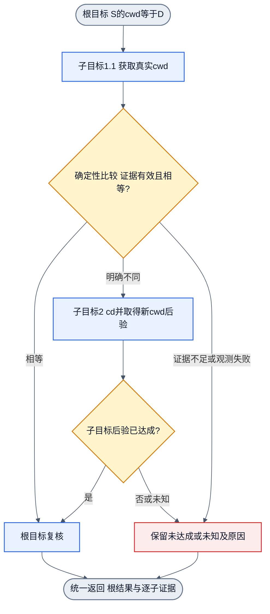

# 递归目标首例：两层cwd验证

状态：2026-10-20，通用递归合同的首个领域实例与验收设计。当前公开CLI原子能力可运行，通用递归runner尚未实现。外置consumer可验证这些原子能力按规则组合的行为；这不等于递归框架已经运行。通用规则唯一源为[递归目标设计](recursive-goal-design.md)，CLI原子调用仍沿[调用合同](cli-call-contract.md)。

## 1. 用户要求与四元素

根Goal：“指定会话S的cwd等于目标路径D”。Goal不是“必须执行cd”；已有证据表明相同就应完成。typed叶语义继续使用`file.property.relation.sessionCwd`，不增加`get-current-cwd`等旧Goal kind。根绑定有限衍生规则，原子子目标绑定领域6N5E执行合同；相同目标语义可以在两种执行模式出现，不因Goal相同就判自循环。

| 元素 | 实例 |
| --- | --- |
| Goal | S当前cwd等于入口已绑定的目标D，证据属于S且仍有效 |
| satisfactionThreshold | 100；路径相等为二元条件，不接受部分cd成功 |
| State | 显式S、D、实际cwd观测及revision/来源、根与子目标状态、共享预算 |
| Action | 衍生获取cwd子目标；确定性比较；必要时衍生改变cwd子目标；调用固定CLI与真实后验观测 |

目标路径在入口相对初始S绑定一次；执行后比较其物理目标及身份有效性，不在新cwd下重新解释原始相对文本。D发生失效或身份变化时按领域合同拒绝/保留未知，不自动改目标。S为显式可持久化执行基准，不能用一次子进程cd冒充父进程或用户终端cwd改变。

## 2. 两层实例和返回

这里“根Goal、Goal 1.1、Goal 2”是帧标识，不是新增语义词表。1.2比较是确定性计算；它增加相等关系知识，不强造可训练head。

| 帧/阶段 | 触发与当前工作 | 真实完成依据及返回 |
| --- | --- | --- |
| 根G | 绑定S、D和有限规则，等待必要子目标结果 | 只有当前同S证据确认cwd等于D才achieved |
| 子G1.1：观测 | 本次需要观测时派发sessionCwd observed(this_run)，模型只选当前head | `pwd`实际返回受信cwd；本次观测成功只完成G1.1，不直接完成G |
| 计算1.2：比较 | 用G1.1的实际New State与D作确定性比较 | 相同则父当前条件成立，G直接achieved；不同则生成G2；未知不猜分支 |
| 子G2：改变cwd | 只在比较明确不同时派发同S的sessionCwd equals D | 模型选当前动作；固定cd提交S，并按既有harness取得同S新cwd；比较成功才G2 achieved |
| 根G复核 | 将G2真实New State与副作用上送 | 重验同S、目标及revision有效性与相等条件，再返回G achieved；不把cd退出0当成功 |

G2的cd后PWD是已有harness的固定后条件观测，不是模型输出的第二步计划。若业务另有“必须额外发起一次独立pwd”的必要条件，才显式增加observed子目标；本例不重复该观测。相同分支无需让模型再选择一次NOOP；控制器直接完成父目标与模型在原子请求内预测NOOP是两件事。

该图展示本例对象流，单入口单出口且无回边；它不是替代通用3N2E的另一运行配置。若G2还需更复杂前置条件，只有已声明且有能力的规则可进一步衍生，仍沿同一通用帧合同。当前不存在的目录不会隐式创建。

## 3. 真实入口与抓错反例

| 情形 | 必需断言 | 禁止的伪成功 |
| --- | --- | --- |
| 初始相同 | 取当前cwd后判相等，无cd、无revision变化 | 为满足“至少一操作”重复cd |
| 初始不同 | 先pwd，后cd；后验属于同S并等于D，revision按真实提交变化 | 只看到旧观测或cd退出0就父成功 |
| G1.1成功，cd失败 | 原子失败保留，父非achieved，无无条件重复执行 | 只按第一个子目标成功聚合 |
| cd提交后观测失败 | 已发生改变保留，父unknown，不重放未知副作用 | 回滚事实或再次cd冒充确认 |
| 相对目标 | 初始目标绑定在执行后保持同一意义 | 在新cwd下重新解释相对目标文本 |
| 其他会话 | foreign S和Agent进程cwd保持不变 | 把改错会话算根成功 |

真实验证只调用当前`createCliCommandPolicy(...).step(...)`，显式回载保存候选，不拟合、不改profile、不采用候选。外置consumer负责本例确定性衍生与父目标评价，产品没有新增recursive-goal API。异常注入如有执行，单列为合同验证，不报成真实OS故障。实际结果与未覆盖项在下面记录。

## 4. 本轮实测记录

使用当前canonical `dist/cli-goal.js`公开入口、显式读取保存候选`ba002b23-b650-4869-87ec-2d36f4fe7485/candidate.json`，外置consumer已完成4场景、87/87断言，0失败：

| 实测场景 | 必要policy调用 | 根结果与实际事实 |
| --- | --- | --- |
| same | 1次pwd | achieved；无cd、revision不变。根完成后额外单列1次NOOP合同检查，零executor，不计必要链 |
| different | pwd→cd，共2次 | achieved；同S提交revision+1，使用cd已有PWD后验验证目标，再返回根 |
| cd-failure | pwd→cd请求，共2次 | 非achieved；合法绑定后移除自有目标，实际绑定复核拒绝`directory_binding_failed`，cd executor未执行，无重复cd |
| postcommit-observation-injected | pwd→cd，共2次 | unknown；受控观察故障，cd已提交、revision+1，证据不足且不重复cd |

四场景均检查foreign session及Agent进程cwd不变、自有fixture无非预期副作用且已清理、profile文本未改。第四场景是公开sandbox依赖的受控故障注入，前三项为真实进程/文件系统路径；第三项验证执行前真实绑定拒绝，不冒称shell cd已执行后失败。脚本和逐步原始回执位于外置`/Volumes/Intel/playground/nnanything-runs/recursive-goal-design-20261020/cwd-probe/`的`run-cwd-probe.mjs`、`result.json`与`run.log`。没有重新训练、改权重或采用候选。

这些证据证明现有CLI叶workflow可以组成用户要求的两层cwd例子，并正确处理两类失败；根调度/比较由外置consumer手写，不是产品递归框架。未实测任意深度递归、组合技能学习、预算、恢复、跨领域operation或任意自然语言目标；这些仍沿通用合同列为后续实现/验收。
