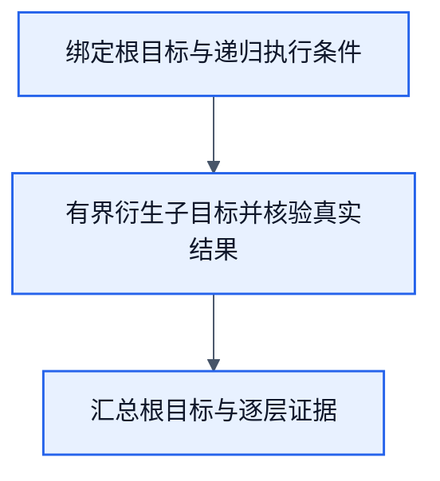

# 通用递归目标：技能选择、节点衍生与反向满足

状态：2026-10-20，设计合同。尚未实现通用递归runner、组合技能选择器或其训练；本轮不修改代码、权重或训练数据。四元素唯一基础为[design.md 1.1](design.md#11-结构化语义的目标与状态推理)，外层拓扑唯一源为[recursive-goal.graph.json](../workflows/recursive-goal.graph.json)。本合同适用于CLI、浏览器及后续computer use，不将通用机制定义为`file.property.plan`。独立模块的导入边界、公开结果类型与准确错误传播唯一源为[递归模块合同](recursive-goal-module.md)，本页维护目标/技能/反向满足算法，不复制第二套错误类型。

## 1. 用户需求与草案Review

用户最终约束：总目标不丢失，只衍生节点目标；每层从可选技能（已定义、训练合同允许的选项）中寻找能提供所需条件的技能，没有就显式报错。节点完成证据沿依赖反向满足上层，所有必要链条收回后，按总目标真实条件验收。模型每次只选择当前节点的一个head，不输出整段计划；不训练递归层序、衍生规则或是否继续。

| 原草案 | 审查结论与修正 |
| --- | --- |
| 总Goal→固定三个子Goal | 可作为实例；基础框架必须支持组合技能衍生任意有界深度节点，根Goal保持不变 |
| 子Goal未达成就继续下一个 | 不成立；只有必要依赖已满足才能放行，失败/缺口向上返回，不盲目跳过 |
| 所有子Goal achieved就父achieved | 不充分；还须父当前条件、证据有效性和不变量成立，历史成功不能代替当前状态 |
| 初始至少一个子Goal | 不必要；根已有合格证据时零动作完成。具体cwd实例显式要求本次观测则仍需pwd |
| 比较节点也训练 | 比较是固定计算；只有必要技能选择由当前节点Goal/State→head学习 |
| 连续两次无进展就stalled | 作为安全可重复已完成步骤的无进展判据；不能替代全树预算，不能重放未知副作用 |
| 所有步骤用同一30维编码 | 当前main CLI是14wire、6head、84参数；新组合技能输入须独立声明可辨性，不能假称已有30维或复用任意域模型 |
| `file.property.plan`与文件progress | 通用目标执行状态属于runner的显式State，不是文件属性；CLI叶目标继续用现有file.property合同 |
| 单级/二级/三级等于1/2/3个子Goal | 链长度和嵌套深度不同，需分别验收 |

## 2. 四元素与根目标不变量

| 元素 | 通用含义 |
| --- | --- |
| Goal | 结构化目标、对象绑定、必要条件、评价器及其证据要求；根Goal在整个执行和续接中不改变 |
| satisfactionThreshold | 各节点明确0..100阈值；根阈值不因拆分而降低，子阈值按条件合同声明 |
| State | 真实观测及来源、根引用、节点帧、依赖/待满足条件、技能选择、预算和进展；预测与事实分开 |
| Action | 选择一个允许技能、衍生其必要条件、固定计算或领域原子workflow执行；真实New State作为结果 |

根保持`rootGoal/rootThreshold/rootBindings`，每个节点携带`rootRef/parentRef/fulfills`；`fulfills`明确本节点向父节点提供哪项条件。节点Goal是局部义务，不替换根，也不通过修改根对象、阈值或作用域消除失败。改变用户目标须开启新请求，不是内部重规划。

达成有两个方向：需求自上而下衍生，证据自下而上反向满足。这是执行时的证据与条件汇合，不是梯度反传。训练期从达标State反推所需动作及前置条件，形成局部监督，仍按既有训练合同处理。

## 3. 每层允许的技能与错误边界

一个技能的设计描述至少包含：稳定id、版本、可处理的typed目标/输出条件、必需输入与前置条件、固定effect上限、执行模式及完成评价。技能属于显式请求控制绑定，不从日志或隐式上下文猜；不建立新全局插件服务。

- 原子技能：指向现有领域workflow与operator合同，执行一个当前动作并取得实际New State。
- 组合技能：指向有限、确定性的条件衍生规则；规则声明本技能达成所需条件、依赖、分支及条件到子Goal的typed绑定，不让模型生成自由计划。
- 固定基础：相等比较、类型检查、证据有效性与预算管理是手写计算，不冒称已训练技能。它们不能补选或改写模型的错误head。

每层只允许选择显式登记于相应selector词表的技能。已登记不等于已训练可用；训练候选、使用profile和准入状态沿[模型演进合同](model-evolution.md)。手写固定技能按自己的合同启用，不强制虚构训练。领域模型只选择当前一步`head`及合同允许的参数引用；组合技能的head也只表示“调用这一已有技能”，不是层序或完整计划。

确定性查找负责判断“是否存在能提供该typed条件的已启用技能”及合同兼容性；语义选择若由模型承担，仍只作当前节点Goal/State→一个head。对已注册模型禁止运行时裁剪logits来掩盖错误；选错技能由guard显式拒绝，不由规则替换成正确技能。没有可用技能就立刻返回`capability_missing`，停止该必要链，并沿父链汇报；不能发明新技能、隐式改目标、换模型fallback或自动请求LLM执行未声明能力。

条件缺失与能力缺失不同：若已有技能声明可取得前置证据，就衍生对应节点；若证据无法取得，返回`evidence_unavailable`。已知前提不成立且无已声明技能能修复时返回`precondition_unsatisfied`。权限拒绝、错误选择、OS失败及结果未知保留原始错误类别。每个必要链上的错误沿唯一父引用收回到根报告，不把错误节点丢弃。

通用框架不保证“物理上可行的任意目标都可解”；它保证在已表达的typed语义、技能、前置条件和预算内执行正确组合，缺口明确。自然语言到typed目标、未声明的跨域规划及新技能训练不在当前实现范围。

## 4. 最小对象合同（设计类型，未导出API）

```text
RecursiveRequest {
  rootGoal, satisfactionThreshold, state, bindings,
  skills, evaluators, derivationRules,
  limits: {maxTransitions, maxDepth, maxDerivedGoals},
  continuation?: ExplicitContinuation
}
GoalFrame {
  id, rootRef, parentRef|null,
  goal, satisfactionThreshold, fulfills|null,
  mode: atomic|composite, selectedSkill|null, ruleCursor,
  dependencies, activeRequirements, children,
  evidenceRefs, evaluation, noProgressCount
}
RecursiveResult {
  rootGoal, satisfactionThreshold, rootEvaluation,
  disposition: completed|error|stalled|exceeded|cancelled,
  error|null, frames, dependencyResults, actualEffects,
  remainingRequirements, budgetUsed, continuation|null, collectionResult
}
```

`goal`由领域合同验证；通用核心不解释cwd、DOM或文件格式。领域提供`evaluate(goal,threshold,state,evidence)`、`derive(selectedSkill,goal,state,cursor)`、`executeAtomic(...)`与`measureProgress(...)`。这些是节点适配合同，不绕过既有compile/run、schema或effects。State更新由实际观测/执行回执承载，不能把模型预期、日志条数或success字符串写成事实。

该形状是概念导航，公开discriminated union以[模块合同](recursive-goal-module.md)为准。根事实评价、控制停止原因和领域原子结果分别承载：领域的failed/rejected不直接复制成根事实，领域status与原始原因保留在原子回执。根尚未评价与已评价但证据未知也须区分；没有根评价器的有效证据不得生成achieved。能力缺失返回明确错误，但根事实未知时保持未知，不能声称已证“世界中目标不可能”。超预算为exceeded，不伪装成已证不可满足。错误保留唯一origin及父链传播关系，不按层覆盖根因；详细code与source/effect语义只沿模块合同，不需要hash/冻结清单。

## 5. DAG、递归与所有链条的回收

外层3N2E：绑定根目标与执行条件→有界衍生及真实结果核验→统一报告。request/result是ARC，不是额外节点。三个operator均`0.1.0-design`，没有可执行绑定。



中间节点内部用显式栈进行有界调度，不在DAG画回边。每个原子调用使用领域的同一编译workflow，CLI复用6N5E；不是第二套执行引擎。浏览器operation与computer use目前未实现，接入只是接口设计。每次叶调用独立run关联，父执行范围保持显式，跨run状态通过返回值和continuation传递。

执行有三种关系，不混画：父→子为义务衍生，子条件→依赖消费者为数据/就绪边，子→父为结果关联。若把调用和返回画成一张普通DAG就会造环；返回记录属于节点执行合同。每次展开的依赖图仍无环，入口是该帧输入，必要链结果合流到该帧唯一完成出口。首轮只用单父子目标实例及顺序调度，复用同一能力可新建实例；共享可变子帧、多父汇合与并发执行不是当前必要机制。

所有已生成节点都必须有回收结果：achieved、明确错误、unknown、cancelled或not_applicable。未选条件分支为not_applicable，不进入当前必要AND集合；失败不会被改成not_applicable。错误后尚未执行的依赖节点记为`not_executed/dependency_failed`并引用原错误，不伪造用户取消；报告显式列出剩余义务。单父实例保证每条链有唯一接收者，最终由根结果汇总；不把“未运行”当满足。

预期领域错误通过明确Outcome传到图中report。底层`runWorkflow`出现基础设施failure时可能跳过report节点；独立模块入口必须按[模块合同](recursive-goal-module.md)捕获可处理异常并返回fault、已知effects及证据边界，不依赖report必执行，不从events/log重建运行决策。不承诺进程被终止后仍能同步返回，也不以伪造成功事件来维持表面SESE。

## 6. 确定性调度与反向满足

1. 绑定不可变根及技能范围，检查预算、typed输入和必要权限；先评价根的合格实际证据。根已满足且无强制新观测义务时直接completed。
2. 当前帧需工作时，在允许技能中选择一个。无合适技能即error，不盲目进入下一个目标。选择组合技能则按其固定规则衍生当前必要条件；只展开当前所需分支，记录条件到子Goal的映射。
3. 从依赖已满足的active节点中取当前项；顺序由规则的稳定顺序确定，不由学生学习层号。原子节点执行现有领域图，模型只回答本次head。
4. 原子返回真实New State；先核验本节点条件，记录实际effects、错误和证据适用范围。未达成则停止该必要链或仅按已声明的安全重试条件继续；不能默认执行后继。
5. 本节点achieved后，把条件证据反向送给父帧。父帧检查所有active必要条件及本节点`fulfills`，再用当前真实State重验自身Goal和不变量；不能仅按子目标状态字符串聚合成功。
6. 父未满足且现有技能规则还有明确可执行义务时继续衍生；无规则可闭合则error，证据不够则unknown。父满足则继续向上回收，直到根。最终收束所有帧后统一report，不遗漏局部错误或已发生effects。

阶段条件与终态不变量分开：获取初始cwd是“已取得该阶段观测”的义务，cd后不要求初始路径仍是当前cwd；根的“当前cwd等于D”必须用最终有效证据评价。规则明确声明哪些条件被一次性消费、哪些必须持续成立。后续操作使持续条件证据失效时撤销其有效性，按规则补证/再满足；不改写历史回执，也不无条件重新执行所有早期阶段。

合法下降可以保留相同Goal语义：根以组合技能执行“cwd equals D”，子节点以原子技能执行相同equals条件，这是执行模式/技能层次的下降，不是循环。禁止组合技能在相同目标、绑定、技能模式、状态事实下再次衍生同一未消解义务；这种无下降自衍生返回`derivation_cycle`。状态有变化也不保证无限允许，仍受全树预算约束。

## 7. 预算、无进展与未知副作用

`maxTransitions`覆盖评价、选技能、衍生、派发、向上汇合的控制转换；每次转换前消费全树共享额度，不在子帧重置。`maxDerivedGoals`在分配节点前检查全树累计数，`maxDepth`以根深度0检查入栈；预算均为有限非负整数，初始绑定仍可拒绝非法配置。已扣预算不因重试、换子目标或续接而重置；新增预算必须由新的显式请求控制值授权。零余额不得再发出副作用；统一report和必要清理不被预算阻断。

规则提供可解释的进展：已证必要条件增加、未完成工作减少，或领域测量的目标距离改善。新timestamp、新run id、重复观测同一值、模型分数升高及多写一条日志都不是进展。无进展计数属于同一未满足义务及有效性范围；不能换帧编号清零逃避终止。只有执行已明确结束且安全可重复、规则允许重试时，连续两次无进展触发stalled。没有安全重试规则时第一次失败就按原错误返回，不为凑两次重放。

副作用未知（例如已发动作但无法确认完成）必须保留actualEffects与未知状态，停止自动重放；先衍生已声明的只读补证技能，若无该技能即evidence_unavailable。continuation保存未完成帧、证据有效性、预算及已执行动作回执；恢复时先重新确认必要事实，不根据“未收到成功”重发动作。取消也统一回收，正在执行动作的最终effect必须待执行器回执或标为未知，不捏造回滚。

## 8. cwd首例与通用性边界

第一条验收按用户的[两层cwd实例](recursive-goal-cwd-validation.md)：根“S.cwd等于D”保持不变；1.1本次pwd→1.2确定性比较，same直接完成根，different才派生原子equals子节点执行cd及既有PWD后验，再反向满足根。不存在目录不隐式创建；没有该条件所需技能则报错，不擅自补mkdir。

浏览器示例仅为设计：根“某表单字段实际值等于X”，组合技能可衍生“绑定允许范围内的输入对象→满足可编辑条件→输入→读取实际值”。如果只有基础分类器而无input operation技能，则在该层报capability_missing；不能把识别input当作已能输入。桌面同理，当前占位不能算可选执行技能。相同框架复用的是目标与结果合同，不是跨域共用特征/权重。

## 9. 训练设计与抓错反例

只训练当前节点的局部技能选择函数`encode(nodeGoal,necessaryState)→head`。Goal相同但已满足/未满足、引用缺失/有效时正确head可不同，不能只给Goal而去掉State。层号、父id、衍生顺序、root完成率、是否继续、预算控制和规则cursor不是学习目标，不作为答案捷径输入；根中影响当前选择的条件须显式投影成必要语义约束，不能隐藏。

当前CLI叶选择仍是一份`cli.command-policy.v1`，6head/14wire/84参数；不会因外层加入递归就改变模型。新的组合技能selector尚无输入/参数/训练设计，实施前按已有设计流程闭合，不宣称现有CLI profile能选择未注册组合技能。固定规则可以先确定本例组合，不冒称模型学会高层技能选择。

训练head标签由独立复核的技能合同及可接受效果确定，真实执行与New State用于验收。退出0不是head真值，执行失败也不自动说明选择错误。来源家族先分train/dev/verification；跨层控制实例用于计划级行为验收，不训练层序。使用样本仍沿[演进合同](model-evolution.md)采集/复核/隔离与回归，不新增自动采用规则。

| 验收家族 | 能抓住的错误 |
| --- | --- |
| 已满足根，零子目标 | 强制动作或无必要层序 |
| 同层1/2/3项链 | 依赖越过、丢节点、局部成功冒充根成功 |
| 嵌套深度1/2/3 | 只会固定序列而不能按相同帧合同递归返回 |
| cwd同/不同、cd失败、提交后证据未知 | 比较错误、目标丢失、旧证据冒充新状态及重复副作用 |
| cd→ls依赖 | ls在旧cwd执行，或复用错误目标引用 |
| 必需技能不存在/词表未支持 | 编造技能、隐式fallback或换目标 |
| 子链全成功但父不变量失败 | 只聚合children的achieved |
| 条件分支未选/已选失败 | 要求未选分支成功或把真失败标为跳过 |
| 后续动作使旧事实失效 | 历史证据被当当前条件 |
| 全树5子Goal、maxDerivedGoals=4 | 子帧重置预算或分配后才发现超限 |
| 自衍生无下降/同Goal组合→原子 | 真循环漏检或合法下降误拒 |
| 日志时间变但无事实进展 | 伪进展逃过stalled |
| 恢复/取消/未知effect | 恢复后重放、漏清理及没有接收者的链 |

不存在目录是某个已知条件不满足，不证明在任意技能集合下不可满足；没有创建技能时本例阻断，有合法创建技能且授权时才可用另一个显式组合规则。链完成率可用于诊断，但不是根满足度；search等连续满足度仍须领域明确范围和分母。

## 10. Owner、实施与未就绪边界

通用目标帧及调用组合属于独立的`lib/workflow/recursive-goal/`后续模块；拟定`lib/recursive-goal.ts`公开门面，尚不存在可导入API，具体职责与错误边界见[模块合同](recursive-goal-module.md)。只通过既有runner调用领域图，不内置CLI/browser/training依赖。领域Goal/证据/effects由领域filter、adapter和node维护；技能本地绑定由应用配置维护，不建远程服务。项目图仍唯一放workflows，内部数值wire与外层DAG分别治理。

本轮交付通用合同、3N2E图、架构衔接、cwd实例与已有原子组合的实测证据。尚未实现：通用三个operator、typed schema编译绑定、帧调度/continuation、组合技能selector与训练、跨域operation接入。设计不等于这些能力已运行。

后续最小实现先固定cwd组合规则接通本合同，按图→受影响gate→真实入口红测→唯一owner实现→同入口验证推进，再扩展嵌套规则。通用帧与终止机制可先验证，不用新增训练来掩盖控制逻辑。任何需要学习的新技能选择能力必须补齐可辨输入与局部监督，不能把“通用框架设计成立”写成“所有语义已可完成”。
