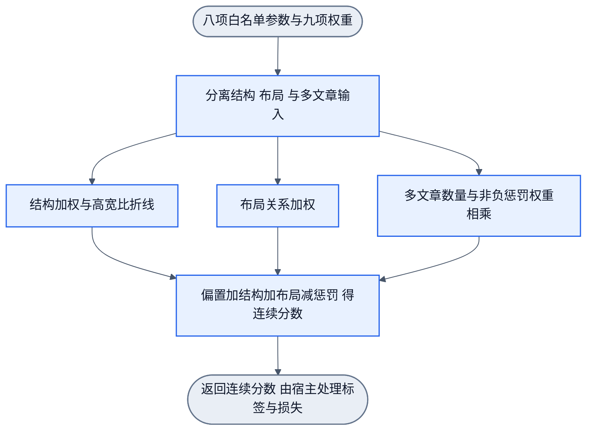

# M1 完整卡片结构电路候选

状态：2026-10-17，D0设计及w测量增量复核通过，尚未实现。目标是post.card结构实验，标签为non_card/post.card；广告或推广若是完整卡片，其结构标签仍可为正。本文不证明输入已足以泛化，不提供来源类别判断或校准成绩。替代旧organic数值草案用于后续L2这一任务，旧任务需求不撤销。

## 输入与可测定义

节点取参器从已保存的结构/几何观测提取下表。不得读class/id、账号、正文名字、URL或根路径。关联引用只用于寻找父子/兄弟，不作为学习特征。

| 输入 | 定义 | 数值范围 |
| --- | --- | --- |
| t | 当前tag是否为article | 0或1 |
| h | 当前节点的局部后代是否包含header元素，遇到嵌套article边界停止向内查找 | 0或1 |
| f | 当前节点是否有直接footer元素子节点 | 0或1 |
| m | 严格后代article数量，包含内嵌文章；显式饱和至16 | 0至16 |
| w | 当前宽度/最近局部重复容器宽度；下文给出确定算法。完整观察中不存在重复容器时为已测0，祖先/兄弟证据缺失时为缺测 | 0至2，显式饱和 |
| r | 当前height/width；width必须正；显式饱和至16 | 0至16 |
| n | 正面积同级兄弟中近似等宽、横向对齐的比例；宽度相差不超过较大宽度的10%，x相差不超过当前宽度的5%；没有合格兄弟时为已测0 | 0至1 |
| s | 最近有效滚动上下文的max(0,scrollHeight-clientHeight)/clientHeight，clientHeight必须正；无祖先滚动上下文时仍检查已测文档滚动器，文档数据缺失则缺测；显式饱和至16 | 0至16 |

h和f仅指HTML结构事实，不声称已识别发帖人或互动语义。现有离线微博测量中，已检查的article有header后代与直接footer；部分正文也有header，因此不能只用h判完整卡片。

所有输入在此实验合同中required。缺失或无法确认相关子树完整性时返回insufficient_observation，不将未采集后代当已测不存在，不将缺测补0。输入变换、顺序和电路ID必须进入兼容合同。来源任务没有相应输入，返回unsupported_target。

### w的确定性测量

从当前节点X的父节点沿已采集祖先链逐层检查容器C。对C的每个正面积直接子元素，若它只有一个正面积元素子节点、其余子元素无正面积，则最多向内穿透2层这种单子包装，得到条目代表。该规则只比较几何和元素层级，不读取class/id或名字；两层是当前局部测量合同，不作为学习的全局深度。

找出包含X的直接子分支及其条目代表。若该代表与C下至少另一个条目代表满足相同tag、宽差不超过较大宽度的10%、x差不超过X宽度的5%、y不相同，则C是重复容器。取最近满足条件的C，计算w=min(2,max(0,X.width/C.width))。X或C宽度非正则不能计算。

若祖先链与所需同级几何完整且到根均无重复容器，w=0表示“已观测不存在”。若分支代表、祖先链或必要兄弟数据缺失/裁剪，则w缺测，不以父容器猜测或名称选择器替代。实现须用透明包装、独立组件、同宽列表与不完整现场的反例验证此合同。

## 连线

固定折线：u = ReLU(r) - ReLU(r - 1)。

结构支路：C = at*t + ah*h + af*f + ar*u。

布局支路：L = aw*w + an*n + as*s。

多文章惩罚：M = am*m。

连续输出：z = bias + C + L - M。

这是显式稀疏连线：只训练at、ah、af、ar、aw、an、as、am和bias九个参数。at/ah/af/ar/am约束非负，其他参数有符号。参数source与特征source分开；拟合使用未校准z，不做会阻断误判纠错的先行布尔门。

宿主计算sigmoid/BCE并注入dL/dz=sigmoid(z)-y，再由Handwired反传。每轮更新投影参数约束，重建候选后校准失效。profile持久数据使用普通有限数值数组；无界参数界限用null，不写Infinity。confidence未独立校准时只解释为分数。

数值图是节点内部计算候选，不是额外workflow调度图。本轮设计审查须覆盖特征取参和连线；实现后再用真实Handwired前向/反传、误判纠错及同节点profile回载证明运行行为。
