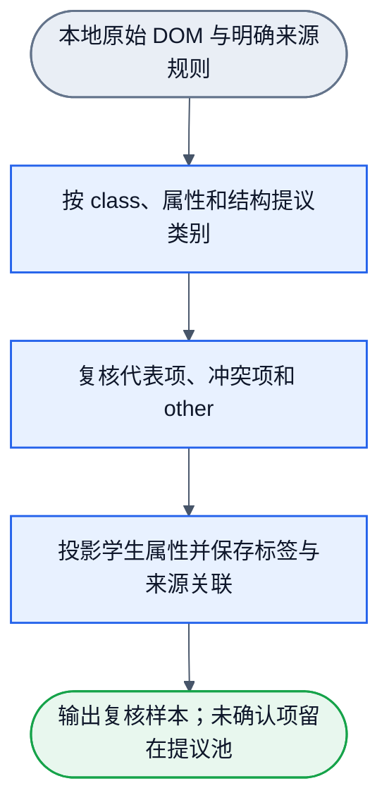
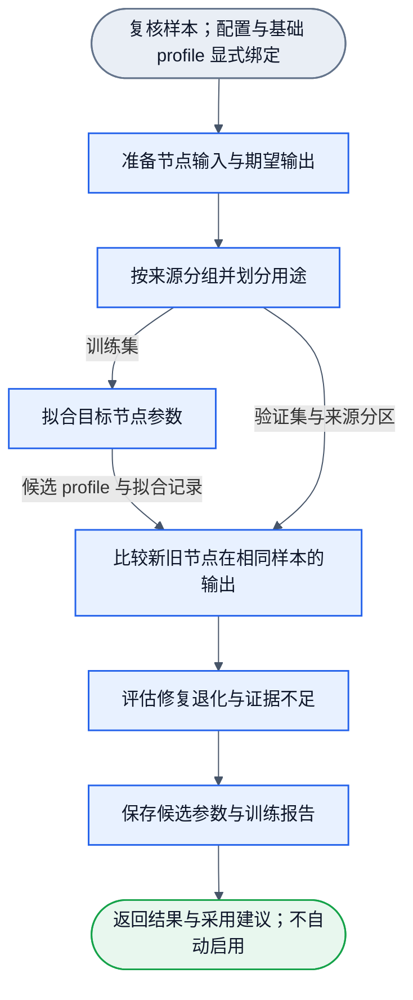
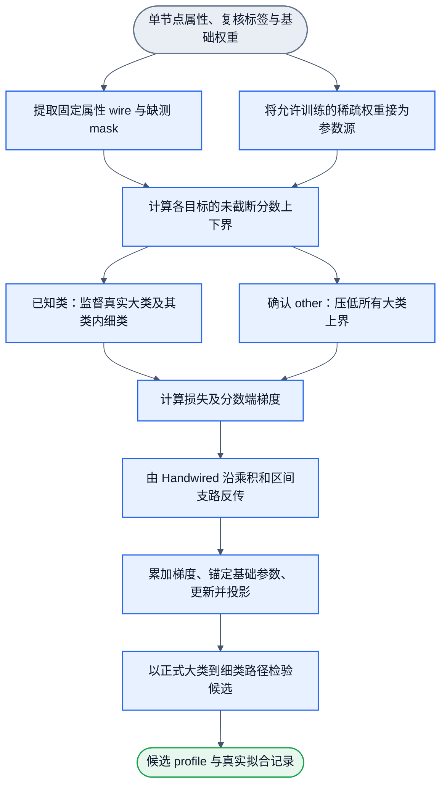

# 节点训练 workflow 设计

2026-10-19新增统一方向：本页维护DOM训练I/O与现有离线实现；所有模型使用时采集、训练/使用版本隔离、零回归条件自动升级和LLM冲突改图，统一沿[模型演进合同](model-evolution.md)。当前离线候选不自动采用的描述仍是实现事实，不反转用户新要求；自动采用链尚待接入。

## 优先级实验与实际计时

`priority_staged_v1` 的正类目标拉高所属 family/leaf 下界，压低同阶段和前序适用竞争分支的上界，不压低后序分支。ignore 与有意义结构共享 structure family，因此 ignore 监督压低前序结构 leaf，不压低自己的 family。静态 gate 同时作用于已测项和缺测项，数值后端与正式前向使用同一支撑定义。旧 topology 的损失路径保持原行为。

`fitBasicKinds` 返回 `timing`：backendLoadMs、circuitBuildMs、baselineEvalMs、trainEpochGradMs、postEpochEvalMs、finalEvalMs、fitTotalMs，以及 completedEpochs、processedRowCount、gradientRowEpochs、totalRowPasses、trainableParamCount、totalSparseCells。单调时钟 `performance.now()` 记录实际耗时；每轮包含一次梯度遍历和一次更新后评估，另有基线及最终评估。正常完成 E 轮、R 行时，梯度行数 E×R，总行遍历 (2E+2)×R。失败按已完成工作记录，不套正常公式。

错误保留原消息/cause，附带 completedEpochs 与 timing。进度回调在该轮完成后调用，回调失败仍计入已完成轮数。未实现取消协议，不宣称 cancelled。训练报告可保存 timing；旧报告缺省该字段仍可读取。重新拟合保持 uncalibrated、not_applied。

公开脚本、三方对照和最小计时矩阵见 [Consumer](../playground/training/README.md)。规模记录区分唯一源、合成、增强和重复负载；参数量未独立变化时，不推断参数量的独立缩放规律。黄金回归不能参与拟合或挑轮数。

状态：2026-10-17，候选内容，实施中复核（candidate under verification）。本文是当前第一层 DOM 基础种类离线训练的合同、连线与验收说明。六个训练算子（training.prepare / partition / fit / compare / assess / report @ 0.1.0）与真实 Handwired Circuit evaluate/backprop 拟合路径存在；本增量的小红书纠错集、旧黄金及场景回归尚未完成整体交付，不能据此宣称候选已采用或未知已清零。保存的候选 profile 绝不自动替换基础 profile；初始及候选参数保持未校准（uncalibrated）；新拟合使旧校准失效。

外层复用已有事件、节点与 Flowed 执行合同，不增加调度器。内部使用 Handwired 数值图。workflow 的边不传梯度；拟合循环在 training.fit 内部执行，不给 DAG 增加回边。基础前向算法与类别真源见 [基础种类连线](basic-kinds-wiring.md)，持久拓扑唯一位于 [训练图](../workflows/node-training.graph.json)。

## 1. 样本准备与训练是两条流程



class、id、name、正文、完整 URL 和根路径只用于 teacher 与原始证据，不进入学生数值输入。学生仅接收基础分类器已声明的属性。未采到 name 时不能编造。规则未命中、缺测、候选排除、模型输出 other 均不自动成为黄金 other 或负例。现有 sample.match 可提供语义提议；已实现的二分类 TaskDataset 不直接变成这次的多分类训练集。

教师复核必须记录实际来源。`reviewerRef` 若来自 LLM teacher，要明确标识 LLM 及其证据引用，不能写成 human；人工复核另记 human 标识。后续补充测量合并入既有 91 行纠错集时，`provenanceRef` 与证据侧车必须同时表达原始采集和补充观测来源，形成混合观测来源记录；不能覆盖原值而丢失第一次观测边界。修正后的小红书台账为 91 行：86 行已知、5 行 ambiguous。已知行为 ignore 52、container 14、text 0、list 1、button 16、select 2、input 1；ambiguous 行为 5、9、13、20、32。

当前小红书、知乎本地返回记录共 5099 条，均为 gold=false 的提议样本。小红书首页和详情含共同背景，不是独立来源。旧微博归档缺少候选裁剪证据，仍保留原资格状态。这些资料不能直接进入训练并宣称准确率。

## 2. 外层训练连线



六节点、六条内部边，单输入 training_request、单输出 training_result。配置见 [持久配置](../workflows/node-training.workflow.json)。算子版本与工作流绑定均为 0.1.0；现有 [训练图](../workflows/node-training.graph.json) 保持 6N6E SESE，[标注图](../workflows/browser-visual-overlay.graph.json) 保持 4N3E，[采集图](../workflows/browser-capture.graph.json) 保持 1N0E。本增量不改变外层拓扑。

| 节点 / 算子 | 输入 | 输出及唯一职责 |
| --- | --- | --- |
| 准备节点输入与期望输出 / training.prepare | training_request | samples：确认标签、属性合同、来源引用及纳入/排除原因，不运行 teacher |
| 按来源分组并划分用途 / training.partition | samples | partitions：来源关联闭包分组、训练与评估用途；不按 DOM 行随机切分 |
| 拟合目标节点参数 / training.fit | partitions；显式绑定基础 profile 与后端 | candidate：候选参数、训练记录、覆盖与不可拟合项；不修改基础 profile |
| 比较新旧节点在相同样本的输出 / training.compare | candidate、partitions；相同基础 profile | comparison：逐例旧新正式分类结果、每类指标；保留候选引用供下游保存 |
| 评估修复退化与证据不足 / training.assess | comparison | assessment：改善、退化与证据边界；保留候选及报告数据 |
| 保存候选参数与训练报告 / training.report | assessment | training_result：权重与报告路径、写入回执；需要 filesystem.write |

六节点是可复用职责。目标 adapter 负责类别、数值图和损失；通用 workflow 核心不写 DOM 分支。首版只提供 dom.basic-kinds.v1 adapter，不提前承诺任意目标只换参数即可训练。

输出内容按以下最小结构实现：samples 保留 rows、includedIndices、逐行 reasons；partitions 增加 sourceClusters、trainIndices、evalIndices、evaluationMode；candidate 包含 profile、fitTrajectory、样本覆盖及基础参数引用；comparison 包含 candidate、逐例旧新判断及逐类指标；assessment 包含 comparison 与采用建议/证据不足原因；training_result 只返回文件引用、统计、建议和保存回执。中间样本与索引共用本次显式输入，不能从日志重建。compare 的两路输入必须属于同一 run 和同一任务，不能混用不同来源分区。

## 3. iframe、登录与风控的范围

iframe 宿主和内部文档分别采集。frame 内部节点也是独立分类输入。顶层脚本不能直接读取跨域文档；只有采集接口实际提供内部观测时才纳入。读不到记为内容未采集，不标为空或 other。当前资料未证明完整覆盖 iframe 内部。

样本来源需要保留 documentRef、frameRef、snapshotRef 和局部区域关联。它们用于定位、来源分组和回放，不作为数值特征，不引入绝对根路径。浏览器候选资格需要计算外层 iframe 与内部视口的共同裁剪；缺少测量则保留未知，不能直接当成视口内。

登录框由 container、input、button、image、text 等基础成分组成。登录区域及账号输入等用途是后续第二层语义。二维码可能由 img、canvas 或 SVG 等载体呈现；第一层按实际属性评分，二维码及其用途需要图像或上下文证据。不能由载体种类直接断定二维码，也不能由二维码直接断定风控。

后续可增加 auth.login.panel、code.qr、security.challenge 等明确语义。页面/区域状态与单节点类别分别建模；同任务仍为单标签。本轮不增加这些基础类别或视觉模型，不实现登录/风控操作。workflow 后续按识别状态决定等待用户或结束。

## 4. 复核多分类样本与来源分区

以下多分类合同由 lib/training 的 `basic-kind-samples` 合同实现，并通过 prepare 的公开 workflow 接点消费；它不是旧二分类 TaskDataset 的扩展。转换工具负责显式投影，旧二分类组装器保持原义。

```ts
type ReviewedBasicKindRow = {
  sampleId: string;
  inputRef: { snapshotRef: string; documentRef: string; frameRef: string;
    nodeRef: string; index: number; regionRef?: string };
  provenanceRef: string;
  sourceAssociations: { snapshotRefs: string[]; postRefs: string[];
    assetRefs: string[] };
  candidateQualification: {
    status: "ok" | "filtered_out" | "skipped" | "unknown" | "not_evaluated";
    reasons: string[];
  };
  captureCoverage: { frameContent: "captured" | "not_captured" | "not_applicable";
    directChildren: "complete" | "incomplete" | "unknown" };
  properties: BasicKindProperties;
  proposal: { ruleRef: string | null; label: BasicKindLabel | null;
    status: "matched" | "unmatched" | "unknown" | "conflict" };
  review: { status: "verified" | "unreviewed" | "ambiguous" | "rejected";
    expectedLabel: BasicKindLabel | null; reviewerRef: string | null;
    evidenceRef: string | null; otherReason: string | null };
};
type BasicKindTrainingRequest = {
  schemaVersion: 1;
  taskId: "dom.basic-kinds.v1";
  rows: ReviewedBasicKindRow[];
};
```

frameRef 是当前采集内的关联引用，不是根到节点的绝对路径。未读到的 iframe 与 shadow 内部不创建虚构子节点行，保持 unassessed，不标为 other；只在原始采集清单记录覆盖缺口。学生投影只取 properties；所有来源、teacher、复核和资格字段均不进入数值向量。复核可由人工或有证据的 LLM 完成，需保存实际复核者与证据引用；规则输出不能自行把 status 改为 verified。

prepare 有两种显式输入范围。默认 candidate_qualified 要求原槽位为 ok。properties_offline 只做离线单节点属性试验，接收合法属性并保留缺测；原候选状态不改写，结果不能证明浏览器候选链通过。两种范围都要求 verified 且有明确期望标签，不增加未复核训练模式。全 null 的合法属性输入可保留为诊断，但若没有可区分信息，不承诺其可拟合。

缺测保持 null，不以零子节点或零面积代替不完整采集。旧样本没有 `svgGraphicChildren` 时，训练请求验证与 fit-row 投影补为 null，不把它当作 false。黄金 other 需复核确认不属于当前 12 个细类，并给出原因；未知真值留在待复核池。模型因为缺测输出 other，而复核真值是 input 时，训练目标仍为 input。来源留出样本只做留出评估，不能进入 in-sample 拟合。

prepare 输出保序槽位、每行纳入理由和可训练索引。partition 按共享 snapshot/post/asset 引用的传递关联形成来源组。相同背景的跨页面或跨 frame 也归同组；不得把每个 frame 自动当作独立来源。缺少关联证据时报告隔离不充分，不能声称已排除泄漏。组内保持原序和重复；不随机拆 DOM 行。按固定 seed 对来源组洗牌后划分 train/eval，不计算哈希或 checksum。

source_group_holdout 模式至少需要两个可分的来源组，并确保两侧非空。若不满足，返回证据不足。调用者可显式选择 development_only 模式，用同组训练和回放诊断，但不报告独立验证。没有被 eval 覆盖的类列为 uncovered；指标分母为零时为 null，不能填造准确率。

## 5. 配置、资源和事件合同

持久配置沿现有 configVersion=1、graphRef、configs、bindings、profileId，不建立第二套注册表。训练请求只传样本，目标配置与基础 profile 走显式控制绑定。fit 和 compare 绑定相同基础 profile；候选参数是训练输出，不能替换基础资源后再与自己比较。

| 节点 | 配置引用 | 运行资源 / effect |
| --- | --- | --- |
| prepare | prepareSpec：taskId、inputScope | 入口已加载样本；无文件读写 |
| partition | partitionSpec：分组模式、seed、evalFraction | 无副作用 |
| fit | targetSpec：固定推理门限、损失目标、学习率、轮数、锚定系数，可选 fit.trainableWires | factory 显式接收 handwiredRoot；profileId 绑定基础参数；声明 filesystem.read |
| compare | 同一 targetSpec | 同一基础 profile；调用正式前向；无副作用 |
| assess | assessSpec：是否要求黄金样本无退化 | 无副作用 |
| report | reportSpec：权重与结果的相对目录 | factory 显式接收 allowedRoot；声明 filesystem.write |

filesystem.read 只授权显式后端源码根；filesystem.write 只授权 report 的 allowedRoot。配置本身不授予能力。运行时显式传入的后端、文件访问对象和观测者由节点工厂闭包绑定，不往现有 NodeExecutionContext 假加未实现的服务字段。

`fit.trainableWires` 是显式的 wire 名称名单。省略时沿用全参数拟合；提供时，只有名单内 wire 对应的已注册权重可更新。空名单冻结全部权重。未入名单的权重不执行优化器更新，也不计入锚定惩罚，输出值保持基础 profile 的原值。名单不改变前向观测、缺测区间或 Handwired 反传图，也不自动补注册权重。新增 wire 的首轮增量可只训练这些新路径，避免没有旧训练回放时漂移已有系数；是否解冻旧 wire 由下次训练配置和独立回归决定。

各 ARC 的设计 schemaId 为 training/basic-kinds/{request,samples,partitions,candidate,comparison,assessment,result}/v1，对应事件类型 training.{request,samples,partitions,candidate,comparison,assessment,result}.v1。端口按第 2 节表和 graph.inputs 顺序绑定；compare 先 candidate、后 partitions。业务 schema 在实现时逐端口验证，图中的 Object 不代替它。

每个节点仍只 emit 一个结束事件。无复核样本、无独立分组等情况返回 unknown 及明确原因。当前 runner 默认跳过非 ok 输入时只保留 upstream_not_ok；为保留原始不足原因，partition/fit/compare/assess/report 的设计均需 acceptNonOkInputs，处理器先识别非 ok 事件并沿声明的不足结果原样保留受限原因，不执行该节点的拟合/比较步骤。assess/report 收束为 evidence_insufficient，candidate=null。可保存不足报告，但不生成虚构权重。后端加载失败、数值非有限、未授权写入等走 WorkflowRunFailure，不能伪造正常候选。

## 6. 运行进度、比较与保存

当前 runWorkflow 在整图结束后才返回结果，没有实时进度回调。后续最小观测接口由 runner/core 负责通用 node-start、node-progress、node-complete、run-failed 通知；progress 是类型明确的通用 JSON，不在核心引入 DOM 或训练类型。训练 adapter 负责 epoch、totalEpochs、loss、knownLoss、otherLoss、anchorLoss、sampleCount、投影权重数。关键轮次的同构记录保存在训练结果，供 CLI 和未来 WebUI 使用；不增加第二调度器或 Web 服务。

compare 在相同样本上调用正式分类器，分别报告 train/eval。已知类正确要求类别相同且 judgmentStatus=judged；黄金 other 正确要求输出 other。逐例分为 fixed、regressed、retained、unresolved；未复核或不在本次评估范围的项为 unassessed。保留样本引用、旧新路径和分数，不能只比较平均 loss。

报告包括每类 support、混淆统计、precision/recall/F1、other 分布、unknown/conflict 数量、未覆盖类别和候选排除统计。样本缺少某类不能证明该类没有退化。第一版不设未经证据支持的准确率门槛；assess 说明是否有修复、是否有黄金退化以及证据是否独立充分，不自动采用参数。

权重仅写 training/weights，报告仅写 training/results，样本仅写 training/samples，均按已有规则保持本地。权重资产封装 targetOperator、contractVersion、基础 profile 引用、未校准状态及兼容的 BasicKindProfile；回载时取 profile 供现有分类器验证。报告引用权重文件，不重复存储矩阵。每次写入使用新文件名和 wx 拒绝覆盖，并沿 sample.save 已有的授权根与路径安全原则实现专用写入器；现有 sample.save 不能直接保存权重。

先写权重，再写报告。后者失败时明确保留已写权重路径和失败原因，不伪造原子回滚。现有 WorkflowRunFailure 没有结构化 details；实现时先保留可恢复路径于错误消息，若需机器可读回执，则最小扩展 typed error chain 和 runner 的 details 传递，不把控制错误镜像为成功 payload。无候选时只写证据不足报告。候选不会覆盖基础参数或自动改 workflow；采用由调用者显式加载并绑定新 profileId 完成。

## 7. training.fit 内部的手写数值连线

这是 training.fit 内部的 Handwired 数值训练图。每次更新走相同路径，epochs 是 fit 内部有限循环。下图展示一轮的数据与梯度依赖，不是给外层 DAG 增加回边。



L/O 按复核标签选择损失，不表示同一个输入接受两个标签。推理先计算五大类，只在成功选中大类后计算其细类。训练已知细类时按真实标签选择监督分支，即使当前大类判错也能训练正确大类及细类。other 是残余输出，不增加类别头或可训练置信度。

配置中的 epochs、learningRate、anchorLambda 是起步示例；来源分区比例也不是已验证的最佳值。初次试验依据样本与学习曲线调整，不能用 eval 成绩反复选参数后仍称其为独立验收。

### 固定部分与可训练部分

| 手写且固定 | 可训练 |
| --- | --- |
| 属性白名单、wire 条件与缺测适用性、五大类和类内标签、两层顺序、门限、稀疏连线键、损失与参数区间 | profile.familyWeights、profile.leafWeights 已声明键的系数，含显式声明的零系数 |

旧 profile 迁移由 `migrateBasicKindProfile(raw)` 唯一维护。它在验证后克隆 id 与全部旧权重，只补齐已登记新目标与 wire 条目的缺失 0：media/image 的 `nat_svg` 与 `svg_graphic_children`，structure/container 的 `div_single_child`，text/text 的 `div_leaf` 与 `div_direct_text` 在两个阶段各一项；其余呈现、关系、连续几何和 ignore 地址同样按名补 0。已存在的新系数保留。训练 profile 加载显式调用迁移，sparse cells 因此为这些显式 0 键建立 `Circuit.source` 参数，可从零开始学习。迁移补 0 不等于已有训练新权重或输入已测量。迁移不增加 profile 版本、校准或门限字段，不修改旧对象，也不自动采用候选。

初版不新增 bias、不自动加边、不训练门限。disabled/hidden 等初值为零的系数没有未经证据支持的否决权。没有激活或只有缺测的特征不能凭训练补出事实。

properties、`extractBasicKindWires` 与区间前向由 `lib/filters/basic-kinds.ts` 唯一维护。正式分类与训练 adapter 共用该实现，不在训练目录重写 tag/role/几何条件。Handwired 将相同 wire 与 profile 项编译为数值算子，并以正式前向对齐验证翻译结果。

### 缺测区间与 Handwired 连接

对目标 c 的现有稀疏键集合 A(c)，保持现有定义：

```text
l(c) = Σ[已观测的 w(c,k)·x(k)] + Σ[缺测的 min(w(c,k), 0)]
u(c) = Σ[已观测的 w(c,k)·x(k)] + Σ[缺测的 max(w(c,k), 0)]
```

训练输出未截断 l/u。推理使用 clamp(l,0,1)、clamp(u,0,1) 后按现有仲裁执行。数据中 null 保持 null；电路用 observedValue 与 missingMask 两个数值槽表达它，不能丢弃 mask 把 null 当作观测零。

每个 w 必须是 Circuit.source 参数源，经 emitMultiply 接到属性和缺测支路。affine 的数字 coefficient 只是固定拓扑系数，不能把待训练权重写在那里。Handwired 的 ReGLU 是 left × ReLU(gate)，所以 ReLU(w) 对应 circuit.reglu([], 1, [[w, 1]], 0)，负部将 gate 系数改为 -1；不是把 w 放在 left、gate 固定为 1。区间下界减去 ReLU(-w)×missingMask，上界加上 ReLU(w)×missingMask。

### 单一代理目标与更新顺序

令 h(z)=max(z,0)，固定推理门限 T=0.6、M=0.15。期望分数的下限 a=0.8，竞争上界 b=0.4。对一层目标集合 C 和真实类别 y：

```text
Lstage(C,y) = h(a-l(y))² + Σ[c∈C,c≠y] h(u(c)-b)²
Lknown = Lstage(五大类,真实大类)
       + Lstage(真实大类的细类,真实细类)
Lother = Σ[f∈五大类] h(u(f)-(T-otherGap))²
Ltotal = mean(逐样本 Lknown 或 Lother) + λ/2 · Σ(w-wBase)²
```

otherGap=0.05。已知类的零阶段损失意味着目标下界至少为 0.8、竞争上界至多 0.4；经正式截断后仍满足门限及严格正间隔。单细类分支也满足相对零竞争分数的间隔。若更改配置，要求 0≤b<a≤1、a≥T、a-b>M；otherGap 满足 0<otherGap<T。非零损失不保证命中，所以始终报告正式前向结果。

目标项只惩罚未达到下限的分数。多个有效证据叠加使未截断下界超过 a 时，不再把该分数拉回 a；这些分数未经过概率校准。宿主对 l/u 求损失导数：目标下界小于 a 时为 2(l-a)，达到或超过 a 时为 0；竞争上界仍为 2h(u-b)，other 上界仍为 2h(u-(T-otherGap))。竞争分数过高仍得到纠错梯度。不对离散类别、布尔路由或 other 字符串反传。

other 约束是保守的充分拒识策略：所有大类上界都低于门限，则不能进入任何已知细类。它比“任一路径弃判”更严格，不能表达所有可能的 other。若它与已知类样本冲突，报告当前特征/连线的可分性限制并审计；不能改黄金标签来消除冲突。预测 other 的缺测样本若真值已知，仍走 Lknown，不走 Lother。

执行顺序为：Circuit.evaluateReference → 宿主计算 loss 和分数端导数 → 填满对应长度的 Float32Array outputGradients → Circuit.backpropagateReference → 读取参数源梯度并按样本平均 → 加 λ(w-wBase) → Adam 更新 → 投影到 [-1,1]。Adam 取 β1=0.9、β2=0.999、ε=1e-8；学习率和轮数为显式配置示例，不声称是经实验选出的最佳值。宿主只负责损失端导数与优化器，权重的链式梯度必须来自真实 Handwired。

ReLU 在零点采用零次梯度。一个初值为零且一直缺测的 wire，不从该缺测支路得到有效更新；有实际观测后才可能学习。锚定正则减少无证据参数漂移，不证明唯一解或收敛。相同学生输入对应不同真值、全缺测、或没有相关连线时，训练不能保证分开；需报告测量/标签/特征/连线 owner。

### 后端加载边界

调用者通过 fit 节点工厂显式提供 handwiredRoot（通过 `--handwired-root` 参数或 `HANDWIRED_ROOT` 环境变量）；缺失或缺少 numeric-ui-core.ts 时报后端错误，不自动搜索或复制源码。该加载机制已在 Node 22 环境测试通过（Bun 未经验证）。TypeScript 是项目已安装的 devDependency，`lib/training/handwired.ts` 通过 `typescript.transpileModule` 将明确指定的本地可信源码在内存中转为 ESM，再用 Node 动态 data URL import 加载，并校验其导出 `Circuit` 类。缺失依赖或转译失败时抛错拒绝，绝不假训练。

## 8. 实现状态、真实试验证据与后续边界

本训练工作流六个算子、6N6E SESE 拓扑与持久绑定已完成 0.1.0 交付。在小型合成样本闭环后，已完成基于本地真实样本的小批复核训练试验，证据记录于 `/Volumes/Intel/playground/nnanything-runs/training-m1/existing-trial-summary.json`：

1. **真实样本与来源划分**：
   - 样本集：158 条经 LLM 复核的离线属性记录（`reviewed-existing.json`）；
   - 输入范围：`properties_offline` 模式（仅验证离线单节点属性拟合，未验证浏览器视口/候选资格链）；
   - 来源分组：仅划分 2 个独立来源组（小红书 120 条用于 train，知乎 38 条用于 eval / source_group_holdout 独立验证）。
2. **拟合与泛化指标**：
   - 训练集（小红书 120 条）：正确数从 108 提升至 120（fixed 12，regressed 0，retained 108）；
   - 独立验证集（知乎 38 条留出）：正确数从 32 提升至 38（fixed 6，regressed 0，retained 32）；
   - 总计：fixed 18、regressed 0、retained 140、unresolved 0、unassessed 0；
   - 覆盖局限：当前样本集仅包含 2 个来源簇；类别中 select 与 audio 的 support 均为 0（标记为 uncovered），不能声称对未覆盖类别的泛化能力。
3. **真实页面跨页评估与增量试验**：
   - 六页201个先复核后预测的节点中，199有确认标签、2个ambiguous；原规则182/199，首轮候选184/199，2fixed、0regressed。
   - 用户随后授权增量试验。首轮候选作锚点，仅用新知乎59项拟合；微博与小红书140项留出从132到139；原158黄金回归不变。完整范围和局限见[实验记录](training-m1-results.md)。
4. **后续边界与停止点**：
   - 初次未见评估与之后明确授权的增量训练分开保存；不以已用于拟合的样本冒称未见测试；
   - 保存的候选 profile 绝不自动替换基础 profile（`candidateAdoption: "not_applied"`）；
   - 置信度校准依然缺席：初始手写分数与候选参数均保持未校准（`uncalibrated`），重新拟合使旧校准自动失效；
   - 第二层业务卡片语义（帖子、作者、评论、广告等）、独立 WebUI、Rust 实现仍保持在当前范围外。
## 探索输入与跨层包含关系

采集、回载和prepare支持可选`explorationInput: ExplorationInputV1 | null`。唯一实现为`lib/adapters/browser/exploration-input.ts`，公开入口为`buildExplorationInputs`、`validateExplorationInput`。该输入保存当前节点、直接父子引用、子元素tag/role/直接文字/几何组成、跨层`contains`与`contained_by`边、相对间隔和测量覆盖。它不携带class/id、原始文字/账号/URL、绝对路径、全局深度或预测类别。包装不从后代继承文字，所有观测节点和引用保留。

纯builder要求显式`maxRelationHops>=1`，默认子节点覆盖为unknown；只有调用者明确保证完整直接子集时才生成已知计数。未测几何或不完整子集保持null。实时适配器的关系数组默认4跳，可通过`observeLiveDom`或`createBrowserOverlayNodeDefinitions`资源参数`maxRelationHops`覆盖，实际值写入每项；到上限返回hop_limit_reached，不宣称完整包含链。缺失父观测、未知根边界和未读iframe/shadow分别保留。关系范围始终是当前观测文档；interior列表是调用者声明的未读区域，省略它不证明不存在内嵌内容，closed shadow仍不可探测。

实时的 `withinControlAncestor` 与 `inSvgAncestor` 是存在性测量。适配器沿当前文档中实际可读的父元素链查到根，命中时为 true，到根仍未命中时为 false。它们不受关系数组的跳数限制，也不向学生输入输出路径或全局深度。离线样本未提供这些事实时仍为 null；不能仅从截断的四跳边数组推断不存在更远的祖先。

旧请求不需要新字段。新字段在导出、JSON回载和prepare中保留；nodeRef必须与样本一致。第一层`toBasicKindFitRows`仍只投影`properties`和`expectedLabel`，不消费关系输入，不宣称已训练它们。关系扩展本身未改变分类器/wire/profile/阈值；后续呈现输入升级见下节。关系或语义相关性目标显式消费新I/O后才能训练；当前不提供保留/忽略标签或训练实现。

## 呈现输入的预处理

实时DOM及原始回放调用相同纯`shapeAppearanceMeasurements`，产生非格式直接文本与四项CSS存在性参数；采集、样本读取、prepare和分类统一使用`validateBasicKindProperties`规范化typed properties。不从teacher正文重建缺少的观测。旧样本省略新字段时回载为null，不填false，不补训练标签。已保存派生特征直接回载，不再次清理原始文本。

本轮呈现六条新wire与四十二个目标地址、关系与连续几何 wire 及 ignore 叶子地址初始为显式0，由既有 Handwired sparse cells 拟合。输入、连线和迁移唯一合同见 `docs/basic-kinds-wiring.md`。exploration 相对节点摘要与 measurementCoverage 保留五项新特征；旧导出缺新项时分别为 null 及 unmeasured，旧必需项维持原合同。

relation／类别条件关系已按显式 wire 进入两阶段数值电路；布局包装的 `structure/ignore` 是同一电路中的可训练叶子，不是独立头或硬过滤。当前新增关系、连续几何与 ignore 系数仍为迁移/默认 0，没有已激活的候选新权重。真实 Handwired 拟合与公开 workflow 是采用前必需证据；现有 357 条黄金评估只能用于旧黄金回归，永不进入拟合。合成训练证明系数可学习，不证明三站未知已准确标注。候选保持 not_applied、uncalibrated，新页面与来源留出不参与本轮调参。

后续消融固定相同来源分组与留出，依次比较仅节点属性、加直接父子、加跨层包含、再加两端类别。类别预测须来自独立或out-of-fold推理，不能用测试真值当输入。报告目标分类与保留/忽略错误、内容丢失和关系边错误，不能只比unknown数；实际实验等标定后进行。忽略仅影响语义视图，不剪掉后代或把包装变基础负例。真实浏览器fixture为`playground/exploration/`；本次验收输入链路，不宣称完成语义消融。
