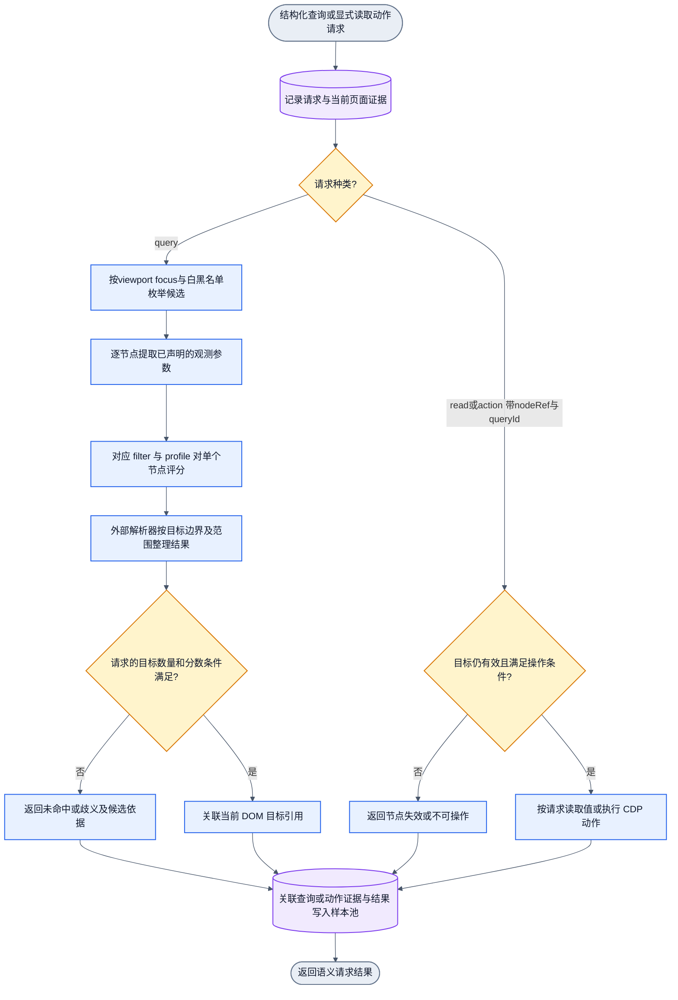
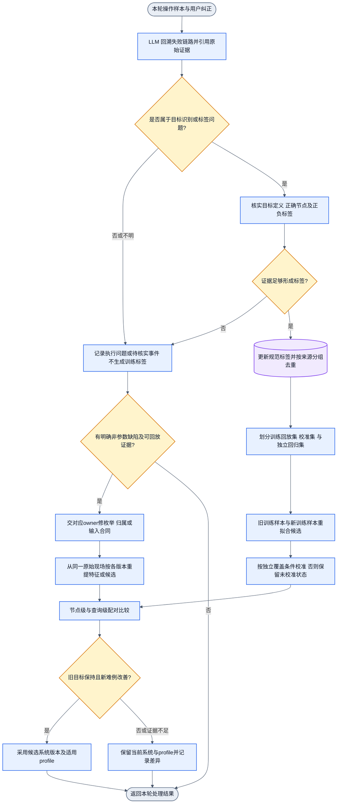

# 浏览器语义使用与纠错训练

状态：待用户审计的设计。未实现浏览器语义接口、filter 或训练器；未测效果。本稿承接多目标识别与双模式需求。首个实现实验仍可从微博完整普通卡片开始。

首期新增 [Focus与单标签合同](../docs/focus-and-labeling.md)：候选仅在viewport和当前focus内，deny优先allow，单任务单标签，批处理保序。原布尔filter是二分类特例；早期同时汇集多目标标记的描述不作为首期范围。

## 职责与合同

浏览器层有两个模式，共用原始页面样本、节点观测和目标定义。

语义接口采用固定分类与结构字段，合同见 [结构化语义分类与查询](semantic-query-contract.md)。下文中文例子仅解释用途，运行时传 target、within、cardinality 和 where，不传叙述性任务作为检索条件。非 LLM 调用方可直接查询。

- 使用模式：接收语义目标，外部程序选择候选，逐节点取参并调用对应 filter，解析具体节点，再由 CDP 读取或操作。
- 训练模式：捕获错误现场，核实原因和正确节点，生成或更正目标标签，用旧训练样本与新样本重拟合，独立回归后决定是否采用新 profile。

每次语义查询/操作尝试都进入操作样本池，含成功、失败、歧义和结果未知。训练监督机制回溯失败样本，选择性纳入训练，再做逐样本版本对比。广告、商业推广和荐读/社交推荐各有显式 target，识别后保留节点和标签，供后续操作选择；普通帖过滤只是其中一种用途。

filter 合同保持不变：一个节点的抽象参数 → `{ isTarget, confidence }`。confidence 表示属于目标的分数，未经独立校准不能称为正确概率。filter 不接收页面树、不遍历、不返回另一个节点，也不执行动作。

浏览器语义层接收例如 target=post.comment.entry、within=当前帖子引用、cardinality=one 的结构化查询，返回目标引用、目标类型和分数。读取值和执行动作使用独立接口。目标引用由调用程序关联，包括当前文档/框架中的元素定位信息；这些信息不参与训练。执行前检查目标仍对应当前页面；节点失效时重新解析，不把失效自动记成语义误判。

## 图一：使用模式

此图描述浏览器层职责，不是Handwired内部数值连线。查询、读取、动作是分别调用的接口，图中用请求种类分支表示，不要求查询后必做动作。每次调用有一个入口和结果出口，queryId与episodeId/step关联分步证据。

“发帖人是谁”先定位作者名称节点，再读取文字。“打开我的主页”先定位当前用户的个人入口，再执行导航。姓名和完整 URL 可以是读取结果，不必成为识别捷径。

## 共享观测与最小 filter 输入

整体与作者/正文/互动/媒体成分是共生关系；关联性直接进入参数。第一阶段使用可测关系，父子/兄弟历史语义分数留到第二阶段训练，见 [阶段边界](compositional-recognition.md)。外部项目参考与训练锚点见 [GitHub 调研](github-semantic-anchors.md)。

扩大可保存的观测，不把所有字段塞给每个 filter。每个目标单独声明采用哪些特征、如何连线、哪些权重可训练。下表为候选观测目录，尚未冻结编码；现有快照并未完整采集所有字段。

| 观测组 | 候选内容 | 边界 |
| --- | --- | --- |
| 类型与语义属性 | tag、role、input type、contenteditable、链接/按钮/表单属性 | 属性白名单，不输入全部 attributes |
| 尺寸与布局 | 宽高、宽高比、相对父级/视口位置和尺寸、对齐、间距 | 保存原始测量；不把固定屏幕坐标当身份 |
| 局部结构 | 父子和兄弟类型构成、透明包装、重复条目关系、局部分区 | 节点索引只关联样本；不输入根路径或全局深度 |
| 滚动与可见性 | overflow、实际滚动范围、有效滚动祖先、裁剪与视口交集 | “离开视口”和“不是目标”分开；操作可见性由浏览器层处理 |
| 交互状态 | 可编辑、可聚焦、disabled、expanded、controls、haspopup | 缺失保持未知；cursor 或标签不能证明实际可点击 |
| 固定 UI 标记 | 搜索、评论、展开等可见标签或无障碍标签；placeholder 的语义 | 与账号/标题分离；需逐目标声明，不能默认读取整段文本 |
| 内容形态 | 文字长度、段落/媒体分布、文字区域比例 | 不输入账号名和正文身份；正文文本可在定位后读取 |
| 局部关系 | 位于候选卡片头部/正文/互动区，邻近输入或按钮 | 关系抽取须公开规则；不得藏入另一个未声明的分类器 |

class/id、账号名、图片文件名、绝对路径和完整 URL 不进入模型。固定 UI 文案与链接的抽象类型是否进入某个 filter，按该目标的审计稿确定。图像广告标记不能假定有 DOM 文本；需要图像证据时另声明识别支路。

同一页面按目标分别标注。同一节点可同时属于“作者主页链接”和“页面跳转”；评论入口对完整卡片目标是负例，对评论入口目标是正例。未标定的节点是未知，不自动当成所有目标的负例。

| 目标 | 正例边界 | 需要优先覆盖的反例 |
| --- | --- | --- |
| 完整普通帖子 | 单条完整信息流卡片，排除已确认广告/推广/推荐 | 正文局部、包装、多卡容器、广告卡片 |
| 平台广告卡片 | 有平台广告证据的完整卡片 | 普通状态徽标、VIP 图标、未证实的荐读 |
| 商业推广卡片 | 有商业推广、促销或导流证据的完整卡片 | 普通商品讨论、非商业科普荐读 |
| 推荐来源卡片 | 有荐读或社交推荐来源证据的完整卡片 | 正文中的关注描述、作者资料粉丝数 |
| 作者名称/头像 | 分开定义名称节点和头像节点，关联所属帖子 | 正文提及的人名、评论作者、推荐用户 |
| 搜索输入 | 可输入查询的实际输入元素 | 发帖框、评论框、搜索按钮 |
| 我的个人入口 | 登录用户导航中的头像或个人主页入口 | 帖子作者头像、站点首页图标 |
| 帖子正文 | 所属卡片的正文区域 | 卡片整体、作者简介、评论正文、广告来源栏 |
| 评论入口 | 打开或聚焦该帖评论的可操作元素 | 点赞、转发、评论计数文字但不可操作的节点 |
| 展开正文入口 | 展开该帖被折叠正文的控件 | 更多菜单、展开评论、折叠按钮 |
| 页面跳转入口 | 会改变页面/路由的链接或控件 | 局部展开、点赞、只打开浮层的控件 |

“我的入口”可能需要当前用户上下文；“评论入口”需要所属帖子范围。先明确上下文来源，再声明特征。不能只靠一个通用几何分数就声称可以区分所有目标。页面跳转的实际行为也不能仅凭 href 存在证明。

## 图二：捕获、重拟合与回归模式

操作样本持续进入；按任务结束或一批样本到达触发 LLM 回溯失败和用户纠正。可信监督需要用户确认或有明确证据的 LLM 标定。下游失败先归因。训练不阻塞当前可用 profile；本图每轮无回边，采用的 profile 供下一轮使用。

捕获记录至少关联：语义目标、请求范围、当时 profile、预测分数、选中节点、用户指出的正确节点或“无目标”、原始 DOM、同步布局测量、截图和实际执行结果。没有正确节点也可以先保存现场。原始资料仅作本地标定证据；不把账号和正文复制进模型输入。

每次query生成queryId，read/action显式引用它，并与episodeId/step关联。查询不自动触发动作；两次调用分别取证，不能假定中间DOM不变。RawDomNodeEvidence只供标定，StudentNodeObservation按白名单输出，训练不接受原始节点对象。缺失观测与已观察不存在分开，按FeatureSchema声明的required失败或optional可用位处理。

失败原因必须区分：错误命中、漏识别、目标边界错误、歧义、节点失效、页面未加载完成，以及动作本身失败。候选枚举漏掉正确节点时，先修外部枚举器；不能用这次失败伪造一个 filter 负例。

## 操作监督与选择性入集

监督调度与入集逻辑属于通用训练框架；浏览器适配器负责取证、关联操作和检查动作后状态；LLM 负责基于证据回溯及提议标签，不直接覆盖当前 profile。

每次操作样本记录以下结构字段。原始页面证据按当时页面状态归档并引用，不能事后从已变化页面补成“当时现场”。同一页面状态可供多次操作引用，不要求每次重复保存相同资料。

| 字段 | 内容 |
| --- | --- |
| sampleId / episodeId / step | 本次操作与前后操作的关联 |
| queryId | 查询与后续显式读取/动作的关联，不意味着两次页面状态相同 |
| focusSpec / candidatePolicy / excluded | 关注范围、规则版本、viewport测量和排除引用/原因；排除不自动生成负标签 |
| query / action / expected | 结构化目标、动作类型与参数、预期可观测结果 |
| activeProfile / inputContract | 当时参数版本、输入定义；使用普通版本标识，不另建哈希包装 |
| candidates / selected | 候选引用及分数、实际选择；无候选时为空 |
| before / after | 原始 DOM、布局、截图等证据引用及实际捕获时间 |
| execution / outcome | 动作回执、结果 success / failure / unknown 与判定依据 |

expected 由任务或操作合同声明，例如展开正文后 expanded=true，或导航后目标页面条件满足。CDP 返回成功不能单独证明任务成功；无可检查结果时保留 unknown。截图和 DOM 若非同步捕获，保留时间差，不假定两者严格一致。

LLM 沿 episode 的操作顺序定位首次偏离，输出 target、failureOwner、errorType、evidenceRefs、labelProposals 与 disposition。failureOwner 至少区分 filter、candidate_enumerator、scope_resolver、executor、page 和 unknown。disposition 为 train、regression、investigate 或 ignore_duplicate；校准用途由数据划分另定。

选择规则：

1. 只有证据充分、可定位节点、目标定义明确且归因于 filter 的标签进入参数修复；同一事件可为错选节点给负标签、为正确节点给正标签。
2. 页面加载/执行失败、错误范围和候选遗漏转给相应 owner，不伪造成 filter 的训练错误。证据不足留在 investigate。
3. 去除同帖重复和同一错误链的重复反馈，保留有区别的布局、状态和难负例。ignore_duplicate 仅影响入集，不删除操作历史。
4. 成功记录保留，抽取经核实的代表样本作为旧能力回归依据；仅训练/评估失败样本无法衡量整体退化。系统自报 success 不自动赋予黄金标签。
5. 标签可以只覆盖部分 target；无法判断商业推广时，不因为已经确认 recommendation 就给 promotion=false。

首轮参数修复保持已审计的输入与 Handwired 连线，只更新声明的权重、校准参数或阈值，并在比较报告中标明更新项。若相同输入无法区分相反标签，记录信息缺口并返回特征/连线审计，不用增加训练轮数掩盖。LLM 提议的结构变化不混入纯参数更新。

## 版本配对比较与劣化判断

当前版本与候选版本在相同标签、相同分组和相同输入合同下逐样本运行。对单节点先比较预测和分数；对一次语义查询再比较是否选对目标及是否出现未命中/歧义。保存每例差异，不能只交总体均值。

| 当前版本 | 候选版本 | comparison |
| --- | --- | --- |
| 错 | 对 | fixed |
| 对 | 错 | regressed |
| 错 | 错 | unresolved |
| 对 | 对 | retained |
| 无法判定 | 任意，或反之 | unassessed |

报告关联 baseProfile、candidateProfile、sampleSet、target、sampleId、truth、beforePrediction、afterPrediction 与 comparison。每个 target 分别统计精确率/召回率；广告/推广分别统计误收与漏识别；同时报告样本数、源批次数、fixed 和 regressed 明细。分数升降本身不等于分类改善或劣化。

历史回放分两种，证据效力分开报告：

- 离线回放：使用归档测量复算单节点与目标查询，不在真实网站上重复点击。只有原始 HTML、缺少相应布局/状态时，该例不能冒充完整可回放样本。
- 浏览器行为回归：在适用的实际场景验证目标解析与动作后条件。离线预测通过不证明真实点击或导航成功。

训练回放结果、新错误修复结果、独立黄金集结果、新独立批次结果分别报告。已用于改特征、调参或反复选择版本的样本属于开发证据，不能继续宣称独立。若改了输入合同或取参器，需对两版本明确使用各自适用的数据/实现；不能把向量含义变化误报为权重修复效果。

采用规则首轮从简：预先列出的关键旧案例不得退化；相关独立目标指标满足事先约定的界限；已知错误有可复现改善；证据不足或出现未接受的退化则保留当前版本。具体数值界限待样本覆盖确定，不预设未经测量的准确率。训练 loss 更低或 fixed 数多于 regressed 数都不能单独作为采用依据。

## 黄金样本与重拟合

用户提出的“旧黄金样本 + 新样本”分成两个用途，均保留：

1. 旧训练回放集与新确认训练样本共同拟合，避免只修新错误却忘记旧目标。
2. 独立黄金回归集与新留出批次只作验收，不进入本次训练、特征选择或校准。
3. 校准使用另外的数据或预先声明的验证划分。数据不够时报告限制，不用训练集成绩代替独立效果。

同一帖子、页面状态派生节点和重复广告素材不能分到训练与独立验收两侧。用于定位和修复错误的新案例属于开发证据；在该案例上改对只证明修复了该案例，仍需新的独立批次验证泛化。黄金集长期影响设计后也需要新的留出批次。

重拟合采用当前标签的规范版本。已吸收错标签被更正时替换旧标签，不同时累计正反两条证据。每个目标分别报告精确率、召回率、边界误判和相关难负例；卡片目标另报广告/推广误收。浏览器层另验收目标引用与实际操作结果。

## 与贝叶斯更新的关系

首个闭环采用用户本轮提出的“旧训练样本 + 新训练样本”重拟合，机制清楚，先验证是否有效。可从当前权重热启动，但这本身不是贝叶斯更新。

若保留贝叶斯路径，应与重拟合明确二选一：

- 全量重拟合：基础先验 + 去重后的全部规范训练标签，各标签计算一次似然；旧后验均值可以作初始值，但不再作为包含同批旧样本的先验罚项。
- 顺序近似更新：当前后验近似作先验，只加入尚未吸收的新标签；旧样本用于回归，不重复叠加旧似然。标签更正按基础先验和规范标签重建候选。

不能既使用已吸收旧数据的强先验，又把相同旧数据当成新的独立证据反复加入。具体近似公式沿用 filter-wiring-audit.md；首轮不必同时实现两套训练机制。本过程称为反馈学习、回放重拟合或顺序更新，不属于自回归生成。

## 审计与实施边界

本稿确定浏览器层双模式和共享样本合同。旧的 10 输入数值图只适用于微博完整卡片，不能成为所有语义目标的统一网络。新增目标须分别画出输入与 Handwired 数值支路后再实现。

当前没有新目标的完整标签、训练参数向量或已测结果。下一步先审计共享观测、各目标边界及本稿两条链路，再补各 filter 数值连线。未越过用户要求的先审图边界。
