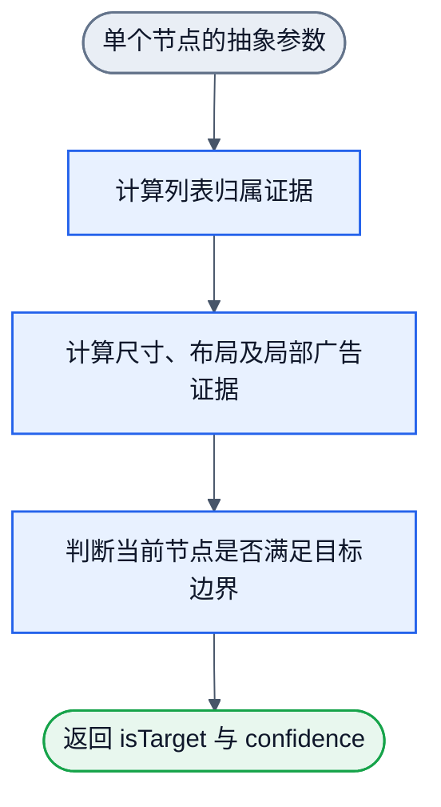

# DOM 卡片节点：基础输入与手写结构草案

状态：需求设计草案。已采集真实页面；未实现识别器，未训练模型。

最新范围已扩展为多目标页面语义识别与浏览器双模式，见 [浏览器语义使用与纠错训练](browser-semantic-modes.md)。本文件保留卡片取参研究；其中列表必要条件和卡片流程不应用于搜索框、作者、评论等其他 filter。新的共享观测目录以最新合同为准。

本轮实验范围已收敛：每个训练目标统一定义为 filter；首轮仅训练/评估微博信息流的完整非广告卡片 filter。具体输入输出、原始 DOM、正负例与样本量实验见 `weibo-filter/README.md`。本文件保留通用输入与已观察边界，不将其他网站纳入首轮训练。

## 已确认目标

- 识别社交媒体信息流中的完整非广告卡片。
- 先浏览和保存真实样本，再抽共性、设计节点内部流程，最后训练明确指定的参数。
- 位置、大小、逻辑父容器的列表关系、滚动信息均纳入基础输入。
- 不通过原始 class、id、节点名称、选择器、URL 或站点标识判断目标。标签类型和有明确语义的属性可以使用。
- 广告是负例，并尽早在前端过滤。保留误删普通帖和漏过广告的证据。

## 输入分层

浏览器提供原始测量；手写结构从测量中计算关系与特征；训练只更新已声明参数。`是否列表`不是浏览器直接提供的布尔属性。

程序负责页面遍历和选择单个节点。节点取参器以该节点为起点读取必要上下文，并生成本表的派生参数。filter 只接收一个节点的抽象参数，返回 `isTarget` 和目标分数 `confidence`；不接收页面树、节点数组或 DOM 对象，不搜索或替换输入节点。

| 组 | 保存的原始输入 | 提供给判断节点的主要派生量 |
| --- | --- | --- |
| 类型与布局属性 | `tagName`、`role`、`display`、`position`、`flexDirection`、网格布局信息 | 稳定类别编码；缺失 role 保持缺失，不能据此排除 |
| 位置 | 节点、父级、候选列表及视口的坐标；采样时的滚动偏移 | 相对视口位置、相对列表位置、局部对齐程度；不按固定屏幕坐标识别站点 |
| 尺寸 | 边界框宽高、client 宽高、视口宽高 | 宽高比、相对视口宽高、相对列表宽度、相对同组条目尺寸、面积比例 |
| 树关系 | 父子索引、各级子节点数、标签构成、候选条目到列表的层数 | 透明包装关系、重复条目组、子树结构相似度；索引只用于关联，不作为可学习数值 |
| 列表布局 | 同组节点边界框、结构概要 | 同组条目数、宽度相似度、横纵对齐、行列关系、间距一致性 |
| 滚动 | 当前节点及祖先的 `overflowX/Y`、`scrollWidth/Height`、`clientWidth/Height`、`scrollLeft/Top`；`document.scrollingElement` | 当前节点实际横纵溢出、用户滚动能力、有效滚动祖先及距离、滚动进度；页面滚动单独处理 |
| 卡片内部 | 后代数量、文字长度、图片/视频/链接/按钮等类型与位置 | 内容分区、媒体占比、内容完整性；第一轮不输入正文文字、账号名或标题文字 |

原始尺寸保留用于复算。预测优先使用相对量，但不提前删除绝对宽高：最小内容尺寸也需验证。高度不只除以整个列表高度，因为无限加载会改变该分母。

可用属性按含义列举，不允许把所有 attributes 直接送入网络。class/id、`data-testid`、任意 `data-*` 名称或取值、URL、`aria-label` 中的账号/标题、图片文件名等均不能成为名称旁路。

原始 DOM/文本/class 属于标定视图，可帮助 LLM 找正确边界。训练视图独立限制字段；当前尚未实现该隔离，保存的原始 JSON 不能直接作为训练向量。

## 列表关系的含义

本任务限定为信息流列表，因此“不属于逻辑列表的节点不输出为正文卡片”。这不是“直接父节点必须有多个孩子”。

内置浏览器的实际链路证据：

- 微博：`article` 卡片 → 只有一个子节点的 `div` → 只有一个子节点的 `div` → 承载多个条目的 `div`。直接父级判断会漏掉正常卡片。
- 小红书：`section` 卡片 → 承载多个条目的 `div`。直接父级可以承担逻辑列表角色。

因此，手写结构要明确候选条目、透明包装层和逻辑列表之间的映射，随后在逻辑条目之间比较结构与布局。包装层数量不是站点名称特征，也不预先写死成微博两层。

列表是必要条件，不能单独证明正文。导航列表、推荐用户列表、热搜列表均是反例，须由尺寸、内容分区及完整性判断继续区分。

## 滚动关系的含义

`overflow: scroll/auto` 和“实际可以滚动”需要分开记录。元素的滚动内容与 client 尺寸相等时，可以没有实际滚动范围。列表自身不滚动，也可以由整个页面承载滚动。

本轮实测：

- 微博逻辑列表 `overflow-y: visible`，而页面的 document scroller 有实际纵向滚动范围。
- 小红书逻辑列表也是 `overflow-y: visible`。某上层元素虽然声明 `overflow-y: scroll`，但 `scrollHeight` 与 `clientHeight` 相等；实际滚动由 document scroller 承载。

不能以“父容器自己不可滚动”直接排除信息流。样本同时保存卡片、逻辑列表和有效滚动祖先。原始采样只需读取状态，不通过试滚每一个节点来制造输入。

## 节点内部流程草案

节点取参器在 filter 外部准备结构、布局和滚动参数。filter 使用局部广告证据尽早排除当前节点，不等待完整卡片评分结束。排除结果进入判定记录，不从评估样本中消失。该图只表示 filter 内部判断，不包含页面遍历或节点搜索；目前未实现或渲染验收。

固定部分包括节点取参字段、关系定义、filter 阶段顺序、各阶段输出含义及标签边界。可训练部分可以包括列表相似度证据组合、尺寸与布局评分、卡片完整性证据权重。filter 只判断传入参数代表的当前节点，不处理重复输出或在包装层间迁移。具体采用哪些参数，需用正反样本验证后确定。

硬过滤后的结果不能反向补救误删。分阶段训练/校准与全链验收都要保留原始负例和被拒绝正例；不假设梯度可以直接穿过所有硬判定。

## 已保存的样本与广告证据

目录：`dom-samples/2026-10-16/`。

- `iab-weibo-signed-in.json` / `.jpg`：用户登录后的微博，1,441 个保留节点，10 个 article 检查候选。候选数量不是已标定正例数量。
- `iab-xiaohongshu-public.json` / `.jpg`：小红书公共发现页，690 个保留节点，30 个 section 检查候选。滚动前后 DOM 可能回收或加载节点。
- `iab-parent-chains.json`：来自未登录信息流的父级层次、尺寸和兄弟几何关系；不含 class/id 名字。
- `iab-scroll-observations.json`：卡片及祖先的尺寸、溢出、滚动范围与页面滚动状态。
- `iab-weibo-ad-card.jpg`：微博一张卡片头部可见“广告”标识的截图。
- `iab-ad-annotation.json`：该广告与原始 DOM 的关联及确认边界。

广告负例在 `iab-weibo-signed-in.json` 中对应节点 492。截图可见“广告”标识；DOM 节点 517/518 对应约 26.125 × 14 CSS 像素的包装及图片，未提供广告文字。仅扫 text/aria 文本会漏掉这个标识。

这证明标定时需要保留截图和局部几何。它尚未证明“图片尺寸 + 所在位置”可以可靠排除所有广告。也不能把该图片文件名或站点 class 当作训练捷径。

同批带“荐读”的购物促销内容已由用户上传截图并确认为广告负例，见 `weibo-filter/user-confirmed-promotion.png` 和 `weibo-filter/seed-labels.json` 节点 1258。广告范围包含这类促销和购物导流，不仅限于平台付费广告标识。“荐读”本身仍不能直接等同于广告。

## 当前验收与下一步

已完成：基础输入类别的需求收敛；内置浏览器两站原始样本保存；父级与滚动的具体反例；一个带平台广告标识的负例确认。

未完成：逐卡片与列表标定、正反例覆盖、基础输入的实际判别能力、名称字段隔离、特征消融、训练和跨站泛化评估。小红书当前仍是公共发现页，未要求用户为此登录。

下一步先对保存样本标出逻辑列表、条目边界、正文/广告及干扰模块，再用这些标签验证列表判断和尺寸判断。基础输入类别保留；具体编码、评分公式与阈值保持草案，不能据一页样本冻结。
