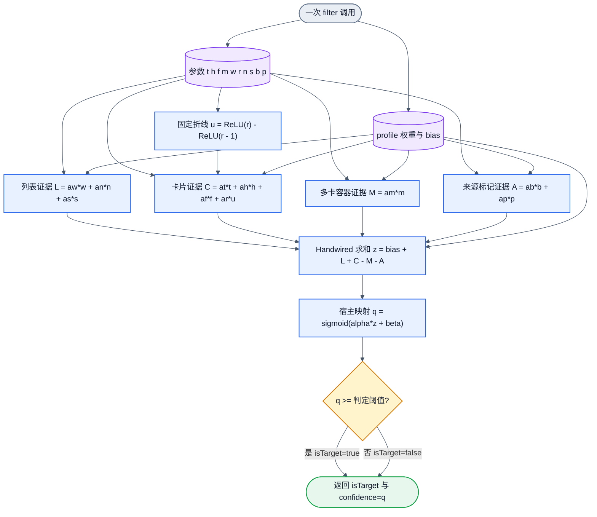
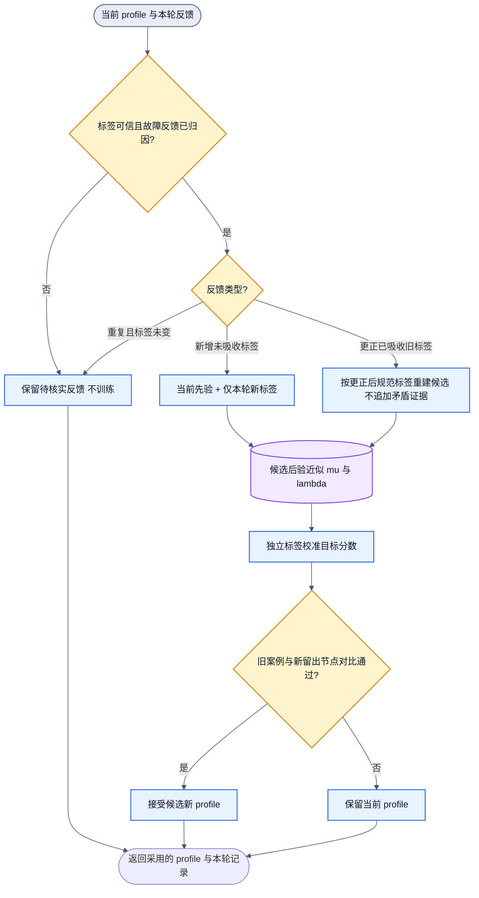

# Filter 连线审计草案

状态：待用户审计。未写产品代码、未训练、未测准确率或运行耗时。

最新上层合同见 [浏览器语义使用与纠错训练](browser-semantic-modes.md)。本文件图一的 10 输入仅是微博完整卡片 filter 的草案，不是搜索、作者、评论等目标的共享网络。图二保留为顺序贝叶斯近似方案；首轮双模式闭环采用旧训练样本与新样本重拟合，独立黄金回归集只验收。两种训练路径不叠加计算旧证据。

## 边界与样本

外部程序选择一个 DOM 节点；节点取参器生成抽象参数；filter 只判断该元素，返回 isTarget 和 confidence。通用训练框架负责权重、反馈更新和校准；微博取参属于适配器，不进入通用框架。

原始样本保留。此卡片 filter 不使用根到节点的绝对路径、全局深度、固定屏幕坐标、class/id、账号名、正文、URL、图片文件名。相对布局位置仍是通用候选观测；其他目标采用哪些字段需分别审计。

| 类别 | 当前可见依据 | 标签 |
| --- | --- | --- |
| 普通完整帖子 | 作者头部、正文、互动区；无已确认推广来源标记 | 正例候选 |
| 平台广告 | 头部次行的“广告”图片 | 已确认负例 |
| 购物促销 | 用户确认的红包、会员促销、购物导流，带“荐读” | 用户确认负例 |
| 科普视频荐读 | 正文是科普，仍有“荐读”来源标记 | 用户确认负例 |
| 社交推荐 | 作者头部之前有“某某和某某关注了”的独立来源栏 | 用户确认负例 |

当前 DOM 中已观察到社交推荐的前置来源栏约 33 CSS 像素高；作者资料区的“1811.5万人关注了TA”处于另一位置。不能用全文关键词匹配代替区域判断。尺寸是样本测量，不是固定阈值。

## 拟议最小首轮输入

先提议 10 个量；每个量都对应当前节点，不改变被判断对象。

| 符号 | 原语含义 | 用途 |
| --- | --- | --- |
| t | 当前节点是否 article | 微博的标签类型证据，不承诺跨站 |
| h | 局部 header 是否存在 | 区分缺头部节点 |
| f | 直接 footer 是否存在 | 区分完整卡片与只含正文的节点 |
| m | 严格后代 article 数量 | 多卡容器证据；只计标签，不递归调用 filter |
| w | 节点宽度 / 局部重复条目容器宽度 | 局部宽度关系 |
| r | 节点高度 / 宽度 | 尺寸形态，保留短帖反例 |
| n | 同组堆叠、近似等宽兄弟的比例 | 列表关系证据 |
| s | 有效滚动祖先的可滚动范围 / 内容高度 | 实际滚动上下文 |
| b | header 次行、时间链接之前是否有可见标识块 | 来源槽位证据，尚不等于广告 |
| p | 作者 header 前是否有可见独立来源横条 | 社交推荐槽位证据 |

取参器根据单子包装、重复条目和局部几何读取祖先，不写死微博两层或全局深度。它不得把判定对象迁移为祖先。局部相似度容差需列明并验证，不能藏成一个已决定答案的 isList。

bodyHeightShare 和右上角关闭控件是独立规划提出的额外候选，暂不进入主图。先验证已有分区、尺寸和来源槽位证据；只有具体误判表明缺少信息时再增加。尚未实测证明额外候选无用。

## 图一：单元素 filter 实际连线

图外取参；图内固定四条有明确含义的证据支路。没有任意隐藏层。10 个系数和 bias 均为可训练单元。

固定部分：输入含义、局部测量方法、拓扑、r 的折线变换、各支路含义。可训练部分：10 个系数与 bias。校准参数 alpha、beta 和判定阈值单独记录；未校准时 alpha=1、beta=0。

支路名表达设计意图，不保证训练后效果。各权重及其符号必须报告和审计。少样本首轮要与同结构的手写参数基线比较。

### 如何用 Handwired 连线

- 输入和可训练权重都放入 source cells。每条 a*x 通过 circuit.multiply 连接；不能误写成编译时固定 affine 系数。
- 非负输入的乘法可由 ReGLU 实现。分支和 z 使用 roundAffine 累加，bias 也是一条可训练单元线。
- u 使用两个 ReGLU 与一次减法；这是固定输入变换，不在可训练支路后做硬截断。
- sigmoid、交叉熵与分数校准在宿主数学层，不声称 Handwired 原生 affine/ReGLU 已实现指数。
- 布尔阈值位于损失路径之外。训练从 z 的交叉熵注入梯度 sigmoid(z)-y，再由 backpropagateReference 更新权重。

真实正例误判为 z=-3 时，损失对 z 的导数约为 -0.953，可以推动纠错。不能先把某条可训练支路截成 0 再相乘，否则可能丢失纠错梯度。相同参数若对应相反标签，训练轮数无法补足信息。

来源支路前置形成负向证据，不宣称有计算短路。Handwired 单程序会计算所有保留算子。硬拒绝和物理短路若需要，须另画边界及其不能学习纠错的部分。

## 标记识别的审计边界

b、p 目前是槽位几何，不是隐藏的 isAd 分类结果。“原创”“置顶”等普通状态若位于相同槽位，纯几何可能误判；无来源标记的推广也可能无法区分。

可选方案是在明确的 UI 槽位中识别固定词“广告”“荐读”和推荐来源短语，不读取账号名或正文。这与 class/id 名字查表不同。图片“广告”没有 DOM 文字，仍需另定局部图像标记识别方法。该可选机制须用户审计后确定，不能藏在输入里。

## 图二：训练框架的一轮反馈更新

每轮是无环图；接受的后验在下一轮成为先验。预测不是真值，下游失败先归因再产生监督。

拟议机制为顺序对角高斯/拉普拉斯近似，不是精确贝叶斯后验：

1. profile 保存权重均值 mu 与精度 lambda。只有旧权重继续训练时，称为增量训练。
2. 新样本目标函数：BCE(new labels) + 0.5 * sum(lambda * (theta-mu)^2)。旧信息由先验近似承载，不再重复加旧似然。
3. 对固定线性 z，可用新样本的 logistic 曲率更新对角精度；对角近似会丢失参数相关性，不能声称完整保留历史信息。
4. 更正已吸收标签时，按保存的规范标签从基础先验重建该候选，不将旧错标签和新正确标签作为独立证据累计。
5. 去重关联反馈事件和源样本，也识别同帖重复采集；不能仅因 snapshotId 不同就重复计数。
6. 独立校准只改变分数解释。confidence 未验证校准前仍是目标分数，也不等于完整贝叶斯预测不确定性。

当前没有训练 profile，用户上传截图属于新标定。上述跨轮过程称为顺序反馈更新或增量贝叶斯学习，无需引入自回归生成模型。

## 首轮验证与停止点

先用少量覆盖普通帖、广告、荐读、社交推荐和边界节点的样本训练，按具体误判补反例。在新帖子/独立批次上分别报告目标召回、推广误收和边界误判，不用大量背景负例抬高总体准确率。尚未测出最少样本量或实际效果。

源快照目前有 15 个初始标注（3 正例、12 负例），另有推广截图监督；初始标签仍待复核。所有原始元素已存档，但未标定和边界等价节点不强行变成负例。

用户审计项：图一的连线与最小输入；来源槽位采用纯几何还是固定 UI 标记识别；图二的反馈、标签更正及后验校准职责。审计前不进入产品实现。两图文本拓扑已检查为单入口单出口且无回边；尚未另行验收视觉渲染。
