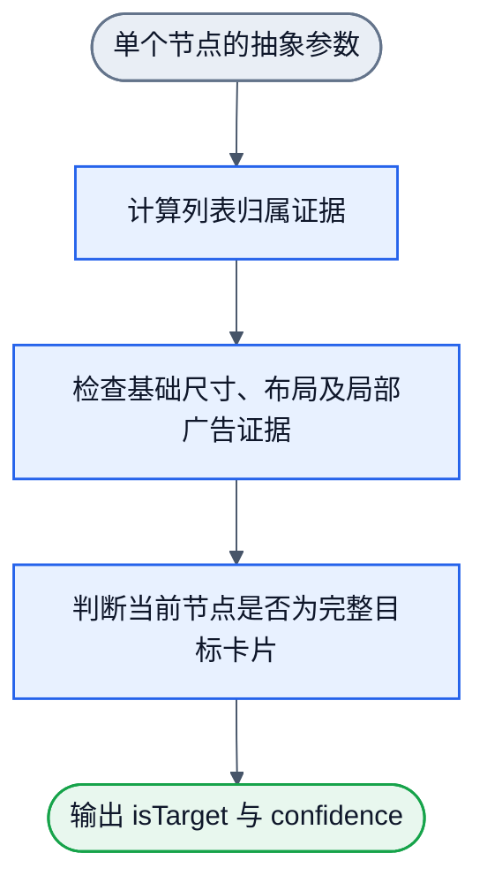

# 微博 filter：首个实验合同

状态：需求与数据设计。未实现 filter，未训练，未测效果。

最新框架范围见 [浏览器语义使用与纠错训练](../browser-semantic-modes.md)：同一页面可支持多个目标，浏览器分使用模式和纠错训练模式。本文件只约束首个微博完整卡片实验；“只训练一个 filter”是首个实验范围，不是框架的能力限制。

当前实际数值连线与通用反馈更新审计入口为 ../filter-wiring-audit.md。本文件中的早期流程图只说明职责，不作为最终数值连线。先按该审计稿确认结构与标记取参方式，再实施。

## 框架约束与本轮范围

本项目每个训练目标统一定义为 filter。每个 filter 都有独立声明的输入、输出、手写内部结构、可训练参数及验收。内部的列表、尺寸、广告和完整性判断可以组合；第一轮只训练和评估一个完整业务 filter，不扩展成多个独立任务。

本轮 filter 为 `weibo-organic-feed-card`，只覆盖微博信息流。小红书及其他网站已有观察保留为研究材料，不进入本轮训练或测试。不证明跨站泛化，也不开展 profile 自动选择或通用框架实现。

## 输入与输出

职责分为三层：调用程序选择一个 DOM 节点；节点取参器读取该节点及必要的父级、兄弟、布局和滚动信息，生成固定含义的参数；filter 只对这些参数进行单元素判断。页面遍历、候选枚举、节点集合管理和页面处理均不属于 filter。

filter 输入：一个节点的抽象参数。DOM 对象、HTML、页面树和节点数组均不直接交给 filter。参数定义沿用 `../dom-input-design.md`；profile 是加载时选择的权重/配置，不是通过站点名称预测的输入。

filter 输出草案：`{ isTarget: boolean, confidence: number }`。本轮目标为完整非广告微博卡片。`confidence` 范围为 0 到 1，统一表示“属于目标”的分数；`isTarget` 由该分数及已声明的判定规则得到。未经校准的分数不能解释成正确概率。若以后要表达“本次布尔判断本身的置信度”，须单独定义，不能混用两种含义。

filter 不搜索替代节点，不向父子节点迁移，不做节点之间的输出去重。规范边界由标签定义；对输入节点本身判断它是否满足该边界。

原始页面、标定数据和模型输入是三层不同的数据：

1. 原始存档保留渲染 DOM 与截图，供 LLM 标定与追溯。
2. 标定数据将候选节点关联到目标布尔标签、负例类型和证据；保留待确认项。初始标注文件中的 `keep` 对应输出中的 `isTarget`，该字段本身不赋予 filter 任何页面操作职责。
3. 训练输入只使用已允许的类型、属性、位置、尺寸、结构和滚动特征。class/id、账号名、标题、正文、URL、图片文件名、节点索引和标注理由不作为预测数值或文本。

基础输入类别及父级/滚动含义沿用 `../dom-input-design.md`，不在此重复定义。

## 原始 DOM 与样本

`snapshot-001/dom.html` 是当次浏览器渲染文档的 `document.documentElement.outerHTML`。它补齐了前期只有结构化测量、没有原始 DOM 的缺口。它包含页面原有脚本和状态，仅作本地原始存档；本轮没有打开执行它。

`snapshot-001/nodes.json` 是同一同步 DOM 读取中的元素测量。它保留 body 轻 DOM 中除 script/style/noscript/template 以外的元素，包含零尺寸节点，并记录树关系、类型、标定用文本/class、坐标、尺寸、CSS 布局与滚动值。

节点索引按上述过滤后的 body 后代文档顺序建立，对应原始 DOM 的遍历结果。索引只供样本定位，不输入模型。`snapshot-001/viewport.jpg` 是随后捕获的视口截图，页面可能在两次捕获间继续加载。

这些文件不包含浏览器资源包、iframe 子文档或 shadow DOM，也不保证离线恢复页面。训练所需布局应读取保存的测量，不能仅解析原始 HTML 就假设已恢复布局。

当前原始快照含 2,000 个元素记录和 10 个 article 检查候选。这是单页状态的数量，不是 2,000 个独立样本。

## 正负例与边界

正例：信息流中单条完整非广告内容卡片，以统一的规范 DOM 边界标注。文字、图片、视频、短帖、长帖应分别覆盖。

负例优先包含容易混淆的对象：

- 带平台广告标识的完整卡片。
- 用户确认的商业促销、返利及购物导流卡片；无需具有平台付费广告标识。
- 用户确认的“荐读”推广，以及带“某某关注了”独立来源栏的社交推荐；正文为正常科普/新闻也属于本轮负例。
- 普通帖子的正文、媒体区域、头部、互动栏等局部节点。
- 包含多条帖子的分组和整个列表。
- 推荐用户、热搜等看起来也是列表的模块。
- 与卡片接近大小的其他模块。

导航、搜索框等明显负例可以保留少量，不能让它们主导训练或评分。单层包装和完整卡片可能等价，边界未定前保持待确认，不能自动把所有祖先或所有子节点都当成负例。

`seed-labels.json` 当前提出 15 个标注：3 正例、12 负例。其中 1 个广告由截图中的平台标识确认，1 个商业推广由用户上传截图并明确确认为广告（`user-confirmed-promotion.png`，节点 1258）。其余仍是初始 LLM 标注，不能当成已独立复核的金标准。产品评测和等价包装边界待确认；不能因为提到商品或存在“荐读”就一律判广告。

同一 DOM 状态产生的正例、广告、局部节点和扰动样本属于同一组，不能拆入训练和测试两侧。`node-observations.json` 保存各标注节点的结构观测，供节点取参器设计参考；其树结构不是 filter 的输入合同，尚未生成最终参数向量。

`node-observations.json` 是早先 14 个标注的观测导出，新确认节点 1258 的原始结构已在 `snapshot-001/nodes.json` 中；待连线图通过用户审计后再统一生成训练参数。当前没有已训练模型，这次确认属于新增监督标签，不是已证实的模型误判。

## 手写内部结构

这是设计草案，未实现或渲染验收。广告证据能关联到局部条目时尽早拒绝。列表本身不滚动不构成拒绝理由；需保留实际滚动祖先。

列表、包装层与滚动上下文由节点取参器计算为参数，filter 计算这些证据如何影响当前节点的目标判断。规范边界先由样本设计清楚；filter 不承担边界搜索。再声明允许训练的评分权重/容差；硬门槛的校准方式单独说明，不假设梯度能穿过全部决策。所有前置拒绝都计入节点测试，不能先删掉广告再报告分类成绩。

## 如何回答需要多少样本

建议训练曲线档位为 10、25、50、100 条去重后的正卡片。每档同步报告普通负例、边界难例、广告负例数量和独立采集批次数。这个档位是实验预算，不代表足够数量。

负例按失败类型补充，不能仅随机采大量小节点。广告必须有多个独立实例，才能讨论广告识别效果。递增训练子集保持嵌套，以区分样本增长的影响。

先划分独立采集批次/源页面，再分配训练、验证、测试。同一帖子、同一页面派生节点和重复广告素材归入同一组。页面换了一次滚动位置不自动构成独立样本。只采一页时不产生可信的泛化分数。

阈值和参数在训练/验证数据上选择。测试数据不参与补标签、挑特征和反复调参；需用测试发现的问题开发时，另安排新的独立测试批次。

对照为同样输入约束下、未训练或手动指定参数的同结构 filter。第一轮不扩展模型家族比较；先判断训练相对手写起点是否带来可复现收益。

## 实际效果验收

在来自独立微博页面的已标注节点上，运行真实入口“单个节点 → 节点取参器 → filter”。每次调用只判断该节点：

- 目标节点精确率、召回率，以及节点误判数量。
- 广告卡片进入结果的数量与比例；广告样本数同时报告。
- 正文局部、包装层、多卡片容器、推荐列表的误收。
- 前置过滤误删普通帖的数量；不得从统计分母中消失。
- 对当前节点边界是否判断正确，以及单次取参、单次 filter 判断的耗时。
- 目标分数的分布；只有经过独立数据校准后，才评估概率置信度。

所有指标报告分子、分母和源页面/批次数。原始页面只负责提供样本与复现上下文，不直接作为 filter 输入。一个广告上的正确拒绝只算一个样本，不表示通用广告过滤成功。训练 loss 下降和初始样本拟合不等于实际效果。

## 当前交付与下一动作

已完成：单节点参数输入、布尔与目标分数输出的 filter 合同草案；程序/取参器/filter 职责划分；单站实验范围；原始 DOM 存档；一组正负例初始标注及结构观测；样本量与节点评估设计。

未完成：标注复核、独立页面/广告样本覆盖、最终输入编码、filter 实现、训练和效果报告。用户现已要求开始搭建框架，并随后明确要求先画实际连线图供审计；因此当前先交付连线与反馈更新设计，产品实现和训练尚未开始。

下一步先确认正负边界并扩充独立微博样本，再进入已设计结构的实现和训练。不能在训练开始前宣称最少样本量或预测成绩。
