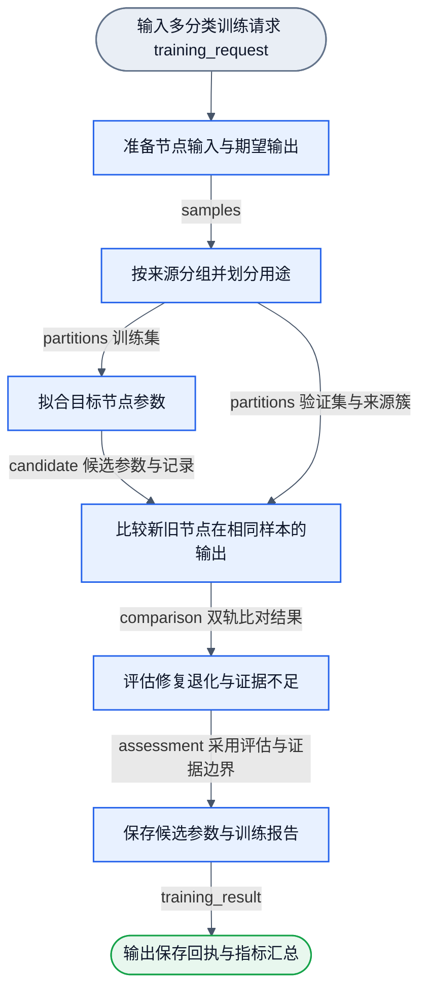

# 项目工作流清单与拓扑真源 (workflows/)

本目录为 NNAnything 项目所有 DAG 图定义（`*.graph.json`）与持久化配置（`*.workflow.json`）的唯一物理真源目录。
遵循单源单汇（SESE）DAG 原则，每个工作流保持单一入口与单一出口。

## 1. 流程清单与状态

| 工作流图文件 | 对应配置文件 | 拓扑规格 | 状态 | 职责与交付范围 |
| :--- | :--- | :--- | :--- | :--- |
| `recursive-goal.graph.json` | `recursive-goal.workflow.json` | 3 节点 2 边 (3N2E SESE) | `0.1.0` 已实现并通过行为验收 | 通用递归目标3阶段，算法见docs/recursive-goal-design.md；独立模块/error/执行错误返回见docs/recursive-goal-module.md。`goal.recursive.bind/run/report` 的 `NodeDefinition` 唯一 owner 为 `lib/workflow/recursive-goal/module.ts`；预期 Outcome 沿图返回，infra fault 由模块入口收口。公开入口、cwd 与纯计算 consumer、预算/恢复及显式权限交集均有运行证据；Review 与 main 回执见 note.md |
| `cli-file-property.graph.json` | `cli-file-property.workflow.json` | 6 节点 5 边 (6N5E SESE) | `0.3.0.0000` 已实现 | 0.3.0保持绑定→同一策略选择→条件与固定执行→实际属性/副作用观测→满足度评价→统一结果；10 head、30 wire、10×30矩阵已运行，新增path.resolve/path.relative/path.parts/entry.inspect |
| `cli-filesystem-training.graph.json` | `cli-filesystem-training.workflow.json` | 8 节点 8 边 (8N8E SESE) | `0.3.0.0000` 已实现 | 0.3.0保持分区→prepare/独立验证支路→fit→save→execute合流→verify→report；10×30已训练并在训练图真实执行262条，旧6×14按名迁移，当前候选35bd5ad9保持uncalibrated/not_applied |
| `project-design.graph.json` | 当前治理标准，无运行配置 | 7 节点 6 边 (7N6E SESE) | `0.2.0-design` | 每个语义及训练设计的四元素闭合、训练反推、固定调用、图纸、独立验收与最小必要性准入；操作方法归nnanything-design Skill，不是自动审核器 |
| `model-evolution.graph.json` | 设计态，无运行配置 | 10 节点 10 边 (10N10E SESE) | `0.2.0-design` | 单元升级：必需自动采样、隔离训练/回载、独立配对评价与回归、条件自动采用，回归/冲突保留并移交裁决；唯一合同docs/model-evolution.md |
| `model-conflict-design.graph.json` | 设计态，无运行配置 | 5 节点 4 边 (5N4E SESE) | `0.2.0-design` | 大模型对回归/冲突定位owner并裁决保留、拒绝、补证或修复；必要时修图并输出下一轮方案，不直接改在用权重 |
| `cli-filesystem-curriculum.graph.json` | 设计态，无运行配置 | 7 节点 6 边 (7N6E SESE) | `0.2.0-design` | CWD/pwd→cd→列举→补全目录/路径属性单元→文件属性单元；每项沿统一file.property图和独立训练合同，批次1的路径与inspect单元已由现有共享图实现，其余新增单元尚未实现 |
| `cli-path-training.graph.json` | `cli-path-training.workflow.json` | 4 节点 3 边 (4N3E SESE) | `0.1.0` 已实现 | 路径动作样本准备、真实Handwired拟合、自主完整路径评估与create-new候选/报告保存 |
| `cli-path-resolve.graph.json` | `cli-path-resolve.workflow.json` | 1 节点 0 边 (1N0E SESE) | `0.1.0` 已实现 | 显式profile绑定的词法路径函数，执行与评估共用相同node/rollout合同 |
| `cli-foundation.graph.json` | `cli-foundation.workflow.json` | 1 节点 0 边 (1N0E SESE) | `0.1.0` 已实现 | CLI 独立基础观测：显式 cwd、pwd、纯路径解释及 stat/lstat 属性；不训练、不搜索 |
| `dom-candidates.graph.json` | `dom-candidates.workflow.json` | 7 节点 6 边 (7N6E SESE) | `0.1.0` 已实现 | L1 能动候选切片：读取页面观测并经视口、focus、黑白名单与拆分复检输出有序候选槽位与排除映射 |
| `dom-rule-sampling.graph.json` | `dom-rule-sampling.workflow.json` | 3 节点 2 边 (3N2E SESE) | `0.1.0` 已实现 | 基础规则采样流：显式 semantic rules 确定性分类 DOM 记录、下游按任务映射正负监督并持久化至本地 JSONL |
| `dom-basic-kinds.graph.json` | `dom-basic-kinds.workflow.json` | 1 节点 0 边 (1N0E SESE) | `0.1.0` 已实现 | 第一层 DOM 基础种类判断流：接收保序候选槽位与可选补充观测，经两阶段（大类 -> 细类）区间计算输出基础种类槽位与审计证据 |
| `dom-recognition.graph.json` | 待按需配置 | 10 节点 10 边 (10N10E SESE) | `0.1.0-design` 设计态 | L2 完整卡片语义识别流：候选展开后经白名单特征提取、单标签语义分类并组装回原槽位 |
| `node-training.graph.json` | `node-training.workflow.json` | 6 节点 6 边 (6N6E SESE) | `0.2.0` 已实现；算子与绑定 `0.1.0` | 第一层基础种类离线训练流：复核样本、来源分区、Handwired 拟合、新旧比较、评估与安全保存；未校准候选不自动采用 |
| `operation-episode.graph.json` | 待按需配置 | 7 节点 6 边 (7N6E SESE) | `0.1.0-design` 设计态 | L3 操作闭环设计示例：观测、目标识别、策略决策、条件执行、新观测验证与统一收束 |

> [!NOTE]
> `dom-candidates.graph.json` (7N6E SESE)、`dom-rule-sampling.graph.json` (3N2E SESE)、`dom-basic-kinds.graph.json` (1N0E SESE) 与 `node-training.graph.json` (6N6E SESE) 均已升级为已实现版本，经 `dagpipe graph validate` 与 `inspect` 验证通过。当前 CLI 推理图 `cli-file-property.graph.json` 与训练图 `cli-filesystem-training.graph.json` 也通过同一静态校验；旧 `cli-command-step` 与旧 cli-goal 图已退役。
> 运行时可通过 `compileWorkflow` 配合 `nnanything/browser`、`nnanything/training` 与 `nnanything/cli-goal` 导出的算子节点执行。当前第一层基础种类判断、离线训练框架及 typed `file.property` CLI 推理/训练路径已闭环，第二层业务卡片语义（`dom-recognition.graph.json`）仍保持后续设计态。
> `recursive-goal.graph.json` 与配置均为 `0.1.0`，三个算子由 `nnanything/recursive-goal` 的公开运行时提供。公开递归回归与两个consumer通过；完整验收和交付回执见模块合同及note.md，静态图校验不替代这些运行证据。

训练图、节点端口、内部 wire、数据范围、真实试验证据及验收统一见 [训练 workflow 设计](../docs/training-workflow.md)。公开离线 consumer 见 [playground/training/README.md](../playground/training/README.md)。

## 2. 基础规则采样流设计 (dom-rule-sampling)

### 2.1 业务流程图（遵循 flow-presentation 规范）

### 2.2 图与配置一一对应关系

持久配置 `dom-rule-sampling.workflow.json`（v1 格式）与 `dom-rule-sampling.graph.json` 严格一一对应：
1. `graphRef`: 对本地图文件显式相对路径 `"./dom-rule-sampling.graph.json"`；
2. `configs`: 提供局部配置对象（`cardMatchRule`、`cardSampleSpec`、`localSaveSpec`），配置采用合成语义规则与任务监督映射（如 `post.card`、`post.body` 等合成类别，非私有生产规则）；
3. `bindings`: 键名必须与图文件中的中文节点 ID 完全一致：
   - `"按显式规则匹配DOM记录"` 绑定 `cardMatchRule`
   - `"组装单任务训练样本"` 绑定 `cardSampleSpec`
   - `"保存样本到本地目录"` 绑定 `localSaveSpec`

三节点完整 I/O、三值逻辑真值表、白名单清洗、副作用、防越界写入及验收要求唯一维护于 [lib/nodes/README.md](../lib/nodes/README.md)。
公开消费端用法与运行方式见 [playground/sampling/README.md](../playground/sampling/README.md)。

## 3. 第一层 DOM 基础种类流设计 (dom-basic-kinds)

### 3.1 业务流程图（遵循 flow-presentation 与 SESE 规范）

### 3.2 图与配置一一对应关系

持久配置 `dom-basic-kinds.workflow.json`（v1 格式）与 `dom-basic-kinds.graph.json` 严格一一对应：
1. `graphRef`: 对本地图文件显式相对路径 `"./dom-basic-kinds.graph.json"`；
2. `configs`: 提供局部配置对象 `basicKinds`（`{ "taskId": "dom.basic-kinds.v1", "minScore": 0.6, "minMargin": 0.15 }`）；
3. `bindings`: 键名必须与图文件中的节点 ID 完全一致：
   - `"判断DOM基础种类"` 绑定 `basicKinds`。

本工作流规格为 1 节点 0 边单入口单出口（1N0E SESE），已完成 SESE 拓扑验证。
输入接收 `candidate_slots`（可选携带 `itemObservations` 补充观测），经两阶段（大类 -> 细类）确定性计算后输出 `basic_kind_slots`。
完整节点合同与端口参数见 [lib/nodes/README.md](../lib/nodes/README.md)，算法设计真源见 [docs/basic-kinds-wiring.md](../docs/basic-kinds-wiring.md)。

## 4. 第一层基础种类离线训练流设计 (node-training)

### 4.1 业务流程图（遵循 flow-presentation 与 SESE 规范）

### 4.2 图与配置一一对应关系

持久配置 `node-training.workflow.json`（v1 格式）与 `node-training.graph.json` 严格一一对应：
1. `graphRef`: 对本地图文件显式相对路径 `"./node-training.graph.json"`；
2. `configs`:
   - `prepareSpec`: `{ "taskId": "dom.basic-kinds.v1", "inputScope": "candidate_qualified" }`
   - `partitionSpec`: `{ "mode": "source_group_holdout", "seed": 20261017, "evalFraction": 0.3 }`
   - `targetSpec`: `{ "taskId": "dom.basic-kinds.v1", "minScore": 0.6, "minMargin": 0.15, "objective": { "targetScore": 0.8, "rivalCeiling": 0.4, "otherGap": 0.05 }, "fit": { "epochs": 25, "learningRate": 0.01, "anchorLambda": 0.01 } }`
   - `assessSpec`: `{ "forbidGoldRegression": true }`
   - `reportSpec`: `{ "weightsDirectory": "training/weights/dom-basic-kinds", "resultsDirectory": "training/results/dom-basic-kinds" }`
3. `bindings`:
   - `"准备节点输入与期望输出"` 绑定 `prepareSpec`
   - `"按来源分组并划分用途"` 绑定 `partitionSpec`
   - `"拟合目标节点参数"` 绑定 `targetSpec`，显式引用 `profileId: "dom-basic-kinds-handwritten-v1"`
   - `"比较新旧节点在相同样本的输出"` 绑定 `targetSpec`，显式引用相同 `profileId: "dom-basic-kinds-handwritten-v1"`
   - `"评估修复退化与证据不足"` 绑定 `assessSpec`
   - `"保存候选参数与训练报告"` 绑定 `reportSpec`

本工作流规格为 6 节点 6 边单入口单出口（6N6E SESE），已完成 SESE 拓扑与算子定义（0.1.0）验证。
完整节点合同与端口参数见 [lib/nodes/README.md](../lib/nodes/README.md)，算法设计、Handwired 反传、优化器与试验证据见 [docs/training-workflow.md](../docs/training-workflow.md)。
公开 Consumer 使用说明见 [playground/training/README.md](../playground/training/README.md)。

## 实时网页标注与采集

`browser-visual-overlay.graph.json` 是 4N3E 实际绑定图：`browser.observe_live` → `browser.qualify_live` → `browser.classify_live` → `overlay.present`。`browser-capture.graph.json` 为 1N0E 的 `browser.capture`。版本均为 0.1.0，使用同一 compiler/runner 与 Flowed 浏览器构建。滚动、页面变化和 Focus 变更触发新运行，不添加回边。图在构建时明确传入，Document、profile、Focus、present/download 与采集会话由 consumer 注入。

节点合同见 [lib/nodes/README.md](../lib/nodes/README.md)，Chrome 入口见 [extension/README.md](../extension/README.md)。采集包可提取为现有训练请求；采集流程本身不训练、不采用候选权重。
