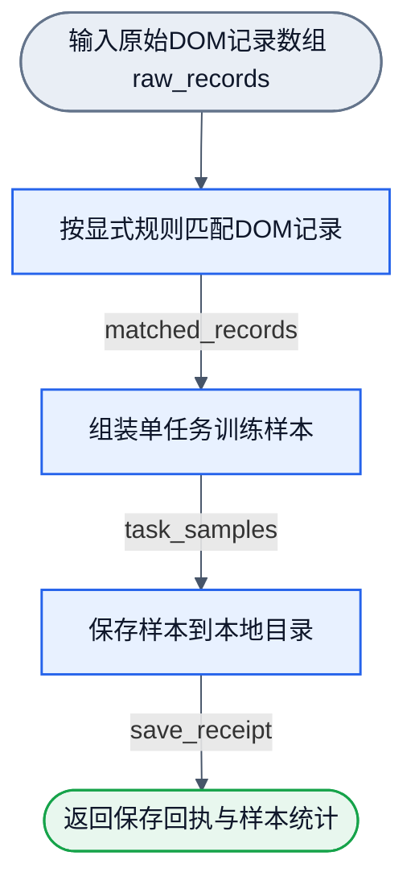
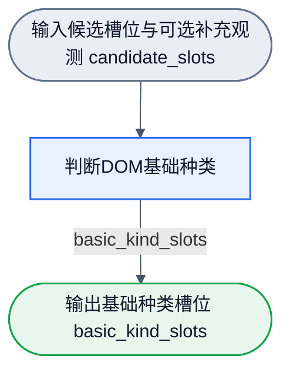

# 项目工作流清单与拓扑真源 (workflows/)

本目录为 NNAnything 项目所有 DAG 图定义（`*.graph.json`）与持久化配置（`*.workflow.json`）的唯一物理真源目录。
遵循单源单汇（SESE）DAG 原则，每个工作流保持单一入口与单一出口。

## 1. 流程清单与状态

| 工作流图文件 | 对应配置文件 | 拓扑规格 | 状态 | 职责与交付范围 |
| :--- | :--- | :--- | :--- | :--- |
| `dom-candidates.graph.json` | `dom-candidates.workflow.json` | 7 节点 6 边 (7N6E SESE) | `0.1.0` 已实现 | L1 能动候选切片：读取页面观测并经视口、focus、黑白名单与拆分复检输出有序候选槽位与排除映射 |
| `dom-rule-sampling.graph.json` | `dom-rule-sampling.workflow.json` | 3 节点 2 边 (3N2E SESE) | `0.1.0` 已实现 | 基础规则采样流：显式 semantic rules 确定性分类 DOM 记录、下游按任务映射正负监督并持久化至本地 JSONL |
| `dom-basic-kinds.graph.json` | `dom-basic-kinds.workflow.json` | 1 节点 0 边 (1N0E SESE) | `0.1.0` 已实现 | 第一层 DOM 基础种类判断流：接收保序候选槽位与可选补充观测，经两阶段（大类 -> 细类）区间计算输出基础种类槽位与审计证据 |
| `dom-recognition.graph.json` | 待按需配置 | 10 节点 10 边 (10N10E SESE) | `0.1.0-design` 设计态 | L2 完整卡片语义识别流：候选展开后经白名单特征提取、单标签语义分类并组装回原槽位 |
| `node-training.graph.json` | `node-training.workflow.json` | 6 节点 6 边 (6N6E SESE) | `0.2.0-design` 设计态；算子 `0.1.0-design` | 第一层基础种类离线训练设计：复核样本、来源分区、Handwired 拟合、新旧比较、评估和保存；首版未校准 |
| `operation-episode.graph.json` | 待按需配置 | 7 节点 6 边 (7N6E SESE) | `0.1.0-design` 设计态 | L3 操作闭环设计示例：观测、目标识别、策略决策、条件执行、新观测验证与统一收束 |

> [!NOTE]
> `dom-candidates.graph.json` (7N6E SESE)、`dom-rule-sampling.graph.json` (3N2E SESE) 与 `dom-basic-kinds.graph.json` (1N0E SESE) 均已升级为 `0.1.0`，经 `dagpipe graph validate` 与 `inspect` 验证通过。
> 运行时可通过 `compileWorkflow` 配合 `nnanything/browser` 导出的算子节点执行。当前第一层基础种类判断只输出基础结构成分，第二层业务卡片语义（`dom-recognition.graph.json`）仍保持后续设计态。

训练图、节点端口、内部 wire、数据范围及后续验收统一见 [训练 workflow 设计](../docs/training-workflow.md)。训练配置可按现有声明格式解析，但缺少训练算子实现，不能编译执行。上方“已实现”说明仅适用于三个已交付工作流。

## 2. 基础规则采样流设计 (dom-rule-sampling)

### 2.1 业务流程图（遵循 flow-presentation 规范）

### 2.2 图与配置一一对应关系

持久配置 `dom-rule-sampling.workflow.json`（v1 格式）与 `dom-rule-sampling.graph.json` 严格一一对应：
1. `graphRef`: 对本地图文件显式相对路径 `"./dom-rule-sampling.graph.json"`；
2. `configs`: 提供局部配置对象（`cardMatchRule`、`cardSampleSpec`、`localSaveSpec`），配置采用合成语义规则与任务监督映射（如 `post.card`、`post.body` 等合成类别，非私有生产规则）；
3. `bindings`: 键名必须与图文件中的中文节点 ID 完全一致：
   - `"按显式规则匹配DOM记录"` 绑定 `cardMatchRule`
   - `"组装单任务训练样本"` 绑定 `cardSampleSpec`
   - `"保存样本到本地目录"` 绑定 `localSaveSpec`

三节点完整 I/O、三值逻辑真值表、白名单清洗、副作用、防越界写入及验收要求唯一维护于 [lib/nodes/README.md](../lib/nodes/README.md)。
公开消费端用法与运行方式见 [playground/sampling/README.md](../playground/sampling/README.md)。

## 3. 第一层 DOM 基础种类流设计 (dom-basic-kinds)

### 3.1 业务流程图（遵循 flow-presentation 与 SESE 规范）

### 3.2 图与配置一一对应关系

持久配置 `dom-basic-kinds.workflow.json`（v1 格式）与 `dom-basic-kinds.graph.json` 严格一一对应：
1. `graphRef`: 对本地图文件显式相对路径 `"./dom-basic-kinds.graph.json"`；
2. `configs`: 提供局部配置对象 `basicKinds`（`{ "taskId": "dom.basic-kinds.v1", "minScore": 0.6, "minMargin": 0.15 }`）；
3. `bindings`: 键名必须与图文件中的节点 ID 完全一致：
   - `"判断DOM基础种类"` 绑定 `basicKinds`。

本工作流规格为 1 节点 0 边单入口单出口（1N0E SESE），已完成 SESE 拓扑验证。
输入接收 `candidate_slots`（可选携带 `itemObservations` 补充观测），经两阶段（大类 -> 细类）确定性计算后输出 `basic_kind_slots`。
完整节点合同与端口参数见 [lib/nodes/README.md](../lib/nodes/README.md)，算法设计真源见 [docs/basic-kinds-wiring.md](../docs/basic-kinds-wiring.md)。
